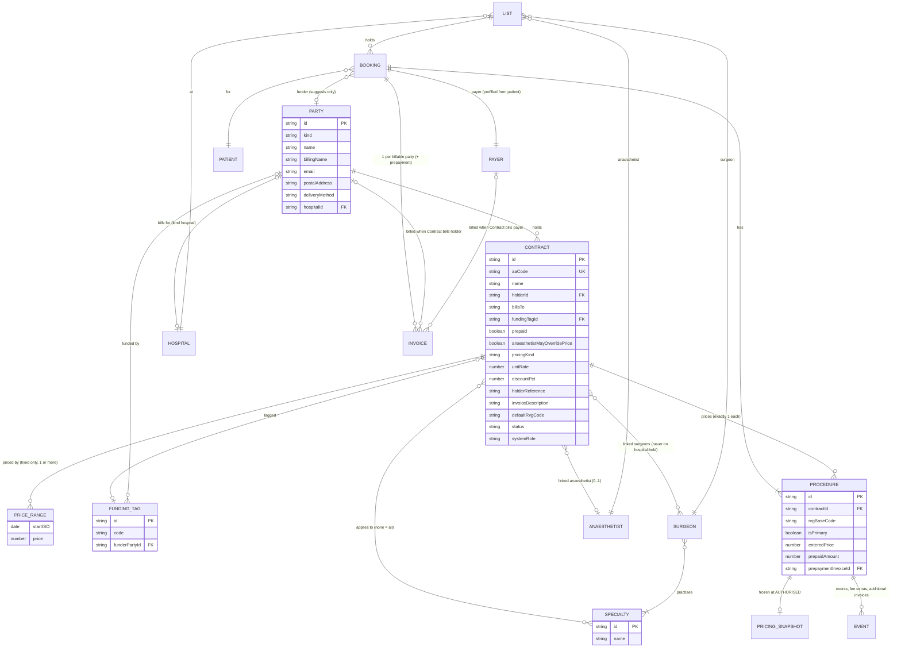

# Contract model proposal (flat Contracts)

Status: proposal for review, 5 November 2026; revised the same day after a critique (see the Review
log at the end). Written from Donald's decisions D1 to D11 after the 5 Nov meeting with Ben and
Vanessa over the contract picker mock
(`docs/discovery-reference/Recordings/AA Meeting with Ben & V 5th Nov. Reconciled Transcript.md`).
Prototype-grade: structured just enough for booking setup, anaesthetist capture, the billing engine,
invoicing, prepayment, the AA Holding account and office review to work as expected.

The decisions win over everything else. Where they leave a gap, this proposal picks the simplest thing
that keeps the prototype working and lists it in section 11 as an assumption (A2, A3, ...).

---

## 1. Summary

Every priced thing AA bills against is **one Contract**: a single, flat record with its own settings.
There is no parent schedule, price list, Contract header or Contract line. A holder's schedule
document (for example "SXAP Ptosis and Blephs") becomes many separate Contracts, one per schedule
item. Ben and Vanessa call these "procedures"; the model and the code keep the name Contract.

Each Contract is **held by a Party** (a hospital, an insurer or funder, a surgeon or surgeon group, an
anaesthetist, or AA), and its own setting says whether it **bills its holder or bills the payer on the
Booking**. It may carry a **funding tag** (SXAP, HNZ, ACC), a set of **specialties** (none means every
specialty), **links** to surgeons and at most one anaesthetist, a **prepaid** flag, one of five
**pricing kinds**, and for fixed prices a list of dated **price ranges** whose ends are implied by the
next start. None of the other settings is dated: a change is an audited edit, and a setting that must
change from a date means a new Contract. Status is Active or Disabled.

The booking's **step rail** reads straight off these settings. The invoice destination (Patient,
Hospital, Special) is derived from the Contract alone, never stored. Every destination has exactly one
system-created **open-price fallback** ("No contract · Fixed price", "Prepaid · Fixed price", "Forte ·
SXAP · Fixed price", "NIB · Fixed price"), selected by the step 3 "Other price" toggle. One built-in,
"No contract · RVG", prices at the anaesthetist's own unit rate and bills the payer.

A Procedure on a Booking carries exactly one Contract. Its price follows the price in force on the
procedure date until a person edits it, a prepayment invoice fixes it, or AUTHORISED freezes it.
Fee extras in the schedules (a GA add-on fee, "per 15 minutes over 120", "per area") are not
Contracts: they are billing events or additional invoices on the Procedure (D10).

**What it replaces.** The Contract header plus Contract line model, Contract versions and "revised by"
chains, line keys and relinking, the OQ-131 options, staged schedule changes and schedule upload, the
technical design v4 and v6 tables and ERD (AR-28, AR-29, AR-30, now historical), the contract holder
with its `is_billable_party` and practitioner links, and the prototype's RFP Contract types 1, 2 and 3
with billing routes and patient payment categories. Business facts from that material (who pays,
prepayment, the ledger, the multi-procedure rule, the snapshot at AUTHORISED) carry forward (D11).

### 1.1 Terms

- **Contract**: one priced arrangement, the thing picked for a Procedure (Ben and Vanessa:
  "procedure"). "Item" is used only for a row of a source schedule document; each seeded item becomes
  one Contract.
- **Billable party**: who an invoice is addressed to. A Party is a billable party when a Contract
  bills its holder; the Booking's payer is the other kind of billable party and is not a Party.
- **Procedure date**: the date of the List the Booking is on.
- **Candidate**: a Contract offered on a given List (5.1).
- **Invoice destination**: Patient, Hospital or Special, worked out from the Contract's own settings
  (5.2).
- **Open-price fallback**: the one system-created Contract per destination with pricing kind `open`.
  It is named "· Fixed price" (D8) because a person types a fixed amount on the Procedure, but it is
  never of kind `fixed`. In code it is `openPriceFallback()`, never `fixedFallback()`.

---

## 2. Entities

Types use the prototype's conventions: `ISODate` is `YYYY-MM-DD`, money is a number in NZD **ex GST**,
ids are strings. "Req" means required.

### 2.1 Party

The shared record for anyone who holds Contracts (D2). A Party is a billable party when a Contract
bills its holder; the Booking's payer is the other kind of billable party, is not a Party, and stays
the Booking's own record, prefilled from the patient.

| Field | Type | Req | Note |
|---|---|---|---|
| `id` | `PartyId` | Req | |
| `kind` | `'aa' \| 'hospital' \| 'insurer' \| 'funder' \| 'surgeon' \| 'surgeonGroup' \| 'anaesthetist'` | Req | `insurer`: NIB, Southern Cross Health Society (a Booking with an insurer as funder warns without an approval number, A42). `funder`: ACC, Health NZ, NZDF, Veterans Affairs. Exactly one `aa` Party. Only `aa`, `hospital`, `insurer`, `funder` and `anaesthetist` drive rules; `surgeon` and `surgeonGroup` only label. |
| `name` | `string` | Req | Short name shown in the picker: "Christchurch Eye Surgery", "NIB", "Merivale Plastic Surgery". |
| `billingName` | `string` | Opt | Name printed on invoices to this Party. Required once the Party holds a Contract with `billsTo = 'holder'` (validation 8, A43). |
| `email` | `string` | Opt | Required when `deliveryMethod` is `email`. |
| `postalAddress` | `string` | Opt | Required when `deliveryMethod` is `post`. |
| `deliveryMethod` | `'email' \| 'post'` | Opt | How invoices to this Party go out (D2). Required once the Party is billed, as for `billingName`. Other outputs stay open (OQ-114). |
| `hospitalId` | `HospitalId` | Opt | Kind `hospital` only, and then required: the hospital master record this Party bills for. This is how "the holder is the List's hospital" is tested. AA rooms is never a Party. |

A Party has no link to a practitioner or to the `SurgeonGroup` master: where a Contract is offered is
set by the Contract's own links (2.2).

### 2.2 Contract

One priced arrangement. Every change is audited through the existing `mutate()` audit trail (D4).

| Field | Type | Req | Note |
|---|---|---|---|
| `id` | `ContractId` | Req | |
| `aaCode` | `string` | Req | AA's own unique code (OQ-66), for example `CES-SXAP-004`. Searchable. |
| `name` | `string` | Req | What the picker shows: "Cataract IOL (LA by Anaesthetist)", "Forte' SXAP", "No contract · RVG". |
| `holderId` | `PartyId` | Req | The Party that holds it. The built-in and the two Patient fallbacks are held by AA. |
| `billsTo` | `'holder' \| 'payer'` | Req | Bills its holder, or bills the payer on the Booking (D2). Holders of kind `aa` or `anaesthetist` always bill the payer (A40); a prepaid Contract always bills the payer (A2). Drives the invoice layout (holder layout adds the BTM breakdown). |
| `fundingTagId` | `FundingTagId` | Opt | SXAP, HNZ, ACC, ... Decides the destination only on a hospital-held Contract that bills its holder (5.2). |
| `specialtyIds` | `SpecialtyId[]` | Req (may be empty) | Empty means every specialty (D3). |
| `linkedSurgeonIds` | `SurgeonId[]` | Req (may be empty) | Surgeons whose Lists it is offered on (OQ-105: individual surgeons, never rooms). Never set on a hospital-held Contract (A38). |
| `linkedAnaesthetistId` | `AnaesthetistId` | Opt | At most one: an anaesthetist's own price-list Contract sets it to that anaesthetist. A Contract held by a surgeon, surgeon group or anaesthetist needs at least one link (A39). |
| `prepaid` | `boolean` | Req | Fixed for the life of the Contract (D4). A prepaid Contract appears only under Patient › Prepaid. |
| `anaesthetistMayOverridePrice` | `boolean` | Req | Only true on RVG pricing kinds (which rules out prepaid Contracts). |
| `pricing` | `Pricing` | Req | One of five kinds (2.3). The kind is set at creation (A36). |
| `holderReference` | `string` | Opt | The holder's own code for the item (`AP0126`, `HNZ07`, `OPT101`, `8268`). Printed on holder invoices and searchable. Not unique (A23). |
| `invoiceDescription` | `string` | Opt | Replaces the received procedure text on the invoice where filled (OQ-103). |
| `defaultRvgCode` | `string` | Opt | Fills the Procedure's RVG code when the Contract is picked and the code is empty. Typing an RVG code in the picker also finds the Contract. |
| `status` | `'active' \| 'disabled'` | Req | Disabled hides it from the picker. Existing Procedures keep it (A14). |
| `systemRole` | `'noContractRvg'` | Opt | Marks the one built-in, found by role, never by name (OQ-78). Fallbacks need no marker: a Contract of kind `open` is a fallback (A3). |

### 2.3 Pricing kinds (part of Contract)

| Kind | Extra field | Price on a Procedure |
|---|---|---|
| `rvgAnaesthetistRate` | none | Units × the anaesthetist's unit rate (`Anaesthetist.unitValue`). |
| `rvgContractRate` | `unitRate: number` (Req, > 0) | Units × the Contract's rate. Undated: a change is an audited edit. |
| `rvgDiscount` | `discountPct: number` (Req, 0 < x < 100) | Units × the anaesthetist's rate, less the discount, shown as its own invoice line. Undated. |
| `fixed` | `ranges: PriceRange[]` (Req, at least 1) | The price of the range in force on the procedure date. No time or modifiers. |
| `open` | none | No price of its own: the amount is typed on the Procedure. Only on the system fallbacks; the office never chooses this kind (A3). |

### 2.4 Price range (fixed-price Contracts only)

| Field | Type | Req | Note |
|---|---|---|---|
| `startISO` | `ISODate` | Req | May be in the past ("this price from 1 Oct 2026", entered on 5 Nov). Unique within the Contract. |
| `price` | `number` | Req | Ex GST, 0 or more (0 gives a no-charge invoice). Above 0 on a prepaid Contract. |

There is no end date. A range ends the day before the next range's start, so ranges can never overlap
or leave a gap after the first start (D6). Ranges are held inside the Contract's `pricing`; the ERD
draws them as their own entity.

### 2.5 Specialty

AA-maintained list of broad specialties, no subspecialties (D3).

| Field | Type | Req | Note |
|---|---|---|---|
| `id` | `SpecialtyId` | Req | |
| `name` | `string` | Req | Seed: Ophthalmology, General surgery, Plastic surgery, ENT, Gynaecology, Orthopaedics, Urology, Gastroenterology, Cardiothoracic surgery (the last three added, A11). |

### 2.6 Funding tag

AA-maintained list (D4).

| Field | Type | Req | Note |
|---|---|---|---|
| `id` | `FundingTagId` | Req | |
| `code` | `string` | Req | Label shown in step 2 and on Contracts: `SXAP`, `HNZ`, `ACC`. List order is display order. |
| `funderPartyId` | `PartyId` | Opt | The insurer or funder whose work arrives under this tag (Southern Cross Health Society for SXAP, ACC for ACC, Health NZ for HNZ). Only used to suggest a path from the Booking's funder. |

### 2.7 Fields the model adds to existing records

Checked against `aa-prototype/src/domain/types.ts` as it stands.

| Record | Field | Type | Req | Note |
|---|---|---|---|---|
| Surgeon | `specialtyIds` | `SpecialtyId[]` | Req (at least 1) | Replaces `specialty?: string`. Usually one (D3). |
| Anaesthetist | none | | | `unitValue` (existing) is the rate for `rvgAnaesthetistRate` and `rvgDiscount`. An anaesthetist with a price list also has a Party of kind `anaesthetist`. |
| List | none | | | The picker reads the List's hospital, surgeon, anaesthetist and date (the procedure date). Its specialties are the surgeon's (derived, not stored). |
| Booking | `funderPartyId` | `PartyId` | Opt | New. The insurer or funder named on the Booking; takes over from `Procedure.insurerId`. Only suggests a path, never narrows (D7, OQ-93). No funder means self-funding. The Booking's payer and approval number are not in the code yet: catch-up phase 21 adds them. |
| Procedure | `contractId` | `ContractId` | Req to submit | Exactly one. Replaces `governingContractId`. Missing: the Booking shows "Needs an invoice destination". |
| Procedure | `rvgBaseCode` | `string` | Req on RVG kinds | Existing. Reference only on fixed and open price. |
| Procedure | `isPrimary` | `boolean` | Req | Added by catch-up phase 23 (replacing `isAdditional`): the marked primary for the multi-procedure rule. |
| Procedure | `enteredPrice` | `number` | Opt | A price a person typed: the open-price amount, an anaesthetist's override, or an office edit. Once set it sticks (D9). Who and when come from the audit trail. Replaces `priceOverride` (no reason needed). |
| Procedure | `prepaidAmount` | `number` | Opt | New. Set when the prepayment invoice is raised; from then on it is the Procedure's price. Cleared if the prepayment is refunded or credited (5.7). |
| Procedure | `prepaymentInvoiceId` | `InvoiceId` | Opt | New (the code today finds the `prePayment` invoice by Booking). Set and cleared with `prepaidAmount`. |
| Procedure | `pricingSnapshot` | `PricingSnapshot` | Opt | Written at AUTHORISED; freezes everything (D9, D11). |

Removed from the Procedure: `billingRoute`, `governingContractId` (now `contractId`), `insurerId` (now
`Booking.funderPartyId`), `billablePartyId` (the payer override; now the Booking's payer, phase 21),
`patientPaymentCategory`, `prepaymentDetail` (full or split deposit), `priceOverride` (now
`enteredPrice`), `billingReference` (the Booking's approval number takes its place, phase 21),
`accRelated` (ACC is now a funding tag), and `isAdditional` (now `isPrimary`, phase 23). Removed from
the prototype's masters: `Insurer` and `ContractHolderOrganisation` fold into Party;
`Insurer.acceptsDirectClaims` goes. `SurgeonGroup` stays as a grouping of surgeons; a group that holds
Contracts also has a Party of kind `surgeonGroup`, with no link between the two.

### 2.8 Pricing snapshot (on the Procedure, at AUTHORISED)

Contracts are edited in place, so the snapshot copies what it needs rather than pointing at a version.
It cannot be written without a price: AUTHORISED is blocked while any Procedure "Needs a price"
(validation 17).

| Field | Type | Req | Note |
|---|---|---|---|
| `takenAtISO` | `IsoDateTime` | Req | |
| `contract` | `Contract` | Req | A copy of the Contract's settings as they were (rate and discount included), with only the range in force kept in `pricing.ranges`. |
| `units` | `{ base: number; time: number; modifiers: number }` | Opt | RVG kinds: after the multi-procedure rule. |
| `unitRate` | `number` | Opt | RVG kinds: the rate actually used (the anaesthetist's rate is not on the Contract). |
| `price` | `number` | Req | The amount invoiced, ex GST. |
| `billedTo` | `{ kind: 'holder'; party: Party } \| { kind: 'payer'; payer: Payer }` | Req | Copy of the billable party. |

---

## 3. ER diagram



RVG codes are plain code strings on the Contract (`defaultRvgCode`) and the Procedure (`rvgBaseCode`),
not relations. The `SurgeonGroup` master and the ledger side (receivable and payable pairs, AA
Holding, Xero mirrors) are unchanged and left off.

---

## 4. TypeScript sketch

```ts
// ── Ids (existing ones: HospitalId, SurgeonId, AnaesthetistId, InvoiceId, ISODate, IsoDateTime) ──
export type PartyId = string
export type ContractId = string
export type SpecialtyId = string
export type FundingTagId = string

// ── Party ──────────────────────────────────────────────────────────────────
export type PartyKind =
  | 'aa' | 'hospital' | 'insurer' | 'funder' | 'surgeon' | 'surgeonGroup' | 'anaesthetist'

export interface Party {
  id: PartyId
  kind: PartyKind
  name: string
  /** Billing fields: required once the Party holds a Contract that bills its holder. */
  billingName?: string
  email?: string
  postalAddress?: string
  deliveryMethod?: 'email' | 'post'
  /** Kind 'hospital' only (then required). */
  hospitalId?: HospitalId
}

// ── Reference lists ────────────────────────────────────────────────────────
export interface Specialty {
  id: SpecialtyId
  name: string
}

export interface FundingTag {
  id: FundingTagId
  code: string
  funderPartyId?: PartyId
}

// ── Contract ───────────────────────────────────────────────────────────────
export interface PriceRange {
  startISO: ISODate
  /** Ex GST. Ends the day before the next range's start. */
  price: number
}

export type Pricing =
  | { kind: 'rvgAnaesthetistRate' }
  | { kind: 'rvgContractRate'; unitRate: number }
  | { kind: 'rvgDiscount'; discountPct: number }
  | { kind: 'fixed'; ranges: PriceRange[] }
  /** Open-price fallbacks only. */
  | { kind: 'open' }

export type PricingKind = Pricing['kind']

export interface Contract {
  id: ContractId
  aaCode: string
  name: string
  holderId: PartyId
  billsTo: 'holder' | 'payer'
  fundingTagId?: FundingTagId
  /** Empty = every specialty. */
  specialtyIds: SpecialtyId[]
  /** Never set on a hospital-held Contract. */
  linkedSurgeonIds: SurgeonId[]
  linkedAnaesthetistId?: AnaesthetistId
  prepaid: boolean
  anaesthetistMayOverridePrice: boolean
  pricing: Pricing
  holderReference?: string
  invoiceDescription?: string
  defaultRvgCode?: string
  status: 'active' | 'disabled'
  /** The one built-in. A Contract of kind 'open' is a fallback. */
  systemRole?: 'noContractRvg'
}

// ── Additions to existing records ──────────────────────────────────────────
export interface Surgeon {
  // ...existing fields, minus `specialty?: string`
  /** At least one, usually one. */
  specialtyIds: SpecialtyId[]
}

export interface Booking {
  // ...existing fields; the payer and the approval number arrive with phase 21
  /** New, taking over from Procedure.insurerId. Suggests a path; never narrows. */
  funderPartyId?: PartyId
}

export interface PricingSnapshot {
  takenAtISO: IsoDateTime
  /** Settings as they were; `pricing.ranges` keeps only the range in force. */
  contract: Contract
  units?: { base: number; time: number; modifiers: number }
  /** RVG kinds: the rate actually used. */
  unitRate?: number
  price: number
  /** `Payer` is the Booking payer record from phase 21. */
  billedTo: { kind: 'holder'; party: Party } | { kind: 'payer'; payer: Payer }
}

export interface Procedure {
  // ...existing fields (description, times, modifiers, notes), minus billingRoute,
  // governingContractId, insurerId, billablePartyId, patientPaymentCategory,
  // prepaymentDetail, priceOverride, billingReference, accRelated and isAdditional
  contractId?: ContractId
  /** Existing. Required on RVG kinds; reference only on fixed and open price. */
  rvgBaseCode?: string
  /** Phase 23 (replaces isAdditional): the marked primary for the multi-procedure rule. */
  isPrimary: boolean
  /** Typed by a person; sticks. Who and when: the audit trail. */
  enteredPrice?: number
  /** Set together when the prepayment invoice is raised; cleared if it is refunded or credited. */
  prepaidAmount?: number
  prepaymentInvoiceId?: InvoiceId
  pricingSnapshot?: PricingSnapshot
}

// ── Derived, never stored ──────────────────────────────────────────────────
export type Destination =
  | { kind: 'patient'; paymentType: 'standard' | 'prepaid' }
  | { kind: 'hospital'; holderId: PartyId; fundingTagId: FundingTagId }
  | { kind: 'special'; holderId: PartyId }
```

---

## 5. Rules

### 5.1 Candidates for a List

A Contract is a **candidate** on a List when all of these hold:

1. `status` is Active, and its kind is not `open` (fallbacks are never listed; they are reached only
   through the step 3 toggle, 5.4).
2. Its specialties are empty, or share at least one specialty with the List's surgeon (A10).
3. It is fixed price and a price range is in force on the List's date, or it is not fixed price (A9).
4. Where it is offered:
   - a **hospital-held** Contract: only on its own hospital's Lists (its holder's `hospitalId` is the
     List's hospital). It carries no links (A38);
   - **any other** Contract: when the List's surgeon is in `linkedSurgeonIds`, or the List's
     anaesthetist is `linkedAnaesthetistId`, or it has no links and its holder is AA, an insurer or a
     funder (offered on every List, which is how No contract · RVG, NIB, NZDF and Veterans Affairs
     appear everywhere).

There is no "show all". Insurance on the Booking never removes a candidate.

### 5.2 Step 1: "Where does the invoice go?" (derived destination)

The destination is a property of the Contract alone (A38):

| Test, in order | Destination |
|---|---|
| `c.billsTo = 'payer'` | **Patient** (Standard, or Prepaid when `c.prepaid`) |
| `c.billsTo = 'holder'`, holder kind `hospital`, and `c.fundingTagId` is set | **Hospital** (that hospital, that tag) |
| anything else | **Special** (grouped by holder) |

Because a hospital-held Contract is only offered on its own hospital's Lists, every Hospital
candidate is the List's hospital's. So surgeons' fixed fees (Merivale, Pryce, Tanaka) are Patient; an
untagged hospital-billed Contract (STG Bariatric, SX Charity Trust) is Special; a surgeon group billed
directly (Unisports, BOSS BWD Ortho ACC, even with an ACC tag) is Special; insurers and funders billed
directly (NIB, NZDF, Veterans Affairs) are Special.

Step 1 shows **Patient** always (No contract · RVG is always a candidate); **the List's hospital**
whenever that hospital has at least one Active tagged Contract, even when the specialty filter leaves
it no candidates (so its tag fallbacks stay reachable, A6); and **Special** when there is at least one
Special candidate. Each option shows its candidate count. The step fills itself in when it offers
only one option.

### 5.3 Step 2

| Step 1 answer | Step 2 question | Options |
|---|---|---|
| Patient | "Payment type" | **Standard** (first), **Prepaid**. Both always offered: Prepaid always has at least the "Prepaid · Fixed price" fallback. |
| Hospital | the hospital's funding tags | Every tag that hospital has a fallback for (an Active tagged Contract, before the specialty filter), in funding-tag list order, each with its candidate count, which may be 0 (A6). Southern Endo shows SXAP and HNZ only. |
| Special | pick the Contract | The Special candidates, grouped by holder, searchable. Picking one completes the rail; the toggle then offers that holder's fallback (A8). |

A step 2 with one option fills itself in (for example Christchurch Hospital, which has only HNZ).

### 5.4 Step 3: pick the Contract

The rows are the candidates at the chosen destination (Patient · Standard, Patient · Prepaid, or
Hospital · tag). One search covers every row, over `name`, `holderReference`, `invoiceDescription`,
`aaCode` and `defaultRvgCode` (A34; Ben's "CAT"). Under Patient · Standard, No contract · RVG is pinned
first and is never filtered out by the search.

- Patient · Prepaid never contains an RVG-priced Contract (validation 4 makes this impossible).
- One toggle, "**Other price**" (A33), switches the pick to the destination's open-price fallback,
  and the amount is typed on the Procedure (by the office; by the anaesthetist only on No contract ·
  Fixed price, 5.8).
- Step 3 fills itself in when it has exactly one row (for example Forte › SXAP, or Patient ·
  Standard on a List whose surgeon has no fixed fees, which picks No contract · RVG). With no rows,
  the fallback is the only answer and fills itself in (Patient · Prepaid when no prepaid Contract
  fits, or a hospital tag the specialty filter has emptied) (A7).

### 5.5 Built-ins and open-price fallbacks

| System Contract | Holder | billsTo | prepaid | Pricing | Destination key | Created |
|---|---|---|---|---|---|---|
| No contract · RVG (`systemRole: 'noContractRvg'`) | AA | payer | no | `rvgAnaesthetistRate`, override allowed | (not a fallback) Patient · Standard | Seed, once |
| No contract · Fixed price | AA | payer | no | `open` | Patient · Standard | Seed, once |
| Prepaid · Fixed price | AA | payer | yes | `open` | Patient · Prepaid | Seed, once |
| `<Hospital> · <TAG> · Fixed price` | the hospital | holder | no | `open`, tag set | Hospital · that hospital · tag | With the first Active Contract for that hospital and tag |
| `<Holder> · Fixed price` | the Special holder | holder | no | `open`, no tag | Special · that holder | With the first Active Special Contract of that holder |

Every Contract of kind `open` is a fallback, and its destination key comes from 5.2 like any other
Contract's, so the key is fixed and needs no List. A Special holder's fallback carries no tag even
when its Contracts do (BOSS BWD Ortho · Fixed price). All fallbacks have empty specialties and no
links. The store keeps them in step with an idempotent `ensureFallbacks()` run after seeding and after
every Contract create or edit: for every destination key implied by an Active non-fallback Contract it
creates the fallback when missing. A fallback is never deleted or disabled; it simply has nothing to
sit beside when its holder's other Contracts are all disabled (A5). The office may rename a system
Contract and edit its invoice description and AA code, nothing else.

Availability: AA's two Patient fallbacks are offered on every List. A hospital and tag fallback is
offered through the toggle whenever that tag is offered at step 2. A Special holder's fallback is
offered through the toggle once one of that holder's Contracts is picked (A4).

### 5.6 Price ranges

- A fixed-price Contract has at least one range; other kinds have none.
- Start dates are unique within the Contract and may be in the past.
- A range ends the day before the next range's start; the last one runs on with no end.
- **Range in force on date d** = the range with the latest `startISO` on or before d. Before the
  first start there is no price (the Contract is not offered on such a List, A9; a Procedure already
  on it shows "Needs a price").
- Changing a price from a date = adding a range with that start (backdating allowed). Correcting a
  mistake = editing or deleting a range (never the last remaining one). All audited.

### 5.7 How a Procedure gets and keeps its values (D9)

When a Contract is picked (or changed):

1. `contractId` is set; `enteredPrice` is cleared (a Contract change resets the starting values).
2. When the old Contract is prepaid, the new one is not, and the prepayment invoice was raised: the
   prepayment is handled like a cancellation of the prepayment (refunded in full if paid, credited if
   sent but unpaid; OQ-119, US-06.5.2), and `prepaymentInvoiceId` and `prepaidAmount` are cleared. The
   Procedure is then invoiced under its new Contract after the procedure (A47).
3. `rvgBaseCode` is filled from `defaultRvgCode` when empty. Recorded times and modifiers are kept
   (A15).
4. On RVG kinds the form asks for the RVG code, start and finish times and the modifiers step (A20).
   On fixed and open price the form collapses: an RVG code may be picked for reference only, no time
   or modifiers.

The Procedure's price at any moment (`date` is the procedure date, the List's date):

```
price(p):
  if p.pricingSnapshot                          -> p.pricingSnapshot.price     // frozen at AUTHORISED
  if contract.prepaid and p.prepaymentInvoiceId -> p.prepaidAmount             // fixed by the prepayment invoice
  if p.enteredPrice is set                      -> p.enteredPrice              // a person's edit sticks
  switch contract.pricing.kind:
    fixed               -> rangeInForce(contract, date).price  (none: "Needs a price")
    open                -> none: "Needs a price"
    rvgAnaesthetistRate -> units(p) × anaesthetist.unitValue
    rvgContractRate     -> units(p) × contract.unitRate
    rvgDiscount         -> units(p) × anaesthetist.unitValue × (1 − discountPct/100)
```

- `units(p)` = base + time + modifiers after the carried-forward multi-procedure rule (D11): base
  units only on the marked primary (`isPrimary`), time units on every procedure, modifiers split
  above 4. Only RVG-priced Procedures carry units, and the modifier split is shared among them (A19).
  On a mixed Booking whose marked primary is fixed or open price, no Procedure takes base units until
  open point 11 is answered.
- The anaesthetist is the List's anaesthetist (whoever submits did the work).
- Because unedited prices are computed, not stored, they **follow**: a range added or a rate or
  discount edited in place reaches every un-authorised, un-prepaid, unedited Procedure on that
  Contract (A13). Example: $500 when booked, a $550 range from a date before the procedure, invoiced
  $550.
- The prepaid amount is copied from `price(p)` when the prepayment invoice is raised (admin approval)
  and must be above 0. From then on the price is read-only; a difference is a credit or additional
  invoice raised by hand (A16).
- Cancelling a Booking credits or refunds its prepayment and clears `prepaymentInvoiceId` and
  `prepaidAmount`; reinstating it raises a fresh prepayment invoice on admin approval (A47).
- **A moved Booking** keeps every Procedure's `contractId`; nothing is re-picked. Prices re-resolve on
  the new date unless held (snapshot, prepaid, entered), so a fixed Contract with no range in force on
  the new date shows "Needs a price". A prepaid Procedure keeps its amount. A Contract that is not a
  candidate on the new List raises a review flag (A41).
- At AUTHORISED the snapshot (2.8) is written and nothing on the Contract can move the Procedure
  again. Later Contract edits never touch an issued invoice.
- No automatic difference invoice or credit ever follows a prepaid, fixed-price or open-price
  Procedure; differences are hand-raised additional invoices or credits.

### 5.8 Who may change what

| Action | Office | Anaesthetist |
|---|---|---|
| Create, edit, disable Contracts; add or edit price ranges | Yes, audited | Never (OQ-91) |
| Edit Parties, specialties, funding tags, surgeon specialties | Yes, audited | No |
| Pick or change a Procedure's Contract until AUTHORISED | Yes | Yes, audited and flagged at review; not onto or off a prepaid Contract (A17) |
| Move a Procedure off a prepaid Contract after its prepayment invoice | Yes: the prepayment is refunded or credited (5.7 step 2) | No |
| RVG code, times, modifiers | Yes | Yes (their job on RVG kinds) |
| Override the price on an RVG Contract | Always | Only where `anaesthetistMayOverridePrice`; the RVG detail stays recorded and visible |
| Type the amount on an open-price fallback | Yes, any fallback | Only on No contract · Fixed price (A37) |
| Change the price on a fixed-price Contract | Yes (no reason; last change stands) | No (OQ-117) |
| Change the price on a prepaid Contract | Until the prepayment invoice is raised; then read-only: "Use a credit or additional invoice" (A16) | No (OQ-96) |
| Change anything after AUTHORISED | No: additional invoices, credits, events | No |

Rate and discount are Contract settings only; there is no per-Procedure rate or discount edit. The
office changes the price instead (A12).

**Flagged at review** (A49): an anaesthetist's Contract change; every `enteredPrice` on a Contract
that is not open price (an anaesthetist's override or an office edit), shown beside the computed
price; a Contract that is not a candidate on the Booking's List (after a move).

### 5.9 Booking-level rules carried forward (D11)

- One invoice per distinct billable party per Booking, plus the prepayment invoice. Billing fails per
  Booking.
- The billable party of a Procedure is the Contract's holder Party when `billsTo = 'holder'`, else the
  Booking's payer. An under-18 payer is a mild warning only when the payer is billed.
- A split between payers is an action on the Booking, never a Contract setting.
- Prepayment mechanics are unchanged: invoice on admin approval, receivable from the payer and payable
  to AA Holding, journal transfer to the anaesthetist at AUTHORISED, a moved Booking keeps its
  amount, cancellation credits or refunds. A Procedure on a prepaid Contract with a prepayment
  invoice is left off the final invoice.
- Events and additional invoices attach to a Procedure; an event's billable party defaults to its
  Procedure's. Fee extras from the schedules (GA add-on fees, "per 15 minutes over 120", "per area")
  are billing events or additional invoices, never Contracts (D10, A46).

### 5.10 Validation

On a Contract (rejected on save):

1. `aaCode` is unique across all Contracts.
2. `fixed` has at least one range; range `startISO`s are unique; prices are 0 or more.
3. Non-fixed kinds hold no ranges. `rvgContractRate.unitRate` > 0; `rvgDiscount.discountPct` is
   above 0 and below 100.
4. `prepaid` requires `billsTo = 'payer'` and kind `fixed` or `open`; its ranges' prices are above 0
   (A2).
5. `anaesthetistMayOverridePrice` requires an RVG kind.
6. Kind `open` exists only on fallbacks made by `ensureFallbacks()`; the office cannot choose it (A3).
7. Exactly one fallback per destination key (Patient · Standard, Patient · Prepaid, each hospital Party
   and tag, each Special holder), and exactly one `noContractRvg`.
8. `holderId` names an existing Party; a `hospital` Party has a `hospitalId`; exactly one `aa` Party.
   A Party holding a Contract with `billsTo = 'holder'` has a `billingName` and a `deliveryMethod`,
   with the email or postal address it needs (A43).
9. Specialty, tag, surgeon and anaesthetist ids exist; at most one linked anaesthetist.
10. A holder of kind `aa` or `anaesthetist` requires `billsTo = 'payer'` (A40).
11. A hospital-held Contract has no linked surgeon or anaesthetist (A38).
12. A Contract held by a surgeon, surgeon group or anaesthetist has at least one linked surgeon or a
    linked anaesthetist (A39).
13. `prepaid` and `pricing.kind` cannot change after creation (D4 for prepaid; A36 for the kind), and
    `billsTo` stays `payer` on a prepaid Contract. Other settings are editable, audited.
14. System Contracts: only `name`, `invoiceDescription` and `aaCode` are editable; never disabled.

On a Procedure (to-do warnings; blocks as noted):

15. No Contract: "Needs an invoice destination" (blocks submission).
16. RVG kind without RVG code, times or a completed modifiers step: incomplete (blocks the
    anaesthetist's "complete"; may be forwarded to the office).
17. Open price without an amount, or fixed price with no range in force: "Needs a price" (blocks the
    anaesthetist's "complete", may be forwarded to the office; blocks AUTHORISED, since the snapshot
    cannot be written without a price) (A48).
18. `enteredPrice` cannot be set on a Procedure on a prepaid Contract once its prepayment invoice is
    raised; the prepaid amount must be above 0 when that invoice is raised (A16).
19. An anaesthetist can type an amount only on No contract · Fixed price (A37).
20. A Disabled Contract on a Procedure: no warning; it bills as normal (A14).
21. The Booking's funder Party is of kind `insurer` and no approval number is entered: the only
    insurance warning (OQ-93, A42).

---

## 6. The step rail as queries

```
holder(c)   = the Party c.holderId
fallback(c) = c.pricing.kind = 'open'
H(L)        = the Party of kind hospital with hospitalId = L.hospitalId

dest(c) =                                                          -- the Contract alone
    c.billsTo = 'payer'                                         -> patient(c.prepaid ? prepaid : standard)
    holder(c).kind = 'hospital' and c.fundingTagId set          -> hospital(c.holderId, c.fundingTagId)
    else                                                        -> special(c.holderId)

cands(L) = Contract c where
    c.status = 'active' and not fallback(c)
    and (c.specialtyIds = [] or c.specialtyIds ∩ L.surgeon.specialtyIds ≠ [])
    and (c.pricing.kind != 'fixed' or rangeInForce(c, L.date) exists)
    and ( if holder(c).kind = 'hospital':  holder(c).hospitalId = L.hospitalId
          else:  L.surgeonId in c.linkedSurgeonIds
              or c.linkedAnaesthetistId = L.anaesthetistId
              or (holder(c).kind in [aa, insurer, funder] and no links) )

openPriceFallback(d) = the Contract f where fallback(f) and dest(f) = d

hospitalTags(L) = tags t where openPriceFallback(hospital(H(L), t)) exists, in tag-list order
                                                                -- before the specialty filter

step1(L)           = Patient (always) | H(L) if hospitalTags(L) ≠ [] | Special if any c in cands(L) has dest special
                                                                -- each with its candidate count
step2(L, patient)  = [standard, prepaid]                        -- counts from step3 below
step2(L, hospital) = hospitalTags(L), each counting cands(L) where dest(c) = hospital(H(L), t)
step2(L, special)  = cands(L) where dest(c) is special, grouped by holder, searchable   -- the pick
step3(L, d)        = cands(L) where dest(c) = d, one search      -- d = patient(x) or hospital(H(L), t)
                                                                -- noContractRvg pinned first
toggle(L, d)       = openPriceFallback(d)                        -- d = patient(x), hospital(H(L), t),
                                                                -- or special(holder of the picked Contract)
autofill: any step whose option list has exactly one entry takes it;
          step3 with zero rows takes toggle(L, d)

suggested(B, L) =                                                  -- marks, never filters
    B.funderPartyId is null                                        -> patient(standard)
    some c in cands(L) with c.holderId = B.funderPartyId           -> special(B.funderPartyId)
    some t in hospitalTags(L) with t.funderPartyId = B.funderPartyId -> hospital(H(L), t)
    else                                                           -> no suggestion
```

---

## 7. Worked examples

### 7.1 The ten mock scenarios

Counts come from running the seed mapping in section 8 against each scenario (candidates only; the
toggle's fallback is always available on top). Unit rates for the mock's anaesthetists are
illustrative (Fairbairn $30, Hollis $28, Cole $32): the mock has none (A35).

| Scenario | List | Surgeon (specialty) | Funder: Suggested | Step 1 counts | Step 2 counts |
|---|---|---|---|---|---|
| cataract-migs | CES, 26 Nov | Whitcombe (Ophthalmology) | Southern Cross: Hospital › SXAP | Patient 4 · CES 144 · Special 3 | Standard 1, Prepaid 3 / SXAP 56, HNZ 62, ACC 26 |
| bleph-ptosis | CES, 30 Nov | Menon (Ophthalmology) | Southern Cross: Hospital › SXAP | Patient 7 · CES 144 · Special 3 | Standard 1, Prepaid 6 / SXAP 56, HNZ 62, ACC 26 |
| abdominoplasty | STG, 2 Dec | Lowe (Plastic surgery) | Self-funding: Patient › Standard | Patient 21 · STG 5 · Special 5 | Standard 16, Prepaid 5 / SXAP 1, HNZ 2, ACC 2 |
| eyelid-lesion | CES, 4 Dec | Menon (Ophthalmology) | Southern Cross: Hospital › SXAP | Patient 7 · CES 144 · Special 3 | Standard 1, Prepaid 6 / SXAP 56, HNZ 62, ACC 26 |
| acl | Forte, 8 Dec | Kerr (Orthopaedics) | ACC: Hospital › ACC | Patient 4 · Forte 3 · Special 5 | Standard 1, Prepaid 3 / SXAP 1, HNZ 1, ACC 1 |
| hysterectomy | STG, 10 Dec | Tanaka (Gynaecology) | Self-funding: Patient › Standard | Patient 48 · STG 4 · Special 5 | Standard 45, Prepaid 3 / SXAP 1, HNZ 1, ACC 2 |
| facelift | STG, 14 Dec | Lowe (Plastic surgery) | Self-funding: Patient › Standard | Patient 21 · STG 5 · Special 5 | Standard 16, Prepaid 5 / SXAP 1, HNZ 2, ACC 2 |
| forte-knee | Forte, 16 Dec | Kerr (Orthopaedics) | Southern Cross: Hospital › SXAP | Patient 4 · Forte 3 · Special 5 | Standard 1, Prepaid 3 / SXAP 1, HNZ 1, ACC 1 |
| nib-chole | SXH, 18 Dec | Bright (General surgery) | NIB: Special › NIB | Patient 1 · SXH 4 · Special 6 | Standard 1, Prepaid 0 / SXAP 1, HNZ 1, ACC 2 |
| endo-colonoscopy | Endo, 22 Dec | Ruru (Gastroenterology) | Southern Cross: Hospital › SXAP | Patient 1 · Endo 2 · Special 3 | Standard 1, Prepaid 0 / SXAP 1, HNZ 1 (no ACC) |

**cataract-migs.** Step 1 Hospital (Suggested), step 2 SXAP. Step 3 has 56 fixed-price Contracts.
Typing "cataract" leaves 7 (three cataract Contracts, four MIGS "Add on to Cataract" Contracts); "cat"
leaves 12 because "Category" matches too. Procedure 1: *Cataract IOL (LA by Anaesthetist)*, `8268`,
$357.39. Procedure 2: type "AP1318" (1) or "glaucoma" (8), pick *Minimally Invasive Glaucoma Surgery
and Goniotomy - Category A (LA) Add on to Cataract*, $400.00: a separately priced procedure, so it
stays a Contract. Both forms collapse (no time or modifiers). One invoice to Christchurch Eye
Surgery: $757.39 + GST. Had the case been under GA, the schedule's GA fee ($334.78) would be a billing
event on Procedure 1, billed to CES with it (A46). Alternative: Patient › Prepaid shows Fairbairn's 3
ophthalmic Contracts (*Cataract extraction with IOL and MIGS, one eye* $650, billed to the payer before
the day). "MIGS" itself finds nothing under Hospital › SXAP until someone adds it to the names (Ben's
own edit list: toric, multifocal).

**bleph-ptosis.** Hospital › SXAP (Suggested). Typing "bleph" leaves 4; pick *Blepharoplasty & ptosis
bilateral - LA (Day Stay/Theatre)* `AP0135`, $1,152.17. The lower lid tarsal strip is a second
Procedure: "ectropion" leaves 4; *Unilateral repair of ectropion - LA (Day Stay/Theatre)* `AP0138`,
$900.00. Each Procedure is priced by its own Contract; the schedules' "second procedure at 50%" clause
is not applied (the multi-procedure rule ignores Contract terms and touches only RVG units). One
invoice to CES: $2,052.17 + GST. Patient › Prepaid would show Hollis's 6 ophthalmic Contracts.

**abdominoplasty.** Patient (Suggested) › Standard: 16 rows, No contract · RVG (pinned first) plus
Merivale's 15 Contracts, which now live under Patient, not Special. Type "abdo": 4; pick
*Abdominoplasty Simple* $2,100. Liposuction to two flanks is a fee extra (Merivale's "$300 per area"),
so the office adds a billing event on the Procedure, "Liposuction, 2 areas", $600 (D10, A46). Its
billable party defaults to the Procedure's, so it goes on the same invoice to the payer, Kirsten
Bowler: $2,700 + GST. Alternative: Patient › Prepaid shows 5 of Fairbairn's Contracts (the plastic
ones; her 3 ophthalmic ones are hidden by the specialty filter), including *Abdominoplasty with
liposuction* $2,450.

**eyelid-lesion.** Hospital › SXAP. Each time band is its own Contract. Typing "lesion" leaves 14,
"mohs" leaves 2. The office picks *Major eyelid or periocular surgery for skin lesions in theatre
(GA/IV sedation) · 60-75 mins*, `AP1520(2)`, $956.52. If anaesthesia runs 80 minutes the anaesthetist
(or office) changes the Contract to the *75-120 mins* band, $1,478.26, before AUTHORISED (audited,
flagged). Invoice to CES.

**acl.** Suggested is Hospital › ACC (Forte ACC), but the office picked Special › *Unisports Ortho
Ltd* (prefilled): the funder only suggests. Special shows 5 Contracts: Unisports Ortho Ltd and BOSS BWD
Ortho ACC (linked to Kerr, Orthopaedics) and NIB, NZDF, Veterans Affairs. Unisports is
`rvgContractRate` at $93.47. The anaesthetist records `LL3` (base 6), 100 minutes (7 time units), no
modifiers: 13 units × $93.47 = $1,215.11. Invoice to Unisports Ortho. The toggle here would pick
*Unisports Ortho · Fixed price*, whose amount only the office can type.

**hysterectomy.** Patient (Suggested) › Standard: 45 rows (No contract · RVG plus Tanaka's 44
estimates). Prefilled *Total laparoscopic hysterectomy +/- adnexae with gelpoint morcellation · 250
mins*, $2,782.61 (a fixed price, A27). "hysterect" leaves 9. Invoice to the payer, Sarah Whyte. If the
case differs from the estimate the office edits the price (flagged at review beside $2,782.61).
Patient › Prepaid shows Cole's 3 gynaecology Contracts (her 3 orthopaedic ones are hidden).

**facelift.** Patient › Standard; "face" leaves 3. Pick *Facelift plus 1 add on (eg bleph)*, $3,400: a
combination is simply its own Contract (D10). Invoice to the payer. Alternative: Patient › Prepaid,
Fairbairn's *Face lift* $3,100, prepayment invoice on admin approval.

**forte-knee.** Hospital › SXAP (Suggested). Forte has one SXAP Contract, *Forte' SXAP*
(`rvgAnaesthetistRate`), so step 3 fills itself in and the office is done; the card goes to Cole for
the RVG detail: `LL1` (base 4), 40 minutes (3), no modifiers: 7 × $32 = $224.00. Invoice to Forte
Health. Patient › Prepaid would show Cole's *Knee arthroscopy* $780.

**nib-chole.** Special (Suggested: NIB holds Contracts on this List). Special lists 6: SX Bariatric,
SX Charity Trust, SX Radiology (SXH), NIB, NZDF, Veterans Affairs, with NIB marked Suggested (SX
Robotic Prostatectomy and SX Eyes Contract are hidden by specialty). Pick *NIB*, RVG at Hollis's rate:
`A3` (6), 80 minutes (6), one modifier unit: 13 × $28 = $364.00. Invoice to NIB; the approval number
sits on the Booking (NIB is an insurer, so its absence warns). Patient › Prepaid has no Contracts, so
choosing it would fill in *Prepaid · Fixed price*.

**endo-colonoscopy.** Hospital › SXAP (Suggested); Southern Endo offers only SXAP and HNZ. One SXAP
Contract, so step 3 fills itself in. `E1` (4), 30 minutes (2): 6 × $28 = $168.00, invoiced to
Southern Endo Centre. Hollis's prepaid Contracts are all ophthalmic, so Patient › Prepaid has only
the fallback.

### 7.2 The 5 November cases and other rules at work

**Ben's ad-hoc prepay ("just make it two grand").** A spine case with nothing priced on any list. The
office chooses Patient › Prepaid. Step 3 shows whatever prepaid Contracts fit the surgeon's specialty
and the anaesthetist (possibly none, in which case the fallback fills itself in); the office flips the
toggle to *Prepaid · Fixed price* and types $2,000 (`enteredPrice = 2000`). On admin approval the
prepayment invoice is raised to the payer for $2,000 + GST, `prepaidAmount = 2000`, and the ledger
pair is a receivable from the payer and a payable to AA Holding. From then on the price is read-only
for everyone (OQ-96, A16). At AUTHORISED the journal moves the payable to the anaesthetist; the
Procedure is left off the final invoice.

**The anaesthetist who records RVG but charges a fixed price.** Two routes reach the same invoice:

- *Route A (recommended for him):* stay on *No contract · RVG* (override allowed). He records `H3`
  (6), 150 minutes (11), modifiers 2: 19 units × $30 = $570 shown, then overrides the price to $650.
  The full RVG detail stays on the Procedure, so he can later show what RVG would have charged. The
  override is flagged at review beside the $570.
- *Route B:* flip the toggle to *No contract · Fixed price* and type $650, optionally with `H3` for
  reference; no time or modifiers are asked for. This is the one fallback whose amount the
  anaesthetist may type (A37).

Either way the payer is invoiced $650 + GST.

**A future Forte fixed-price knee arthroscopy under SXAP.** Forte agrees a price. The office creates
one Contract: holder Forte Health, bills holder, tag SXAP, specialty Orthopaedics, `fixed` with a
range from 1 Jan 2027 at $650, holder reference as Forte gives it, invoice description "Knee
arthroscopy (Forte SXAP agreed fee)", default RVG `LL1`, AA code `FORTE-SXAP-002` (Forte' SXAP is
`-001`). Nothing else changes: *Forte · SXAP · Fixed price* already exists. On Lists dated 2027 and
later, Forte › SXAP has 2 rows (Forte' SXAP and the knee Contract), so step 3 no longer fills itself
in; typing "knee" finds it, the form collapses, and Forte is invoiced $650. On forte-knee (16 Dec
2026) it is not yet in force and not offered (A9).

**A price that changes between booking and procedure ($500 to $550).** A fixed-price Contract has one
range: from 1 Jan 2026, $500. A Booking for 10 Dec is set up on 1 Nov and shows $500. On 20 Nov the
office adds a range from 1 Dec, $550. The Procedure (not edited, not prepaid, not authorised) now shows
$550 and is invoiced $550. Had the office typed $520 earlier, it stays $520. Had it been prepaid and its
prepayment invoice raised at $500 before 20 Nov, it stays $500 with no difference invoice. Had it been
AUTHORISED, the snapshot holds.

**A Merivale price list update with a backdated start.** On 5 Nov Merivale sends new prices "from
1 Oct 2026". Vanessa finds each Contract on screen (for example types "face lift") and adds a range:

| Contract | Before | After |
|---|---|---|
| Face lift | from 1 Jun 2026: $3,100 | from 1 Jun 2026: $3,100 (ends 30 Sep, implied) · from 1 Oct 2026: $3,200 |

A Procedure dated 20 Sep stays $3,100. One dated 15 Oct that is not yet AUTHORISED moves to $3,200.
One dated 15 Oct already AUTHORISED and invoiced at $3,100 is untouched; if AA wants the $100 it raises
an additional invoice by hand. A new item on Merivale's list is a new Contract; an item dropped is
Disabled. Fairbairn's own "Face lift" is a different Contract and is unaffected.

**A dated change to a setting other than a fixed price (Unisports' rate from 1 Jan 2027).** Rates are
undated (D5), so a change "from 1 Jan 2027" means a new Contract (D4). The office creates *Unisports
Ortho Ltd · from 1 Jan 2027*: same holder, link to Kerr, specialty and billing as the old one,
`rvgContractRate` $97.00, AA code `UNI-002`. Both are Active, so both are offered on Kerr's Lists
under Special until the office disables the old one, which it does once no more 2026 Lists need
setting up (Procedures already on it keep it, A14). A 2027 Procedure already on the old Contract stays
there, at $93.47 a unit, unless the office changes its Contract (audited); 13 units on the new
Contract would be $1,261.00. Contrast an in-place edit of the old rate, which reaches every
un-authorised Procedure on it whatever its date (A13). Whether the office needs a list of the
Procedures dated after the change that are still on the old Contract is open point 7.

**A prepaid job that becomes an insurance job (OQ-119).** On the facelift List, the office had chosen
Patient › Prepaid › Fairbairn's *Face lift*, $3,100; on admin approval the prepayment invoice was
raised and paid, so `prepaidAmount = 3100`. On 1 Dec the patient's insurer, NIB, agrees to fund it.
The office sets the Booking's funder to NIB (Special › NIB is now Suggested, and the missing approval
number warns) and changes the Procedure's Contract to *NIB*. Because the old Contract is prepaid and
its prepayment invoice was raised, 5.7 step 2 applies: the $3,100 + GST is refunded in full, reversing
the AA Holding pair, and `prepaymentInvoiceId` and `prepaidAmount` are cleared. The Procedure now
prices from RVG at Fairbairn's rate; she records the RVG detail on the day and NIB is invoiced after
the procedure. Had the prepayment invoice been sent but unpaid, it would be credited instead.

---

## 8. Seed mapping (mock to flat Contracts)

### 8.1 Counts

The mock's 56 Contracts and 349 lines (plus 20 prepay lines) become **343 Contracts**:

| Destination | Pickable Contracts | Fallbacks | Detail |
|---|---|---|---|
| Patient · Standard | 117 | 1 | No contract · RVG 1, Merivale 15, Pryce fee card 57, Tanaka estimates 44 |
| Patient · Prepaid | 20 | 1 | Fairbairn 8, Hollis 6, Cole 6 |
| Hospital (hospital-billed and tagged) | 159 | 15 | CES fixed-price 144 (SXAP 56, HNZ 62, ACC 26); one RVG Contract per mock Contract: STG 5, Forte 3, SXH 4, Southern Endo 2, Christchurch Hospital 1 |
| Special | 20 | 10 | Hospital specials 15 (STG 7, SXH 5, MacMurray, Intus, Pacific Radiology); surgeon groups 2 (Unisports, BOSS BWD Ortho); NIB, NZDF, Veterans Affairs 3 |
| **Total** | **316** | **27** | **343** |

By kind: 280 `fixed` (260 schedule items, 20 prepay items), 35 `rvgAnaesthetistRate`, 1
`rvgContractRate` (Unisports), 27 `open`.

From 349 lines: 19 sx-eyes clones dropped; 59 CES HNZ panel lines held back (A44); 6 duplicates
dropped (chch-eyes-sxap :1, :17, :18, :19; chch-eye-acc :27; the 8265 GA add-on repeated in
sxap-ectropion :7); 5 fee extras not seeded, billed as events instead (A46: the GA fees
sxap-ptosis-bleph :7 and chch-eyes-sxap :3, :21 "Vitrectomy under GA", :20 "Over 120 minutes add $100
per additional 15 minutes", merivale :16 "ADD ON Liposuction ... per area"). That leaves 260.

Parties: 24. AA; 9 hospitals; 3 surgeon groups (Unisports Ortho, BOSS BWD Ortho, Merivale Plastic
Surgery); 2 surgeons (Pryce, Tanaka); 3 anaesthetists; 2 insurers (NIB, Southern Cross Health
Society); 4 funders (NZDF, Veterans Affairs, ACC, Health NZ). Southern Cross Health Society, ACC and
Health NZ hold nothing; they back the SXAP, ACC and HNZ tags.

### 8.2 Naming, codes and links

- **Schedule items:** `name` = the line description, plus ` · <band>` where it has a time band.
  `invoiceDescription` = the line description. `holderReference` = the line code.
- **Whole-arrangement RVG Contracts:** AA's own name kept ("Forte' SXAP", "STG Bariatric").
- **Fallbacks:** `<Holder> · <TAG> · Fixed price` or `<Holder> · Fixed price`.
- **AA code:** `<HOLDER>[-<TAG>]-<nnn>`, numbered per holder and tag across fixed and RVG Contracts
  (so Forte' SXAP is `FORTE-SXAP-001`), for example `CES-SXAP-004`, `MER-013`, `FAIR-P-08`. Fallbacks
  end in `-FIX` (`FORTE-SXAP-FIX`, `NIB-FIX`); the AA three are `AA-RVG`, `AA-FIX`, `AA-PRE`.
- **Price ranges:** one each, starting on the source's date (CES SXAP 1 Apr 2026, Merivale
  1 Jun 2026), otherwise 1 Jan 2026 (A28).
- **Links:** each prepay Contract sets `linkedAnaesthetistId` to its holder's anaesthetist (Fairbairn,
  Hollis, Cole). Merivale, Pryce and Tanaka Contracts link their surgeon (Lowe, Pryce, Tanaka).
  Unisports and BOSS link Kerr. Hospital-held Contracts, NIB, NZDF and Veterans Affairs have none.
- **Specialties:** CES Contracts Ophthalmology; Merivale and Pryce Plastic surgery; Tanaka Gynaecology;
  each prepay Contract by its own procedure (Fairbairn: 3 Ophthalmology, 5 Plastic surgery; Hollis: 6
  Ophthalmology; Cole: 3 Orthopaedics, 3 Gynaecology). Hospital Contracts with specialties: STG CDHB
  Dupuytrens Plastic surgery and Orthopaedics, Plastics DHB Plastic surgery (both HNZ). Named
  specials: STG Bariatric and SX Bariatric General surgery, STG Cochlear ENT, STG Eye and SX Eyes
  Ophthalmology, STG Heart Cardiothoracic surgery, STG Heaton Orthopaedics, SX Robotic Urology;
  Unisports and BOSS Orthopaedics. All others empty (every specialty).
- **Surgeon specialties:** Whitcombe and Menon Ophthalmology, Lowe and Pryce Plastic surgery, Tanaka
  Gynaecology, Kerr Orthopaedics, Bright General surgery, Ruru Gastroenterology.
- **Override setting:** true on No contract · RVG only (A18).

### 8.3 How the oddities are read

| Mock data | Reading |
|---|---|
| Time bands (vitrectomy 9, skin lesions 16, gynae 44, plastics 57, WCDHB <30 / >30 mins) | One fixed-price Contract per band, band in the name. Typing "vitrect" finds 11: the 9 bands, "Vitrectomy(Max up to 2 hour)" and "Ant Vitrectmy addn to Catrct". |
| chch-eyes-sxap :1 "Vitrectomy (minimum)" = the 0-60 band; :2 "Max up to 2 hour" $878.26 matches no band | Drop :1; keep :2 pending Ben. |
| `addOn` flag on 13 lines | Flag dropped. Separately priced procedures (the 4 MIGS "Add on to Cataract" items, :7 "Ant Vitrectmy addn to Catrct") stay Contracts, picked as a further Procedure. Pure fee extras (the GA add-on fees, :21 "Vitrectomy under GA", :20 the per-15-minute increment, Merivale's liposuction per area) are not seeded: they are billing events or additional invoices (A46). :18, :19 and sxap-ectropion :7 are duplicates. Merivale "Facelift plus 1 add on" and "plus 2 add ons" are combination Contracts. |
| "GA by Anaesthetist" (chch-eyes-sxap :3, 8265, not flagged `addOn`) | Read as a GA fee extra like the others and not seeded (A46; open point 13). |
| Same code, different fee (8265 at $334.78 and $321.74) | Both are GA fee extras and are not seeded. Codes are still not unique elsewhere (AP0163 on 10 vitrectomy Contracts; A23). |
| `approx` estimates (Pryce 57, Tanaka 44) | Fixed-price Contracts billing the payer, linked to the surgeon. The office edits if the actual differs (A27). |
| GST "unstated" (Pryce card) | Stored as printed, as ex GST; flagged for AA to confirm. Incl-GST sources keep their divided figures (826.09). |
| SXAP schedules: holder CES or Southern Cross Health Society? | Holder CES, billed to CES, tag SXAP (Hospital) (A26). If Southern Cross is really invoiced they move to Special (open point 1). |
| sx-eyes clones CES lid schedules | 19 clones dropped; "SX Eyes Contract" kept as one Special RVG Contract (Ophthalmology). |
| CES HNZ commitment vs panel (same 59 items, 18 differ) | Only the commitment set ("Ch Ch Eye CDHB", 59) is seeded; the panel set ("Outplaced CES") is held back until Ben says which applies when (A44, open point 3). |
| Hospitals with tags but no lines (STG, Forte, SXH, Endo, Christchurch Hospital) | One RVG Contract per mock Contract, plus a fallback per hospital and tag. |
| Christchurch Hospital's only Contract is Plastics DHB (HNZ, Plastic surgery) | On any other specialty's List there, step 1 still offers Christchurch Hospital, step 2 fills in HNZ with no rows, and step 3 fills in *Christchurch Hospital · HNZ · Fixed price* (A6, US-04.3.7). |
| Unlinked surgeon groups (Canterbury Orthopaedics, Urology Associates x2, Canterbury Breastcare) | Left out of the seed: a surgeon-group Contract needs a link (validation 12) and AA has not named their surgeons (A45, open point 14). |
| NIB, NZDF, Veterans with no links | Insurer and funder Contracts shown on every List under Special. |
| STG and SXH hold tagged and untagged Contracts | Both Hospital and Special holders: 3 tag fallbacks plus "<Hospital> · Fixed price" each. |
| BOSS BWD Ortho ACC (surgeon-group-billed, tag ACC) | Tag kept; Special because the holder is not a hospital. Its fallback, *BOSS BWD Ortho · Fixed price*, has no tag. |
| Dated mock Contracts | CES SXAP and Merivale: first range starts on that date. Unisports: undated `rvgContractRate` 93.47; its 1 Oct 2026 start is dropped and its 30 Jun 2027 end becomes a hand Disable (A29). |
| Surgeon fixed fees (Merivale, Pryce, Tanaka: `holderBilled: false`) | Move from Special to Patient · Standard. Scenario notes for abdominoplasty and facelift need rewording. |
| Prepay lists span specialties | Each prepay Contract gets its own specialty, so the filter trims them. |
| Unknown specialties (SX Radiology, MacMurray, Intus, Pacific Radiology, STG Inc, STG RTT, SX Charity) | Left empty: every specialty (open point 6). |
| `Selection.amount` / `priceBy: 'amount'` | Becomes the "No contract · Fixed price" fallback with `enteredPrice` on the Procedure. |
| `mappings.ts` family-to-RVG map | Used only to seed `defaultRvgCode` on fixed-price Contracts where one family matches. T2 and P6 are ambiguous in `rvgCodes.json`; leave those empty. |
| Mock scenario count | 10, not 6 as the mock README says. |

---

## 9. What this replaces

This section is the change brief for `/update-requirements` and `/update-build-plan`. It is not part
of the model.

### 9.1 Catalogue, EP-04 Contracts

- EP-04: reword (Party holder, per-Contract billsTo, specialties, tags, Active/Disabled; drop versions and upload).
- FT-04.1 Contract catalogue: reword to one record per priced arrangement, audited, Active or Disabled.
- FT-04.2 Contract definition: rewrite as the flat record with D4 settings and D5 kinds.
- FT-04.3 Contract selection: reword to the decided step rail (D7).
- FT-04.4 and US-04.4.1: stay Retired; their idea returns as the system fallbacks.
- US-04.1.1 Typical arrangements: reword to destinations crossed with pricing kinds; add open price.
- US-04.1.2 Create, edit, retire: reword to create, audited edit, Disable; price changes by range; a dated change to any other setting is a new Contract.
- US-04.1.3 Audit and versioning: reword to audit only.
- US-04.1.4 AA identifier: keep the AA code; drop line key and per-Contract code uniqueness.
- US-04.1.5 Contract holders: rewrite as the Party record (insurer and funder kinds, billing fields required only when billed).
- US-04.1.6 Stage changes: obsolete.
- US-04.2.1 Holder, who is billed, where it applies: reword (billsTo setting, D7 candidates, specialty, hospital-held Contracts unlinked).
- US-04.2.2 Pricing terms: reword to the five kinds; drop per-Contract units.
- US-04.2.4 Contract lines: obsolete; fields move onto the Contract.
- US-04.2.8 Invoice presentation and delivery: reword (delivery on Party, layout from billsTo).
- US-04.2.10 Prices effective from a date: obsolete; replaced by price ranges with backdating.
- US-04.2.11 Combinations as lines: reword (a combination is its own Contract; fee extras are events).
- US-04.2.13 Upload a schedule: obsolete for now (Future Work).
- US-04.2.14 Anaesthetist's own price list: reword (one prepaid fixed Contract per item, linked to the anaesthetist).
- US-04.3.1 One Contract per Procedure: drop "and at most one line".
- US-04.3.2 Filtered list: reword (D7 candidates, specialty, Disabled hidden, Suggested).
- US-04.3.3 No contract (RVG) first: rename "No contract · RVG"; remove "no default Contracts".
- US-04.3.4 Admin sets Contracts at setup: reword ("Needs an invoice destination", Payment type).
- US-04.3.5 Locked at AUTHORISED: reword (snapshot copies settings and the price in force).
- US-04.3.7 Procedure not on the schedule: reword to the hospital and tag fallback, reachable even when the specialty filter leaves the hospital no Contracts.
- US-04.2.3, US-04.2.5, US-04.2.6, US-04.2.7, US-04.2.9, US-04.2.12, US-04.4.2, US-04.3.6: unaffected.

### 9.2 Catalogue, other epics

- FT-03.4, US-03.4.1: drop "and its line"; reset rules sit beside "an edit sticks"; flag rules as 5.8.
- US-03.1.8: prepaid amount comes from the prepayment invoice; read-only after it.
- US-03.1.9: pricing-basis labels gain open price; drop "a guess".
- US-03.3.1, US-03.3.4, US-03.6.1: RVG code, times, modifiers required on RVG kinds only.
- US-03.3.3, US-03.5.2: no times or modifiers on fixed or open price.
- FT-03.5, US-03.5.1, US-05.4.1: override is a price override on RVG Contracts with the setting; the anaesthetist types an open amount only on No contract · Fixed price.
- FT-05.2, US-05.2.5: range in force replaces version; add open price and the D9 exceptions; "Needs a price" blocks AUTHORISED.
- US-05.2.6, US-05.4.3: kinds renamed; rate and discount undated.
- US-05.5.1: ACC is a funding tag.
- US-05.3.1: note it adjusts RVG-priced Procedures only; base units on the marked primary only.
- FT-06.2, US-06.2.2, US-06.3.1, US-06.4.1, US-06.3.6: prepaid amount from the price in force or the typed fallback amount.
- US-06.3.5, US-06.5.2: moving off a prepaid Contract after its invoice refunds or credits the prepayment (OQ-119).
- US-06.3.2: check against the out-of-scope "overdue alerts".
- US-07.2.2: SXAP is a tag; "needs a Contract" becomes the destination wording.
- US-08.1.1, US-08.4.4: snapshot replaces "Contract version".
- US-08.4.6: invoice description from the Contract.
- US-08.6.4: a combination is a Contract; fee extras are events.
- US-08.4.1: layout from billsTo.
- FT-11.2, US-11.2.1: who is billed is a Contract setting.
- US-11.4.3: the insurer is a Party; the funder suggests a path; the approval-number warning keys on the insurer kind.
- US-13.4.1, US-13.4.3: Parties, specialties, tags, Contracts with ranges; drop versions and upload.
- US-13.6.2: surgeon specialties become required (a list).

### 9.3 Questions

- OQ-131: answer and close (D4, D6).
- OQ-100: answer no (Future Work).
- OQ-73: retire or re-answer: a prepaid Contract must bill the payer (A2).
- OQ-62: re-answer: no per-Contract unit overrides.
- OQ-114: partly answered (delivery on the Party); other outputs open.
- OQ-78: partly reversed (system fallbacks per destination).
- OQ-66, OQ-67, OQ-18, OQ-48, OQ-104, OQ-55, OQ-130: reword to the flat model.
- OQ-89, OQ-98, OQ-106: moot (no lines).
- OQ-93, OQ-105, OQ-53, OQ-25: stand; OQ-93 gains "Suggested" and the insurer kind.
- OQ-96, OQ-117, OQ-119: stand; their mechanics are in 5.7 and 5.8.

### 9.4 domain-model.md

- Header L8 and §Contract L338-345: drop the v6 structure and OQ-131 paragraphs.
- §1 rows L17, L18, L20, L23, L25, L32, L34, L44, L45, L46, L48, L56: amend; L47 replace.
- §2 ERD: replace CONTRACT_LINE, CONTRACT_HOLDER, "revised by"; add PARTY, PRICE_RANGE, SPECIALTY, FUNDING_TAG (section 3 here).
- §2 L117 "Procedures and Contracts": replace.
- Booking L207-211, L232-236 and Procedure L263-291: amend wording.
- §Contract tables (holder, Contract, typical arrangements, line, removed from the line, billing context, selection): replace with sections 2 and 5 here.
- RVG groups L481-487: drop the line clause.
- Patient and billable party L512-518: Party plus billsTo.
- Surgeon L546-549: add specialties.
- Reference data L683-703: Parties, specialties, tags, Contracts with ranges; drop upload.
- §3 calculation rules L712-743 and prepayment L768-799: amend to section 5.7.
- §4 glossary: amend Contract, No contract · RVG, Reference code, Editable, Prepaid Contract, the two rate kinds, Billable party, Invoice description, Procedure, Prepayment; delete Contract holder, Typical arrangements, Contract line, line key, Contract version; add Party, Specialty, Funding tag, Invoice destination, Payment type, Pricing kind, Price range, Open price, Open-price fallback, Status.

### 9.5 Catch-up plan phases

- 18: rewrite (Party, flat Contract, specialties, tags, status, audit, built-in, fallbacks).
- 19a: replace (pricing kinds, price ranges, starting values, schedule items as Contracts).
- 20: rewrite the picker to D7 and D8.
- 20a, 21, 22, 24, 27, 39, 42, 43, 44: reword their Contract, line and route wording to this model (Contract, destination, billsTo, range in force).
- 25: mostly obsolete; keep the snapshot and "Regenerate from locked data"; add range resolution.
- 33, 34, 35, 43a: step-rail wording and Suggested.
- 19, 19b, 23, 26, 27a, 36, 38b, 39a, 39b, 41: unaffected (23: base units on the marked primary only; open point 11).
- The mock: "Prepaid?" and "Not prepaid" in `parts.tsx` and `paths.ts` become "Payment type: Standard / Prepaid".

### 9.6 Prototype code

- `types.ts`: replace `Contract` (types 1, 2, 3), `ContractPrice`, `ContractHolderType`, `ContractScope`, `ContractType2Detail`, `BillingRoute`, `PatientPaymentCategory`, `PrepaymentDetail`, `PriceOverride`; fold `Insurer` and `ContractHolderOrganisation` into `Party`; `Surgeon.specialty` becomes `specialtyIds`; Procedure and Booking fields as in 2.7.
- `domain/seed/contracts.ts` and `SeedMasters`: reseed from section 8; add specialties, tags, Parties. Bump `PERSIST_VERSION`.
- `store/contractActions.ts`: create, edit, disable Contract; add, edit, delete range; `ensureFallbacks()`.
- `domain/billing/contracts.ts`: replace `isEffectiveOn`, `selectContract`, `matchContractPrice` with `candidates`, `destinationOf`, `openPriceFallback`, `rangeInForce`, `suggestedPath`.
- `domain/billing/fee.ts`, `invoiceBuild.ts`, `validateBookingForBilling.ts`: price per 5.7; billable party and layout from billsTo; drop the type 2 and 3 branches and the route-driven counterparty. `buildPrePaymentInvoiceForBooking` is re-keyed from `patientPaymentCategory === 'selfFundedPrepayment'` to `contract.prepaid`, always the full amount (no split deposit), and sets `prepaymentInvoiceId` and `prepaidAmount`.
- UI: `ContractEditSheet`, `OfficeBillingSetup`, `EditBillingSetupSheet`, `EditProcedureSheet`, `ManualBookingForm`, `capture/feeContext`, `reviewFlags`, `ReviewScreen`, `InvoiceDocument`.

### 9.7 New requirements implied

1. Party record shared across all holder kinds (insurer and funder separate), with billing name, contact and delivery method required once the Party is billed.
2. "Bills its holder or the payer" as a per-Contract setting; AA and anaesthetist holders bill the payer.
3. Specialty master list (broad, no subspecialties).
4. Surgeon specialties, one or more, required.
5. Contract specialties, none meaning all; the picker hides non-matching Contracts, no "show all".
6. Funding tag master list and an optional tag per Contract.
7. Linked practitioners on the Contract (surgeons, at most one anaesthetist); unlinked AA, insurer and funder Contracts on every List; hospital-held Contracts unlinked and only on their own hospital's Lists; practitioner-held Contracts need a link.
8. Active or Disabled status replacing end dates and retirement.
9. Five pricing kinds, including open price.
10. Price ranges on fixed price only, backdatable, ends implied.
11. System-created open-price fallbacks, one per destination, selected by the "Other price" toggle.
12. Derived invoice destination and the step rail (steps, auto-fill, "Needs an invoice destination").
13. "Suggested" path from the Booking's funder, never narrowing.
14. Undated rate, discount and settings; a dated settings change means a new Contract; prepaid and pricing kind fixed.
15. Default RVG code, invoice description and holder reference code as Contract settings.
16. Price follows the range in force; a person's edit, a prepayment invoice and AUTHORISED hold it; "Needs a price" blocks AUTHORISED.
17. RVG detail required on RVG kinds; form collapses on fixed and open price.
18. Override on RVG Contracts where allowed, RVG detail kept; review flags on price edits.
19. RVG-priced Contracts never under Prepaid; prepaid Contracts bill the payer; price read-only once the prepayment invoice is raised; moving off a prepaid Contract refunds or credits the prepayment.
20. Fee extras (GA add-on fees, time increments, per-area quantities) billed as events, not Contracts.
21. A moved Booking keeps its Contracts and flags any that no longer fit.

---

## 10. Out of scope and future work (D10)

- Add-ons as a concept. A combination such as Merivale "Facelift plus 1 add on" is its own Contract;
  fee extras (GA add-on fees, per 15 minutes, per area) go through billing events and additional
  invoices, with the amount typed.
- Bulk upload and export of Contracts. Vanessa maintains prices by finding each Contract and editing
  it on screen. A developer seed loader remains (it is not a user feature).
- Split slots (AM A / AM B) and out-of-hours Lists.
- Hospital procedure text replacing the rooms' text.
- The live price widget on the phone.
- The edit history UI on a Booking.
- Overdue alerts (check US-06.3.2).
- Support hours and help desk.
- Not in D10 but also not modelled here: the CES vitrectomy time-band question beyond "one Contract
  per band", and a list of the Procedures affected by a backdated range or a dated settings change
  (open point 7).

---

## 11. Assumptions and open points

### 11.1 Assumptions (choices beyond the decisions)

A1 and A30 are withdrawn (see the Review log); the other numbers are kept so references stay stable.

- **A2** A prepaid Contract must bill the payer. This retires OQ-73's holder-billed prepaid Contract,
  which D7 could never offer.
- **A3** Open price is used only by system fallbacks, and every Contract of kind `open` is a fallback;
  the office cannot create open-price Contracts.
- **A4** Fallback availability: AA's two Patient fallbacks always; a hospital and tag fallback when
  that tag is offered at step 2; a Special holder's fallback through the toggle once one of its
  Contracts is picked.
- **A5** Fallbacks are created by `ensureFallbacks()` when the first Contract of their destination
  exists, are never deleted or disabled, and only their name, invoice description and AA code can be
  edited.
- **A6** The List's hospital appears at step 1, and its tags at step 2, whenever it has a tag
  fallback (an Active tagged Contract, before the specialty filter). A tag with no candidates fills
  step 3 with its fallback.
- **A7** Step 3 fills itself in with exactly one row, or with the fallback when there are none. The
  toggle is not counted as a competing answer.
- **A8** Special's step 2 is the pick itself, grouped by holder; the toggle applies to the picked
  holder.
- **A9** A fixed-price Contract with no range in force on the List's date is not offered; a Procedure
  dated before its Contract's first range shows "Needs a price".
- **A10** Specialty match is any overlap with the surgeon's specialties.
- **A11** Urology, Gastroenterology and Cardiothoracic surgery are added to D3's specialty list (SX
  Robotic, Ruru, STG Heart).
- **A12** No per-Procedure rate or discount edits; the office changes the price instead.
- **A13** Rate and discount edits in place reach every un-authorised, unedited, un-prepaid Procedure
  on that Contract, as range changes do.
- **A14** Disabling a Contract leaves Procedures already on it alone; they bill as normal.
- **A15** Changing a Procedure's Contract clears `enteredPrice`, keeps recorded RVG detail, and fills
  the RVG code from the new default only when empty.
- **A16** The prepaid amount is taken when the prepayment invoice is raised, from the price the
  Procedure resolves to then (range in force on the procedure date, or the typed amount). From then on
  the price is read-only for the office too; differences go through credits and additional invoices.
- **A17** Only the office moves a Procedure onto or off a prepaid Contract.
- **A18** The override setting is on only for No contract · RVG in the seed.
- **A19** The multi-procedure rule adjusts only RVG-priced Procedures, and the modifier split is
  shared among them; base units stay on the marked primary only, as carried forward (open point 11).
- **A20** "Modifiers mandatory" means the modifiers step must be completed; none is a valid answer.
- **A21** Holder-required booking inputs (member number, claim reference, purchase order) have no
  Contract setting; the Booking keeps the insurer approval number only.
- **A22** Per-Contract base and modifier unit overrides (OQ-62) are dropped.
- **A23** `holderReference` is not unique; `aaCode` is the unique key.
- **A24** A hospital Party points at its Hospital master record; AA rooms is never a Party. `Insurer`
  and `ContractHolderOrganisation` fold into Party; `SurgeonGroup` stays for membership, with no link
  to the group's Party.
- **A25** The Booking's funder is a Party reference; `FundingTag.funderPartyId` drives "Suggested".
- **A26** SXAP schedules are held by and billed to CES.
- **A27** Time bands are one Contract per band; approximate estimates are fixed prices; "GST not
  stated" figures are stored as ex GST and flagged.
- **A28** Seeded price ranges start on 1 Jan 2026 unless the source gives a date.
- **A29** Unisports' start and end dates are dropped; the office disables it by hand.
- **A31** Invoice layout is derived from `billsTo` (holder layout adds the BTM breakdown).
- **A32** Delivery methods are email and post only for now.
- **A33** The step 3 toggle is labelled "Other price" (Ben's word); the fallbacks keep D8's
  "· Fixed price" names.
- **A34** Picker search covers name, holder reference, invoice description, AA code and default RVG
  code.
- **A35** Illustrative unit rates for the mock's anaesthetists in the worked examples.
- **A36** A Contract's pricing kind is set at creation; a kind change means a new Contract. `billsTo`
  stays `payer` on a prepaid Contract.
- **A37** The anaesthetist may type an amount only on No contract · Fixed price (billed to the payer).
  Amounts on hospital, tag and Special fallbacks are the office's, so a hospital or insurer is never
  billed a figure the anaesthetist typed.
- **A38** The destination is a property of the Contract alone. Hospital-held Contracts carry no links
  and are offered only on their own hospital's Lists (specialties do any narrowing).
- **A39** A Contract held by a surgeon, surgeon group or anaesthetist needs at least one link;
  unlinked Contracts are offered on every List only when held by AA, an insurer or a funder.
- **A40** AA and anaesthetist holders always bill the payer.
- **A41** Moving a Booking keeps every Procedure's Contract; prices re-resolve on the new date unless
  held; a Contract that no longer fits the List is flagged at review, never re-picked.
- **A42** Insurers (NIB, Southern Cross Health Society) are their own Party kind; the approval-number
  warning applies only when the Booking's funder is an insurer.
- **A43** A Party's billing name and delivery details are required only once it holds a Contract that
  bills its holder.
- **A44** The seed holds only the CES HNZ commitment set; the panel set is held back.
- **A45** The four unlinked surgeon-group Contracts are left out of the seed until AA names their
  surgeons.
- **A46** Pure fee extras in the schedules (GA add-on fees including "GA by Anaesthetist", the
  per-15-minute increment, per-area quantities) are not seeded; they are billed as billing events or
  additional invoices. Separately priced procedures that the schedules call add-ons (MIGS "Add on to
  Cataract", anterior vitrectomy) stay Contracts.
- **A47** Moving a Procedure off a prepaid Contract after its prepayment invoice, or cancelling the
  Booking, refunds a paid prepayment in full or credits an unpaid one, and clears the Procedure's
  prepayment fields; a reinstated Booking gets a fresh prepayment invoice on admin approval.
- **A48** "Needs a price" blocks the anaesthetist's "complete" (the Procedure may be forwarded to the
  office) and blocks AUTHORISED.
- **A49** Review flags: an anaesthetist's Contract change; every `enteredPrice` on a Contract that is
  not open price, shown beside the computed price; a Contract that no longer fits the List after a
  move.

### 11.2 Open points (for Ben, Vanessa, Greg or Donald)

1. When a backdated range is added, or a dated settings change makes a new Contract (the Unisports
   example), does the office want a list of the Procedures affected (for a new Contract: those dated
   after the change still on the old one)?
2. OQ-73: confirm no holder-billed prepaid Contract is needed.
3. Does D10's "overdue alerts" include US-06.3.2's outstanding prepayment alert?
4. Should a Disabled Contract on an un-authorised Procedure raise a review flag?
5. Raised as **OQ-132** (Donald, 5 November): on a mixed Booking whose marked primary is on a fixed
   or open price, does another Procedure take the base units? Until answered, base units go only on
   the marked primary, so none are billed.
6. Holder-required booking inputs (gap 2): drop for good, or add a Contract setting later?

Settled since (Donald, 5 November): the Procedure's invoice description always wins over the
hospital's description on the invoice. The default chain in 2.7 and the domain model already says
so (rooms' text, replaced by the hospital's, replaced by the Contract's invoice description, and an
admin edit always wins), so nothing in the model changes.

### 11.2a Seed data readings (illustrative, not questions)

The fee files are a sample for the prototype, not AA's live data. Donald (5 November): there is no
real data to question until the system exists, so these readings stand for the seed and are not
put to AA:

- SXAP schedules are held by and billed to CES (A26).
- Pryce's and Tanaka's approximate fees are seeded as fixed prices.
- Only the CES HNZ commitment set is seeded.
- CES vitrectomy is seeded as 9 bands, each its own Contract.
- Pryce's fee card figures stand as printed.
- The special Contracts listed in 8.3 carry no specialty.
- Fee extras (GA add-on fees, "Vitrectomy under GA", the per-15-minute increment, liposuction per
  area) are billed as events, not seeded as Contracts.
- Canterbury Orthopaedics, Urology Associates and Canterbury Breastcare are left out of the seed
  (no linked surgeons).

### 11.3 Review log

Findings from the 5 November critique, in the order given.

1. Prepaid fields never cleared (high): **applied**. 5.7 step 2 refunds or credits and clears them
   (OQ-119); the price guard and "left off the final invoice" key on `contract.prepaid` with the
   invoice; cancellation covered; OQ-119 worked example in 7.2; A47.
2. Anaesthetist typing amounts on hospital and insurer fallbacks (medium): **applied**. Only No
   contract · Fixed price (A37, 5.8, validation 19).
3. Hospital unreachable when the specialty filter empties it (medium): **applied**. Step 1 and step 2
   read the hospital's tag fallbacks before the filter (A6, 5.2, 5.3, section 6, Christchurch Hospital
   row in 8.3). No scenario count changed.
4. Office price edit on a prepaid Procedure silently ignored (medium): **applied** as option (a):
   read-only once the prepayment invoice is raised (5.8, validation 18, A16).
5. Fee extras seeded as Contracts (medium): **applied**. Pure fee extras are not seeded (A46);
   separately priced add-on procedures stay; the abdominoplasty second area is a $600 billing event;
   counts recomputed; open point 13 asks Ben to confirm the list.
6. "Needs a price" blocked only billing (medium): **applied**. It blocks "complete" (forwardable) and
   AUTHORISED; the snapshot cannot be written without a price (validation 17, 2.8, A48).
7. Sketch misdescribed the current code (medium): **applied** after checking `types.ts`: Procedure
   removals listed in full, payer and approval number from phase 21, `isPrimary` from phase 23,
   `prepaymentInvoiceId` is new, prepayment builder named in 9.6.
8. No example of a dated non-price change (medium): **applied**. Unisports rate example in 7.2; open
   point 7 widened.
9. Kind lock had no assumption; billsTo on prepaid (low): **applied** as A36 (lock kept, as it keeps
   the Contract editor simple).
10. AA code collision (low): **applied**. Codes numbered per holder and tag across kinds; the knee is
    `FORTE-SXAP-002`.
11. Seed and example errors (low): **applied**. Parties and column fixed, Dupuytrens and Plastics DHB
    moved, Urology in A11, seeded names verbatim, "Brief C" removed. "vitrect" now finds 11, not 12,
    because "Vitrectomy under GA" is a fee extra (finding 5); other counts changed with findings 5, 20
    and 31 and were recomputed from the mock data.
12. ER diagram out of step (low): **applied**. Attributes added, PROCEDURE entity and PAYER-INVOICE
    added; stated that a Party has no link to the `SurgeonGroup` master.
13. "Insured Booking" undefined (low): **applied** as a separate `insurer` Party kind (A42).
14. Billing fields required on never-invoiced Parties (low): **applied** (A43, validation 8).
15. Destination depended on the List (low): **applied** through finding 18.
16. Price edits not flagged at review (low): **applied** (5.8, A49).
17. A19 changed billed amounts on mixed Bookings (low): **applied**. Carried-forward rule kept as the
    default (base units on the marked primary only); the question is open point 11.
18. Destination and fallbacks disagree across Lists (high): **applied**. Destination is a property of
    the Contract; hospital-held Contracts unlinked, offered only at their hospital (A38, validation 11,
    section 6).
19. Office edit on prepaid contradicts price(p) (high): **applied** with finding 4.
20. Unreachable Contracts (high): **applied**. Validation 12 (A39); prepay links stated in 8.2; the
    four unlinked surgeon-group Contracts left out of the seed (A45, open point 14); A30 withdrawn.
21. AA or anaesthetist billing itself (medium): **applied** (validation 10, A40).
22. `practitionerId` and Party fields (medium): **applied**, except merging `surgeon` and
    `surgeonGroup`: **declined**, as D2 names both and the kind only labels.
23. `openFallback` role duplicated kind `open` (medium): **applied**. `systemRole` is
    `'noContractRvg'` only; kind `open` marks a fallback (A3).
24. "· Fixed price" fallbacks of kind `open` (medium): **applied**. Glossary line (1.1), toggle settled
    on "Other price" (A33), old open point 7 closed, `openPriceFallback()` in code.
25. Terms clash with the catalogue (medium): **applied**. "Billable party", PROCEDURE, RVG codes as
    attributes, procedure date defined, "Contract" in model text and "item" only for schedule rows.
26. Moved Booking (medium): **applied** (5.7, A41).
27. Rules 5 and 10 (low): **applied**. Kind lock in A36; rule 5 trimmed.
28. Unused fields (low): **applied**. `Specialty.active`, `FundingTag.name`, `enteredPrice.by` and the
    snapshot's `discountPct` dropped; `unitRate` kept as the rate used.
29. AA clause described three ways (low): **applied**. One clause for unlinked AA, insurer and funder
    Contracts; fallbacks never rows; A1 withdrawn.
30. Search unclear (low): **applied**. One search over every row; No contract · RVG pinned first.
31. Counts and HNZ duplicates (low): **applied**. Column renamed, Parties counted once, "one RVG
    Contract per mock Contract", only the HNZ commitment set seeded (A44).
32. Section 9 belongs in a separate brief (low): **partly applied**. Kept here and labelled as the
    change brief, since this step revises one file and `/update-requirements` will take it from here;
    the `PERSIST_VERSION` remark and the "Brief C" reference are removed.

---

## Appendix: Donald's decisions of 5 November 2026

Settled by Donald (product owner) in a question-and-answer session after the 5 November meeting with
Ben and Vanessa. They are Donald's decisions, not yet confirmed by AA or Greg. Everything earlier on
contracts (Contract header and lines, contract versions, line keys, relinking, staged schedule changes
and upload, the technical design v4 and v6 tables, Contract types 1, 2 and 3) is replaced.

- **D1 One entity per priced item.** Every Contract is a single record with its own settings: no parent
  schedule or price list, no contract lines. A holder's schedule document becomes many Contracts. Ben
  and Vanessa call them "procedures"; the model and code keep the name Contract. UI wording follows
  Ben: "Needs an invoice destination" (not "Needs a contract"); for the patient, step 2 is "Payment
  type: Standard / Prepaid", Standard first.
- **D2 Holder and who is billed.** The holder is a shared Party (a hospital, insurer or funder, surgeon
  or surgeon group, anaesthetist, or AA) holding the billing name and details and how invoices are
  delivered. Each Contract says whether it bills its holder or the payer on the Booking.
- **D3 Specialties.** AA keeps a list of broad specialties, with no subspecialties. A surgeon holds a
  list (usually one). A Contract holds none or more; none means every specialty. The picker hides
  Contracts whose specialties do not include the List surgeon's, with no "show all".
- **D4 Settings, none dated:** holder, bills holder or payer, funding tag (optional, from an AA list:
  SXAP, HNZ, ACC, ...), specialties, linked practitioners (any number of surgeons, at most one
  anaesthetist), prepaid (a prepaid Contract appears only in the Prepaid flow), whether the
  anaesthetist may override the price, pricing kind, rate or discount, holder reference code,
  invoice description, optional default RVG code, AA code, status Active or Disabled. Every change
  is audited. Changing a setting from a date means a new Contract.
- **D5 Pricing kinds:** RVG at the anaesthetist's unit rate; RVG at the Contract's rate; RVG less the
  Contract's discount; fixed price (in price ranges); open price (typed on the Procedure). Rate and
  discount are undated. Prices are ex GST.
- **D6 Price ranges, fixed price only.** At least one per fixed-price Contract. Each has a start date,
  which may be in the past, and a price; it ends the day before the next one starts, so ranges never
  overlap or leave a gap. The range in force on the procedure date gives the price.
- **D7 Step rail.** Candidates are Active Contracts that fit the List (its hospital, or linked to its
  surgeon or anaesthetist, or an unlinked insurer or funder) and whose specialties match. Step 1 is
  derived: Patient = bills the payer (built-ins, prepay lists, surgeons' fixed fees such as Merivale);
  Hospital = bills the List's hospital and has a funding tag; Special = everything else. Step 2:
  Patient, the payment type; Hospital, the tags that hospital has; Special, pick the Contract. Step 3:
  pick the Contract, or the "Other price" toggle, which picks the destination's open-price fallback.
  RVG-priced Contracts never appear under Prepaid. The booking's funder only suggests a path.
- **D8 Built-ins and fallbacks.** AA holds "No contract · RVG". Every destination has exactly one
  open-price fallback, made by the system: "No contract · Fixed price" and "Prepaid · Fixed price"
  (AA, for the patient), one per hospital and funding tag, one per Special holder.
- **D9 Procedure on a Booking.** Exactly one Contract. On an RVG price, the RVG code, time and
  modifiers are required; on a fixed or open price the form collapses to an optional RVG code for
  reference. Where the Contract allows it, the anaesthetist can override an RVG price with the RVG
  detail kept. The price follows the price in force on the procedure date, except that a prepaid
  Procedure keeps its prepayment invoice's price, an edited value keeps the edit, and AUTHORISED
  freezes everything.
- **D10 Out of scope:** add-ons (a combination is its own Contract; extras are ad-hoc invoices or
  events), bulk upload and export, split and out-of-hours lists, the hospital's text replacing the
  rooms' text, the live price widget, the booking edit history screen, overdue alerts, support hours.
  These are for the requirements update, not this model.
- **D11 Carried forward:** the multi-procedure units rule, the payer on the Booking, the AA code, the
  snapshot at AUTHORISED, the prepayment mechanics and the AA Holding account, events and additional
  invoices, one invoice per billable party per Booking, a split between payers as a Booking action.

Later the same day: the mixed-Booking base units question was raised as OQ-132; the Procedure's
invoice description always wins over the hospital's description on the invoice; and the fee-file
readings in 11.2a are seed data, not questions for AA.
