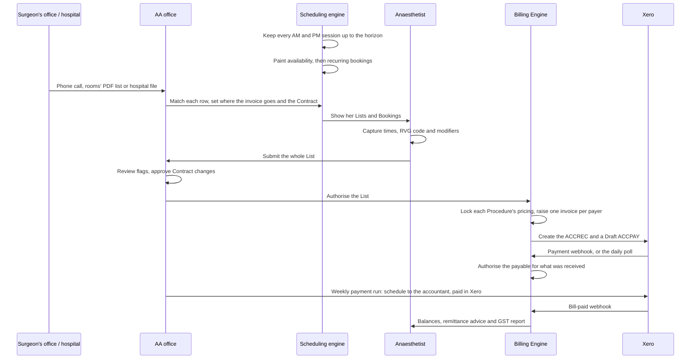

# Workflows and Handoffs

How work moves between the AA office, the anaesthetist, the Billing Engine and Xero in the prototype. Each workflow says who acts, what happens step by step, who picks it up next, and which run-sheet beats show it. The run sheet (`03-demo-script.md`) holds the click paths and the figures.

## End-to-end business flow



## The two kinds of state

Keep these apart in the demo.

### Session availability

Every anaesthetist has an AM and a PM session each day, and the office can open an out-of-hours session after PM. A session shows its List when it has one, otherwise its availability. The statuses are a list the office keeps in **Master data → Availability statuses**:

- Free (every session starts Free)
- On holiday
- Unavailable
- Public hospital, with an optional note such as CPH ("Public / CPH" on the Day view)

The Day view legend adds the kinds of List: Private and Pre-op. Public is a session status. It never holds a List and is never billed.

### The life of a List

```text
DRAFT (a Draft List only) -> ACTIVE -> SUBMITTED -> AUTHORISED
```

| State | Anaesthetist | Office | Rows from a hospital file | Meaning |
|---|---|---|---|---|
| `DRAFT` | Never sees it | Assigns it to an anaesthetist | Can create or join it | A Draft List: work with no anaesthetist yet |
| `ACTIVE` | View and edit | View and edit | Applied by the office | Work being prepared |
| `SUBMITTED` | View and edit her own, until authorised | View and edit | Applied by the office | The whole List is with the office; the last change stands |
| `AUTHORISED` | Read only | Read only | Cannot be applied | Locked and billed |

There is no send-back state. The office corrects a submitted List itself, after a phone call if it needs one.

## Workflow 0: the schedule canvas

**Primary actor:** the Scheduling engine, set up by the AA office
**In the demo:** S2 Beat 1, S2 Beat 3 and its staged-clash aside, S5's go-live aside
**Requirements:** EP-01, EP-13

### Trigger

- The schedule horizon (**Master data → Schedule settings**, four months) rolls forward each day, or the office changes it.
- An anaesthetist is added with a start date, or switched active or inactive.
- An anaesthetist changes their calendar, or a recurring booking, hospital holiday or public holiday changes.

### Steps

1. Every active anaesthetist has an AM and a PM session for each day from their start date to the end of the horizon. Every new session starts Free.
2. The anaesthetist's calendar goes on first: days off weeks ahead, repeating days off, and one occurrence changed or deleted. The calendar sets the session's status directly. Seeded public sessions are Public with the note CPH, and Public closes a session as Unavailable does.
3. Recurring bookings (each surgeon's standing arrangement of hospital, anaesthetist, day and session) go on next. Each one places an empty List in its free sessions ahead. A recurring booking that lands on a session the anaesthetist has closed becomes a Draft List for the office.
4. A change to a recurring booking reaches the canvas through **Apply to canvas now**, from tomorrow to the end of the horizon. Empty Lists are added or updated; a List with Bookings or office edits is left as it is. When nothing differs the page reads "The canvas already matches every recurring booking."
5. A session shows the same thing in every app and every finder: its List when it has one, otherwise its status.
6. A closed hospital puts every List there that day on **Conflicts**. The List stays where it is until the clash goes or the office clears it. Unavailability is never a conflict: Workflow 3 covers it.

### Handoff

The office gets a schedule already laid out, and works on the exceptions: Draft Lists, conflicts, sickness and new Bookings.

### Master data the office keeps

- Surgeons: one or more specialties, the practice name as plain text, one personal contact and one or more office contacts (practice manager, PA or shared inbox: name, email, phone). Admin staff fill in the HPI CPN. A surgeon can be saved without one and reads "No HPI CPN yet" (OQ-143).
- Surgeon groups, hospitals and their holidays, public holidays, AA's specialties and its funding tags (SXAP, HNZ, ACC, in the order they are offered).
- Priority tiers (Tier 1 to Tier 4) on each anaesthetist, and pairing preferences (Preferred, Not preferred) on the surgeon and the anaesthetist. Both are private to the office. Anaesthetists never see them, and an anaesthetist handing on her own List gets no pairing warning.
- Email templates, one for each kind of change (Change of anaesthetist, Cancellation, Correction of an error, Booking change), and the prepayment letters.

Each List keeps where it came from. The update email and any request for a missing NHI go to that List's sender, otherwise to the surgeon's first office contact with an email, with the others offered. The personal contact is never the default.

### Go-live

AA starts clean. Before go-live a developer loads AA's controlled spreadsheets once (**Master data → Seed load** and **Go-live load**). Every row goes through the same checks as one added by hand, and a row that fails is listed with its reason and left out. From Solutions Plus the load takes operation names only, never its unit values. After go-live the office keeps every master by hand, and every change is audited. There is no Contract upload or export in the first release.

### Demo point

Open **Admin → Day view** and show the AM and PM rhythm across 14 anaesthetists, the Draft Lists band, and Dr Ropata's "Public / CPH" morning. Then run S2 Beat 3: a recurring booking on a closed session becomes a Draft List.

## Workflow 1: booking intake by import and matching

**Primary actors:** the AA office (Kirsty), the surgeon's office, the hospital
**In the demo:** S1 Beat 2 and its asides, S4's unmatched-queue aside, S5 Beat 2
**Requirements:** EP-02, EP-11, EP-14

### Triggers

- A hospital's bookings arrive. The office imports the hospital's file (St George's and Southern Cross) on **Admin → Intake → Matching**. Sample files stand in for each hospital's real format until the integration team confirms how each hospital provides its bookings (OQ-13).
- A surgeon's office emails a PDF list. The office uploads it on **Intake → PDF lists** with the address it came from.
- A surgeon's office phones or emails AA (Workflow 2's phone-advice path).
- The anaesthetist finds a patient missing on the day and adds the Booking herself.

### Main path

1. Every row from a hospital file or a rooms' PDF list waits on the matching screen. Nothing reaches a Booking, List or patient until the office decides.
2. The screen suggests what to do with each row: create a Booking on a List, apply changes to an existing Booking, cancel one, or create a List in a session (or a Draft List) for a row with no List. The office applies, creates or rejects each one.
3. A row's NHI finds the patient's existing record, so a returning patient keeps one record. A patient who owes AA raises the balance warning when the Booking is created.
4. The procedure text stays exactly as received. The rooms may send "RTK" and the hospital "right total knee": the hospital's text replaces the rooms' text once the office applies its row, and the rooms' wording stays in the Booking's History. The invoice description starts as the text received; where a Contract has its own invoice description, the invoice prints that instead.
5. The office sets where the invoice goes and the Contract (Workflow 4's step rail), on the matching screen or later from the **Needs an invoice destination** list on the Day view.
6. A later row for a Booking already matched waits as a modification. The office ticks the fields to apply (time, procedure text, note) and approves it. A Booking moved to another day arrives as a cancellation plus a new Booking. A row for a submitted List can still be applied; a row for an authorised List cannot.
7. The matching screen shows only the fields needed to match. The rest of what the hospital sent is held under restricted access: the office sees it masked with **View raw row**, giving a reason each time, and every view is audited with the reason and no values ("Raw row viewed"). Anyone else is refused ("Raw row view refused").
8. Every List records where it came from (a rooms' PDF with its sender, the hospital's list, by hand, or a recurring booking) and keeps it after assignment.

### A row with no NHI

- An NHI is mandatory, so a row without one never becomes a Booking. It waits on Matching and on **Admin → Patients → Waiting for NHI**.
- Meanwhile a stub stands on its List: a dashed row reading "Waiting at intake: no NHI · The office is resolving this", with the time, name and wording as received. The List counts it apart ("1 waiting at intake"), and it never blocks submit or authorise. In Admin it carries **Resolve on Matching**.
- The office uses **Email for the NHI** to ask the List's sender, then **Add NHI**. The Booking takes the stub's place. Rejecting the row removes the stub.
- How a stub reads is our reading, to confirm with AA.
- Seeded: Mere Tipene on Dr Souter's Tue 4 Aug PM List.

### The rooms' PDF lists

- On **Intake → PDF lists** the office opens the list beside its facsimile, corrects a row it can see is wrong (an NHI that fails its check digit, say) and selects **Send to matching**. The rows land on Matching with the rooms' wording, like a hospital file's.
- A List made from a PDF reads "From a rooms' PDF · sent from <address>" with **Replies go to** that address.
- A re-sent list is matched to the earlier one by surgeon, hospital, date and session (our reading). Unchanged rows are skipped, a changed field waits as a difference, and a new patient arrives as a new row. A patient dropped from the re-sent list is not detected (Future scope).

### Other ways in

- **Phone advice:** Kirsty opens a free session on the Day view and selects **Book (phone advice)**, or adds a Booking to a List she may edit. The procedure stays exactly as the caller said it, with **Told by** Phone or Email.
- **The anaesthetist's own Booking:** Dr Souter adds a missing patient on her List, on the phone or the web, with the procedure as written on the hospital's list. If she knows it she sets the Contract on the step rail; otherwise the Booking waits on the office's Needs an invoice destination list.
- **NHI lookup:** on every **Add a booking** the NHI is checked in both formats as it is typed, and **Look up** stays disabled until it is valid. Look up asks the Digital Services Hub (simulated over a synthetic NHI register) and fills in the patient, still editable. The purpose note names who it is looked up for, by HPI CPN. When the Hub is down the details are typed by hand; the NHI is still required and must be valid.
- **Booking from a photo of a paper booking:** Future scope, behind a badged demo action on the List.

### Handoff

The Booking shows on the assigned anaesthetist's List on mobile and web, with the procedure text as received and where it came from ("Hospital download, St George's").

### Points to keep straight

- Intake is an import that the office decides row by row. Nothing applies by itself.
- Hospitals and surgeons send bookings; they have no login in the prototype.

## Workflow 2: plan the day, Draft Lists and late changes

**Primary actor:** the AA office (Kirsty)
**In the demo:** S2 Beats 1 to 3 and their asides, S2 Beat 6's office-move aside, S5 Beat 1
**Requirements:** EP-01, EP-02, EP-13

### Trigger

A hospital, surgeon, patient or anaesthetist reports a change, or a Draft List needs an anaesthetist.

### Steps

1. Kirsty opens **Admin → Day view**. The header counts anaesthetists, sessions, free sessions, submitted Lists and Draft Lists. Each List block shows its booking count, and the right rail holds the **To-do** list, **Pre-payments**, **Needs an invoice destination**, **Draft Lists** and **Notifications**.
2. Draft Lists wait in a band at the top of the day and on **Draft Lists**, soonest first. They come from a recurring clash, a List returned by an anaesthetist, a request with no anaesthetist yet (phone, email or rooms' PDF), or a row on Matching.
3. She assigns a Draft List with **Assign**. The picker lists who is free that session by priority tier, then preferred pairings first within a tier. A Not preferred pairing sits apart in its own group: picking it shows the surgeon's reason and **Assign anyway**, and going ahead is noted in the history. Anaesthetists who are unavailable or already have a List show below, read only. **Find available** gives the same view for any session.
4. To move one patient, she moves the Booking to another List (**Move**). The dialog shows an advisory when the hospital or surgeon differs and never blocks. The Booking keeps its Contract and any typed price; if the new List does not offer that Contract, the Booking says so and Review flags it.
5. For a wrong hospital, surgeon or time, she edits the List or the Booking.
6. For a cancellation she records a reason and cancels the Booking. A cancelled Booking stays visible for history and never bills. If it was prepaid, the cancel sheet says what happens before she confirms (Workflow 8).
7. She can add an internal day note for colleagues.
8. Her changes on an Admin Booking wait as unsaved until she selects **Save changes**. Each save is one change set: one grouped row in the Booking's **History** naming who saved it, and **View as at** shows the Booking as it stood at any save. With two office users, each save names its own.
9. When a change matters to someone outside, she drafts an update email on demand from the Booking or the List (**Draft update email**). She ticks the saved changes to report and starts from one of AA's templates. It goes to the List's sender, otherwise the surgeon's first office contact, with the others offered. The office note never goes in an email. The email opens in her own mail client, and she sends it by hand.
10. She can add a Booking to any List she may edit, with the procedure kept exactly as typed, and edit any field until the List is `AUTHORISED`.

### Handoff

Saved changes show at once on Dr Souter's phone and web while the List is `ACTIVE` or `SUBMITTED`. A Booking she has open shows a line saying the office saved changes.

### Demo point

S2 Beat 3 assigns a Draft List through the tiers and the Not preferred warning. S5 Beat 1 shows two office users' saves in History and drafts the update email from both.

## Workflow 3: cover, by the anaesthetist's own move or by the office

**Primary actors:** the anaesthetist and the AA office
**In the demo:** S2 Beats 4 to 7, S2 Beat 1's out-of-hours aside
**Requirements:** EP-01

### Trigger

An anaesthetist becomes unavailable, needs cover at short notice, or wants one case done by a colleague.

### Steps

1. Dr Souter keeps her availability in her calendar on the phone or the web: days off ahead, repeating days off, one occurrence changed or deleted, and Public sessions with an optional note such as CPH. The office can set any of these from **Change status** on the Day view. Setting a Public session back to Free reopens it.
2. **Moving her own List.** From **List options → Move this List** she returns the List to the office or hands it on to a colleague free that session. It happens at once: nobody accepts and the office does not confirm. She then chooses what her own session becomes, Free or Unavailable.
3. The colleagues offered are those free that session, in surname order, each with a phone number. She sees nothing of the office's tiers or pairings.
4. A List she returns goes back to the office as a Draft List with its hospital, surgeon and Bookings. A List she hands on moves with every Booking and its history, as an office reassignment does. Nothing about billing or a prepayment is recalculated.
5. **Marking a booked session off.** When she marks a session with a List Unavailable, the app asks first: **Return to the office** or **Hand on to a colleague**. No List stays on a session its anaesthetist cannot work.
6. **Moving a single Booking.** From the Booking, **Move to a colleague**: she finds a colleague free that session by typing a name or from the free list. The Booking becomes a new List in the colleague's session and never joins an existing List. A colleague on leave is offered once they set that session available themselves. **Tell the office** is a tick she may leave off.
7. Whoever submits a List did every procedure on it, so a case a colleague does moves to a List of theirs before the procedure, and its payable follows. A prepaid Booking keeps its payable in the AA Holding account, and the transfer when the List is authorised pays whoever did it. Her move sheet carries the line "This Booking is prepaid. The prepaid amount stays as agreed, and moves to Dr ... once the List is authorised."
8. **Sickness the office records.** When nobody has arranged cover, Kirsty takes the call and sets the session Unavailable from **Change status**. The same "Where does this List go?" step asks her to return the List to the Draft Lists or hand it to a colleague there and then. Sickness never raises a conflict.
9. **The office's reassignment.** Kirsty opens the List and reassigns it (**Reassign list**), or assigns the Draft List. The picker orders by tier, then preferred pairing, with Not preferred pairings apart and warned. A colleague marked unavailable shows but cannot be picked until the session is made available, with that anaesthetist's agreement.
10. On a prepaid Booking the office's move and reassign steps carry the line "The prepayment keeps its agreed amount. Whoever the office assigns claims it." Nothing in the ledger changes. The moved Booking reads "Prepayment kept at the agreed amount · now with Dr ...", and the office may send the optional **Email patient: anaesthetist changed** (provisional, OQ-120).
11. Whoever moves a List, the anaesthetist or the office, chooses what the vacated session becomes: Free or Unavailable.
12. **Alert the office.** An anaesthetist unsure about a Booking or a List sends **Alert the office** with a note. It waits in the office's notifications until someone ticks it resolved. Submitting is not affected.
13. **Out of hours.** For an emergency or a late case after PM, Kirsty opens an out-of-hours session from the anaesthetist's row on the Day view (**Open out-of-hours session**: one a day, 18:00 to 21:00 by default) and puts a List in it, a new one or a Draft List waiting for that evening. From then on it behaves like AM and PM: the finders offer it while it is free, and its List moves, returns and bills like any other. An empty one can be closed.
14. Every move and reassignment is audited.

### Handoff

- Each move of a whole List posts a notice to the office's shared notification pool, on the Day view rail and the **Notifications** page. A single Booking posts there only when she ticks **Tell the office**.
- The colleague sees the List or the Booking with a "Moved to you" notice.
- The office assigns any Draft List returned to it.
- A notice or an alert stays active until anyone in the office ticks it resolved, which clears it for the whole office. **Show resolved** brings it back with who resolved it and when. Nothing expires.
- The hospital hears about a change of anaesthetist by email. After an office reassignment or a Draft List assignment, the List drawer offers **Draft update email**. After an anaesthetist's own move to a colleague, the notice on the Notifications page offers **Draft cover-change email**. Each opens a draft with the change ticked and the Change of anaesthetist template, and the office sends it by hand. A List returned to the office gets its email once the Draft List is assigned.

### Points to keep straight

- A move happens at once. Nobody claims a List or accepts one.
- A single Booking always lands as a new List in the colleague's session.
- An anaesthetist who cannot work a session never keeps its List.
- A notice is ticked resolved. The pool records moves and alerts and sits apart from the to-do list.

## Workflow 4: capture a Booking

**Primary actor:** the anaesthetist (Dr Souter)
**In the demo:** S1 Beats 3, 6 and 7 and their asides, S3's 3-procedure aside
**Requirements:** EP-03, EP-04, EP-05, EP-11

### Trigger

The procedure has happened, and the anaesthetist records what is billed.

### Setting the Contract

Every Procedure has its own Contract. The office sets it through the step rail, and the anaesthetist can change it until the office authorises the List:

1. **Where does the invoice go?** Patient, the List's hospital (with its funding tag) or Special (an insurer, a funder or a surgeon who is billed, then which holder).
2. Under Patient, **Standard or prepaid?** Under the List's hospital, its funding tag, filled in by itself when the hospital has only one.
3. **The Contract**, found by typing. Two backstops always sit under "No contract": No contract · RVG (priced from RVG units, for an invoice to the patient that is not prepaid) and No contract · Fixed price (a person types the amount).

A "Suggested" mark follows the insurer or funder on the Booking and never hides a path. **Start again** goes back to step 1. Who is invoiced comes from the Contract: its holder, or the payer on the Procedure (its **Paid by** line).

### Steps

1. Dr Souter opens her List and the patient's Booking. On a handset she signed in once with her demo account, and the phone keeps her signed in. How anaesthetists sign in for real is still to be decided (OQ-83).
2. She reads the procedure text as received, with when and where it came from, and the Billing section below it: Invoice to, Contract, Price and Paid by.
3. What each Procedure asks for follows its Contract's pricing kind. On an RVG price (No contract · RVG, an RVG rate or an RVG discount) the RVG code, the start and finish times and the modifiers step are required, each marked **Required** until answered. On a fixed or open price there are no times, units or modifiers, and the RVG code is optional.
4. She finds the RVG code by typing (**Choose the RVG code**), under its body-area heading. The base units start from the RVG group. On a group with a range she may change the figure, and a value outside the range raises a mild warning for the office.
5. She records the start and finish (**Start now**, **Finish now**, or typed). Time units follow the RVG tiers: 1 unit per 15 minutes for the first two hours, then 1 unit per 10 minutes. The T stepper also lets her set the time units by hand, shown as "Adjusted manually".
6. The patient's age modifier, and any modifier the procedure's base units include (P1 on Neurosurgery and Spine codes), come in applied, and she can remove them. She claims any other modifier that applies, ASA included, each with a short explanation. Modifiers stack with no limit, and the same modifier is never added twice. An included modifier shows at 0 units. If nothing else applies she taps **None apply**, which reads "No modifiers claimed · Change". A modifier already applied does not answer the step on its own.
7. The Price section shows what the Contract comes to as she records ("8 units x $26.50 = $212.00"), and the Booking total sits above **Mark complete** (the phone's dock, the web's side panel).
8. She types a price only where the Contract allows it: on an RVG Contract that allows it, such as No contract · RVG (a **PRICE $** field and **Save price**), or the amount on No contract · Fixed price. Elsewhere the price is read only: "Set by {Contract}. To use a different price, change the Contract or alert the office." The office can change any price until the List is authorised, and Review shows a typed price beside the computed one.
9. She can add an event under the Procedure: **Add pre-op or post-op event**, or **Add billing event** (a charge or credit with free text). Workflow 8 covers both.
10. **Mark complete** checks three things: every Procedure has a Contract; on an RVG price, the RVG code, both times and the modifiers step, with a reason for each claimed modifier; and a price (a Procedure with none reads **Needs a price**). An early press jumps to the first thing missing and shows its message. A warning never stops it.
11. Something only the office can fix goes through **Alert the office**.
12. The info sign beside each heading explains the section.

### More than one Procedure

- One Booking can hold several Procedures. One is the primary, listed first with a **Primary** pill. The first Procedure entered is the primary until someone changes it with **Make primary** (a sheet on the phone, a dialog on desktop: "Make this the primary procedure?"). Nothing is ever promoted without a person choosing it, and the primary cannot be removed.
- Who can use Make primary: the anaesthetist on her own List until it is authorised (after **Amend** on a completed Booking), the office on `ACTIVE` and `SUBMITTED` Lists, a hospital feed on an `ACTIVE` List only.
- The multi-procedure rule, one rule for the whole system: base units on the primary only; time units on every Procedure from its own times; modifiers recorded once, on the primary. At 4 modifier units or fewer they all stay on the primary. Above 4 they split equally across the RVG-priced Procedures, the remainder to the primary (7 over 3 gives 3, 2 and 2), whichever Contracts they are on.
- A fixed or open price keeps its own price and takes no share. On a mixed Booking whose primary has a fixed price, no base units bill (provisional, OQ-132).
- Seeded: Graeme Tullett on Dr Souter's Mon 13 Jul AM List (three Procedures, 7 modifier units, split 3, 2 and 2) and Brian Holt on her Mon 20 Jul AM List (two Procedures, one invoice).

### Handoff

When every active Booking is complete, the List can be submitted.

### Demo point

Capture Sarah Mitchell live in S1 Beat 6. For the price rules, open Dr Souter's Mon 27 Jul AM List: Tama Rewiri on No contract · RVG has a price field; Natalie Brennan on Forte Health RVG less 10% reads "Set by Forte Health RVG less 10%". On her Mon 10 Aug PM List, Miriam Holloway's fixed price ($3,400.00) asks for no times, and Graham Pulley on No contract · Fixed price reads **Needs a price** until an amount is saved.

## Workflow 5: submit the whole List, then office review

**Primary actors:** the anaesthetist, then the AA office
**In the demo:** S1 Beat 7 and its authorise aside, S2 Beat 8 and its review asides
**Requirements:** EP-07

### Trigger

Every active Booking on the List is complete.

### Steps

1. Dr Souter selects **Mark list completed**. While anything is left it reads "3 to finish · Tap to see what is left" and lists each Booking with what it still needs.
2. She selects **Submit to office** in the confirm sheet, and a short **List submitted** moment follows. The List becomes `SUBMITTED` and reads "Submitted to office".
3. The List stays on her main view, marked "Done · unbilled", and she can still change it until the office authorises it (**Amend** on a Booking). Every change is audited, and Review shows "Changed since submitted". A Booking she reopens must be completed again before the office can authorise.
4. Kirsty opens the **Review queue** and a List with **Review →**. The summary tiles show the bookings, total units, total fee and open flags.
5. Each row shows each Procedure's stack: the procedure text as received, the Contract with who is invoiced, the RVG code, the payer ("Paid by ..."), the insurer or funder with its approval number, and that Procedure's flags.
6. The flags point at what needs a look. None of them blocks authorising:
   - **Changed by Dr X: was** the old Contract, with **Approve** and **Correct**
   - **Price typed: $X (computed $Y)**
   - **Contract not offered on this List** (after a move to another surgeon's List, for example)
   - **Contract disabled on <day>**, for a Procedure dated on or after the day its Contract was disabled
   - **Needs an invoice destination**, **Not marked completed**, **Email or postal address needed**
   - an open alert from the anaesthetist (ticked resolved here) and open warnings (cleared here)
7. Two things hold up authorising: a Procedure that **Needs a price**, and a Booking reopened and not completed again. **Authorise for billing** stays disabled and names what is missing, with an **Open** link.
8. She approves each Contract change the anaesthetist made, or corrects it, or uses **Approve all N Contract changes**. If something is wrong she phones for clarification and corrects it in the office. Nothing goes back to the anaesthetist.
9. She selects **Authorise for billing** and confirms. Authorising approves any Contract change still waiting, and the confirm says how many. Until then the anaesthetist sees **Awaiting office approval** under the Billing section, and **Approved by the office** after.
10. The List becomes `AUTHORISED`, and every Booking on it is read only. In the same step each Procedure's pricing is locked onto it: the Contract and its settings, the price range in force, the units, rate and discount, the price, who is billed (with the patient and payer details as they stood), the split, and who is paid (the List's anaesthetist at that moment). The Booking shows **Contract locked at authorise**.

### Handoff

Authorising hands the whole List, with each Procedure's locked record, to the Billing Engine, which raises and sends the invoices in the same step: "List authorised · locked for billing", then "N invoices raised. N emailed, 0 to post."

### Key rule

Review is the office's sanity check. A missing price, or a Booking reopened and not completed again, holds up authorising; the office fixes what it finds itself.

## Workflow 5a: the main view and search

**In the demo:** S1 Beat 7

- The anaesthetist's main view starts at today with upcoming work. Earlier Lists not yet authorised sit under "Earlier, not yet authorised".
- Once the office authorises a List it leaves the main view, and its invoices show in her balances.
- To find older work she searches by any part of the patient's name or by NHI, or picks a day and drills into its Lists, Bookings and Procedures. An authorised List opens read only with its invoices. Search covers her own Bookings only.
- Dr Souter has history back to January 2026 to find (try Fri 13 Mar 2026).

## Workflow 6: the billing run and the invoices

**Primary actor:** the Billing Engine, watched by the office
**In the demo:** S3 Beats 1 and 2 and their asides, S5 Beats 4 and 5
**Requirements:** EP-08, EP-04, EP-05

### Trigger

The List reaches `AUTHORISED`.

### Steps

1. The Billing Engine reads each active Booking's locked record and nothing else. It never looks a Contract, payer, rate or RVG group up afresh, and never puts another Contract in its place. A Booking with no lock fails on its own.
2. A Contract edit, a Disable or a new price range after authorise changes nothing here. **Regenerate from locked data** rebuilds an invoice from the lock and reads "identical".
3. Each Procedure's locked Contract says who is billed: its holder when the Contract bills its holder (a hospital, an insurer, a surgeon group), otherwise the Procedure's payer: the patient, or whoever the Paid by sheet names (a parent, a guardian, a benefactor, a family trust). A surgeon's fixed price, No contract · RVG, No contract · Fixed price, an anaesthetist's own price list and every prepaid Contract bill the payer. The insurer or funder on the Booking never decides it.
4. Procedures that share a payer share one invoice. Payers are never matched on name or email, so a payer typed on two Procedures gets an invoice for each.
5. A Procedure's fee can be split (the **Split** button on its Paid by line, set by the office or the anaesthetist before authorise: each share in $ or %, one party taking the rest). Each party gets an invoice for its share.
6. The price comes from the lock: units at the rate, less any discount (printed as its own line), or the fixed price from the range in force on the procedure date. The multi-procedure rule applies to RVG-priced Procedures. A typed price of $0.00 still gets an invoice, marked "No charge".
7. Each invoice is in the name of the anaesthetist locked at authorise, as supplier with her GST number, with AA as her agent (the agency wording is provisional, OQ-29). The invoice's **Locked record** card shows what it was raised from.
8. The layout follows the Contract: the holder's layout when it bills its holder (its invoice descriptions, the B, T and M breakdown, the procedure date and surgeon, and the Contract's own code as "Your reference"), otherwise the patient's. Prices are held without GST, and GST goes on at the foot.
9. The run sends each invoice by the Party's delivery: by email, or **To post** for a payer with only a postal address (provisional, OQ-122). How each Party's invoices are delivered is still open (OQ-114). A payer with neither reads **No invoice address** until the office adds one and sends. The office can **Resend** from the invoice; there is no separate email step.

### Handoff

The Billing Engine sends each invoice to Xero as a matched pair. Each ACCPAY is the buyer-created tax invoice for one receivable invoice, at the same value, naming the anaesthetist as supplier and AA as agent (provisional, OQ-29; one BCTI per invoice is provisional, OQ-29 and OQ-60).

### How many invoices

One invoice per payer per Booking. A Booking with several Procedures and one payer is one invoice, and one BCTI. A split fee gives one invoice per share.

## Workflow 7: collection, the ledger and paying the anaesthetist

**Primary actors:** Xero, the Billing Engine, the office and AA's accountant
**In the demo:** S3 Beats 3, 4, 5 and 7, S4 Beat 6 and its asides
**Requirements:** EP-08, EP-09, EP-10, EP-12

### Trigger

An invoice is raised.

### Steps

1. Every invoice is a pair in AA's own ledger, created with the invoice: a receivable from the payer and a payable to the anaesthetist, the same amount. AA's own fee is invoiced separately and never deducted here.
2. The Billing Engine creates the matching pair in Xero:
   - `ACCREC`: what the hospital, insurer or patient owes AA;
   - `ACCPAY`: what AA owes the anaesthetist, equal to the `ACCREC`, starting as a Draft bill.
   Both carry the invoice number (the `ACCPAY`'s ends `-P`) and the case reference.
3. The payer pays into AA's account. A Xero webhook tells the Billing Engine, and a daily poll catches anything missed.
4. The matching payable is authorised for exactly the amount received, part payments included. The rest stays outstanding on the invoice.
5. The released payable waits for the week's payment run on the Billing monitor's **Payment cycle** panel:
   - the office **closes the week** (planned for Friday), which reconciles it to the bank download;
   - the **Monday checks** list anything odd, and a problem not sorted in time is **held out of this run** and rolls into next week;
   - the office approves the week's BCTIs (**Approve week N's BCTIs**), and nothing is paid without it;
   - on Tuesday the **payment schedule** goes to the accountant, who pays it in Xero.
6. A bill-paid webhook, or the daily poll, tells the Billing Engine, which records the payment. The app never pays anyone itself.
7. Each run is named by its ISO week and kept as a record: its page, its payment schedule and a remittance advice for each anaesthetist, which she reads under **Accounts → Remittances** on the web. Every payment shows the week it was paid in. A negative invoice nets against her payments in the run. The weekly cycle is proposed and being confirmed with AA's accountant (OQ-47).
8. A prepayment's payable sits in the AA Holding account and no run pays it. The anaesthetist is paid only after the transfer at authorise (Workflow 8).
9. The anaesthetist sees her position from the Billing Engine's own ledger, never from Xero: owed to you, collected, paid out to you; one flat list of unpaid invoices, oldest first, each reading "Paid in, due to you" once the money is in; her payment history; and the monthly GST report of what AA paid her, on a cash basis.
10. The office checks **Admin → Ledger**: receipts held, less payables due, the AA Holding account and credits held for payers, plus negative invoices to net, come to $0.00 ("In balance · receipts held equal payables due"). A receipt that matches no invoice puts the ledger out of balance, with the anaesthetist it names on the out-of-balance list, until the office allocates or refunds it.
11. Patient and payer contacts in Xero carry only a hidden internal ID: no name, NHI or other personal information. Once fully paid and inactive for a set number of days, the nightly job archives them (**Master data → Xero & archiving**).

### Xero going wrong

1. Every call to Xero (a hand-off, a payment, a disbursement, the poll) is written to the **Xero sync queue** first. If Xero does not answer, the call waits and retries with growing gaps. The Billing monitor shows each waiting call, and **Retry now** sends one straight away.
2. Authorising and invoicing carry on during an outage. The invoice and its ledger pair stand, and the List reads **Waiting for Xero** until its hand-off lands.
3. When Xero is back, the queue sends what waited in order, once each: no duplicate pair, contact, receipt or disbursement.
4. An invoice voided or edited straight in Xero is found at the daily poll and flagged on the Billing monitor (**Changed directly in Xero**). The ledger keeps what AA issued, and the office records a resolution, which moves no money. The policy for each mismatch is provisional, to be agreed with AA.
5. A hospital that pays many invoices with one bank payment is matched in Xero: its remittance matches each line by invoice number, and the engine learns each payment through the normal webhook. A line Xero cannot match waits in Xero's bank reconciliation for the office (**Demo actions → Simulate bulk hospital remittance**, then **Match in Xero**).
6. The Day view's **Reconciliation** card says whether the ledger and Xero agree (**Books square**) or not (**Out of balance**), with each item to resolve and how long it has waited.

### Handoff

The financial episode closes when the money is in and the anaesthetist has been paid.

### Demo point

S3 Beat 4: **Demo actions → Payment received · full** on AA-2026-0005, then **View in Dr Souter's account**. S3 Beat 5 runs the week end to end and opens the remittance advice. S3 Beat 7 closes on the ledger: in balance, then a $120.00 receipt that matches no invoice puts it out of balance until the office allocates it, and the Reconciliation card reads **Books square** again.

## Workflow 7a: AA's monthly fee

**Primary actors:** the office, the Billing Engine, Xero and the anaesthetist
**In the demo:** S3 Beat 6 and its fee-payment aside
**Requirements:** EP-10

### Trigger

Month end. In the demo, **Run monthly fee invoices** on **Admin → Billing monitor → AA fee invoices**, or **Demo actions → Run scheduled month-end fee run**. Whether the fee invoice goes at month end or on the 20th is still open (OQ-112).

### Steps

1. The office keeps **Fee settings**: several fixed items and a charge per BCTI, every amount without GST. A change applies from the next run, and fee invoices already raised keep their settings. The schedule in the demo is a sample.
2. For the month, the Billing Engine counts each anaesthetist's BCTIs: one per receivable invoice, once, against the anaesthetist who did the procedure, in the month its invoice is paid in full. A prepayment's payable is not counted. The count is provisional (OQ-29, OQ-60).
3. It raises one AA fee invoice to each active anaesthetist: the fixed items plus the charge per BCTI times the count, with GST at the foot. Each has a Xero ACCREC against the anaesthetist's contact and no ACCPAY.
4. The anaesthetist pays it by bank transfer into AA's own account. It is never taken out of a payment to her, and it is not her income, so it never appears on her GST report.
5. Admin and the web **Accounts → AA fees** tab show each fee invoice paid or unpaid.

### Demo point

S3 Beat 6: **Demo actions → Seed a month of BCTIs**, then **Run monthly fee invoices**. Dr Rutherford's July invoice reads $500.00 + $5.00 x 40 = $700.00 before GST, $805.00 with it.

## Workflow 8: exceptions and compliance

**Primary actors:** the office, the anaesthetist, the Billing Engine
**In the demo:** S4 throughout, S2 Beat 2, S5
**Requirements:** EP-06, EP-08, EP-10, EP-11, EP-12, EP-13, EP-15

### Prepayment

- A Procedure on a prepaid Contract is paid in full before the procedure. The office picks the prepaid Contract (Patient, then **Prepaid**), often one of the anaesthetist's own price list, which the office keeps. A prepaid Contract always bills the Procedure's payer, awaiting AA's confirmation (OQ-73).
- One prepayment invoice per payer, each payer locked once theirs is raised. The amount is the Procedure's price when the invoice is raised, read only after; on No contract · Fixed price, an amount the office types. That is the prepaid amount. The anaesthetist sees it and cannot change it ("Set by the office").
- The office approves and sends it from **Admin → Invoices** (**Approve and send**). The approval step is on by default and AA can switch it off, in which case the invoice goes by itself. It goes with the prepayment letter from **Master data → Prepayment letters** (the Standard prepayment letter by default), which names the anaesthetist (provisional, OQ-120). The letter says the anaesthetist may send a further invoice or a credit if the procedure turns out very different.
- The invoice's pair credits the AA Holding account, never the anaesthetist. While it is unpaid or part paid, the office can **Send prepayment reminder** from the Booking for what is still to pay; the panel and the Day view rail show when it was sent.
- The AA Holding account is a payables creditor, kept like an anaesthetist's account. It is not a bank account and not a Xero ledger account, and no payment run pays it. Money leaves it only by a transfer or a refund the system raises.
- Two steps, and the anaesthetist is paid only after the second:
  1. **Collected into the AA Holding account.** The payer's money lands, the payable to the AA Holding account is authorised for what was received, and the Billing monitor's **AA Holding account** card shows a Received entry.
  2. **Transferred at authorise.** When the office authorises the List, the system writes a transfer from the AA Holding account to the anaesthetist who did the List, with no office step: a Transferred entry on the card, and a manual journal in the Xero simulation. No invoice or payment is raised and GST does not move. The next weekly payment run pays the anaesthetist. The release at authorise is provisional (OQ-125), and the card says so.
- Money paid after the transfer goes straight to the anaesthetist's payable as it arrives. A part-paid prepayment moves in full at authorise and is released as money arrives.
- An unpaid prepayment never blocks. It is a warning that turns strong as the date nears, so the anaesthetist sees it before surgery starts.
- After the procedure the prepaid amount is the price. The Procedure stays off the final invoice, and nothing more is invoiced or credited by itself; the **Prepaid settlement** block shows the recorded units for reference only. A real difference is raised by hand, by the anaesthetist or the office: a credit note, always for the whole prepayment invoice, and anything still owed as a new additional invoice. Both go through review and the next run. Before authorise, only the office credits it.
- A move changes nothing in the books: the patient is not billed again, nothing is repointed, and the transfer pays whoever did the List.
- A cancel settles it on the spot, whoever cancels: credited if unpaid, credited and refunded in full from the AA Holding account if paid, and a payment that arrives after the credit is refunded straight back. A Contract changed off prepaid after sending is settled the same way. **Rebook with another anaesthetist** starts a fresh prepayment at the new anaesthetist's own price.

### Warnings and the to-do list

- One routine checks each Booking and raises warnings, each with its own text, a kind (before or after the procedure) and a strength (mild or strong). A Booking can carry several.
- A warning never blocks. Saving, completing, submitting and authorising all go through, with no confirm step.
- The anaesthetist sees a triangle on the Booking's row and the warning at the top of the Booking when she opens it. The office sees the same triangle, the Day view outline, and the **To-do** card on the Day view.
- The office clears a warning once it has dealt with it (**Clear**, or **Clear (optional)** on a mild one). The clearance is audited, and the Booking shows who cleared it and when.
- The rules: an unpaid prepayment (strong as the date nears); base units outside the RVG guide; a child as the payer on a Procedure; an insurer named with no approval number (an insurer only, never ACC or Health NZ); a split that does not fit the fee; and a patient who owes AA (mild under the threshold, strong over it: **Master data → Patient balance warning**, 90 days).
- The to-do list holds warnings that need action. Moves and alerts go to the notification pool.

### The payer and the insurer or funder

- Every Procedure names a payer: the patient, filled in from the patient record. The office and the anaesthetist change it in **Paid by** (a sheet on the phone, a dialog on the web) until the List is authorised. The change is offered to the Booking's other Procedures with the same payer, and a Procedure added later copies the payer the others share.
- A payer needs an email or an NZ Post postal address. The Paid by sheet asks for one, and Review flags **Email or postal address needed**; nothing blocks.
- The Booking's **Insurer or funder** row (reading "None" when empty) holds the insurer or funder, a Party, and the approval number. It comes from the hospital's row where the file carries it, or the office records it; the anaesthetist sees the number and can enter it on the day. The funder marks one path "Suggested" on the step rail. It never narrows the choice and never decides who is invoiced.

### The anaesthetist's profile

- Each profile holds the rate per unit (the dollar value of one RVG unit), phone, email, registration number, HPI CPN and bank account.
- The anaesthetist sees it on the phone's **More** screen and on the web **Profile** page. She edits only her own rate per unit (**Change** on the phone, the field and **Save changes** on the web). The new rate applies to Bookings on Lists not yet authorised; authorised Lists keep their locked rate.
- Contact details, the HPI CPN and the bank details are held by the office and read only for her. The bank number is always masked (Dr Souter's 99-0101-•••••21-00).
- The office keeps every profile on the Admin anaesthetist record (**Master data → Anaesthetists**, open a row, **Edit details**), with the GST number in the table. The HPI CPN and bank details are required. Every change is audited, with the bank number masked in the audit too.
- The payment itself is made in Xero, never from the app.

### Events: pre-op, post-op and billing events

- An event sits on a Procedure, never on a List: its date is its own. The original Booking, if authorised, stays locked.
- The anaesthetist records her own from the Booking, reached from the main view or search: **Add pre-op or post-op event**, a type (Post-op ward review, HDU review, Pain consult, ACC pre-op assessment, Other pre-op, Other post-op), its date and start time, and a time recorded or a fixed fee. **Invoice this event** keeps it billable. It is billed to the same party as the procedure unless she names another. She sees no calculation; the office prices the time at review.
- A billing event (**Add billing event**) is a charge or a credit with free text and an amount without GST. A credit is a negative line, offered only before the Procedure is invoiced; after that it is a credit note.
- The office can add any of these too.
- One review step (**Review queue → Events**) approves each one, and the next billing run bills it. It joins an invoice to the same party in that run where there is one; otherwise it gets its own invoice, linked to the Procedure's.
- A Contract can carry an event fee that replaces the time (St George's ACC STGACC-PAIN, $120.00 for a pain consult). On a fixed-price Procedure the office sets a price.
- **ACC pre-op assessment:** a pre-op event dated on or before the procedure. The sheet offers three codes, CS250, CS260 and CS70, and the code prints on its invoice line. The codes and their fee are to confirm with AA's accountant (OQ-12).

### Additional invoices

- A later ward review or pain consult never reopens the Booking. The office, or the anaesthetist on her own invoiced Procedure (found through search), raises an additional invoice with free-form lines (description, quantity, amount) to whoever should pay (**Create additional invoice**, or **Raise additional invoice** for the anaesthetist).
- It goes through the same review step and bills in the next run, with its own number and Xero pair, linked both ways to the original.
- After a prepaid or fixed-price procedure nothing is billed by itself; any extra is an additional invoice raised by hand.

### Correction after invoicing

- An issued invoice is never edited. A wrong amount or billable party, an invoice paid twice, or less work than a fixed price assumed, is corrected by crediting the invoice in full and rebilling.
- The office does it from the invoice's **Correct this invoice** card (**Credit note**, or **Credit in full and rebill**, whose draft starts from a copy of the original's lines). The anaesthetist does it on her own invoiced Procedure (**Credit note**, beside **Raise additional invoice**).
- The credit is an event on the Procedure, through the same review step, and is issued in the next billing run with its credit note number (CN-2026-nnnn). Any new invoice raised with it gets its own number and is linked to the original.
- The anaesthetist's payable is always reversed by a negative invoice: offset against the payable while it is unpaid, or netted in her next weekly payment run once she has been paid. A negative invoice with no later payment to net against is settled with the anaesthetist outside the system. Both sides move together in the ledger and in Xero.
- A credit note is not a refund. Nothing is credited without a person deciding. A disputed invoice with no AA error stays outstanding.

### Splitting a combined procedure

- When the billable party wants a combined procedure's invoice in pieces, the office uses **Split into additional invoices**: the invoice is credited in full and one invoice is raised per piece.
- The office divides the amount however it needs, but the pieces must add up to what was credited. **Left to allocate** must reach $0.00 before it can be saved.
- It goes through the same review step and run as any credit. Before an invoice is sent, the office edits the Booking instead.

### Billing failure

- The run prices only from the lock, so a Contract edit cannot make it fail. What can still fail is outside the lock, such as the hand-off to Xero.
- Failure is per Booking: the failed Booking is held back (a split Booking's invoices with it) while the rest of the List bills.
- A failed hand-off waits in the Xero sync queue, which retries it by itself, and **Retry now** on its row sends it at once. A failure in the run itself shows its reason and **Retry** on the Booking's row, which rebuilds from the lock. **Problems only** on the Billing monitor narrows the list to these.
- The fix never edits a Contract or any other master. A wrong price after invoicing is corrected by a credit note and rebill.

### Patients

- An NHI is required for every Booking, checked in both the current and the new format as it is typed.
- The patient record (**Admin → Patients**) holds what the patient owes under each anaesthetist, what other payers owe, their invoices and Bookings, and a follow-up log (call, note, reminder), with **Resend** on an unpaid invoice and **Clear** on the balance warning. The anaesthetist sees only that the patient owes AA.
- The office refreshes a patient from the NHI register on demand (**Refresh from NHI register**, marked Provisional): each field that differs is **Keep** or **Use register**, the change reaches the patient's Bookings, the record reads "Last refreshed", and the refresh is audited. Nothing goes to Xero.
- On **Patients → Waiting for NHI**, the **Add NHI** sheet looks up a valid NHI and shows the register's name and date of birth, with a mild line if they differ from the row's. It never blocks the add.

### Compliance

- Every change is audited, including those the system makes, with who made it, their role, where it came from, and the value before and after.
- An NHI is validated before any lookup, its use is limited to its purpose (Health Information Privacy Code 2020), and practitioners are referenced by their HPI CPN.
- No NHI or other personal information goes to Xero, patient names included. The Data inspector's leak scan checks the Xero records, the diagnostic log and every failure reason.
- Sign-in, sign-out and failed attempts are recorded against the account.

### Help and product support

- Anaesthetist: when something in the apps is not working (a forgotten password, a failed sign-in), **Help** (**More → Get help** on the phone, **Help** in the web top bar) gives the help line 0800 787 286 (fictional), its hours (8:30am to 5:00pm, Monday to Friday, outside New Zealand public holidays) and a request form. **Your requests** tracks each one (Logged, Responded, Closed) against its respond-by time. Out of hours, only a security breach or the platform being down is answered; anything else is picked up at the next opening.
- Office: Admin's **Help** has the same **Help line** tab, plus **Product support**, AA's line to Stratos for incidents, fixes, changes and new features, and **Every request** across both. Product support out of hours is best effort, and a public-holiday call-out needs AA's approval first.
- Whether AA needs cover from 8:00am is still to be agreed (OQ-141). The panel sets out the rest under "How the support terms apply", as the rule.

> **Future scope:** automatic hospital feeds over HL7 v2 and FHIR R4, applying hospital changes by themselves, and reschedule rules. The **Demo: Future scope, HL7 and FHIR** surface (`/demo/integrations`) replays sample messages for discussion, including a malformed message that retries and then goes to a dead-letter queue for a person to fix.

## Workflow readiness

Every workflow above is built and runs in the prototype. The phase ids are from the build record (archived in `docs/archive/prototype-build/PROGRESS.md`): 00 to 13 are the original build, the rest the requirements catch-up.

| Workflow | Built | Phases |
|---|---|---|
| The schedule canvas: AM and PM sessions to the horizon, recurring bookings | Yes | 02, 06, 28 |
| The availability calendar and the status list | Yes | 29 |
| Hospital closures on Conflicts, hospital and public holidays | Yes | 30 |
| Public sessions | Yes | 32d |
| Out-of-hours sessions | Yes | 32c |
| Draft Lists, the Day view and its rail | Yes | 31 |
| Surgeons, their contacts, pairing preferences and priority tiers | Yes | 17, 17a, 17b |
| Lists of Bookings, phone-advice Bookings and the anaesthetist's own Bookings | Yes | 03, 05, 06, 15, 15b |
| Hospital import and the matching screen | Yes | 33 |
| Stubs for a row with no NHI | Yes | 33a |
| The rooms' PDF lists, and where each List came from | Yes | 34 |
| Explicit save, change sets and the on-demand update email | Yes | 35 |
| The anaesthetist's own List move and the notification pool | Yes | 32 |
| The single-Booking move and who is paid for it | Yes | 32a |
| Unavailability without conflicts, notices that resolve, Alert the office | Yes | 32b |
| Parties, one Contract per priced item, specialties, funding tags and the two No contract backstops | Yes | 18, 18a |
| RVG groups and the RVG code type-ahead | Yes | 19 |
| Price ranges and starting values | Yes | 19a |
| Modifiers: pre-applied age and included modifiers, explanations | Yes | 19b |
| The step rail | Yes | 20 |
| The procedure text as received and the invoice description | Yes | 20a |
| The payer on each Procedure, the insurer or funder, and who is invoiced | Yes | 21, 22a |
| Capture, completion and submit | Yes | 01, 04, 05 |
| What each pricing kind asks for, and the review flags | Yes | 21a |
| Editing until authorised, the main view and search | Yes | 38a |
| The primary Procedure and the multi-procedure rule | Yes | 23 |
| Pricing kinds and who may change a price | Yes | 24 |
| Office review and authorise | Yes | 07, 21a |
| The lock at authorise and each Contract's history | Yes | 25, 25a |
| The billing run, invoice layout, delivery and the Split | Yes | 08, 22 |
| Warnings and the to-do list | Yes | 15a |
| Prepayment, the AA Holding account and the transfer | Yes | 27, 27a |
| The prepayment letter, reminders, cancellation and differences by hand | Yes | 41 |
| Xero pairs, payment and disbursement | Yes | 10 |
| The internal ledger and the out-of-balance list | Yes | 36 |
| The Billing monitor, the Xero sync queue, outages and changes made in Xero | Yes | 09, 37 |
| Web accounts: outstanding list, payments and the GST report | Yes | 38 |
| The weekly payment run, netting and the remittance advice | Yes | 39a |
| AA's monthly fee invoices | Yes | 16 |
| Events and additional invoices | Yes | 38b, 39b |
| Credit notes, credit and rebill, and the combined split | Yes | 39 |
| The anaesthetist's profile and bank details | Yes | 26 |
| Patients: required NHI, the balance warning and the patient record | Yes | 40 |
| NHI lookup and identity standards | Yes | 40a |
| Reference data and the go-live load | Yes | 42 |
| Full-scale data and the privacy checks | Yes | 43 |
| Sign-in, simple anaesthetist screens and point-of-need help | Yes | 43a |
| The help line and product support | Yes | 43b |
| Demo actions on each screen, the Control Panel and the scenario jumps | Yes | 12, 14 |
| One set of shared components across the three apps | Yes | U1 to U7 |
| The mobile app's atmospheric gradient | Yes | 13 |

Automatic hospital feeds are Future scope, shown only on their own badged demo surface (built in 11, moved there in 34).
