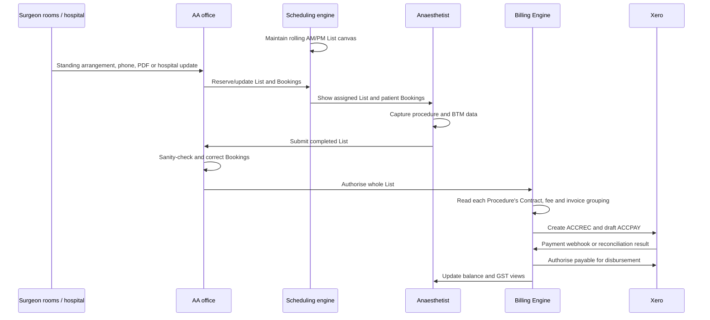

# Workflows and Handoffs

## End-to-end business flow



## The two kinds of state

Do not confuse these in the demo.

### Operational List status

Examples:

- Private
- Public
- Pre-op assessment
- Holiday
- Unavailable
- Free

These describe what the half-day List is being used for.

### Approval lifecycle

```text
ACTIVE -> SUBMITTED -> AUTHORISED
```

| State | Anaesthetist | Office | Integrations | Meaning |
|---|---|---|---|---|
| `ACTIVE` | View and edit | View and edit | May update | Work is still being prepared |
| `SUBMITTED` | View and edit, own, until authorised | View and edit | Do not apply updates | Anaesthetist has handed the whole List to office; the last change stands |
| `AUTHORISED` | Locked | Locked | Do not apply updates | Office has approved it for billing |

A List's state is `DRAFT` (a Draft List, no anaesthetist yet), `ACTIVE`, `SUBMITTED` or `AUTHORISED`; a
session's availability is separate.

There is no `RETURNED` state.

## Workflow 0: create and maintain the schedule canvas

**Primary actor:** Scheduling engine, configured by AA office

**Prototype readiness:** Ready

### Trigger

- The schedule horizon (a setting, four months today) advances or is changed.
- A new anaesthetist is added with a start date, or an anaesthetist is switched active or inactive.
- A recurring booking or hospital holiday changes.

### Steps

1. The system ensures every active anaesthetist has an AM and a PM session for every day from their
   start date to the end of the rolling horizon. Every new session starts Free.
2. The anaesthetist's calendar (leave, unavailability and their repeating days off) is painted onto
   the session's status; nothing is reconciled, because the calendar sets the session's status directly.
   The statuses are a list in master data (Free, On holiday, Unavailable to start), next to the fixed
   List types.
3. Recurring bookings (the surgeons' standing arrangements) then project their Lists, empty, into
   free sessions, after the anaesthetist's calendar: a session already closed is not painted: a recurring booking that lands on a day the anaesthetist has
   already blocked out becomes a Draft List for the office, since the calendar is painted first. A change to a recurring booking reapplies at once through "Apply to canvas
   now", from tomorrow to the horizon's far end, never touching a List with Bookings or office edits.
4. The displayed status is the List's kind when a List is in the session, the session's status
   otherwise: one derivation, so free, unavailable, holiday and booked show the same in all apps and
   the finders, including after a phone booking.
5. Conflicts (a closed hospital, or a List in a session marked unavailable) are surfaced without
   deleting the List; they clear when the clash goes or the office clears them.

### Handoff

The office receives a stable schedule on which it can paint assignments and patient Bookings.

### Master data the office keeps

In Admin, the office also maintains surgeons (each keyed on their HPI CPN and holding one or more
specialties), surgeons' rooms, surgeon groups, hospital contact emails, AA's list of specialties, its
funding tags (SXAP, HNZ, ACC, in the order they are offered), and its private pairing preferences and
anaesthetist priority tiers.
A surgeons' room's email and phone are optional (a room may hold none); a surgeon belongs to one or more
rooms, the first the main room; and each room holds its practice manager and PA contacts (name, email,
role), for the whole room or named for one surgeon (provisional, OQ-127).
The surgeon update email (Phase 35) will go to the main room's email when one is held, otherwise to
nothing (the office types one), with the surgeon's other rooms offered; never to a contact.
Anaesthetists never see preferences or tiers, and an anaesthetist handing on their own List gets no
warning.

### Demo point

Open the Admin Day View and show the repeated AM/PM rhythm, including one full-day booking represented
by two adjacent Lists. Explain that the office manages exceptions rather than manually inventing every
session.

### Source

- RFP: `Schedule Management - Candidate Architecture`
- RFP: `Supporting / Master Data`
- Prototype: `D1`, `D2`, `D5`

## Workflow 1: reserve a List and populate patient Bookings

**Primary actors:** AA scheduling coordinator, surgeon rooms, hospital/PAS

**Prototype readiness:** Ready. Manual phone booking, mobile and web manual Booking creation, and the
HL7/FHIR and surgeon-PDF ingestion paths (Phase 11) are all built.

### Triggers

- A recurring booking creates the standing pairing.
- A surgeon's room calls AA for an ad-hoc List.
- A hospital sends a new booking or update.
- A surgeon's room emails a PDF List.
- The anaesthetist finds a patient missing on the day.

### Main path

1. The office selects a suitable AM or PM List.
2. The List is assigned a hospital and surgeon.
3. Patient appointments are represented as time-ordered Bookings inside the List.
4. Each Booking points to a patient and contains one or more Procedures.
5. Later messages or office actions can add, reschedule, modify, move or soft-cancel a Booking while the
   List remains `ACTIVE`. Each Booking holds its procedure text as received from each channel; when the
   hospital's text arrives it replaces the surgeon's rooms' text, and the original stays in the
   Booking's history.
6. Every change writes `lastModifiedBy/At` and append-only audit history.

### Manual fallback paths

- **Phone advice:** Kirsty creates the booking in Admin, typing the procedure as she was told it
  (kept exactly as typed, Told by Phone or Email).
- **No anaesthetist yet:** a request with no anaesthetist yet becomes a Draft List, which can take
  Bookings before it is assigned.
- **Mobile/web manual Booking:** Dr Souter enters the missing Booking, with the procedure as written on
  the hospital's list (kept exactly as typed) and, if she knows it, its Contract on the step rail; otherwise it waits on the office's Needs an invoice destination list.
- **Photo of the booking card:** Future Work (US-02.4.4); a badged Future-scope demo on the mobile List.
- **PDF:** the office reviews extracted rows, corrects a mistyped NHI, and ingests them (deduped by
  NHI, so a re-ingest updates rather than duplicates).

### Handoff

The populated List becomes visible to the assigned anaesthetist on mobile and web.

### Key distinction

A hospital or surgeon supplies booking information; they are not shown as logged-in users of the
prototype.

### Source

- RFP: `Card`
- RFP: `Manual Processing`
- RFP: `Automated Processing`
- Prototype: `D3`, `M7`, `A2`, `I1` to `I4`

## Workflow 2: plan the day and manage late changes

**Primary actor:** AA scheduling coordinator

**Prototype readiness:** Ready

### Trigger

A hospital, surgeon, patient or anaesthetist reports a change.

### Steps

1. Kirsty opens the Admin Day View.
2. She locates the relevant List by anaesthetist, time, hospital and status colour.
3. She opens the List drawer and its Bookings.
4. For a routine patient reschedule, she moves one Booking to a different List.
5. For an incorrect assignment, she changes hospital, surgeon or actual start/end time.
6. For a cancellation, she records a reason and soft-cancels the Booking.
7. Cancelled Bookings remain visible for history but do not block submission or enter billing.
8. She can add an internal day note for colleagues.
9. She plans the day from the Draft Lists rail card and band, soonest first. The assign picker is
   grouped and tier-ordered, and every List block shows its booking count.

### Handoff

The updated List and Bookings are immediately visible in Dr Souter's mobile and web views while the List
is `ACTIVE`.

### Demo point

Show a single Booking move and explain that it is different from reassigning an entire List.

### Source

- RFP: `Card`
- RFP: `Key Design Principles`
- Prototype: `A1`, `A2`, `D3`

## Workflow 3: find cover: the anaesthetist's own move, or the office's reassignment

**Primary actors:** Anaesthetist and AA scheduling coordinator

**Prototype readiness:** Ready (US-01.4.3: the anaesthetist's own move; US-01.4.1: the office's
reassignment; US-01.4.7 and US-01.4.6: the single-Booking move and the doer rule, Phase 32a)

### Trigger

An anaesthetist becomes unavailable or needs cover at short notice.

### Steps

1. Dr Souter keeps her availability in her calendar (mobile or web): days off ahead, repeating days
   off, one occurrence changed or deleted.
2. She moves one of her Lists to a free colleague or returns it to the office, also when she marks a
   booked session off: the app asks "Return to the office" or "Hand on to a colleague" first, so no
   List is left with her, and then what her session becomes (the status she is setting, or Free).
   It happens at once: nobody accepts and the office does not confirm.
3. The colleagues offered are those free that session, in name order, by availability alone. She
   sees no preference, tier or warning.
4. A List she returns goes back to the office as a Draft List with its hospital, surgeon and Bookings;
   one she hands on moves with every Booking and its history, exactly as the office's reassignment.
   Nothing about billing or prepayment is recalculated.
4a. When it is one case, not the whole List, she moves that Booking from its Booking screen ("Move to
   a colleague"): a colleague free that session, found by typing a name or from the free list, takes
   it as a new List of theirs in that session, never added to an existing List. A colleague on leave
   is offered only once they set that session available themselves. Telling the office is a tick she
   may leave off. This is also the doer rule: whoever submits a List did every procedure on it, so a
   Booking a colleague does moves to a new List of theirs before the procedure, and its payable
   follows. A prepaid Booking's payable stays the AA Holding account: the new anaesthetist claims the
   prepaid amount and nothing is recalculated.
5. When nobody has arranged cover, Kirsty receives the phone call and records the sickness on the
   Day view (Change status). Unavailability is never a conflict: the same "Where does this List go?"
   step asks her to return the List to the office (a Draft List) or hand it to a colleague there and
   then. The Conflicts screen covers hospital closures only.
6. She views the anaesthetists free at the required AM/PM granularity, in priority-tier order and
   preferred pairing first within a tier, with any not-preferred pairing grouped apart and warned
   (never blocked), and assigns or reassigns the List. A colleague marked unavailable shows but cannot
   be picked: the session is made available first, with that anaesthetist's agreement.
7. Whoever moves the List, the anaesthetist or the office, chooses what the vacated session becomes:
   Free or Unavailable (OQ-84, answered).
8. Every move and reassignment is audited.
9. An anaesthetist unsure about a Booking or List uses **Alert the office** with a note. It waits in
   the office's notifications, with the note, until someone there ticks it resolved; submitting is not
   affected.
10. An emergency or late case after the PM session: Kirsty opens an **out-of-hours session** from the
   anaesthetist's row on the Day view (any day from today, the same evening included; one a day; 18:00 to
   21:00 by default) and puts a List in it, a new one or a Draft List waiting for that evening. From then
   on it is a session like AM and PM: the anaesthetist marks it available or not, the finders offer it
   while it is free, and its List moves, returns and bills like any other. An empty one can be closed.

### Handoff

Each anaesthetist's own List move posts to the office's shared notifications (Admin Day's rail and the
Notifications page), the same for the whole office; a single Booking posts there only when she ticks
"Tell the office". The colleague sees the List or the Booking with a "Moved to you" notice either way.
The office then assigns any Draft List returned to it. A notice, or an alert, stays active until an
admin ticks it resolved, which hides it for the whole office; "Show resolved" brings it back with who
resolved it and when. Nothing expires.

### Requirement

US-01.4.1 settles the mechanism: change the List's owner, consume the covering anaesthetist's free
session, and return the vacated session to available (or mark it unavailable if more appropriate).
OQ-84 is answered: whoever moves the List chooses Free or Unavailable for the vacated session. OQ-81
part 3 is answered: sickness forces a return or a hand-on, never a conflict. Alerts to the office are
US-03.6.3. Out-of-hours sessions are US-01.1.6 (the office opens a third, evening session; D84 answered 10 November).

### What not to say

There is no claiming of open shifts, no acceptance step, no preference warning for the anaesthetist,
no prepayment recalculation or payee change on a move, no moving a Booking into a colleague's existing
List, no List left on an unavailable session (never "flag the sickness"), and notifications are not
tasks: a notice is ticked resolved, not done.

### Source

- RFP: `List`
- RFP: `Key Design Principles`, item 8
- RFP: `Open Questions`
- Prototype: `D7`, `M8`, `M9`, `A3`

## Workflow 4: capture BTM and complete a Booking

**Primary actor:** Anaesthetist

**Prototype readiness:** Ready

### Trigger

The procedure has occurred and the anaesthetist needs to record the clinical billing inputs.

### Steps

1. Dr Souter opens her List and selects the patient Booking.
2. She confirms patient, operation, hospital and surgeon context.
3. What each Procedure asks for follows its Contract's pricing kind. On an RVG price (No contract ·
   RVG and the RVG rate and discount kinds) the RVG code, start and finish times and the modifiers step
   are required, each with a **Required** caption. On a fixed or open price there are no times, units or
   modifiers, and the RVG code is optional, "for reference". She picks an RVG code by typing; on a
   ranged group she may change the starting figure, and an out-of-range value raises an office warning.
4. On an RVG price she records the start and finish times.
5. The system calculates tiered Time units:
   - 1 unit per 15 minutes for the first two hours;
   - 1 unit per 10 minutes after two hours.
6. The age modifier, and any modifier the procedure's base units include (P1 on Neurosurgery and
   Spine codes), are pre-applied and removable; she claims any other modifier that applies, ASA
   included, each with a short explanation. If none applies she taps **None apply** (then **No
   modifiers claimed · Change**); a pre-applied modifier alone does not answer the step.
7. An included modifier shows at 0 units and cannot be added twice.
8. Modifiers stack with no limit, each with its own reason; the same modifier is never added twice.
9. Her Booking shows what the price comes to: a quiet **Price** card in the capture ("4 units x $26.50
   = $106.00") and the Booking total above Mark complete (the phone's dock strip, the web rail panel),
   rising as she claims a modifier or adds time, with no prompt. The office sees the full billing total
   on the Admin Booking.
10. She may add a fixed billing line, and type a price where the Contract allows it, no reason needed
    (an RVG Contract that allows it, or the amount on No contract · Fixed price). Elsewhere the figures
    are read-only: "Set by {Contract}. To use a different price, change the Contract or alert the
    office." The office can change any price until AUTHORISED, shown at review beside the computed
    price.
11. She selects Mark complete. It checks exactly three things: every Procedure has a Contract; on an
    RVG price, the RVG detail (code, start and finish, the modifiers step answered); and a price, not
    **Needs a price**. It does not check the RVG code on a fixed price, the payer's contact, the approval
    number or out-of-range base units. If anything required is missing, the Booking scrolls to and
    focuses the first incomplete control while showing its inline validation message. She resolves each
    item and marks the Booking complete.
12. Something only the office can fix shows a pointer to **Alert the office**; she sends it there. Submit
    still needs every Booking complete.

### Multiple Procedures

- One Booking can have several Procedures, and exactly one of them is the primary: listed first
  everywhere, with a neutral **Primary** pill when there are two or more. The first Procedure entered is
  the primary until someone changes it.
- **Make primary** on any additional Procedure (a bottom sheet on the phone, a dialog on desktop: "Make
  this the primary procedure?") moves the primary. Anyone with edit rights can use it: the anaesthetist
  on her own List until it is authorised (she amends a completed Booking first), the office on `ACTIVE`
  and `SUBMITTED` Lists, a hospital feed on `ACTIVE` Lists only. Removing the primary is refused, and
  nothing is ever promoted silently.
- The multi-procedure rule, one rule system-wide: base units on the primary only (from its RVG group or
  the value recorded); time units on every Procedure from its own times; modifiers recorded once for the
  Booking, on the primary. At 4 modifier units or fewer they all stay on the primary; above 4 they split
  equally across the RVG-priced Procedures, the remainder to the primary (7 over 3 = 3 / 2 / 2), whichever
  Contracts they are on.
- A fixed or open price keeps its price and takes no share. On a mixed Booking whose primary is a fixed
  price, no base units are billed (provisional, OQ-132).
- AA confirmed the rule on 19 October (OQ-90; the 3 / 2 / 2 split was agreed on 7 October). Which
  Procedure should be primary is not settled (Vanessa: the most expensive; Greg: the first in the list),
  so the first stays primary until someone changes it.
- Brian Holt's Booking on Dr Souter's Mon 20 AM List is the seeded two-procedure example; Graeme
  Tullett's on her Mon 13 Jul AM List (Forte Health, in the Review queue) is the three-procedure
  one, split 3 / 2 / 2.

### Handoff

When every active Booking in the List is complete, the List becomes eligible for submission.

### Demo point

Use Margaret Ellison. She is the one incomplete Booking on Dr Souter's Southern Cross PM List; on her
RVG price she taps **None apply** before Mark complete. On Dr Souter's Mon 10 Aug PM List, Miriam
Holloway (Merivale "Facelift plus 1 add on", a fixed price) completes with no times, and Graham Pulley
(No contract · Fixed price) shows **Needs a price** and refuses Mark complete until an amount is typed.

### Source

- RFP: `The Big Picture: What Are We Actually Calculating?`
- RFP: `How Anaesthesia Associates Calculates Invoices`
- RFP: `Split Billing`
- Prototype: `M3` to `M6`, `B3` to `B5`

## Workflow 5: submit the whole List and perform office review

**Primary actors:** Anaesthetist, then billing review officer

**Prototype readiness:** Ready

### Trigger

Every active Booking in the List has been marked complete.

### Steps

1. Dr Souter chooses **Mark list completed**.
2. The app confirms that every Booking is complete and valid.
3. She selects **Submit to office**.
4. A brief **List submitted** success moment confirms that it was sent to the office for review.
5. The List becomes `SUBMITTED`.
6. Dr Souter still sees it on her main view, less prominent ("Done · unbilled"), and can still change
   it until the office authorises it, when it leaves her main view and is found by search. Any change
   she makes is audited and Review shows "Changed since submitted"; a Booking she reopens must be
   completed again before the office can authorise.
7. Kirsty opens the Review queue.
8. She checks the full set of Bookings, including:
   - each Procedure's stack: procedure text, Contract with who is invoiced, and RVG code, with that
     Procedure's flags under it;
   - the payer, and the insurer or funder with its approval number (**Change** opens the Admin Booking);
   - an open alert from the anaesthetist (a Resolve tick) and open warnings (Clear);
   - the **Changed** marker for edits since submit;
   - flags, which never block authorise: **Changed by Dr X: was** the old Contract, **Price typed: $X
     (computed $Y)**, **Contract not offered on this List** (for example after a move to another
     surgeon's List), **Needs an invoice destination**, **Not marked completed**, **Email or postal
     address needed** and manual B/T/M notes. A Disabled Contract raises no flag.
   - the one blocker: a Procedure that still **Needs a price**. **Authorise for billing** stays
     disabled, naming the Procedure with an **Open** link, until a price is typed (Dr Chen's Tue 14 Jul
     AM review List shows it on Hemi Walker's No contract · Fixed price Booking).
9. She approves (**Approve**) or corrects (**Correct**, which opens the Booking's rail) each Contract
   change the anaesthetist made, or uses **Approve all N Contract changes**; she checks any typed price
   against the computed one. If something is wrong, Kirsty phones for clarification and corrects it in
   the office.
10. She may log a phone note.
11. She selects **Authorise for billing**. Authorising approves any Contract change still waiting; the
    confirm says how many. The anaesthetist sees **Awaiting office approval** under the Billing card
    until then, and **Approved by the office** with the time after. Authorise is refused while any
    Procedure needs a price.
12. The List becomes `AUTHORISED`; every Booking is immutable. In the same step each Booking's lock is
    written: each Procedure's Contract and its settings, the price range in force, the units, rate and
    discount, the price, who is billed (with the patient and payer details as they stood), the split,
    and who is paid, fixed as the List's anaesthetist at that moment. The Booking shows **Contract
    locked at authorise**.

### Handoff

One List-authorised event hands the whole List, with each Booking's lock, to the Billing Engine.

### Key rule

Review is a human sanity check, not a system gate that automatically rejects every advisory. There is
no send-back workflow.

### Source

- RFP: `Card Immutability and the List Approval Process`
- RFP: `Proposed Design decisions`
- Prototype: `D6`, `M5`, `M10`, `A4`

## Workflow 5a: looking back

The anaesthetist's main view starts at today: upcoming work, with any earlier Lists not yet
authorised a scroll back. Once the office authorises a List it leaves the main view and its invoices
show in her balances at once. To find older work she searches by patient name (any part of it) or NHI,
or picks a date and drills into that day's Lists, Bookings and Procedures; an authorised List opens
read only with its invoices. Search covers her own Bookings only. Catch-up Phase 38a seeds January to
March 2026 for Dr Souter so there is history to find (Fri 13 Mar 2026 is the pinned day).

## Workflow 6: calculate and issue invoices

**Primary actor:** Billing Engine automation, monitored by office

**Prototype readiness:** Ready; Phase 08 is recorded complete

### Trigger

The List reaches `AUTHORISED`.

### Steps

1. The Billing Engine iterates each active Booking and reads only its lock, written at authorise. It
   never looks up a Contract, a payer, a rate per unit or an RVG group afresh, and never swaps in a default
   or another Contract; a Booking with no lock fails on its own.
2. Each Procedure's locked Contract is the one it was authorised with; a Contract edit, Disable or new
   price range after authorise changes nothing here.
3. Each Procedure's Contract (as locked) says who is billed: its holder Party when the Contract bills its holder
   (a hospital, an insurer, a surgeon group), otherwise the Procedure's payer: the patient,
   or whoever the Paid by sheet names (a parent, a guardian, a benefactor, a family trust). Procedures
   sharing a payer share one invoice; payers are never matched on name or email.
   A surgeon's fixed price, No contract · RVG, No contract · Fixed price, an anaesthetist's own price
   list and every prepaid Contract bill the payer. The Booking's insurer or funder never decides it.
4. It takes each Procedure's price from the lock (units, rate and discount, or the range in force on
   the procedure date, as locked).
5. It applies the multi-procedure rule to RVG-priced Procedures. A Procedure's fee split on the Booking (the **Split**
   button in its Billing card's Paid by, typed by the office or the anaesthetist before authorise: each party's
   share in $ or %, one party taking the rest) bills each party its share.
6. It makes one invoice per billable party per Booking, and one per share where a fee is split.
7. It creates one or more invoice documents, each in the name of the payee locked at authorise as
   supplier with their GST number, and AA as agent (the agent wording is provisional, OQ-29). The
   invoice document prints from the lock (its **Locked record** card on the invoice rail), so it can be
   regenerated exactly (**Regenerate from locked data**: identical), whatever has changed since.
8. The layout comes from the Contract: the holder's when it bills its holder (invoice descriptions, the
   BTM breakdown, a cross-match strip and the Contract's holder reference code as "Your reference"),
   otherwise the patient's. Prices are held GST exclusive, with GST at the foot.
9. The run sends or queues each invoice by the Party's delivery: emailed, or **To post** for a payer
   with only a postal address (provisional, OQ-122); a payer with neither raises **No invoice
   address** until the office types one and sends. The office resends only (**Resend** on the
   invoice rail); there is no separate email step.
10. Completion of the billing run stamps `billedAt` and removes the List from the anaesthetist's List
    views.

### Handoff

The Billing Engine sends the invoice values to Xero and expects a matched collection/payable pair. Each
ACCPAY carries one buyer-created tax invoice per invoice, the same value, naming the anaesthetist as
supplier and AA as agent (provisional wording, OQ-29).

### RFP ambiguity

Multi-procedure invoice count: the RFP contains tension between same-counterparty grouping and its
`Split Billing` section's statement that multiple procedures in one episode (and a partly covered
procedure) need two separate invoices. The prototype
groups invoices by billable party, one invoice per billable party per Booking, so a multi-procedure
Booking with one payer is one invoice and one BCTI. Two invoices arise only where a Procedure's fee is
split on the Booking.

### Source

- RFP: `Billing Engine Integration Point`
- RFP: `The Card as the Billing Anchor`
- RFP: `Xero Integration - Candidate Design`
- Prototype: `B1` to `B6`

## Workflow 7: collect money and disburse it to the anaesthetist

**Primary actors:** Xero, Billing Engine, finance/reconciliation officer

**Prototype readiness:** Ready (Phase 10)

### Trigger

An invoice has been generated.

### Steps

1. The Billing Engine creates a matched Xero pair:
   - `ACCREC`: what the hospital, insurer or patient owes AA;
   - `ACCPAY`: the full amount AA owes the anaesthetist, equal to the `ACCREC`. AA's own fee is
     invoiced to the anaesthetist separately and never deducted here.
   Both records carry the InvoiceNumber (the `ACCPAY`'s ends `-P`) and the case Reference.
2. `ACCPAY` begins in `DRAFT`.
3. Payment lands in the AA account.
4. A Xero webhook notifies the Billing Engine; a daily poll is the safety net.
5. The matching payable becomes `AUTHORISED` for exactly the amount received, including a partial
   payment; the rest stays outstanding on the invoice.
6. AA runs payables and disburses the authorised amount to the anaesthetist.
7. The system tracks **paid into AA** and **disbursed to anaesthetist** separately.
8. The anaesthetist's flat balance view, persistent payment history and GST activity update from the
   Billing Engine's mirror, not from direct Xero queries.
9. Eligible individual Xero contacts may later be archived to manage active-contact volume. These
   patient and payer contacts carry only the hidden internal ID: no name, NHI or other personal
   information.

### Handoff

The financial episode closes when the receipt and disbursement states are both complete.

### Demo point

For S3, use the selected invoice's combined **Simulate payment and payout** shortcut, then follow its
direct link to the highlighted Web Payments row. Explain that the shortcut combines the two demo
events while the underlying receipt and disbursement states remain separate. For a technical
audience, use a partial payment followed by two payables runs to prove no double payment.

### Source

- RFP: `Payments - Where the Money Lands`
- RFP: `Xero Integration - Candidate Design`
- RFP: `Mobile App Consumption Model`
- Appendix 2
- Prototype: `X1` to `X5`

## Workflow 7a: monthly AA fee invoicing

**Primary actors:** office finance, Billing Engine, Xero, the anaesthetist

### Trigger

Month end: the office runs the month's fee invoices (in the prototype, **Run monthly fee invoices** on
Admin → Billing → AA fee invoices, or the "Run scheduled month-end fee run" demo action).

### Steps

1. The office maintains **AA fee settings**: several fixed items and a charge per BCTI, every amount held
   excluding GST. A change applies from the next run; raised fee invoices keep their settings.
2. For the chosen month the Billing Engine counts each anaesthetist's BCTIs: one per receivable invoice,
   once, against the anaesthetist who did the procedure, in the month its invoice is paid in full.
3. It raises one **AA-FEE** invoice to each active anaesthetist: the fixed items plus the charge per BCTI
   times the count, with GST worked out at the foot. Each is its own case with a Xero ACCREC against the
   anaesthetist's existing contact and no ACCPAY.
4. The anaesthetist pays it by bank transfer into AA's own account. It is never deducted from a payment
   to them (trust law), and it is not their income, so it never reaches their GST activity.
5. Admin and the web **Accounts → AA fees** tab show each fee invoice paid or unpaid.

### Demo point

S3 Beat 4: Seed a month of BCTIs, then Run monthly fee invoices, gives Dr Rutherford $500 + $5 x 40 =
$700.00 before GST ($805.00 with GST). The fixed schedule, the paid-only count and BCTI granularity are
with AA's accountant.

## Workflow 8: handle failures, late additions and compliance

**Primary actors:** Office exception operator, Billing Engine and integration automation

**Prototype readiness:** Ready. Audit, NHI validation, master controls and the full
exception/payment/integration workflows (Phases 09 to 11) are built.

### Cases

#### Pre-payment

- A patient-funded Procedure may require full or split pre-payment.
- Payment is required before the procedure.
- An unpaid prepayment never blocks: it is a strong before-procedure warning on the Booking in both
  apps, so the anaesthetist sees it before surgery starts (AA's decision, OQ-57). There is no override.
- The office raises the pre-procedure invoice; once it is paid the warning goes.
- Exact timing relative to the normal `AUTHORISED` billing trigger is a prototype reading.

#### Warnings and the to-do list

- One warning routine checks each Booking and raises warnings, each with its own text, a kind
  (before or after the procedure) and a strength (mild or strong). A Booking can carry several.
- A warning never blocks: saving, completing, submitting and authorising all go through, and there
  is no confirm step at submit.
- The anaesthetist sees a small triangle on the Booking's row and the warning at the top of the
  Booking when they open it. The office sees the same triangle, the Day view outline down to the
  Booking, and the **To-do** card on the Admin dashboard.
- The office clears a warning from the To-do card once it is dealt with (a mild one optionally); the
  clearance is recorded and audited, and the Booking shows who cleared it and when.
- The to-do list holds warnings that need action only. Notices that need none go to the shared
  notification pool when it is built.
- The rules today: the unpaid prepayment (strong), base units outside the range, a child as the payer
  on the Booking (catch-up Phase 21) and an insurer named with no approval number (catch-up Phase 21,
  NIB or Southern Cross Health Society only, never ACC or Health NZ), all mild but the first. Later
  rules add a prepaid procedure with no price and a paying patient with a balance. There is no warning
  for an insurer named without an insurer Contract.

#### Booking setup: the payer and the insurer or funder (catch-up Phases 21 and 22a)

- Every Procedure names a payer: the patient, prefilled from the patient record, with no step
  taken. The office and the anaesthetist change it in **Paid by** (a bottom sheet on the phone, a
  dialog on web) until the List is AUTHORISED; the change is offered to the Booking's other
  Procedures with the same payer, and a Procedure added later copies the payer the others share.
  One invoice and one prepayment invoice per payer.
- A billed payer needs an email or an NZ Post postal address. The Paid by sheet asks; Review flags
  **Email or postal address needed**; nothing blocks.
- The Booking's **Insurer or funder** row (empty state "None") holds the insurer or funder (a Party) and the approval number,
  from the source data where an intake path carries them (the hospital matching screen, Phase 33) or
  recorded by the office; the anaesthetist sees the number and can enter it on the day. The funder
  marks one path **Suggested** on the step rail and never narrows it.

#### Profile and bank details (catch-up Phase 26)

- Each anaesthetist's profile holds their rate per unit (the dollar value of one RVG unit), phone,
  email, registration number, HPI CPN and bank account.
- The anaesthetist sees it on the mobile More tab (the Profile card) and on the web Profile page,
  opened from their name and avatar in the top nav. They edit only their own rate per unit
  (**Change**, a bottom sheet on the phone): the new rate applies to Bookings on Lists not yet
  authorised, and authorised Lists keep their locked rate.
- Contact details, the HPI CPN and the bank details are held by the office and show read-only with a
  lock; the bank number is always masked (Dr Souter's 99-0101-•••••21-00).
- The office keeps every profile on the Admin anaesthetist record (Master data, Anaesthetists, open a
  row: **Edit details**) and in the Anaesthetists table, the GST number with it. The HPI CPN and bank
  details are mandatory: an add or edit without either is refused. Every change is audited, the bank
  number masked in the audit too.
- Bank details are display-only master data. The payment to the anaesthetist is made in Xero; the app
  never pays from them.

#### Post-operative addition

- A later pain consult or ward review can create another charge.
- The original authorised Booking stays immutable.
- The prototype adds a linked addendum Booking that follows its own submit, authorise and bill cycle.

#### Billing failure

- The run prices only from the lock, so a Contract edit cannot fail it; what can still fail is outside
  the lock, such as the Xero hand-off.
- Failure is per Booking and a List never fails as a whole (OQ-05, answered): the failed Booking is held
  back (a split Booking's invoices with it) while the rest of the List bills.
- The office retries once from the Billing monitor: **Resolve & retry** re-sends a hand-off, **Retry**
  rebuilds from the lock. The fix never edits a Contract or any other master; a wrong price after
  invoicing is corrected by a credit note and rebill (a later build).

#### Integration failure

- A malformed message retries, then moves to manual intervention without being lost.
- A duplicate message is an idempotent no-op.
- A message for a submitted or authorised target is not applied automatically.

#### Compliance

- All changes, including automated ones, are audited.
- Both old and new NHI formats are validated.
- No NHI or other personal information enters Xero, patient names included (confirmed with AA).

## Workflow-to-prototype readiness

| Workflow | Ready now | Built in |
|---|---:|---|
| Fixed canvas and recurring bookings | Yes | Phase 02 |
| Manual phone booking and office changes | Yes | Phase 06 |
| Mobile/web manual Booking creation | Yes | Phases 03 to 05 |
| Anaesthetist's own List move, the notification pool, and office List reassignment | Yes | Phases 28, 32 |
| Single-Booking moves and the doer rule | Yes | Phase 32a |
| BTM capture, completion and submit | Yes | Phase 04 |
| Office review and authorisation | Yes | Phase 07 |
| Invoice calculation and documents | Yes | Phase 08 |
| Pre-payment, addendum, billing monitor/retry | Yes | Phase 09 |
| Contract locked at authorise, invoices from the lock, Contract history | Yes | Catch-up Phase 25 |
| Xero pairs, payment, balances and disbursement | Yes | Phase 10 |
| Anaesthetist profile, rate per unit and bank details | Yes | Catch-up Phase 26 |
| AA's monthly fee invoices (settings, run, AA fees tab) | Yes | Catch-up Phase 16 |
| HL7/FHIR/PDF ingestion and monitoring | Yes | Phase 11 |
| Scenario jump controls and guided script | Yes | Phase 12 |
| Mobile atmospheric gradient (visual only) | Yes | Phase 13 |
