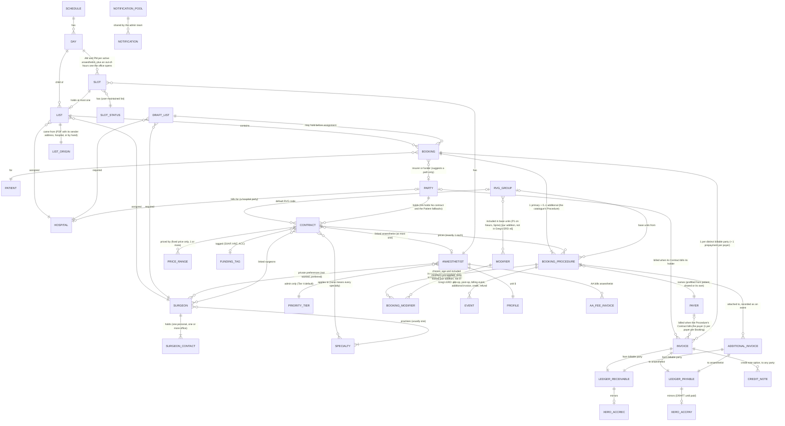

# AA Future-State Domain Model

Companion to the requirements catalogue in this folder. This is the narrative and structural reading of the future state
as understood on 2026-09-24, updated 2026-10-02, 2026-10-07, 2026-10-18, 2026-10-19, 2026-10-28, 2026-11-04, 2026-11-05 and 2026-11-17, built from the RFP, the six future-state diagrams, the meeting notes
with AA's lead administrator, the Q&A of 2026-09-24, the meeting with Greg (RFP author) and the Requirements Board
answers of 2026-10-01, the AA meeting with Greg of 2026-10-02 and its question answers (OQ-62 to OQ-75), the afternoon AA requirements review with Greg of 2026-10-02 (Notes 2026-10-02 · AA requirements review with Greg), the directors' answers of 2026-10-06 (Notes 2026-10-06 · AA directors meeting), the AA meeting with Greg and the AA client meeting of 2026-10-07 (Notes 2026-10-07 · AA meeting with Greg; Notes 2026-10-07 · AA client meeting), the AA meetings with Greg of 2026-10-14, 2026-10-16 and 2026-10-19 (Notes 2026-10-14 · AA meeting with Greg; Notes 2026-10-16 · AA meeting with Greg; Notes 2026-10-19 · AA meeting with Greg) and the board edits Donald made during the second, the AA meeting with Ben and Vanessa of 2026-10-27 (Notes 2026-10-27 · AA meeting with Ben and Vanessa), the AA meeting with Greg of 2026-10-28 (Notes 2026-10-28 · AA meeting with Greg) with the board edits Donald made during it, Donald's working decisions of 2026-11-04 for the build, not yet seen by Greg or AA (Notes 2026-11-04 · Donald working decisions), the AA meeting with Ben and Vanessa of 2026-11-05 over the contract picker mock (Meeting 2026-11-05 · Ben and Vanessa) and the decisions on the Contract model Donald made after it (Donald's decisions 2026-11-05), which are his and not yet agreed by Greg or AA beyond what the meeting shows, Donald's decision of 2026-11-17 to hold the payer on each Procedure, not yet confirmed by AA (Notes 2026-11-17 · Donald payer per procedure; OQ-140), Greg's pricing model executive summary v6, now retired (Notes 2026-10-16 · Pricing model documents v6 #10), and the real fee schedules in `../../docs/discovery-reference/Data files/`. Where this document and the RFP disagree, this document wins.

The Contract structure here (parties, Contracts with their settings and price ranges, specialties and funding tags, and the Procedure priced under exactly one Contract) follows Donald's decisions of 2026-11-05, made after that day's meeting with Ben and Vanessa (Meeting 2026-11-05 · Ben and Vanessa; Donald's decisions 2026-11-05). It replaces the earlier reading of the technical design v6 and its ERD, Greg's proposal, and of the draft v4: there are no contract lines, Contract versions, line keys, staged schedule changes or schedule uploads. Those documents remain sources for facts about the business (who pays, prepayment, the ledger), not for the structure. The model is deliberately prototype-grade: structured just enough for booking setup, the anaesthetist's capture, the billing engine, invoicing, prepayment, the AA Holding account and office review to work. Where the decisions leave a gap, this document gives our reading and says so. The requirements themselves stay in plain words: field names are given for orientation only, not as requirements. How a Procedure is priced is in §3.

## 1. What changed since the RFP

| RFP said | Future state says | Why |
| --- | --- | --- |
| Card | **Booking**. "Card" now only means the physical hospital or surgeon card. | Notes; Q&A #11 |
| Billing Engine | **Billing/Invoice Engine** | Q&A #11 |
| List states DRAFT → SUBMITTED → AUTHORISED, DRAFT being an assigned List still being worked | **DRAFT → ACTIVE → SUBMITTED → AUTHORISED**: DRAFT is a Draft List with no anaesthetist; ACTIVE is a List with all five of its pairing (anaesthetist, surgeon, hospital, day, session), where the anaesthetist completes Bookings and submits | Notes 2026-10-07 · List lifecycle states #1 to #3 |
| Each Procedure has a *billing route* (Hospital / Billable Party / Insurer), set explicitly, plus a separately looked-up *governing Contract* of type 1, 2 or 3 | Each Procedure selects exactly **one Contract**. The Contract defines rules and pricing, and decides who is invoiced: each Contract is held by a **party** (a hospital, an insurer or funder, a surgeon or surgeon group, an anaesthetist, or AA, which holds the built-in No contract · RVG) and has its own setting, **bills its holder** or **bills the payer** named on the Procedure (OQ-67). There is no separate route step. The words "first party" and "third party" are dropped, since the cases are not truly that. | Diagrams 3 and 7; Q&A #2, #3; Notes 2026-09-29 #24; Notes 2026-10-02 #8; Notes 2026-10-07 · AA meeting with Greg #51; Notes 2026-10-07 · Pricing model documents #11, #22; Notes 2026-10-14 · AA meeting with Greg #10, #30; Notes 2026-10-16 · Pricing model documents v6 #22, #24; Donald's decisions 2026-11-05; Notes 2026-11-17 · Donald payer per procedure #1 |
| Counterparty resolved by the engine when the List is AUTHORISED | Contract applied at **booking setup** by admin, and mandatory there: the office's main job is to say where the invoice goes and then pick the Contract, on a **step rail** (where does the invoice go, then the payment type or the hospital's funding tag, then the Contract; see Selection in §2). A Procedure with no Contract shows "Needs an invoice destination", Ben's wording. The anaesthetist may change it; the office sees the change at review. The engine reads the Contract, frozen in the pricing snapshot at AUTHORISED. | Diagram 7; Q&A #4; Notes 2026-10-07 · AA meeting with Greg #55; Notes 2026-10-16 · AA meeting with Greg #39, #48; Notes 2026-11-04 · Donald working decisions #9; Meeting 2026-11-05 · Ben and Vanessa; Donald's decisions 2026-11-05 |
| Secondary procedures in a split-billing episode charge **time units only** | Base units only on the **primary**; time on **every** procedure; modifiers on the primary **unless total modifier units exceed 4**, then split as evenly as possible across all procedures with the remainder to the primary (7 over 3 is 3, 2, 2). No Contract changes this rule (OQ-90). | Notes; Q&A #1; Notes 2026-10-19 · AA meeting with Greg #10 |
| `priceOverride` on the Procedure | **The Contract on the Procedure sets its price.** Each Contract has a **pricing kind**: RVG at the anaesthetist's own unit rate, RVG at the Contract's rate, RVG less the Contract's discount, a fixed price (held in dated price ranges) or an open price (no price of its own; the amount is typed on the Procedure). The Procedure's price follows from it (§3). On a Contract priced from RVG units, the anaesthetist may override the price only where that Contract's setting allows it, a setting AA keeps per Contract, not a global rule (OQ-107); the RVG code, time and modifiers stay recorded and visible beside the override, so a price can later be explained by its RVG (Ben, 5 November). A fixed price never allows the anaesthetist's override (OQ-117), and a prepaid Contract cannot carry the setting (OQ-96). The office can change any price on any Contract until the List is authorised (on a prepaid Procedure, until its prepayment invoice is raised), the way a fixed price is changed without changing the Contract. Rate and discount are settings on the Contract, not values edited on a Procedure: the office changes the price instead (our reading). No reason is needed; every change is audited and flagged at review, and the last change stands: neither side has more authority than the other. On a fixed or open price the form collapses: an RVG code may be recorded for reference only, with no time or modifiers. | Diagram 7; Q&A #3, #6; Notes 2026-10-14 · AA meeting with Greg #23, #24, #39; Notes 2026-10-16 · AA meeting with Greg #10, #54, #55; Notes 2026-10-16 · Pricing model documents v6 #11, #27; Notes 2026-10-19 · AA meeting with Greg #9, #20; Notes 2026-10-28 · AA meeting with Greg #1; Meeting 2026-11-05 · Ben and Vanessa; Donald's decisions 2026-11-05 |
| Xero as accounts receivable with the engine's database as a mirror for the app | The engine's **internal ledger is the system of record**. Xero is an AR and banking service mirroring ledger pairs. Patient history survives Xero contact archiving. | Q&A #9 |
| Payment to anaesthetist implied a fee deducted | **AA's fee is a separate invoice from AA to the anaesthetist**, managed by the system, distinct from any procedure's receivable and payable. A monthly fee invoice run raises one per anaesthetist: fixed charges (possibly several items) plus a charge per BCTI issued to them, set on a settings page; not a percentage cut of the payable. The fixed schedule, whether only paid invoices count and whether the fee nets against payables are open (OQ-60); Greg's view, to confirm with AA's accountant, is that only paid invoices count and the fee is always a separate invoice paid into a separate bank account, never netted. | Q&A #8; Notes 2026-10-01 #1; Notes 2026-10-02 #1 |
| "Self-funded, pre-payment required" as a patient category | **Prepayment is a first-class flow**: triggered when the office picks a Contract flagged as prepaid under Patient › Prepaid (normally an item on the anaesthetist's own price list, or a surgeon's, the Contract linked to that practitioner; or the Prepaid · Fixed price fallback, where the office types the amount), never by a setting on the anaesthetist's profile. A prepaid Contract bills the Procedure's payer and is never priced from RVG units (Donald's decisions 2026-11-05), so OQ-73's holder-billed prepaid Contract can no longer be picked and needs re-answering; prepayment invoice when an admin approves it (an optional workflow step AA can switch off), tracking, alerts. The prepaid amount is the Procedure's price when the prepayment invoice is raised (the price range in force, or the typed amount), which must be above zero: the full amount, never a deposit or a part (OQ-04, OQ-76). A prepaid Contract never allows the anaesthetist's price override (OQ-96); the office can change the price until the prepayment invoice is raised, after which the invoiced amount stands (our reading). The prepayment invoice, and its pair, are generated when an admin approves it (the office picks the prepaid Contract, then approves the invoice where outgoing invoices are approved), and it is then sent with the letter. Each payer receives their own prepayment invoice, where prepaid Procedures on one Booking name different payers, and each payer is locked once their own prepayment invoice is raised. Its pair is a receivable from that payer and a payable to the **AA Holding account**, an accounts payable creditor alongside the anaesthetists, not to the anaesthetist (OQ-80). There is no settlement against a final BTM amount: nothing more is invoiced or credited automatically (see §3). | Diagram 7; Notes; Q&A #5; Notes 2026-10-01 #32, #50; Notes 2026-10-02 #14, #17; Notes 2026-10-06 · AA directors meeting #1, #4, #9; Notes 2026-10-07 · Pricing model documents #1, #35; Notes 2026-10-16 · AA meeting with Greg #20, #22; Notes 2026-10-16 · Pricing model documents v6 #4, #28; Notes 2026-10-19 · AA meeting with Greg #4; Notes 2026-10-28 · AA meeting with Greg #1, #6, #43, #44, #46, #47, #63; Meeting 2026-11-05 · Ben and Vanessa; Donald's decisions 2026-11-05; Notes 2026-11-17 · Donald payer per procedure #1, #5 |
| Hospital HL7 integrations exist but are unreliable | **Two hospitals are integrated with the current system; everything else is manual.** Today the matching screen imports the files of St George's and Southern Cross through an integration (OQ-109). The first release builds both intake sources, each landing on the same review-and-merge screen: the hospital booking downloads, taken however each hospital provides them, and the surgeons' rooms' PDF lists, read and ingested (OQ-108). There is no automatic sync in the first release (OQ-109): automatic sync from those two is Future Work with the other feeds. The screen has no pull buttons, schedules or sync on open, and nothing is applied silently: the office accepts unmatched rows as new and approves the differences on matched Bookings. More hospital feeds, automatic matching and HL7/FHIR are Future Work, and PDFs are still needed alongside them. NHI lookup is in scope. | Q&A #4; Notes 2026-09-29 #13, #14; Notes 2026-10-01 #7; Notes 2026-10-02 · AA requirements review with Greg #34, #35, #65; Notes 2026-11-04 · Donald working decisions #7, #8 |
| Patient master implied | **Patient record keyed on NHI**. Who is billed is set through each Procedure's Contract: its holder, or the **payer named on the Procedure**, prefilled from the patient and changeable to a parent, guardian or other party, such as a benefactor or a family trust (OQ-140). The NHI is mandatory, with no blank, and is the patient identifier throughout: a Booking cannot be saved without one, and an incoming Booking that has none waits at intake until the office adds it (OQ-49); meanwhile a stub stands in its place on its List, seen by the anaesthetist and the office, until the office resolves it, and a stub is not a Booking (OQ-118). Admins see patient outstanding bills and are alerted to patients with outstanding balances: a mild alert under the threshold (90 days from the invoice date, may move), a strong one above it, a mild one for a credit balance, and staff can always wave it through (OQ-41, OQ-74); the anaesthetist sees the alert too, on their List. Demographics and ethnicity are held where supplied, never required. The anaesthetist sees the NHI for Health Connect lookup. | Notes; Q&A #9, #13; Notes 2026-09-29 #10, #26, #35; Notes 2026-10-01 #17, #23, #62; Notes 2026-10-02 #15; Notes 2026-10-07 · Pricing model documents #11; Notes 2026-10-16 · AA meeting with Greg #3; Notes 2026-10-19 · AA meeting with Greg #1; Notes 2026-10-28 · AA meeting with Greg #25, #29, #37; Notes 2026-11-04 · Donald working decisions #1; Notes 2026-11-17 · Donald payer per procedure #1 |
| Office monitoring of the billing flow | Retained, plus **ledger balance tools** (whole ledger, per anaesthetist, per patient) in the Admin App. | Q&A #12 |
| Two Lists per active anaesthetist per day, unassigned until a surgeon and hospital are set | Three distinct things: a **Slot** (a box for the AM or PM session, created and stored per active anaesthetist per day across a rolling schedule, four months ahead in current practice, its length a rarely changed setting; or a third, out-of-hours Slot after the PM session that the office opens for an anaesthetist on a day, at most one a day; defaults to free and has a status from a user-maintained list until a List is put in it, and the List then shows in place of the status), an **active List** (assigned to an anaesthetist, put into a Slot, holds Bookings, follows the one-surgeon, one-hospital rule) and a **Draft List** (a List created with no anaesthetist: its surgeon, hospital, day and session are required; it also arises when an anaesthetist moves a List to the office (including marking its Slot unavailable), and when a recurring booking lands on an unavailable Slot; shown prominently in the Admin App, a major feature for AA staff; only ever assigned by an admin, never offered to anaesthetists to claim, OQ-86). Slots and Lists are both children of the day. This is the logical model; how it is stored is for the developers, and the word "slot" never appears in the UI (OQ-64). | Notes 2026-09-29 #17, #36; Notes 2026-10-01 #9, #13, #15, #20, #42; Notes 2026-10-02 #5, #23, #29, #30; Notes 2026-10-02 · AA requirements review with Greg #1, #20, #61; Notes 2026-10-07 · AA client meeting #12 |
| Permanent Lists and List templates | **Recurring bookings**: the standing intersection of a hospital, an anaesthetist and a surgeon (day of week, AM or PM), painted onto Lists. The term replaces "template", "permanent booking" and "Permanent List". | Notes 2026-10-01 #44 |
| An anaesthetist hands a List to a colleague by a swap request the office confirms | An anaesthetist **moves their own List** without office confirmation: to the AA office, where it becomes a Draft List, or pushed into a colleague's free Slot, with no acceptance needed (a high-trust system). The office is told through a **shared notification pool** in the Admin App and offered the cover-change update email; the colleague sees the List appear with a notice (OQ-65). An anaesthetist can also move a **single Booking** to a colleague who is free in that Slot: the move creates a List in the colleague's Slot holding it, and a Booking is never moved into another anaesthetist's existing List (OQ-85). Whoever moves a List off a Slot, the anaesthetist or the office, is asked whether the vacated Slot becomes free or unavailable (OQ-84). | Notes 2026-10-01 #15; Notes 2026-10-02 #6, #18; Notes 2026-10-02 · AA requirements review with Greg #3; Notes 2026-10-19 · AA meeting with Greg #6, #7, #16, #17 |
| Who did a List's procedures not stated | **Whoever submits a List did its procedures.** If another anaesthetist does a Booking, it is moved to a List of theirs, even a one-Booking List; the payable follows the Booking. A prepaid Booking's payable is the AA Holding account, so it does not move: nothing detects the move or recalculates anything, and the prepayment is transferred from the AA Holding account to whoever did the List. | Notes 2026-10-01 #16, #38; Notes 2026-10-06 · AA directors meeting #10; Notes 2026-10-28 · AA meeting with Greg #63 |
| A List leaves the anaesthetist's view once the office approves it for invoicing | The anaesthetist can still see and edit a submitted List until it is authorised; submitting still tells the office it has a job to do. Once authorised, the List is handed to invoicing and leaves the anaesthetist's main view (Lists not yet authorised, and upcoming work), and is found through a search, by patient name first and by NHI too, so an old Booking can be checked when an invoice is queried (OQ-31). | Notes 2026-10-07 · AA client meeting #2, #16; Notes 2026-10-16 · AA meeting with Greg #26, #33, #49 |
| No surgeon master data beyond a name | Surgeons are master data; the system keeps no record of surgeons' rooms. Each surgeon has a profile (NZ medical registration number, one HPI CPN identifier, the practice name as plain text, one personal contact and one or more office contacts) and holds a list of **specialties**, usually one, from an AA-maintained list of broad specialties (Ophthalmology, General surgery, Plastic surgery, ENT, Gynaecology, Orthopaedics and so on; no subspecialties), which narrows the Contracts offered on their Lists. **Private two-way preferences** (labelled Not preferred and Preferred until AA picks names; formerly the blacklist) are kept by admin staff on surgeon and anaesthetist profiles: pairings someone does not want and pairings someone prefers. They are never shown to anaesthetists, and neither side learns of the other's. When admin assign or move a List, available anaesthetists with a conflict are shown separately from those without: information for the decision, never a block. There is no warning when an anaesthetist hands their own List to a colleague (OQ-43). Each anaesthetist also carries an admin-only **priority tier** (four tiers, Tier 1 to Tier 4, Tier 4 the default, until AA picks names; OQ-102) that orders assignment suggestions, shuffled within a tier. The anaesthetist profile also holds the HPI CPN. | Notes 2026-09-29 #15, #16; Notes 2026-10-01 #19, #26; Notes 2026-10-07 · AA client meeting #4, #19 to #23; Notes 2026-11-04 · Donald working decisions #4; Meeting 2026-11-05 · Ben and Vanessa; Donald's decisions 2026-11-05; Notes 2026-11-18 · Donald surgeon contacts no rooms #6 to #8 |
| No cancellation fee mentioned | AA charges no cancellation fees; a cancelled Booking's loss is taken. | Notes 2026-09-29 #1 |
| Prepaid amount worked out by the office from a local table, six or seven time units chosen by the anaesthetist's rate | The prepaid amount is the **price of the prepaid Contract** when its prepayment invoice is raised. Normally that is an item on the anaesthetist's own price list (a surgeon's can be prepaid too, the Contract linked to that surgeon): each item they price this way is a prepaid fixed-price Contract of its own, linked to them, whose price must be above zero. Where nothing is priced in advance, the office picks the Prepaid · Fixed price fallback and types the amount (Ben: "Oh, just make it two grand", 5 November). Greg: "technically it's an estimate, but it's the anaesthetist's price." Nothing is estimated from units (OQ-04, OQ-38). The anaesthetist sees the prepaid amount on the Booking. The office creates and maintains these Contracts, from the price list each anaesthetist supplies; anaesthetists do not create or edit Contracts in the app (OQ-91). Letters come from standard templates (OQ-58). A prepaid Procedure keeps the price on its issued prepayment invoice when the Contract's price changes before the procedure: a later price range does not move it. Ben confirmed it on 27 October: "You would honour the money that's been prepaid, because that's the quote that the patient's been given" (OQ-104). | Notes 2026-09-29 #2; Notes 2026-10-06 · AA directors meeting #4, #5, #9; Notes 2026-10-07 · AA client meeting #3, #8, #17, #18; Notes 2026-10-07 · AA meeting with Greg #34, #36; Notes 2026-10-07 · Pricing model documents #35; Typed decision 2026-10-08 · Donald (product owner); Notes 2026-10-14 · AA meeting with Greg #5, #26; Notes 2026-10-16 · AA meeting with Greg #4, #20; Notes 2026-10-16 · Pricing model documents v6 #4; Notes 2026-10-19 · AA meeting with Greg #4; Notes 2026-10-27 · AA meeting with Ben and Vanessa #1; Notes 2026-10-28 · AA meeting with Greg #44, #46; Meeting 2026-11-05 · Ben and Vanessa; Donald's decisions 2026-11-05 |
| Availability conflicts undecided (hard block or warning) | Soft warning for a hospital closure only: the Booking stays, and a conflict is flagged and coloured. An anaesthetist never keeps a List on a Slot they mark unavailable, whether planned or short-notice sickness: the system makes them return the List to the office (it becomes a Draft List) or assign it to a colleague there and then, so unavailability never leaves a conflict (OQ-64, OQ-81). A recurring booking landing on an unavailable Slot becomes a Draft List instead. Generation paints the anaesthetist's calendar first, then recurring bookings. | Notes 2026-09-29 #3; Notes 2026-10-02 #5, #27, #45; Notes 2026-10-02 · AA requirements review with Greg #1; Notes 2026-10-19 · AA meeting with Greg #5 |
| Anaesthetist bank details location open | Held in the system, on the anaesthetist's profile; the only billing setting there is the unit rate (a dollar value per RVG unit), the rest being identity, contact and bank details. No GST period and no prepaid procedures. | Notes 2026-09-29 #4; Notes 2026-10-16 · AA meeting with Greg #22, #25 |
| Office price override gated by the Contract | The office can always change any price, including a fixed fee (authorised, not hard-coded); a Contract's rate and discount are settings the office edits on the Contract itself (Donald's decisions 2026-11-05), and a prepaid Procedure's price stands once its prepayment invoice is raised (our reading). It has no special authority: the office is normally the last to touch a Booking, and the last change stands. | Notes 2026-09-29 #5; Notes 2026-10-14 · AA meeting with Greg #24, #39; Notes 2026-10-16 · AA meeting with Greg #10 |
| Prepayment refund handled ad hoc between anaesthetists | Prepaid money is not paid to the anaesthetist until the procedure is done: the prepayment invoice's payable is to the **AA Holding account**, an accounts payable creditor in the payables sub-ledger alongside each anaesthetist (Greg: "a fake anaesthetist"), not a bank account and not a Xero ledger account. The money itself sits in AA's **trust account**, the bank account. Cancelling a prepaid Booking automatically credits its prepayment invoice if unpaid, or refunds it in full if paid; a prepaid Procedure whose Contract is changed to one not flagged as prepaid after the prepayment invoice is sent or paid is handled the same way (OQ-119). A Booking moved to another anaesthetist keeps the agreed prepaid amount and the anaesthetist who does it is paid, wearing or benefiting from any difference: the new anaesthetist claims the prepaid amount, the payable does not move because it is the AA Holding account, and nothing is recalculated (OQ-70, OQ-80; Ben confirmed it on 27 October). The patient may be sent an informational email that their anaesthetist has changed. Prepayment is two steps: the money is collected against the AA Holding account, then, when the List is authorised (the engine acts only then), it is moved by a journal transfer (an accounting move, not a payment) to the anaesthetist who did the procedure. The AA Holding account is never paid itself, and money leaves it only through the system (a transfer or a refund the system raises); the payments themselves are made in Xero, which the system tracks (OQ-111). A prepaid Contract never allows the anaesthetist's price override, so the price stands; any difference is a second invoice or credit raised by hand (OQ-96). The office can change the price until the prepayment invoice is raised, after which the invoiced amount stands (our reading of Donald's decisions 2026-11-05). | Notes 2026-09-29 #6; Notes 2026-10-01 #2, #16, #57; Notes 2026-10-02 #11; Notes 2026-10-06 · AA directors meeting #10; Notes 2026-10-19 · AA meeting with Greg #4, #15; Notes 2026-10-27 · AA meeting with Ben and Vanessa #2; Notes 2026-10-28 · AA meeting with Greg #1, #8, #47, #57, #62, #63, #64, #65; Notes 2026-11-04 · Donald working decisions #2, #5 |
| Unpaid-patient alert on any unpaid invoice | Alert on patients with outstanding balances: mild under a threshold, strong above it (90 days to start, may move); the threshold applies only to amounts owing. The days count from the invoice date, and a credit balance raises a mild warning (OQ-74). | Notes 2026-09-29 #10; Notes 2026-10-01 #17; Notes 2026-10-02 #15 |
| Late billing lines added by the anaesthetist as supplementary invoices; adhoc billing after invoicing was open (OQ-24) | **Additional invoices** are a free-form function (description, quantity, amount; no pricing rules), created by admin staff (and, where a prepaid or fixed-price procedure's work differed, by the anaesthetist) to any billable party, recorded as an **event** on a Procedure and traceable to the original; no Contract or pricing rules; used for supplementary charges and for splitting a combined fixed-price Procedure. Like every event they go through the one standard review step (OQ-63). The function has a **credit note option**: the original is credited to any party, the original billable party included, then new additional invoices are raised (OQ-72). The rebilled invoices must equal the credited one, and the credit reverses the linked payable to the anaesthetist (OQ-77 parts 1 and 2); a split asked for before the combined invoice is sent, while the List is not yet authorised and handed to billing, is a normal admin edit of the Booking's Procedures, Contracts and prices, with no credit (OQ-77). Nothing is invoiced or credited automatically after a prepaid procedure or on any fixed-price or open-price Contract: where the work differed, the anaesthetist (or the office) raises an additional invoice or credit note by hand. Each additional invoice raised after the original has gone is an invoice of its own, with its own ledger pair, Xero pair and anaesthetist payable; like every event, it is billed in the next run and never held for the Procedure's own invoice (see Events; OQ-121; Notes 2026-10-16 · AA meeting with Greg #59, #61). | Notes 2026-09-29 #8, #18, #23, #29; Notes 2026-10-01 #21; Notes 2026-10-02 #4, #13, #32, #33; Notes 2026-10-06 · AA directors meeting #1, #2, #10; Notes 2026-10-07 · AA client meeting #9; Notes 2026-10-19 · AA meeting with Greg #2; Notes 2026-11-04 · Donald working decisions #3 |
| No self-service for late lines (today the anaesthetist rings or emails the office) | **Events**: everything recorded against a Procedure after it is set up (pre-op, post-op, billing events, additional invoices, credits) is an event, its own element attached to the original Procedure, linked in reference rather than in time, and visible on it in both apps. The "other billing lines" (post-op, nerve catheters, pain consults) are merged into events. The anaesthetist mostly adds pre-op and post-op events themselves (self-service), and the admin team can too; each is a time recording or a fixed fee with its own date and time, no other modifiers, and a tick box for whether it will be invoiced. A **billing event** is a free-form way to invoice against a Procedure and its Contract: a charge with a free-text description, or a credit. A billable event is its own line item, through the one standard review step (OQ-63). An event marked for invoicing is billed in the next billing run and never held for the Procedure's own invoice: it goes on the same invoice as other lines for the same billable party in that run where it can, otherwise it is an invoice of its own, with no rules by kind of event (OQ-121). Events appear on no List or schedule, even when dated differently: they live with the Booking. A refund can also show as an event, best done on the web. Covers pain management after the procedure and ACC pre-op assessments. The name "events" is kept for now. | Notes 2026-10-01 #6, #34, #61; Notes 2026-10-02 #4, #24, #25, #44; Notes 2026-10-16 · AA meeting with Greg #45, #59, #61, #62; Notes 2026-10-28 · AA meeting with Greg #23, #24; Notes 2026-11-04 · Donald working decisions #3 |
| Correction after invoicing by credit note and re-issue, policy open (OQ-28) | A wrong invoice is **credited in full, then rebilled**; never retracted, edited or partly adjusted. Additional invoice is reserved for supplementary charges and splits. A refund after the anaesthetist has been paid is a credit note to the billable party and a **negative invoice** to the anaesthetist, netted in their next payment run and shown on the remittance advice (OQ-42). With no later payment to net against, it is handled outside the system (OQ-71). A credit note is not a refund: a refund of a resulting credit happens outside the system. A prepayment invoice is credited in full too: when only part of the prepaid work was done, it is credited whole and the work done is invoiced afresh (OQ-97). | Notes 2026-09-29 #9, #12, #34; Notes 2026-10-01 #18; Notes 2026-10-02 #12, #33; Notes 2026-10-06 · AA directors meeting #10 |
| No path for telling hospitals about Booking changes | An on-demand button on any Booking in the Admin App lets the admin **draft an update email** via a mailto link (plain text, about 2,000 characters), prefilled with a subject, boilerplate, the changes the admin picks (one or many) from the Booking's change history and, where known, the To address (OQ-69). Contact emails are held for hospitals and, as office contacts, on each surgeon. The system sends nothing. It is addressed to the hospital contact for a cover change and, for a Booking change, to the address the Booking's List came from, otherwise the surgeon's first office contact (OQ-46, OQ-127). Proposed: user-configurable templates, one per kind of change. Manual in the MVP; sending change emails automatically is later work (OQ-82). | Notes 2026-09-29 #19; Notes 2026-10-01 #22; Notes 2026-10-02 #10, #31; Notes 2026-10-07 · AA client meeting #11, #13, #25; Notes 2026-11-18 · Donald surgeon contacts no rooms #10, #11 |
| The Contract decides who is invoiced | The Contract decides who is billed, through its own setting, with as many Contracts as AA needs (OQ-67): it **bills its holder** (the party that holds it pays AA itself: a hospital, an insurer or funder, a surgeon group billed directly) or it **bills the Procedure's payer** (a surgeon's fixed fee, an anaesthetist's own price list, No contract · RVG). Holders are **parties**: one shared record for each hospital, insurer or funder, surgeon or surgeon group, anaesthetist, and AA, holding the billing name and details and how its invoices are delivered, by email or another output (OQ-114). Insurers are parties like any other: there is no separate insurer master list. A Contract held by AA or an anaesthetist always bills the payer (our reading). The only per-Procedure choices are the Contract and the payer named on the Procedure; splitting one Procedure's fee between parties (the Procedure's payer, the Contract's holder, other parties or another person) is an action on the Booking, not a Contract setting (US-08.2.3). No invoice email sits on the Contract. Where a Contract is offered is set on the Contract itself: a hospital's Contracts on that hospital's Lists; a Contract linked to surgeons, or to one anaesthetist, on those people's Lists; an insurer's or funder's Contract with no links on every List; and in each case only where the Contract's specialties include the List surgeon's, or it has none. No contract · RVG is held by AA, which is never billed, so it bills the Procedure's payer (OQ-78). A Contract stays one unit: how it prices and who it bills are not picked separately, so two Contracts with the same pricing but different payers are two Contracts. | Meeting 2026-11-05 · Ben and Vanessa; Donald's decisions 2026-11-05; Notes 2026-09-29 #24; Notes 2026-10-01 #29; Notes 2026-10-02 #4, #8, #41; Notes 2026-10-07 · AA meeting with Greg #7, #26, #29; Notes 2026-10-07 · Pricing model documents #11, #22, #34; Typed decision 2026-10-05 · Donald (product owner); Notes 2026-10-14 · AA meeting with Greg #13, #31; Notes 2026-10-16 · AA meeting with Greg #64; Notes 2026-10-16 · Pricing model documents v6 #15, #24; Notes 2026-10-28 · AA meeting with Greg #3, #40; Notes 2026-11-17 · Donald payer per procedure #1, #6 |
| Contracts filtered by the patient's insurer or funding source | Where a Booking is insured, the **insurer and the insurance approval number** (the reference the insurer gives when it accepts the claim) are fields on the Booking, shown on the matching screen and editable by the office and by the anaesthetist on the day; where the Booking holds an approval number, the anaesthetist sees the number itself. A missing approval number on an insured Booking is a warning (OQ-93). A code such as SXAP from the rooms or the hospital says the hospital is arranging the cover and is the billable party, not that the cover is approved; SXAP, HNZ and ACC are now **funding tags** on the hospital's Contracts. Insurance does not narrow the Contract list, and the missing approval number is the only insurance warning (OQ-93): the Booking's insurer or funder only marks one path on the step rail as "Suggested". The Contract decides who is billed. The office picks it on a **step rail**: where does the invoice go (Patient, the List's hospital, or Special), then the payment type (Standard or Prepaid) or the hospital's funding tag, then the Contract itself, found by typing (Ben: "CAT", and cataract comes up), or an "Other price" toggle that picks an open price for an amount typed on the Procedure. Under Patient the payment type is always asked; elsewhere a step with only one possible answer fills itself in. The office's job ends at the Contract, and a Contract priced from the RVG goes to the anaesthetist for the RVG code, time and modifiers. Holder codes are kept as searchable references, typing an RVG code finds the Contracts that carry it as their default, and every Contract carries a short structured AA code (format still to be designed) (OQ-66). | Notes 2026-10-01 #10, #27, #29; Notes 2026-10-02 #7; Notes 2026-10-07 · AA meeting with Greg #2, #6, #27; Notes 2026-10-07 · Pricing model documents #11, #34; Notes 2026-10-14 · AA meeting with Greg #3, #19, #32, #33; Notes 2026-10-16 · AA meeting with Greg #1, #39, #40; Notes 2026-10-16 · Pricing model documents v6 #5, #31; Notes 2026-10-23 · AA meeting with Greg #1; Notes 2026-10-28 · AA meeting with Greg #4, #41; Notes 2026-11-04 · Donald working decisions #6, #9; Meeting 2026-11-05 · Ben and Vanessa; Donald's decisions 2026-11-05 |
| The default Contract | **No contract · RVG** is the one built-in default for the whole system: standard RVG pricing at the anaesthetist's own unit value, offered first under Patient › Standard, with the anaesthetist's price override allowed. Behind the scenes it is a Contract like any other, held by AA, whose holder is never billed, so every Procedure is priced the same way: exactly one, carrying no practice-wide prices, never disabled, and found by its system role, never by its name. It bills the Procedure's payer (OQ-78); insured patients who claim the money back themselves are billed under it. Beside it, every invoice destination has exactly one **open-price fallback**, created by the system, with no price of its own: No contract · Fixed price (Patient, Standard) and Prepaid · Fixed price (Patient, Prepaid), both held by AA; one for each hospital and funding tag (for example Forte · SXAP · Fixed price, billing Forte); and one for each Special holder (for example NIB · Fixed price). The "Other price" toggle picks it, and the amount is typed on the Procedure. This reverses "no hospital, insurer or per-procedure default Contracts" (OQ-78 needs re-answering on that point). There are no lines: a routine procedure with its own price is a Contract of its own (OQ-106 is moot). No competition-law rule stops other Contracts carrying fixed prices: AA accepts vendors' price offers (for example ACC's negotiated rates) as Contracts. | Notes 2026-09-29 #24; Notes 2026-10-07 · AA meeting with Greg #7, #54, #59, #60, #61; Notes 2026-10-07 · Pricing model documents #2, #10, #37; Notes 2026-10-14 · AA meeting with Greg #17, #19; Notes 2026-10-16 · Pricing model documents v6 #15, #22, #51; Notes 2026-10-28 · AA meeting with Greg #15; Donald's decisions 2026-11-05; Notes 2026-11-17 · Donald payer per procedure #1 |
| Contract prices have one Contract-level effective date | **Contracts are edited in place, and only a fixed price is dated.** None of a Contract's settings is dated: a change is an audited edit, and a setting that must change from a date means a new Contract, the old one then being Disabled, and the app warns, with a list, of Procedures dated on or after the change still on the old Contract, when the new Contract is made or the old one disabled; nothing moves by itself (OQ-133). A fixed-price Contract holds one or more **price ranges**, each a start date and a price: a range ends the day before the next one starts, so ranges never overlap or leave a gap, and a start may be in the past (entered on 5 November, "this price from 1 October"). A backdated range lists no re-priced Procedures, since they follow the range in force by themselves, but warns, with a list, of authorised Procedures it covers that kept their old price (OQ-133). The range in force on the procedure date gives the price, and a Procedure follows it until something holds the price: $500 when booked, a $550 range from before the procedure, invoiced $550. A prepaid Procedure keeps the price on its prepayment invoice (OQ-104), a price a person typed keeps the edit, and the snapshot at AUTHORISED freezes everything. One procedure can have different prices under different arrangements, each its own Contract. This answers how the office keeps prices current (OQ-131): Vanessa finds each Contract on screen and edits it (Meeting 2026-11-05 · Ben and Vanessa). Price ranges were Donald's idea at the 23 October meeting with Greg, here without a code per range. | Donald's decisions 2026-11-05; Meeting 2026-11-05 · Ben and Vanessa; Notes 2026-09-29 #25; Notes 2026-10-07 · AA client meeting #6; Notes 2026-10-19 · AA meeting with Greg #4; Notes 2026-10-23 · AA meeting with Greg #53, #55, #59, #85; Notes 2026-11-04 · Donald working decisions #10 |
| Base units come from the RVG code | Base units sit on the **RVG group** (as published, plus AA's own); a Contract does not state its own (Donald's decisions 2026-11-05 have no such setting, so OQ-62 needs re-answering); position loadings are modifiers (OQ-06). There is no procedure list: the RVG groups are the one master list, and the procedure on a Booking is the text received (OQ-88). The anaesthetist picks the RVG code with a type-ahead showing each row's code, short description and base units; the office may enter one if they know it. RVG groups are seeded once from spreadsheets, then maintained by hand, so a rare RVG change is applied by hand. A base unit overridden consistently means AA changes its own data. | Notes 2026-09-29 #30; Notes 2026-10-01 #4, #59; Notes 2026-10-07 · AA meeting with Greg #62; Notes 2026-10-07 · Pricing model documents #8, #21; Notes 2026-10-14 · AA meeting with Greg #1, #19, #20; Notes 2026-10-16 · AA meeting with Greg #21; Notes 2026-10-16 · Pricing model documents v6 #1, #23 |
| Billable party defaults to the patient | Every **Procedure** names a **payer**, prefilled from the patient and changeable by the office or the anaesthetist to a parent, guardian or other party, such as a benefactor or a family trust; the payer is billed whenever that Procedure's Contract does not bill its holder, so two Procedures on one Booking can bill two different people, and needs an email or a postal address (NZ Post standard). Changing one Procedure's payer offers the same change on the Booking's other Procedures billing the same payer, each ticked by default and never forced; a Procedure added later copies the payer when the Booking's payer-billed Procedures all share one, otherwise it starts from the patient. Procedures on one Booking billing the same payer share one invoice; a payer typed in separately is a different payer with its own invoice, never matched on name or email. A patient under 18 as the payer is a **mild warning** to AA staff on each such Procedure, one per Booking on the dashboard to-do list, clearable there, not a block (no warning when the billable party is, say, a hospital); the office checks the guardian's contact details (OQ-54). A guardian's or other payer's details are held as the Procedure's payer, kept for the life of the debt and then archived. Donald confirmed a payer on each Procedure, rather than one on the Booking, on 18 November, not yet discussed with AA (OQ-140). | Notes 2026-09-29 #20; Notes 2026-10-01 #28; Notes 2026-10-07 · AA meeting with Greg #25; Notes 2026-10-07 · Pricing model documents #11, #25, #34; Notes 2026-10-16 · Pricing model documents v6 #29; Notes 2026-10-28 · AA meeting with Greg #29, #34; Notes 2026-11-17 · Donald payer per procedure #1 to #4, #9, #11 |
| Billing failure scope open (OQ-05) | Failure is **per Booking**: other Bookings on the List still invoice. If any Procedure's billable party fails, the whole Booking is held back for AA admin staff to fix manually. | Notes 2026-10-01 #3 |
| No common warning model | **One warning routine** checks conditions and raises warnings, several per Booking if need be, of a before-procedure or after-procedure kind, mild or strong. They show on the admin dashboard as a to-do list, where they can be cleared, and as a small warning flag on the Booking in both apps, visually clear when the anaesthetist opens the Booking, much like the prototype; no confirm step on submit. Warnings are soft, never blocks. A settings page for thresholds, active warnings and switching off check steps is built only when AA asks. | Notes 2026-10-01 #28, #30, #31, #32, #47, #65; Notes 2026-10-02 · AA requirements review with Greg #15, #16 |
| No shared notices for the office | A **shared notification pool** in the Admin App: one pool for the whole admin team, separate from the to-do list, for things that happened, newest first. The first source is an anaesthetist moving their own List. Notices never expire: each is active or resolved, ticked off by hand by anyone on the team, which resolves it for everyone and hides it (who and when are kept, and a "show resolved" filter brings it back). The to-do list uses the same tick. A List or Booking can also be flagged to alert the office to review or act on it, with a note (OQ-79); one earlier idea is an anaesthetist's "please check this" flag on a Procedure. | Notes 2026-10-02 #6, #18, #43; Notes 2026-10-14 · AA meeting with Greg #7; Notes 2026-10-19 · AA meeting with Greg #3 |
| No GST schedule mentioned | A monthly **GST report** for each anaesthetist's GST return: a list of the payments AA passed to them in the month, with the GST component of each. It lists payments, not invoices sent, since an invoice may be paid in part (for example on a repayment plan). There is no GST period. Wanted early; release slot unconfirmed. | Notes 2026-10-01 #40; Notes 2026-10-16 · AA meeting with Greg #22, #24 |
| Fee schedules quoted GST inclusive, exclusive or both | Every price is held **GST exclusive**; GST is calculated when needed and goes at the foot of the invoice. | Notes 2026-10-07 · AA meeting with Greg #32 |
| Payment day and cycle not settled | Proposed: a **weekly payment cycle** identified by ISO week number (Friday close and ledger snapshot, Monday for the office to resolve issues, payment on Tuesday, anomalies rolled into the next cycle). The prototype and requirements build to it; it stays a question for AA's accountant (OQ-47). | Notes 2026-10-07 · AA client meeting #5, #15 |
| RFP response: master and reference data migrated at cutover | Clean cut. Reference data loaded once by a one-off data load (what is loaded, and from where, is not yet clear), then maintained by hand. Bulk upload and export of Contracts are out of scope for now, Future Work (Donald's decisions 2026-11-05; OQ-100 to answer): Vanessa wants to maintain prices by finding each item and editing it on screen ("That's what I'd love to do"). Ben wants a safe, secure source of truth for the contracts; Donald's position is that the system is that source of truth, backed up by its hosting (Meeting 2026-11-05 · Ben and Vanessa). | Notes 2026-09-29 #27, #28; Notes 2026-10-07 · AA meeting with Greg #48, #62; Notes 2026-10-16 · AA meeting with Greg #17, #18; Meeting 2026-11-05 · Ben and Vanessa; Donald's decisions 2026-11-05 |

Everything else in the RFP (Xero pairing, NHI change, archiving, time tiers,
per-anaesthetist unit value, roles, audit) carries forward unchanged, except that the audit trail
covers invoices and credit notes but not disbursements, payments or receipts (Greg: those are done
in Xero), with its depth
for the developers to settle, and sign-in is an account login for the anaesthetist PWA (Auth0 is
Stratos' default; platform, biometrics, MFA, single sign-on and identity provider are open, as is the
experience, OQ-83) (Notes 2026-10-02 · AA requirements review with Greg #2, #12, #42, #78, #84).

## 2. Entities



**Hierarchy:** Day → Slot → List → Booking → Procedure (a booking procedure) → priced under exactly one Contract, with events on the Procedure. Slots and Lists are both children of the day: a List is put into a Slot. This is the logical model; how it is stored is for the developers. A Draft List sits outside the Slots until assigned (Notes 2026-10-01 #27, #42; Notes 2026-10-02 #4, #5, #23, #29).

**Procedures and Contracts.** The master data is the RVG group, and party → Contract (→ price ranges, for a fixed price). Each RVG group is as published plus AA's own, with base units (required, above 0) and modifier units (default 0). A **party** is the shared record for anyone who holds Contracts: a hospital, an insurer or funder, a surgeon or surgeon group, an anaesthetist, or AA (which holds No contract · RVG and the two Patient fallbacks). A hospital's party points at the hospital master record, which is how "held by the List's hospital" is tested; surgeons and anaesthetists are tied to Contracts by each Contract's own links, not through a party. A surgeon group exists only as a party: the surgeons who work for it are those linked on its Contracts, and there is no separate surgeon group record (Notes 2026-11-25 · Donald people section #6). A **Contract** is one priced item with its own settings: there is no parent schedule or price list and no contract lines, so a holder's schedule document (for example "SXAP Ptosis and Blephs") becomes many separate Contracts, one per item. Ben and Vanessa call these "procedures"; the model keeps the name Contract. A Contract may name an RVG group as its default RVG code, and several may share one. It holds zero or more **specialties** from an AA-maintained list (none means every specialty) and at most one **funding tag** (SXAP, HNZ, ACC, from another AA-maintained list); a surgeon holds one or more specialties. Only a fixed-price Contract is dated, through its price ranges. There is no procedure level: no procedure list sits between the text received and the RVG (OQ-88). Each Procedure on a Booking is priced under exactly one Contract (Meeting 2026-11-05 · Ben and Vanessa; Donald's decisions 2026-11-05). Greg's ERD v6 had no entity for modifiers; BOOKING_MODIFIER, MODIFIER and the RVG group's "included" link are our addition, labelled so in the diagram, and the system pre-applies only the age modifier and any modifier a code's base units include, none locked (OQ-95) (Notes 2026-10-06 · AA directors meeting #7; Notes 2026-10-14 · AA meeting with Greg #1, #29, #30; Notes 2026-10-16 · AA meeting with Greg #21; Notes 2026-10-16 · Pricing model documents v6 #1, #2, #12, #23 to #26, #52).

**Terms.** A Procedure on a Booking is what the design calls a *booking procedure*. The catalogue keeps "Procedure" for it. A lower-case "procedure" no longer names an entry on a procedure list, since there is none: the procedure on a Booking is the text received from the rooms or the hospital, a free-text field the anaesthetist reads as an input to choosing the Contract and the RVG code (Notes 2026-10-16 · AA meeting with Greg #21, #35, #44). *Time entry* is the design's name for the anaesthetist filling in the Booking (the business says "filling in the card"). The design retires "Card" too, in favour of Booking. The naming is still to settle (Notes 2026-10-07 · AA client meeting #32; Notes 2026-10-16 · Pricing model documents v6 #12, #22).

### Slot, List and Draft List

- Fixed canvas: two **Slots** (AM and PM) per active anaesthetist per day across a rolling schedule, four months
  ahead in current practice (its length a setting changed rarely), whether or not a List or Booking
  is attached. A Slot is a box (container) that has a status, and a List is put into it. Every Slot
  is created and stored across the horizon, empty ones included:
  "the foundation on which everything else is painted" (OQ-64). The generation run writes an AM and
  a PM Slot as free for every active anaesthetist, then paints the anaesthetist's own calendar
  (holidays and other unavailability) first, then surgeons' recurring bookings; a recurring booking
  that lands on an unavailable Slot becomes a Draft List (Notes 2026-10-02 · AA requirements review with Greg #1, #20). A new anaesthetist gets Slots from their start date, and Slots can then be edited freely.
  The word "slot" never appears in the UI: users see Lists, and free or unavailable Slots are shown
  much as in the prototype today.
- Each List records **where it came from**: a surgeons' rooms' PDF (with the email address it arrived
  from), the hospital's list, or entry by hand. See "Surgeon, contacts, preferences and priority
  tiers" below for how the office's emails use it (Notes 2026-11-18 · Donald surgeon contacts no rooms #9).
- **Availability status** belongs to the Slot, not the List, and is set by the anaesthetist per Slot
  (half-day), independent of bookings. The anaesthetist keeps it up from a calendar in their app
  (mark days off ahead, create a series, edit or delete one instance). The Slot status and that
  calendar are one mechanism; once a List is put in the Slot, the List shows in place of the status
  (OQ-27, OQ-64). The status values are **master data**, a user-maintained list rather than a fixed
  set: each has a fixed internal ID, an editable label and an editable colour, and rules read the ID,
  not the label. For now they start from the values in use (free by default, on holiday,
  unavailable, public) with colours chosen for now; the final values are to be defined with AA's
  users, who have redundant statuses (to verify). Theatre is not recorded. Public works like
  Unavailable (not open for bookings, set by the anaesthetist or the office), carries no List
  detail and can hold a short note such as "CPH"; its own label tells public work apart, and its
  colour is master data (OQ-139).
- Marking a Slot unavailable while it holds a List asks the anaesthetist to return the List to the
  office, where it becomes a Draft List with its hospital, surgeon and Bookings, or to assign it to
  an available colleague, as when they move their own List. This holds for planned time off and
  short-notice sickness alike: the List is never left on the Slot as a conflict. Only a booked List
  whose hospital closes is accepted and flagged as a conflict; a recurring booking that lands on an
  unavailable Slot becomes a Draft List (Notes 2026-10-02 #5, #27, #45; Notes 2026-10-02 · AA
  requirements review with Greg #1; Notes 2026-10-19 · AA meeting with Greg #5).
- **List**: assigned to an anaesthetist, sits in one Slot, exactly one surgeon and one hospital,
  one day, one session; AM and PM may differ. A Slot with no List has no surgeon and no hospital.
  A List has no availability status of its own: once it is in a Slot, the List decides what the Slot shows (OQ-64). Lists are projected from **recurring bookings** (a hospital,
  an anaesthetist and a surgeon on a day of week and session) or made ad hoc: an admin puts an ad hoc
  List into a free Slot. A recurring booking creates its List at the far end of the rolling schedule, before any Bookings
  exist, so a List can hold no Bookings (Notes 2026-10-02 #28; Notes 2026-10-02 · AA requirements review with Greg #20).
- **Proposed: a session split between two surgeons.** Two surgeons sometimes share an AM or PM
  session; today their Bookings sit on one List, with the second surgeon's cases marked in
  brackets. Donald's working idea, not yet agreed with AA or Greg, is that an admin splits the Slot
  into an A and a B List (AM A and AM B, or PM A and PM B), each with its own surgeon under the
  one-surgeon, one-hospital rule, and never more than two (US-01.1.5). Most sessions are never
  split. If agreed, a split Slot is the one exception to one List per Slot, and the diagram's
  "holds at most one" changes with it; until then that rule stands. Whether the halves have their
  own times, whether a half can go to another anaesthetist (our reading: then it is a List in that
  anaesthetist's own Slot), and how a List already holding Bookings is split are not worked out
  (Notes 2026-11-05 · AA meeting with Ben and Vanessa #28).
- **Out-of-hours Slot**: a Slot's session is AM, PM or out-of-hours. The out-of-hours Slot sits
  after the PM session and holds an out-of-hours List, for emergency or late cases in any
  specialty. It is not generated: the office opens one for an anaesthetist on a day, any day from
  today (today included) within the schedule, and the anaesthetist never opens one. There is at
  most one per anaesthetist per day, holding at most one List, like AM and PM. It has default times
  (18:00 start by default) that it can override, as any Slot can. Once open it is a full session:
  it starts free, the anaesthetist marks it available or unavailable, the availability finders
  offer it when free, and marking a booked one unavailable sends its List to the office or a
  colleague as for any session. The office puts any List in it, a new one or a Draft List (a Draft
  List can be for a day's out-of-hours session), and can close one that holds no List. Its Bookings
  are captured, submitted, authorised and billed as on any List (our reading: no after-hours
  pricing). Who opens one when the office is closed is still open (US-01.1.6; Notes 2026-11-05 · AA
  meeting with Ben and Vanessa #29; Donald, 2026-11-10, replacing a List held outside the Slots).
- **Draft List**: a List created with no anaesthetist. Its surgeon, hospital, day and session are
  always known when it is created and all four are required. Bookings can be added before an
  anaesthetist is assigned. It arises when a surgeon's room needs an anaesthetist and none is
  assigned, when an anaesthetist moves a List to the office (including marking its Slot
  unavailable), and when a recurring booking lands on an unavailable Slot (Notes 2026-10-02 · AA requirements review with Greg #1, #61). It shows prominently
  in the Admin App (a major feature for AA staff), is never offered to anaesthetists to browse or
  claim (OQ-86; Notes 2026-10-07 · AA client meeting #12), and only an
  admin assigns it, when it becomes an active List in a Slot. A cancelled or unfilled one is removed or
  re-dated. The name Draft List is kept.
- **List state** (DRAFT → ACTIVE → SUBMITTED → AUTHORISED) is separate from availability status.
  DRAFT is a Draft List (no anaesthetist yet). A List is ACTIVE once it has all five of its pairing
  (anaesthetist, surgeon, hospital, day, session), whether an admin assigned it from a Draft List or
  it was set up assigned; an ACTIVE List that goes back to the office (moved or withdrawn by its
  anaesthetist) is DRAFT again. The anaesthetist
  completes Bookings and submits while it is ACTIVE (Notes 2026-10-07 · List lifecycle states #1 to #3).
- Lists move between anaesthetists with their Bookings intact. An anaesthetist moves their own
  List without office confirmation: to the office (it becomes a Draft List) or into a colleague's
  free Slot, with no acceptance needed. The office is told through the shared notification pool
  and offered the cover-change update email; the colleague sees the List appear in their app with
  a notice (OQ-65). An anaesthetist can also move a single Booking, only to a colleague who is free in that
  Slot: scrolling the free colleagues or typing to filter them, then creating a List in the
  colleague's Slot that holds the Booking. A Booking is never moved into another anaesthetist's
  existing List, and two Lists in one Slot are not supported (OQ-85). The mover may notify the
  admin team or raise the update email, optionally. Whoever moves a List off a Slot, the anaesthetist or
  the office, is asked whether the vacated Slot becomes free or unavailable (OQ-84) (Notes 2026-10-02
  · AA requirements review with Greg #3; Notes 2026-10-19 · AA meeting with Greg #6, #7, #16, #17).
- **A List never moves to another day or session.** A List is defined by its day and session (it can still be handed to another anaesthetist, above), and Bookings sit on it. A change of procedure time within a List is an ordinary modification. When a Booking or a whole List moves to another day, the rooms cancel and re-send: the Bookings are removed from the old List and arrive again, as new Bookings, on the List of the new day. A Booking moved to another day is therefore a cancellation plus a new Booking, for the same patient (same NHI). The system does not recognise a move as a move: it detects removals from re-sent snapshots, by the match and merge (OQ-87) (Notes 2026-10-19 · AA meeting with Greg #8, #18).
- **Whoever submits a List did its procedures.** A Booking done by another anaesthetist is moved
  to a List of theirs, even a one-Booking List; its payable follows it. A prepaid Booking keeps its
  prepaid amount: the payable is the AA Holding account, which does not move, and the system
  detects nothing and recalculates nothing (Notes 2026-10-06 · AA directors meeting #10; Notes
  2026-10-19 · AA meeting with Greg #4). Say a completed or submitted Booking, not a "timesheet"
  (Notes 2026-10-01 #38, #39).
- Once the office has authorised a List, it leaves the anaesthetist's
  main view, which shows Lists not yet authorised and upcoming work; until then the anaesthetist
  can still see and edit it. Older work is found through a search, by patient name first and NHI
  too, so an anaesthetist can check what they entered when an invoice is queried (OQ-31) (Notes
  2026-10-07 · AA client meeting #2, #16; Notes 2026-10-16 · AA meeting with Greg #26, #33, #49).
- Settled (OQ-64): the day is the parent of both Slots and Lists; an unavailable half-day is a Slot
  status, not a List; a newly unavailable anaesthetist's List leaves them by their choice (office
  or colleague) rather than keeping a conflict flag. Settled (OQ-81 parts 1 and 2): the
  anaesthetist's calendar is painted before recurring bookings, and a recurring booking on an
  unavailable Slot becomes a Draft List. A short-notice sickness follows the same
  unavailable flow: the system forces the transfer or the return to the office there and then
  (OQ-81) (Notes 2026-10-02 · AA requirements review with Greg #1; Notes 2026-10-19 · AA meeting
  with Greg #5).

### Booking

- Replaces Card. Belongs to one List. References a Patient (NHI).
- Has exactly **one primary Procedure** and zero or more additional Procedures in the same
  anaesthetic episode. Anyone with edit rights can set which is primary.
- Holds no payer of its own: each of its Procedures names one (see Procedure), and Procedures
  billing the same payer share one invoice for the Booking. There is no separate payer section for
  the Booking as a whole (OQ-140) (Notes 2026-11-17 · Donald payer per procedure #1, #4, #7).
- Holds the **insurer and the insurance approval number** where it is insured: fields on the
  Booking, shown on the matching screen when it comes in (the rooms should send the approval number
  with the list, though they often do not) and editable by the office and by the anaesthetist, who
  may find out only on the day. A code such as SXAP from the rooms or the
  hospital says the hospital is arranging the cover and is the billable party, not that the cover is
  approved. A Booking that says it is insured but has no approval number raises a warning (OQ-93),
  and the office rings the surgeon's rooms; a patient insured but not approved is billed directly. Where the
  Booking holds an approval number, the anaesthetist sees the number itself (OQ-93 part 4). The
  insurance guides which Contract is chosen but never decides
  who is billed, and does not narrow the Contract list (OQ-93). The missing approval number is the only
  insurance warning. The v6 design holds an insurer and an "insurance acceptance" reference on each
  booking procedure; it is the approval number (Notes 2026-10-23 · AA meeting with Greg #1). Whether the insurer has approved the charges stays a gap in the
  information that reaches AA (Notes 2026-10-14 · AA meeting with Greg #3, #14; Notes 2026-10-16 ·
  AA meeting with Greg #1, #57; Notes 2026-10-16 · Pricing model documents v6 #5; Notes 2026-10-28 · AA meeting with Greg #4, #40, #41,
  #42; Notes 2026-11-04 · Donald working decisions #6). The insurer or funder and the approval
  number stay on the Booking and are never part of a Procedure's "Paid by": they never decide who
  is invoiced (Notes 2026-11-17 · Donald payer per procedure #10).
- Each of its Procedures keeps its **procedure text**, the surgeon's rooms' description until the
  hospital's (whose list, received the day before, often expands the abbreviations) replaces it,
  plus an **invoice description**, the wording the invoice prints (see Procedure) (Notes 2026-10-07
  · AA client meeting #29; Notes 2026-10-08 · Procedure picker and source text #7; Notes 2026-10-16
  · AA meeting with Greg #36, #38; Notes 2026-11-05 · AA meeting with Ben and Vanessa #30).
- Carries prepayment state, from any of its Procedures on a Contract flagged as prepaid (detected
  per Procedure, not across the Booking): required, the prepaid amount (the Procedure's price when
  its prepayment invoice is raised, shown to the anaesthetist), prepayment invoice (one per payer,
  each payer locked once their own is raised); the amount and
  the invoice are cleared if the prepayment is credited or refunded (Notes 2026-10-06 · AA directors
  meeting #5; Notes 2026-10-16 · AA meeting with Greg #20; Notes 2026-10-16 · Pricing model
  documents v6 #4, #28; Notes 2026-10-28 · AA meeting with Greg #45; Donald's decisions 2026-11-05;
  Notes 2026-11-17 · Donald payer per procedure #5).
- Carries any open **warnings** (shown as a small flag in both apps; see Warnings below), and may
  carry a free-text note anyone can read, as a List may (Notes 2026-10-28 · AA meeting with Greg #39).
- Takes inbound changes (the rooms' List PDFs and the hospital's list, through a review and merge
  step for the office), like the anaesthetist's and the office's own changes, until the List is
  AUTHORISED, the last change standing; then immutable. Append-only change history, from which
  the admin picks the changes an on-demand update email reports (OQ-69) (Notes 2026-10-16 · AA
  meeting with Greg #14, #26, #49). The office opens that history from each Booking, one step away
  behind a history button rather than on the face of the page: every change to the Booking and its
  Procedures, with when it was made, who made it (the named user, or the hospital's
  list or integration it came from) and what changed, including any procedure text a hospital's
  list replaced. Each office user signs in as themselves, so every entry names a person, not a
  shared office login (our reading). Whether the anaesthetist sees the history too is not settled
  (US-02.5.8; Notes 2026-11-05 · AA meeting with Ben and Vanessa #30, #33).
- Sources: hospitals (imported however each hospital provides them), surgeons' rooms, admin entry
  by hand, and the anaesthetist ad hoc (including in theatre). Both intake sources are in the first
  release: the hospital booking downloads and the surgeons' rooms' PDF lists, read and ingested,
  each landing on the same matching screen for review and merge, and nothing is applied silently
  (OQ-108). The first release has no automatic sync; today's matching screen imports St George's
  and Southern Cross files through an integration (OQ-109).
  Adding a Booking from a photo is Future Work, and copying a Booking is retired. A Booking missing from a re-sent List is treated as
  removed (Notes 2026-10-19 · AA meeting with Greg #18). The rooms re-send
  the whole List as a PDF on every change; each hospital sends one theatre list a day, for the next
  day (format still OQ-13) (Notes 2026-10-16 · AA meeting with Greg #2, #12; Notes 2026-11-04 · Donald working decisions #7, #8).
- Anything billed after setup is an event on the Procedure: pre-op and post-op events (mostly added
  by the anaesthetist), billing events (a free-form charge or credit) and additional invoices
  created by admin staff, or by the anaesthetist where a prepaid or fixed-price procedure's work
  differed (OQ-24, OQ-63); a wrong invoice is credited in full, then rebilled (OQ-28).
- Billing fails per Booking, not per List: if any Procedure's billable party fails, the whole
  Booking is held back for AA admin staff to fix manually (OQ-05).

### Procedure

- One procedure performed on one Booking (the design's *booking procedure*). Holds the procedure
  text and an invoice description; the selected **Contract**; its **payer**; an RVG code; base, time and
  modifier units; its price; start and finish times; and itemised modifiers (the ASA grade is one
  of the optional modifiers, not a separate field, FT-03.3). Choosing the Contract fills in the RVG
  code from the Contract's default RVG code where none is set yet, and the Contract's pricing kind
  decides what the Procedure needs (§3). A price a person types (an anaesthetist's override, an
  office change, or the amount on an open price) is the Procedure's own value from then on (Notes
  2026-10-16 · AA meeting with Greg #47; Notes 2026-10-16 · Pricing model documents v6 #29;
  Donald's decisions 2026-11-05).
- The office's job ends at the Contract: it is what must be set at setup, and the RVG code is not
  the office's job, though they may enter one if they know it (OQ-99). On a Contract priced from
  RVG units the RVG code, the start and finish times and the modifiers step are required, filled
  in by the anaesthetist; completing the modifiers step with none is a valid answer (our reading).
  On a fixed or open price the form collapses: an RVG code may be picked for reference only, with
  no time or modifiers (Ben: "if I'm just doing a price, I don't want to fill out any of this
  rubbish") (Notes 2026-10-14 · AA meeting with Greg #19, #32; Notes 2026-10-16 · AA meeting with
  Greg #39, #57; Notes 2026-10-16 · Pricing model documents v6 #7; Meeting 2026-11-05 · Ben and
  Vanessa; Donald's decisions 2026-11-05).
- **Procedure text**: the procedure text exactly as the originating system sent it (the rooms' PDF,
  the hospital's list or feed, email), or typed "as given" on manual entry. Nobody edits it by
  hand. It starts as the surgeon's rooms' description; when the hospital's list arrives, usually the
  day before, the hospital's description replaces it, taken as the source of truth with no check
  against the rooms' wording, and a later update with different wording replaces it again in the
  same way (in the first release, when the office applies the change on the matching screen). Each
  replaced text is kept in the Booking's change history with its source system and time, so the
  rooms' original can always be seen there. Until 5 November the rooms' and the hospital's texts
  were kept side by side, neither overwritten (US-02.5.7; Notes 2026-11-05 · AA meeting with Ben
  and Vanessa #30). Shown above the RVG code and the
  Contract on the booking screens, though the views need not look the same in every app. **Invoice
  description**: the wording the invoice prints, set by a series of defaults (OQ-103): it starts as
  the surgeon's rooms' description; the hospital's description replaces it whenever one arrives
  (until then, or if none ever arrives, the rooms' text stays); and where the chosen Contract
  has an invoice description filled in, that becomes the default instead. The RVG code plays no
  part. AA admins can edit it at any time, as free text, without changing the procedure text, and
  an admin's edit always stands: a later hospital description does not replace it, nor a Contract's
  invoice description, and choosing or changing the Contract does not replace an admin's edit
  (OQ-130, Donald's ruling, not yet confirmed by AA or Greg; Notes 2026-11-05 · Donald contract
  model decisions #13). Greg's ERD v6 had neither field; the
  technical design's text adds a booking description and an invoice description (US-02.5.7,
  US-03.1.9, US-08.4.6; Notes 2026-10-08 · Procedure picker and source text #6 to #8; Notes
  2026-10-14 · AA meeting with Greg #18; Notes 2026-10-16 · AA meeting with Greg #36 to #38, #41;
  Notes 2026-10-16 · Pricing model documents v6 #8, #29; Notes 2026-10-23 · AA meeting with Greg #3,
  #16, #47, #87).
- Names a **payer**, prefilled from the patient; a "different payer" tick names someone else who
  pays, such as a parent, a guardian, a benefactor or a family trust, editable by the office or the
  anaesthetist. The payer is billed whenever this Procedure's Contract does not bill its holder, so
  two Procedures on one Booking can bill two different people; before a Contract is chosen the payer
  reads as not billed yet. It needs an email or a postal address (NZ Post standard), checked on each
  Procedure billed to a payer. It is shown and changed in the **"Paid by"** line of the Procedure's
  billing details, only where its Contract bills the payer: the payer's name, relationship and the
  two warnings ("Email or postal address needed", "Under 18"), with the email and postal address
  shown where the payer is changed; the same place splits the fee, so one place answers who pays.
  Changing one Procedure's payer offers the same change on the Booking's other Procedures billing
  the same payer, each ticked by default; the user can untick any. A Procedure added later (an
  extra procedure or a post-op addendum) copies the payer when the Booking's Procedures billing the
  payer all share one; otherwise it starts from the patient. Procedures billing the same payer
  share one invoice for the Booking; a payer typed in separately is a different payer with its own
  invoice, never matched on name or email. Donald confirmed a payer on each Procedure on 18
  November, not yet discussed with AA (OQ-140;
  OQ-54, OQ-67; Notes 2026-10-16 · Pricing model documents v6 #29; Notes 2026-10-28 · AA meeting
  with Greg #29, #31, #34; Notes 2026-11-17 · Donald payer per procedure #1 to #4, #7 to #9, #11).
- Exactly one Contract. On a fixed price, the price range in force on the procedure date (the
  List's date) gives the price (OQ-48). The pricing snapshot taken at AUTHORISED copies the
  Contract's settings as they then were, since Contracts are edited in place (§3).
- **Modifiers.** The anaesthetist chooses modifiers from the RVG modifier table plus AA's own, and
  claimed modifier units need a short explanation, because insurers ask for one. Modifier units are
  0 by default, a value held quietly on the RVG group that the user never sees. The system
  pre-applies two kinds of modifier, shown selected and never locked, so the anaesthetist can
  remove either:
  - the **age modifier**, A1 or A2, from the patient's age on the procedure date, with the lower
    bounds inclusive as the RVG prints them: under 1, A2; 1 to under 2, A1; 70 to under 80, A1;
    80 and over, A2. None is added on a base code already split by age, such as H6b or P2;
  - a modifier already included in a code's base units: P1, non-supine positioning, on every
    Neurosurgery code H7A to H9b, supine 'a' and prone 'b' alike, and every Spine code S1 to S10
    (OQ-94), shown at 0 units.
  Nothing else is pre-filled: not from the ASA grade, and not from procedure defaults (OQ-95,
  Donald 18 November, to confirm with Vanessa) (Notes 2026-10-06 · AA directors meeting #3, #8;
  Typed decision 2026-10-08 · Donald (product owner); Notes 2026-10-14 · AA meeting with Greg #4,
  #9, #21; Notes 2026-10-16 · AA meeting with Greg #7; Notes 2026-10-16 ·
  Pricing model documents v6 #36).
- `isPrimary` flag drives the multi-procedure rule.
- Holds **events**, each its own element attached to the Procedure (not a Procedure added to the
  Booking): pre-op and post-op events (an ACC pre-op assessment, pain management after the
  procedure), billing events (a free-form charge with a free-text description, or a credit; the
  former "other billing lines" are merged into these), additional invoices, credits and refunds,
  all listed on the Procedure in both apps. The anaesthetist or an
  admin adds a pre-op or post-op event; it has its own date and time, records either a time or a
  fixed fee, and takes no other modifiers. A tick box says whether it will be invoiced, so an event
  can be recorded without being billed. Its billable party defaults to its Procedure's, by a "same
  as" tick, since the event is attached to the Procedure, otherwise entered. Events appear on no List
  or schedule, even when dated differently: they live with the Booking. An event marked for
  invoicing is billed in the next billing run and never held for the Procedure's own invoice. It
  goes on the same invoice as other lines for the same billable party in that run where it can,
  otherwise it is an invoice of its own, traceable to the Procedure, with no rules by kind of event
  (OQ-121). Every event
  goes through the same standard review step (OQ-63) (Notes 2026-10-16 · AA meeting with Greg #45,
  #59, #61, #62; Notes 2026-10-28 · AA meeting with Greg #23, #24, #31; Notes 2026-11-04 · Donald working decisions #3).
- AA also bills, through the system, a **pre-op consult held in AA's own room**, the one charge of
  its kind beside the anaesthetists' procedures. It is not the ACC pre-op assessment above. What is
  billed, to whom, at what price and how it is recorded (an event, an additional invoice, a Booking
  of its own or a charge to the anaesthetist for the room) are open (OQ-138; US-03.7.4; Notes
  2026-11-05 · AA meeting with Ben and Vanessa #35).

### Contract

In plain words, a **Contract** is a structure in the system that sets how a procedure is paid for
and who pays; it is not necessarily a legal contract. AA is the party in the centre, and everyone
else with an arrangement is a **party** that holds Contracts. Each Contract is one priced item: Ben
and Vanessa call them "procedures" ("Our procedures will have [specialties]... if you want to call
them contracts, that's fine as well. But we think of them as procedures"); the model keeps the name
Contract, and the screens use Ben's wording where it matters ("Needs an invoice destination"). The
Procedure says what was done; the Contract says how it is paid for. The same work can be paid for
under many Contracts, and changing the Contract never changes the text received (Notes 2026-10-07 ·
AA meeting with Greg #8, #22; Notes 2026-10-07 · Pricing model documents #9, #10; Meeting
2026-11-05 · Ben and Vanessa).

The Contract answers: *how is this priced, what rules apply, who gets the invoice?* The reusable
Contract (master data) stays separate from the per-Booking **billing context** captured on the
Procedure: the Procedure *holds* the values (its payer, recorded units, the price), and the
Booking holds the insurer and approval number.

The tables below follow Donald's decisions of 2026-11-05, made after the meeting with Ben and
Vanessa over the contract picker mock, and replace the earlier tables read from the technical design
v6 and its ERD: there are no contract
lines, Contract versions, line keys, relinking or staged schedule changes. The model is
prototype-grade, structured just enough for the rest of the system to work. How the office keeps
prices current (OQ-131) is answered by the price ranges below: settings are edited in place and
audited, only a fixed price is dated, and Vanessa finds each Contract on screen to change it. The
field names are for orientation; the requirements stay in plain words (Meeting 2026-11-05 · Ben and
Vanessa; Donald's decisions 2026-11-05).

**Party (master data)**

| Field | Notes |
| --- | --- |
| name | The short name shown on the step rail: for example Christchurch Eye Surgery, Forte Health, NIB, Merivale Plastic Surgery, an anaesthetist's own name for their price list. AA itself holds No contract · RVG and the two Patient fallbacks. |
| kind | A hospital, an insurer (NIB, Southern Cross Health Society), a funder (ACC, Health NZ, NZDF, Veterans Affairs), a surgeon or surgeon group, an anaesthetist, or AA (exactly one). Insurers are parties like any other: there is no separate insurer master list and no "accepts direct claims" flag. "First party" and "third party" are not used. A surgeon's arrangement is linked to the individual surgeons it covers, not the rooms: holding Contracts by rooms is not a requirement (OQ-105), and the links sit on each Contract (below). Insurer and funder as two kinds, with the approval-number warning only for an insurer, is our reading. |
| billing name and details | The name printed on invoices to the party, and the email or postal address they go to; required once the party holds a Contract that bills its holder (our reading). The party is itself the billing record: there is no separate billable party record behind it. No invoice email sits on the Contract (OQ-67). |
| invoice delivery | How the party's invoices are delivered: by email or post for now; what other outputs there are (a portal, an insurer's API) is open (OQ-114). |
| hospital | A hospital's party points at the hospital master record, which is how a Contract held by the List's hospital is found. AA's rooms are never a party (our reading). |

Sources: Notes 2026-10-07 · AA meeting with Greg #22, #29; Notes 2026-10-14 · AA meeting with
Greg #10, #13, #30, #31, #35; Notes 2026-10-16 · AA meeting with Greg #9; Notes 2026-10-23 · AA
meeting with Greg #5, #10; Notes 2026-10-28 · AA meeting with Greg #3, #46; Typed decision
2026-10-29 · Donald (product owner); Donald's decisions 2026-11-05.

**Contract (master data)**

None of these settings is dated: a change is an audited edit, and a setting that must change from a
given date means creating a new Contract (and disabling the old one when it is no longer needed).

| Field | Notes |
| --- | --- |
| id, aaCode, name | Every Contract carries AA's own unique identifier (`aaCode`), a short structured code; holder codes are kept as references and do not replace it. The code format is part of designing the Contract (OQ-66). The name is what the step rail shows (for example "Cataract IOL (LA by Anaesthetist)", "Forte' SXAP", "No contract · RVG"). |
| holder | The party that holds it; fixed once the Contract is created. |
| bills holder or payer | Whether the Contract **bills its holder** (the holder pays AA itself) or **bills the payer** named on the Procedure (the holder only sets the price). A Contract held by AA or an anaesthetist always bills the payer, and so does a prepaid Contract (our reading). Drives the invoice layout (below). |
| funding tag | Optional, from an AA-maintained list (SXAP, HNZ, ACC, ...). On a Contract that bills a hospital it decides that the Contract sits under Hospital on the step rail, under that tag. The tag also lets the Booking's insurer or funder suggest a path (Southern Cross Health Society for SXAP, ACC for ACC, Health NZ for HNZ). |
| specialties | Zero or more from AA's list of broad specialties; none means every specialty (RVG arrangements, the built-ins). The step rail hides a Contract whose specialties do not include the List surgeon's; there is no "show all". A procedure done by more than one specialty (a breast reduction, by a plastic or a general surgeon) carries both (Ben, 5 November). |
| linked practitioners | Zero or more surgeons and at most one anaesthetist, on whose Lists the Contract is offered. One Contract is linked to every surgeon it covers, not one per surgeon (Donald, 29 October). An anaesthetist's own price list is created and kept by the office, from the list the anaesthetist supplies (OQ-91), each item a Contract linked to that anaesthetist, so an anaesthetist sees only their own. A hospital's Contract carries no links, and a Contract held by a surgeon, surgeon group or anaesthetist needs at least one (our reading). |
| prepaid | Fixed for the life of the Contract. A prepaid Contract appears only under Patient › Prepaid, never elsewhere, and picking it starts the prepayment (letter and invoice); its price must be above zero. It is priced at a fixed or open price, never from RVG units. The anaesthetist can never override its price (OQ-96). OQ-73 allowed a prepaid Contract that bills its holder; one could no longer be picked, so OQ-73 needs re-answering. |
| anaesthetist may override the price | Only on a Contract priced from RVG units: whether the anaesthetist may type a price of their own, the RVG detail staying recorded and visible beside it. A fixed price never allows it (OQ-117), nor a prepaid Contract (OQ-96). The office can change any price on any Contract. Whether to allow it is AA's call per Contract (OQ-107). |
| pricing kind, rate, discount | One of five pricing kinds (below), set when the Contract is created (our reading). The rate or discount, where the kind uses one, is undated: a change is an audited edit. |
| price ranges | Fixed price only: one or more, each a start date and a price (below). |
| holder reference code | Optional: the holder's own code for the item, kept for reference, printed on the holder's invoices and searchable when picking (type `8942` to find it). Real examples from `Data files/`: SXAP `AP0126 Blepharoplasty unilateral LA`, CES `HNZCATall`, ACC `OPT101`, Merivale `Abdominoplasty simple`. Not a unique key, since a holder's codes repeat across items (our reading); the AA code is the key. |
| invoice description | Optional: where filled in, it becomes the Procedure's invoice description when the Contract is chosen; if blank, the hospital's or the rooms' description is used (see Procedure; OQ-103). |
| default RVG code | Optional: the RVG group the Contract refers to. It fills in the Procedure's RVG code when the Contract is picked and none is set, and lets a search by RVG code find the Contract. Several Contracts may share one; a fixed-price Contract needs none, though one can be given. |
| status | Active or Disabled. Disabled hides it from the step rail; Procedures already on it keep it and bill as normal; one not yet authorised and dated on or after the day it was disabled is flagged at office review, never blocked (OQ-135). It replaces end dates and retirement. |
| system role | Marks the one built-in, No contract · RVG, found by this role and never by its name. The open-price fallbacks are made and kept by the system (below); the office may rename a system Contract and edit its invoice description and AA code, nothing else (our reading). |
| invoiceLayout | Not a setting: worked out from bills holder or payer. A holder's invoice adds the BTM breakdown and a few fields to cross-match; the payer's is the patient layout (Notes 2026-10-14 · AA meeting with Greg #6). |
| deliveryMethod | Not a Contract setting: how invoices are delivered is set on the party (above; OQ-114). |
| gstTreatment | Every price held GST exclusive; GST is calculated when needed and goes at the foot of the invoice. |
| references the holder needs | The earlier model let a Contract name references its holder needs on invoices (an insurer member number, a claim reference, a purchase order) for the Booking to ask for (US-04.2.2). There is no such setting: the Booking keeps only the insurer approval number, and a setting can be added if a holder ever needs one (OQ-136, answered 18 November). |

Every change to a Contract or its price ranges is audited. Sources: Notes 2026-10-06 · AA directors
meeting #6, #7, #11; Notes 2026-10-07 · AA meeting with Greg #23, #24, #32, #35, #53; Notes
2026-10-07 · Pricing model documents #2, #26, #27, #37, #38; Notes 2026-10-14 · AA meeting with
Greg #19, #27, #28, #36; Notes 2026-10-16 · AA meeting with Greg #5, #20, #64; Notes 2026-10-28 ·
AA meeting with Greg #1, #3, #6, #44, #46; Meeting 2026-11-05 · Ben and Vanessa; Donald's decisions
2026-11-05.

**Pricing kinds** (all prices ex GST; BTM is the base, time and modifier units)

| Kind | Price on a Procedure |
| --- | --- |
| RVG at the anaesthetist's rate | BTM × the anaesthetist's own unit rate. No contract · RVG, and a hospital's or insurer's plain RVG Contract. |
| RVG at the Contract's rate | BTM × the Contract's own rate (formerly a fixed-rate Contract; for example Unisports Ortho). |
| RVG less a discount | BTM × the anaesthetist's own unit rate, less the Contract's discount, shown as its own invoice line (formerly a fixed-discount Contract; for example a hospital at standard RVG pricing less 20%). |
| Fixed price | The price of the price range in force on the procedure date. No time or modifiers; an RVG code for reference only. |
| Open price | No price of its own: the amount is typed on the Procedure. Used only by the open-price fallbacks, which the system creates; the office does not create open-price Contracts (our reading). |

**Price ranges** (fixed-price Contracts only)

A fixed-price Contract has at least one price range; no other kind has any. A range has a start date
and a price: its end is implied, the day before the next range's start, so ranges can never overlap
or leave a gap after the first start, and the last runs on with no end. The start may be in the past
("this price from 1 October", entered on 5 November). The range in force on a date is the one with
the latest start on or before it. Changing a price from a date means adding a range with that start;
correcting a mistake means editing or deleting a range (never the last one). There is no code or
other setting per range: the holder reference code is an undated setting of the Contract. A
fixed-price Contract with no range in force on a List's date is not offered on that List (our
reading). Price ranges were Donald's idea at the 23 October meeting with Greg (Notes 2026-10-23 · AA
meeting with Greg #53, #55, #59; Donald's decisions 2026-11-05).

**Invoice destinations** (step 1 of the step rail, worked out from the Contract's own settings, never
stored; they replace the earlier "typical arrangements")

| Destination | Which Contracts | Examples | Step 2 |
| --- | --- | --- | --- |
| Patient | Every Contract that bills the Procedure's payer | No contract · RVG; an anaesthetist's prepay price list; a surgeon's fixed fees, such as Merivale's, which move here from Special | Payment type: **Standard** (first, the normal pathway) or **Prepaid** |
| Hospital (the List's hospital) | A Contract that bills the List's hospital and carries a funding tag | the items of CES's SXAP, HNZ and ACC schedules (fixed price, one Contract each); Forte' SXAP (RVG at the anaesthetist's rate) | The funding tags that hospital actually has |
| Special | Everything else | An untagged hospital-billed Contract (STG Bariatric, SX Charity Trust); a surgeon group billed directly (Unisports); an insurer or funder billed directly (NIB, NZDF, Veterans Affairs) | Pick the Contract directly |

Any pricing kind can sit under any destination, except that Prepaid holds no Contract priced from RVG
units. Many insurance jobs are plain RVG paid by the insurer: a Special insurer Contract priced at the
anaesthetist's rate, such as NIB.

**Built-ins and open-price fallbacks**

| System Contract | Holder | Bills | Pricing | Where it sits |
| --- | --- | --- | --- | --- |
| No contract · RVG (the built-in) | AA | the payer | RVG at the anaesthetist's rate, override allowed | Patient › Standard, offered first on every List |
| No contract · Fixed price | AA | the payer | open price | Patient › Standard, through the toggle |
| Prepaid · Fixed price | AA | the payer | open price, prepaid | Patient › Prepaid, through the toggle: Ben's ad hoc prepay ("just make it two grand") |
| one per hospital and funding tag, for example Forte · SXAP · Fixed price | the hospital | the hospital | open price, tagged | Hospital › that tag, through the toggle |
| one per Special holder, for example NIB · Fixed price | that holder | that holder | open price | Special, through the toggle once one of that holder's Contracts is picked |

Every invoice destination has exactly one open-price fallback, created by the system when the first
Contract for that destination exists; a fallback is never disabled or deleted, has no specialties
and no links, and is never a row of its own on the step rail (our reading). Its "· Fixed price"
name is Donald's: the person types a fixed amount, though the Contract itself is an open price. The
anaesthetist may type the amount only on No contract · Fixed price; amounts on hospital, tag and
Special fallbacks are the office's, so a hospital or insurer is never billed a figure the
anaesthetist typed (our reading). No contract · RVG is exactly one, never billed itself, never
expires and is found by its role (OQ-78). OQ-78's "no hospital, insurer or per-procedure default
Contracts" no longer holds for the fallbacks (Donald's decisions 2026-11-05; Notes 2026-10-07 · AA
meeting with Greg #7, #54; Notes 2026-10-14 · AA meeting with Greg #17, #19).

**Schedules as Contracts**

A holder's schedule document becomes one Contract per item, with no grouping above them. Each item's
code becomes the Contract's holder reference code and its description the Contract's invoice
description. A holder's alternative price columns, such as CES HNZ "commitment" and "panel", become
Contracts of their own. A schedule priced by time band becomes one fixed-price Contract per band,
as the CES vitrectomy schedule (up to 60 / 61-90 / 90-120 min, then $100 per extra 15 min) is seeded.
The fee files are a sample for the prototype, so these are seed readings, not questions for AA:
there is no real data to question until the system exists (Donald's decisions 2026-11-05). There is
no add-on flag, quantity rule or price tier. A **combination** (for example the Merivale "Facelift
plus 1 add on" at $3,400 ex GST) is simply a fixed-price Contract of its own; once it is chosen,
history shows only the Contract (OQ-53). Fee extras in the schedules (a GA add-on fee, "per 15
minutes over 120", "per area") are not Contracts: they are billing events or additional invoices on
the Procedure, with the amount typed (our reading). A Contract does not state its own base or
modifier units (OQ-62 needs re-answering). Add-ons as a concept, and bulk upload and export of
Contracts, are out of scope for now (Notes 2026-10-07 · AA meeting with Greg #5, #30, #31; Notes
2026-10-14 · AA meeting with Greg #29, #37; Notes 2026-10-16 · AA meeting with Greg #40; Notes
2026-10-19 · AA meeting with Greg #9, #20; Meeting 2026-11-05 · Ben and Vanessa; Donald's decisions
2026-11-05).

**Procedure billing context** (instance values, on the Procedure / Booking)

| Field | Notes |
| --- | --- |
| procedure text, invoice description | The procedure text as received: the hospital's once it arrives, otherwise the rooms' (each replaced text kept in the change history); and the invoice description the invoice prints (see Procedure). |
| contract | Exactly one Contract. The office sets it and the anaesthetist may change it; frozen in the pricing snapshot at AUTHORISED. Missing, its List and the office's list show "Needs an invoice destination". |
| RVG code | Required on a Contract priced from RVG units, picked by the anaesthetist for the base units; reference only on a fixed or open price. |
| payer | On the Procedure: prefilled from the patient, editable by the office or the anaesthetist to a parent, guardian or other party (a benefactor, a family trust) in its "Paid by" line; needs an email or a postal address; billed when its Contract does not bill its holder, "not billed yet" before a Contract is chosen. A change is offered to the Booking's other Procedures billing the same payer; a Procedure added later copies a shared payer (OQ-140). |
| insurer, approval number | On the Booking, not the Procedure, and never part of "Paid by": fields on an insured Booking, shown on the matching screen and editable by the office and by the anaesthetist on the day; a missing approval number is a warning (OQ-93). The insurer or funder is a party, and only suggests a path on the step rail. The v6 design holds an insurer and an "insurance acceptance" reference on the booking procedure. |
| prepaymentRequired, prepaidAmount, prepaymentInvoiceId | From a Procedure on a prepaid Contract; prepaidAmount is the Procedure's price when the prepayment invoice is raised, shown to the anaesthetist, and from then on is its price. Cleared if the prepayment is credited or refunded. |
| recorded BTM, modifiers with explanation | On a Contract priced from RVG units: base units from the RVG code (editable), time units from the start and finish times, and modifiers, each claimed one with a short explanation. None of these is asked for on a fixed or open price. |
| price | Worked out from the Contract (§3) and following it (the range in force, the Contract's rate or discount) until a person types one: the anaesthetist where the Contract allows the override, or on No contract · Fixed price; the office on any Contract. No reason is needed; each change is audited and flagged at review, and the last change stands. A prepaid Procedure's price is its prepayment invoice's once raised. Cleared when the Contract changes. |
| pricing snapshot | Set at authorisation (§3). |

**Selection.** At booking setup the office's main job is to say where the invoice goes and then pick
the Contract; setting the Contract is mandatory, and the RVG code is not the office's job. The office
picks it on a **step rail**, one question at a time (Donald's decisions 2026-11-05, from the contract
picker mock's default "step rail" shown to Ben and Vanessa on 5 November):

- **Candidates.** The Contracts offered on a List are the Active ones that fit it: held by the List's
  hospital; or linked to the List's surgeon or anaesthetist; or an insurer's or funder's Contract with
  no links (offered on every List, as No contract · RVG is); and in every case only where the
  Contract's specialties include the List surgeon's, or it has none. There is no "show all". Insurance
  on the Booking does not narrow the list (OQ-93).
- **Step 1, "Where does the invoice go?"**: Patient, the List's hospital, or Special, worked out from
  each candidate's settings (Invoice destinations, above). Each option shows how many Contracts it
  holds. The List's hospital is offered whenever it has tagged Contracts, even when the specialty
  filter leaves none for this surgeon, so its fallback stays reachable (our reading).
- **Step 2**: under Patient, "Payment type": Standard (first) or Prepaid, the wording Ben asked for
  over "Prepaid? / Not prepaid" ("90% or 95% of what we do is just the normal pathway"); under the
  hospital, the funding tags it actually has; under Special, the Contract itself.
- **Step 3**: pick the Contract, searching by typing (Ben: "CAT", and cataract comes up) over the
  name, the holder reference code, the invoice description, the AA code and the default RVG code
  (our reading of what is searched). Every list starts with a "No contract" heading holding the
  destination's two backstops, No contract · RVG (priced from RVG units at the anaesthetist's rate,
  invoiced to the destination) and No contract · Fixed price (an amount typed on the Procedure)
  (Donald, 16 November). Under Patient › Standard, where No contract · RVG is the only Contract, it
  is picked at once, with "RVG code | Fixed price". Contracts priced from RVG units never appear
  under Prepaid.
- Under Patient the payment type is always asked (Donald, 16 November): Prepaid is shown even when
  it holds nothing, then greyed out, and to the anaesthetist as "Set by the office". Elsewhere a
  step with only one possible answer fills itself in; a step 3 with no Contracts fills in the
  fallback. The Booking's insurer or funder marks one path "Suggested", never narrowing it. A
  Procedure with no Contract shows "Needs an invoice destination" on its List and the office's
  list, Ben's wording in place of "Needs a contract"; the Billing card does not repeat it.

The office's job ends at the Contract: a Contract priced from the RVG goes to the anaesthetist for
the RVG code, time and modifiers, and a fixed-price Contract needs none (Ben, of an eye schedule:
"if it's a fixed price, that has to be clicked. So that could be the admin team"). A holder's own
code can be typed to find its Contract (OQ-66). The specialty filter and typing are the answer to the
list-length concern: Greg expected about a dozen Contracts on a hospital and one on an anaesthetist,
Donald expected more, and CES's SXAP schedule alone is dozens of items. The anaesthetist may change
the Contract, the RVG code, and the price where the Contract allows, until the List is authorised,
with no reason needed; each change is audited and flagged at office review, and changing the
Contract clears a typed price (recorded RVG detail is kept). Only the office moves a Procedure onto
or off a prepaid Contract (our reading). The anaesthetist who records RVG but charges his own price
has two routes to the same price: stay on No contract · RVG, record the RVG code, time and modifiers,
and override the price; or choose No contract · Fixed price, type the price and optionally record
the RVG code for reference. When pre-approval falls through on the day, the anaesthetist changes to
No contract · RVG and the Procedure's payer is billed. A Booking moved to another List keeps every Procedure's
Contract, and one that no longer fits the new List is flagged at review, never re-picked (our
reading). Each Procedure on a Booking is priced on its own Contract (Notes 2026-10-01 #29, #64;
Notes 2026-10-02 #7; Notes 2026-10-07 · AA meeting with Greg #2, #16, #24, #52, #53, #55; Notes
2026-10-07 · AA client meeting #27; Notes 2026-10-14 · AA meeting with Greg #15, #32, #33, #34;
Notes 2026-10-16 · AA meeting with Greg #39, #40, #49, #51; Notes 2026-11-04 · Donald working
decisions #9; Meeting 2026-11-05 · Ben and Vanessa; Donald's decisions 2026-11-05).

### RVG groups and modifier master

- **RVG groups** (v6: RVG_GROUP): the NZSA RVG 2021 as published, each with its code, anatomy
  heading and procedure wording, and base units (required, above 0), with the printed range where the guide gives one, such as 10
  to 12, shown to the anaesthetist (OQ-101), plus modifier units (0 by default, kept quietly in the data: the
  user never interacts with it, and a prompt could be added later without changing the database).
  AA may add its own groups if it ever needs to, and does not mark them as AA-sourced (US-05.1.1). RVG codes are not unique
  enough to be keys. The RVG groups are the one master list: there is no procedure list (OQ-88).
  Users find a code with a type-ahead ("If I want H1, I just press H"), each row showing its code,
  short description and base units, since the same code can appear on more than one row with
  different values (Notes 2026-10-14 · AA meeting with Greg #1, #20, #21; Notes 2026-10-16 ·
  Pricing model documents v6 #1, #23).
- **Base units** sit on the RVG group; a Contract does not state its own (OQ-62 needs re-answering
  under Donald's decisions 2026-11-05). A Procedure takes them when its RVG code is chosen, and the anaesthetist may change them.
  The RVG guide is only a guide (the same code appears with different base units), and AA can set
  any base units regardless of it; a base unit overridden consistently means AA changes its own
  data. An anaesthetist may enter base units outside a code's range, which raises an
  after-procedure warning for the office (OQ-56) (Notes 2026-10-07 · Pricing model documents #8,
  #21; Notes 2026-10-16 · Pricing model documents v6 #21, #36).
- RVG groups are seeded once from spreadsheets, then maintained by hand by the office, and every
  create, update and retirement is audited (Notes 2026-10-07 · AA meeting with Greg #62; Notes
  2026-10-16 · Pricing model documents v6 #48, #49).
- **Modifier master**: the RVG modifier table (pages 12 to 13): PA1-PA5, A1-A2, AS1/AS3/AS4, ASE,
  OB1-OB4, AI1, P1, VM1, TTE1-2, PACU1, EAA1, POC1-POC3, NC1-NC2, with unit values (some are not a
  plain number), plus AA's own modifiers (Vanessa's list), each with a short explanation when
  claimed. ACC pre-op: CS250, CS260, CS70 (TBC). Transcribed in `artifacts/files/NZSA RVG 2021
  modifiers.md`; the codes whose base units already include P1 (20 Neurosurgery and Spine codes)
  are in `artifacts/files/NZSA RVG 2021 included modifiers.csv`. The RVG gives one flat value per
  modifier, not typical or maximum values by body area; its only body-area notes are the
  Neurosurgery and Spine inclusions and an Upper Limb sitting-position addition. The system
  pre-applies only the age modifier and included modifiers (OQ-95; see Procedure). The modifier
  list is "itself quite a big list" (Notes 2026-10-06 · AA directors meeting #3, #8; Notes
  2026-10-07 · Pricing model documents #42 to #45; Notes 2026-10-14 · AA meeting with Greg #1, #9).

### Patient, payer and billable party

- Patient: one record per NHI (both formats validated, modulus 24 and 23), contact, and
  demographics and ethnicity (NZHIS Level 4) where supplied, never required: nothing in the system
  acts on them, and they are shown as information (Notes 2026-10-28 · AA meeting with Greg #25). Supplied by hospital, surgeon or AA. NHI is mandatory and is the
  patient identifier throughout, billing and ledger records included, and the dedupe key (OQ-49);
  any internal patient ID is only an implementation detail. How duplicates found later are
  resolved is not settled. NHI and other PII never go to Xero, which
  holds only a unique ID linking back to the system's invoices (OQ-30).
- Billable party: whoever receives the invoice for a Procedure, decided by its Contract (OQ-67). A
  Contract that bills its holder bills the holder's party record, with its billing name, contact
  details and delivery method; otherwise the Procedure's payer is billed. Parties cover
  hospitals, insurers and funders, surgeons and surgeon groups, anaesthetists and AA; a guardian or
  other payer is entered as a Procedure's payer, not held as a party. Insurers are parties like any
  other, with no separate insurer master list. The invoice email belongs to the party or the payer,
  never to the Contract (Notes 2026-10-07 · AA meeting with Greg #29; Notes 2026-10-07 · Pricing
  model documents #11, #22, #34; Donald's decisions 2026-11-05).
- Payer: every Procedure names one, prefilled from the patient and editable by the office or the
  anaesthetist to a parent, guardian or other party, such as a benefactor or a family trust; it is
  used whenever that Procedure's Contract does not bill its holder, so two Procedures on one
  Booking can bill two different people. A change to one Procedure's payer is offered to the
  Booking's other Procedures billing the same payer, and a Procedure added later copies a shared
  payer (see Procedure). It needs an email or a postal address (in the NZ Post standard format),
  since some patients have no email, required on each Procedure billed to a payer. Donald confirmed
  a payer on each Procedure on 18 November, not yet discussed with AA (OQ-140) (Notes 2026-10-28 · AA meeting with Greg #29, #30, #34;
  Notes 2026-11-17 · Donald payer per procedure #1 to #3, #9).
- NHI is mandatory, with no blank allowed, and is present on every Booking from creation: a
  Booking cannot be saved without one. An incoming Booking (a feed or a surgeon's PDF) that has no
  NHI waits at intake, on the matching screen, until the office adds it (OQ-49). Meanwhile a stub
  stands in its place on its List, seen by the anaesthetist and the office, until the office
  resolves it; a stub is not a Booking (OQ-118) (Notes 2026-10-16 ·
  AA meeting with Greg #3; Notes 2026-10-19 · AA meeting with Greg #1; Notes 2026-11-04 · Donald working decisions #1). The NHI can be refreshed from the central
  register.
- A patient under 18 left as a Procedure's payer raises a mild warning on each such Procedure,
  with one per Booking on the dashboard to-do list, clearable, not a block; no warning when the
  billable party is not the patient (OQ-54). A guardian's or other payer's details are held as the
  Procedure's payer, kept for the life of the debt and then archived, not a master record
  (Notes 2026-11-17 · Donald payer per procedure #9).
- A split of one Procedure's fee (US-08.2.3) can name another person as a party, with their own
  name and email or postal address (for example two separated parents sharing a fee), as well as
  the Procedure's payer, the Contract's holder and other parties. The under-18 warning applies to a
  share billed to the patient, the only one whose age is known (Notes 2026-11-17 · Donald payer per
  procedure #6).
- Admin can see a patient's outstanding invoices across all anaesthetists and is alerted to
  patients with outstanding balances: a mild alert under the threshold (90 days, may move), a
  strong one above it, and staff can always wave it through. The threshold applies only to amounts
  owing (OQ-41). The days count from the invoice date, and a credit balance raises a mild alert
  (OQ-74). The anaesthetist sees the alert too, on their List; whether an alert can be dismissed is
  parked. A free-text note can sit on a List or a Booking, for anyone to type in and read, so a
  follow-up reader sees what was done (Notes 2026-10-28 · AA meeting with Greg #37, #38, #39).

### Surgeon, contacts, preferences and priority tiers

- The surgeon master data is AA's address book of surgeons: it holds people only (the surgeons and
  their contacts; our reading: no hospital or insurer contacts), kept current by AA's admin staff,
  with no separate address book screens (OQ-126). The system keeps no record of surgeons' rooms. The rooms are the
  practices that book surgery and send List PDFs; a surgeon is identified by their HPI CPN, not
  their practice. The surgeon's profile holds the practice name as plain text, one **personal
  contact** and one or more **office contacts** (a practice manager, PA or shared inbox), each with
  a name, email and phone, entered by AA's admins. A surgeon who works from two practices holds an
  office contact for each.
- Each **List keeps where it came from**: a surgeons' rooms' PDF (with the email address it arrived
  from), the hospital's list, or entry by hand. The office's emails about a Booking (the update email
  and the missing NHI request) go back to the List's sender address, otherwise to the surgeon's first
  office contact, never to every contact at once (OQ-127; Notes 2026-11-18 · Donald surgeon contacts
  no rooms #6 to #11).
- A surgeon profile holds the NZ medical registration number and the **HPI CPN** (Common Person
  Number): for an individual practitioner the CPN and the HPI practitioner number are one
  identifier, the surgeon's unique index. HPI (Health Provider Index) identifies practitioners and
  facilities and is not the patient's NHI (OQ-52). A surgeon can be held, and loaded at cutover,
  without one; AA's admin staff fill it in (OQ-129).
- A surgeon holds a list of **specialties**, at least one and usually one, from AA's list of broad
  specialties (Ophthalmology, General surgery, Plastic surgery, ENT, Gynaecology, Orthopaedics and
  so on; no subspecialties: "we can just say general surgery"). AA attaches them from its surgeon
  spreadsheet, so they are not inferred from incoming Lists. A List's specialties are its surgeon's,
  and they narrow the Contracts offered on it (see Contract). Ben knows of no private surgeon with
  two surgical specialties, but the list allows more (Meeting 2026-11-05 · Ben and Vanessa; Donald's
  decisions 2026-11-05; Notes 2026-11-03 · Ben specialist list email #5).
- **Preferences** (labelled Not preferred and Preferred until AA picks names; formerly the
  blacklist) are private and
  two-way: held by admin staff on surgeon and anaesthetist profiles, they record pairings someone
  does not want to work with (in either direction) and pairings someone prefers. They are never
  shown to anaesthetists, and neither side learns of the other's. When admin assign or move a List
  or Draft List, available anaesthetists with a conflict are shown separately from those without:
  information for the decision, never a block. There is no warning when an anaesthetist hands their
  own List to a colleague; the system reveals nothing (OQ-43) (Notes 2026-10-07 · AA client meeting
  #4, #19, #20).
- **Priority tier**: each anaesthetist carries an admin-only tier, set administratively, that orders
  the suggestions when admin look for someone to assign. Four tiers, Tier 1 to Tier 4,
  Tier 4 the default: Tier 1 the directors, Tier 2 particularly helpful shareholders, Tier 3 other
  shareholders, Tier 4 non-shareholders (labels until AA picks names, OQ-102; Vanessa's provisional
  names were Gold Elite, Gold, Silver, Bronze); within a tier the
  order is shuffled, to avoid favouritism. Not a numeric rank (Notes 2026-10-07 · AA client meeting
  #21 to #23). An anaesthetist moving their own List or a single Booking sees colleagues by
  availability alone, never ordered by tier or preferred pairing (OQ-113).
- **Active and inactive anaesthetists**: an anaesthetist is active from their start date. The
  office can set a **last day**, with a reason, when they leave or stop taking Lists for a long
  time; it is refused while they hold a List after that day. After the last day the anaesthetist is
  inactive: no Slots, not offered or picked for any List, no sign-in, and the Contracts held by
  their own party and linked to them are disabled. Everything recorded before stays. Made active
  again, they have Slots and sign-in back from that day, and their disabled Contracts are offered
  back to the office to make active again (Notes 2026-11-25 · Donald people section #10, #11).

### Internal ledger

- For every invoice: a **receivable** from the billable party and a linked **payable** to the
  anaesthetist, so the total patients owe equals the total owed to anaesthetists. Prepayment
  invoices create a pair too, except that the payable is to the **AA Holding account**: an accounts
  payable creditor in the payables sub-ledger alongside each anaesthetist (Greg: "a fake
  anaesthetist"), not a bank account and not a Xero ledger account. The ledger treats it as an
  anaesthetist, and its balance is all the prepayments received for procedures not yet done. It
  receives prepayments and transfers them, but is never paid itself. Once the List is authorised,
  the money is moved from it to the anaesthetist who did the procedure by a **journal transfer**: an
  accounting move (credit one creditor, debit the other), not a payment; the anaesthetist is then
  paid in the normal payment run. Money leaves the holding account only through the system (a
  transfer or a refund the system raises), never by hand outside it, or the balances break; the
  payments themselves are made in Xero, which the system tracks (OQ-111). The pair is created when the prepayment invoice is generated,
  which is when an admin approves it (an optional step AA can switch off). A move to another
  anaesthetist changes nothing in the ledger (OQ-80, replacing OQ-70's update of the payable), and
  the prepaid amount is not recalculated (Notes 2026-10-06 · AA directors meeting #10; Notes
  2026-10-19 · AA meeting with Greg #4; Notes 2026-10-28 · AA meeting with Greg #8, #43, #47, #62, #63, #64; Notes 2026-11-04 · Donald working decisions #5).
- The **trust account** is AA's bank account, into which patients' and prepayers' money is paid and
  out of which anaesthetists are paid; it is analysed out into which anaesthetists are due to be
  paid. It is not the AA Holding account, which is a creditor. The **control accounts** (debtors, creditors)
  hold only totals; the **sub-ledgers** (patients; the anaesthetists and the AA Holding account)
  hold the detail, and each sub-ledger is reconciled to its control account (Notes 2026-10-28 · AA meeting with Greg #63, #64).
- Cancelling a prepaid Booking automatically credits its prepayment invoice if it is unpaid, or
  refunds it in full from the AA Holding account if it is paid, as part of the cancellation
  (Notes 2026-10-28 · AA meeting with Greg #65). A prepaid Procedure whose Contract is changed to
  one not flagged as prepaid after the prepayment invoice is sent or paid is handled the same way,
  refunded if paid and credited if unpaid, then invoiced under its new Contract after the procedure
  (OQ-119) (Notes 2026-11-04 · Donald working decisions #2).
- Tracks $ in (receipts) and $ out (disbursements) so the whole ledger, each anaesthetist and each
  patient can be shown in or out of balance.
- Mirrored to Xero as ACCREC + DRAFT ACCPAY. Full receipt authorises the payable; partial receipt
  authorises a payable for exactly the amount received. Payment of the ACCPAY in Xero's payables
  run is detected the same way and recorded as the disbursement: the anaesthetist's payment is made
  in Xero's payables run, and the system detects and tracks it but does not make it (OQ-111). The engine raises the invoice;
  our system is assumed to send invoices for now, but whether it or Xero does is for the build team,
  with more Xero expertise, to decide: not a hard requirement (Notes 2026-10-28 · AA meeting with Greg #50; Notes 2026-11-04 · Donald working decisions #5).
- Invoices are issued in the anaesthetist's name with AA as agent; the ACCPAY is a buyer-created
  tax invoice (BCTI), which IRD has since renamed (new name to confirm). How many: one per procedure
  was the reading, but Greg floated one per payment or one per weekly payment run, so it is no
  longer clearly settled (OQ-29; Notes 2026-10-28 · AA meeting with Greg #73). Exact
  GST presentation to be confirmed with AA's accountant (OQ-29). Once generated for a period, the
  BCTIs are approved for payment before they are paid.
- A refund after the anaesthetist has been paid is a credit note to the billable party offset by a
  **negative invoice** to the anaesthetist, netted in their next payment run and shown on the
  remittance advice (OQ-42). With no later payment to net against, it is handled outside the
  system; AA settles it with the anaesthetist (OQ-71).
- The additional invoice function has a **credit note option**: the original invoice is credited
  to any party (the original billable party included), then new additional invoices are raised;
  the credit and the new invoices are events on the Procedure (OQ-72). A credit note is not a
  refund: refunding a resulting credit happens outside the system, except a cancelled
  prepayment's refund, which the system makes (OQ-115). When a combined invoice is
  split, the amounts are allocated by hand (not the old individual prices) and the rebilled
  invoices must equal the credited one; the credit reverses the linked payable to the anaesthetist
  (OQ-77 parts 1 and 2). A split asked for before the combined invoice is sent, while the List is
  not yet authorised and handed to billing, is a normal admin edit of the Booking's Procedures,
  Contracts and prices, with no credit (OQ-77 part 3). Proposed: the rebill starts from a draft
  copy of the original's lines (Notes 2026-10-07 · AA client meeting #9; Notes 2026-10-07 · AA
  meeting with Greg #3; Notes 2026-10-19 · AA meeting with Greg #2).
- No invoice or credit is raised automatically after a prepaid procedure or on a fixed-price or
  open-price Contract; the anaesthetist or the office raises one by hand where the work differed (Notes
  2026-10-06 · AA directors meeting #1, #2, #10).
- A prepaid Procedure is **left off the final invoice**: no prepayment is deducted, and a Booking
  that mixes prepaid and not-prepaid Procedures is invoiced for the not-prepaid ones only (OQ-116).
- **Payment cycle** (proposed, OQ-47): weekly, identified by ISO week number: Friday close and
  ledger snapshot, Monday for the office to resolve issues, payment on Tuesday, anomalies rolled
  into the next cycle. Still to confirm with AA's accountant (Notes 2026-10-07 · AA client meeting
  #5, #15).
- **AA fee invoices** from AA to each anaesthetist are separate ledger items, raised by a monthly
  fee invoice run: fixed charges (several items may make it up) plus a charge per BCTI issued to
  the anaesthetist, set on a settings page (OQ-02). The fixed schedule, whether only paid invoices
  count and whether the fee nets against payables are OQ-60. Greg's view, to confirm with AA's
  accountant: only paid invoices count, and the fee is always a separate invoice paid into a
  separate bank account, never netted.
- A monthly **GST report** for each anaesthetist: a list of the payments AA passed to them in the
  month, with the GST component of each, so they know their income and its GST for their GST
  return. It lists payments, not invoices sent, since an invoice may be paid in part (for example
  on a repayment plan). It is something to download, email or print, so it suits the web app. The
  agency treatment is still OQ-29 (Notes 2026-10-01 #40; Notes 2026-10-16 · AA meeting with Greg
  #24, #32).
- Xero contacts use a hidden internal ID and are archived after inactivity; the ledger keeps the
  history.

### Warnings

- One routine checks conditions and raises warnings, possibly several per Booking, of a
  before-procedure or after-procedure kind, mild or strong (for example out-of-range base units,
  an unpaid prepayment, a child as payer, a patient's outstanding balance, an insured Booking with no
  approval number)
  (Notes 2026-10-28 · AA meeting with Greg #4).
- Warnings are soft: they never block. They show on the admin dashboard as a to-do list, where an
  admin clears them, and as a small warning flag on the Booking in both apps, visually clear
  when the anaesthetist opens the Booking, much like the prototype; there is no confirm step on
  submit.
- Approving a prepayment invoice is an optional workflow step AA can switch off (Ben "wants them
  just sent out", Notes 2026-10-28 · AA meeting with Greg #43). A settings page for thresholds, which warnings are active and
  switching off other check steps is built only when AA asks (Notes 2026-10-01 #28, #31, #32, #47,
  #65; Notes 2026-10-02 · AA requirements review with Greg #15, #16).
- Notices are not warnings: they go to the **shared notification pool** in the
  Admin App, one pool for the whole admin team, separate from the to-do list, newest first. Every
  logged-on admin sees the same pool. The first source is an anaesthetist moving their own List (to
  the office or a colleague), saying which List moved and to whom. A notice never
  expires: it is active or resolved, and anyone on the team ticks it resolved by hand, which hides
  it for everyone (who and when are kept; a "show resolved" filter brings it back). One person
  reading a notice is not the same as it being actioned, so there is no "read" state. The pool is a
  panel on the Admin App dashboard beside the to-do list, active notices newest first with a count
  (placement is our design, for AA to check; OQ-79) (Notes 2026-10-02 #6, #18, #43; Notes 2026-10-19 · AA meeting with Greg #3).
- For now, a List or a Booking can be flagged to alert the office to review or act on it, with a
  note (OQ-79). One origin is the anaesthetist who is unsure about a Procedure or cannot complete
  it ("I'm not sure about this one, can you check it?", US-03.6.3); the v6 design also asks for a
  way to forward an incomplete Procedure to the office. A flag carries its note and opens that List
  or Booking (Notes 2026-10-14 · AA meeting with Greg #7; Notes 2026-10-16 · Pricing model
  documents v6 #37; Notes 2026-10-19 · AA meeting with Greg #3).

### Reference data and go-live

- Clean cut, not a full migration: decide what is useful rather than migrating everything.
- Reference data is loaded once from controlled spreadsheets in AA-defined templates: hospitals,
  surgeons (with their specialties and practice names, loaded without HPI CPNs where none is
  known), anaesthetists, RVG groups with their base units, modifiers, the specialty list and the funding tag list, parties, and Contracts with their
  settings and price ranges (Notes 2026-10-02 · AA requirements review with Greg #10, #77;
  Donald's decisions 2026-11-05). The open-price fallbacks are created by the system, not loaded.
  Loading must be repeatable, so test environments can be wiped and reloaded. The mechanism is
  a developer-run import for the first release (the v6 design suggests the same), then
  office screens to create, edit and disable records, every change audited (Notes 2026-10-07 · AA
  meeting with Greg #62; Notes 2026-10-16 · Pricing model documents v6 #9, #48).
- Bulk upload and export of Contracts, and the staged schedule changes of Greg's v6 proposal, are
  out of scope for now, Future Work (Donald's decisions 2026-11-05; OQ-100 to answer). Vanessa
  wants to maintain prices by finding each item and editing it on screen: a new item is a new
  Contract, a changed price a new price range, a dropped item a Disabled Contract. Ben wants a
  safe, secure source of truth for the contracts kept somewhere; Donald's position is that the
  system is that source of truth, backed up by its hosting, and Ben will be guided by Vanessa
  (Meeting 2026-11-05 · Ben and Vanessa).

## 3. Calculation rules

A Procedure is priced by the Contract on it and the values held on the Procedure itself. This is
Donald's decision of 2026-10-18; the documents' step order is not adopted for the build (Notes
2026-10-14 · AA meeting with Greg #39; Notes 2026-10-16 · AA meeting with Greg #10; Notes
2026-10-16 · Pricing model documents v6 #11, #14, #33).

```
the Contract's pricing kind decides how the Procedure is priced:
  RVG at the anaesthetist's rate:  (B + T + M) x the anaesthetist's own $ per unit
  RVG at the Contract's rate:      (B + T + M) x the Contract's rate
  RVG less a discount:             (B + T + M) x the anaesthetist's own $ per unit x (1 - discount)
                                   discount as a fraction (20% is 0.2), shown as its own invoice line
  fixed price:                     the price of the price range in force on the procedure date
  open price:                      none of its own; the amount is typed on the Procedure

  B, T, M: base units from the RVG code (editable), time units from the start and finish times,
  modifier units from the modifiers, after the multi-procedure rule below; only Contracts priced
  from RVG units carry them

the Procedure's price at any moment, first match wins:
  the pricing snapshot was taken at AUTHORISED          -> the snapshot's price
  prepaid Contract, prepayment invoice raised           -> the prepaid amount
  a person typed a price (an anaesthetist's override,
    an office change, an open-price amount)             -> that price
  otherwise                                             -> worked out from the pricing kind above,
                                                           so it follows a new price range or an
                                                           edited rate or discount
  nothing can be worked out                             -> "Needs a price"

typed prices: the anaesthetist only on an RVG Contract that allows the override, or on
  No contract · Fixed price; the office on any Contract; no reason needed; audited and flagged
  at review; the last change stands
changing the Contract clears a typed price; recorded RVG detail is kept
a price of 0 gives a no-charge invoice
```

- Because a price nobody has typed is worked out, not stored, it **follows** the Contract until
  the List is authorised: a new price range, or a rate or discount edited in place, reaches every
  un-authorised, un-prepaid Procedure on that Contract whose price nobody typed (our reading for
  rate and discount). Post-procedure billing example: $500 when booked, then a $550 range from a
  date before the procedure is added, so the Procedure is invoiced $550. A prepaid Procedure keeps
  the price on its issued prepayment invoice (OQ-104), a typed price keeps the edit, and the
  snapshot freezes everything. A Disabled Contract does not move a Procedure already on it, which
  bills as normal; one dated on or after the day it was disabled is flagged at review (OQ-135). A
  moved Booking keeps its Contracts, and its prices are worked out again for the new date unless
  held (OQ-48; Donald's decisions 2026-11-05).
- "Needs a price" is shown when no price can be worked out: an open price with no amount typed, or a
  fixed price with no range in force on the procedure date (an RVG Contract still missing its RVG
  code, times or modifiers step is incomplete, which also stops completion). It stops the anaesthetist completing the Procedure (which they can forward,
  incomplete, to the office) and stops the List being authorised, since the snapshot cannot be
  taken without a price (our reading of "submission is rejected when no price can be worked
  out"). The anaesthetist needs a way to forward an incomplete Procedure to the office (Notes
  2026-10-16 · Pricing model documents v6 #33, #37).
- On a Booking that mixes RVG-priced and fixed or open-price Procedures, base units still go only
  on the primary; where the primary is on a fixed or open price, whether another Procedure takes
  the base units is open (OQ-132). Until it is answered, base units go only on the primary.
- The **pricing snapshot** at AUTHORISED copies what it needs, since Contracts are edited in place
  and have no versions: the Contract's settings as they then were (its rate and discount, and only
  the price range in force), the values on the Procedure, the recorded BTM, the unit rate used, the
  price, and the billable party or payer details. Later changes to the RVG groups or Contracts never
  alter an invoice already issued (Notes 2026-10-16 · Pricing model documents v6 #34; Donald's
  decisions 2026-11-05).
- The RVG multi-procedure rule below applies to every Booking with more than one Procedure, with no
  per-Contract override (OQ-90). It adjusts the units of Procedures priced from units, before the
  price is worked out (Notes 2026-10-16 · Pricing model documents v6 #38; Notes 2026-10-19 · AA
  meeting with Greg #10).

**Units within a Booking** (RVG default multi-procedure rule):

| Component | Primary procedure | Additional procedures |
| --- | --- | --- |
| Base units | Yes (one base code per anaesthetic) | Never. Field not editable. |
| Time units | From its own start and finish times: 1 per 15 min for the first 2 h, then 1 per 10 min; a part interval is always rounded up (OQ-75) | Same, from its own times |
| Modifier units | All of them if total ≤ 4. If total > 4: equal share + remainder | Equal share when total > 4 |

Worked example: three Procedures, modifiers AS3 (2) + OB3 (2) + ASE (2) + A1 (1) = 7 units.
7 > 4, so 7 ÷ 3 = 2 each with remainder 1 → primary 3, second 2, third 2. Base units on the
primary only. Each Procedure's time units from its own times. Each Procedure is then priced by
its own Contract, so an additional cosmetic procedure on a Contract that bills the payer and a primary on a hospital
Contract each carry their correct share.

Contracts do not define how further procedures are priced, so no Contract replaces this rule, even
where a holder's schedule prices a second code at 50% or an add-on as its own fee (as the SXAP and
CES schedules do) (OQ-90; Typed decision 2026-10-05 · Donald (product owner); Notes 2026-10-19 · AA
meeting with Greg #10).

**Prepayment.** Required when a Procedure is on a Contract flagged as prepaid, which the office
picks at setup under Patient › Prepaid: normally an item on the anaesthetist's own price list, or a
surgeon's (a prepaid fixed-price Contract linked to that practitioner), or the Prepaid · Fixed price
fallback, where the office types the amount (Ben: "Vanessa might say, 'Hey Ben, how much do you want
them to prepay?' And I would say, 'Oh, just make it two grand'"). A prepaid Contract always bills the
Procedure's payer, is never priced from RVG units, and stays prepaid for its whole life (Donald's
decisions 2026-11-05), so OQ-73's Contract that bills its holder and is prepaid can no longer be
picked and OQ-73 needs re-answering (the RFP's typical case is an additional elective cosmetic
procedure). Nothing on the anaesthetist's profile triggers it: a person sets up the Contract, and a
Booking made with it starts the prepayment. The amount is the **Procedure's price when the
prepayment invoice is raised**: the price range in force on the procedure date, or the typed
amount (our reading that it is taken then, not at booking). It must be above zero: the full amount,
never a deposit or a part (OQ-04, OQ-76), and nothing is estimated from units (OQ-38). The anaesthetist sees it on the Booking. By default it
is the final price; the BTM recorded on the day is for reference. Greg: "technically it's an
estimate, but it's the anaesthetist's price." The office creates and maintains the anaesthetists'
price lists, from the list each supplies (OQ-91). The prepayment invoice is generated when an admin
approves it (the office picks the prepaid Contract, then approves the invoice where outgoing invoices
are approved; an optional workflow step AA can switch off) and is then sent with the letter (OQ-58).
Where prepaid Procedures on one Booking name different payers, each payer receives their own
prepayment invoice, and each payer is locked once their own prepayment invoice is raised. Each
invoice's pair is a receivable from its payer and a payable to the **AA Holding
account**, an accounts payable creditor, not to the anaesthetist; the money itself sits in AA's
trust account, the bank account, until the procedure is done. Then, when the List is authorised, a
journal transfer (an accounting move, not a payment) moves it from the AA Holding account to the
anaesthetist who did the procedure (OQ-80). Cancelling a prepaid Booking automatically credits an
unpaid prepayment invoice or refunds a paid one in full, and a prepaid Procedure whose Contract is
changed to one not flagged as prepaid after the prepayment invoice is sent or paid is handled the
same way, then invoiced under its new Contract after the procedure (OQ-119). A prepaid Procedure keeps the price on its
issued prepayment invoice when the Contract's price changes before the procedure: a later price
range does not move it (Notes 2026-10-19 · AA meeting with Greg #4). Ben confirmed it on 27
October: "You would honour the money that's been prepaid, because that's the quote that the
patient's been given" (OQ-104). A prepaid Contract cannot carry the price
override setting (OQ-96, answered 28 October): the price stands, and any difference is a second
invoice or credit raised by hand. Ben: "a rare event can have some manual input." The office can
change the price until the prepayment invoice is raised; from then on the invoiced amount is the
Procedure's price (our reading of Donald's decisions 2026-11-05). Cancelling the Booking, or
moving the Procedure off its prepaid Contract, clears the prepaid amount and invoice once the
prepayment is credited or refunded; only the office moves a Procedure onto or off a prepaid
Contract (our reading). The v6 design's automatic difference invoice or refund is not adopted.
A credit is always for the whole prepayment invoice, then a fresh invoice for anything owed
(OQ-97; Notes 2026-10-14 · AA meeting with Greg #5, #40; Notes 2026-10-16 · AA meeting with Greg #4, #20; Notes
2026-10-16 · Pricing model documents v6 #4, #6, #28; Notes 2026-10-19 · AA meeting with Greg #4;
Notes 2026-10-27 · AA meeting with Ben and Vanessa #1; Notes 2026-10-28 · AA meeting with Greg #1, #43, #44, #46, #47, #63, #65; Notes 2026-11-04 · Donald working decisions #2; Meeting 2026-11-05 · Ben and Vanessa; Donald's decisions 2026-11-05; Notes 2026-11-17 · Donald payer per procedure #5).

**No automatic invoice or credit** follows a prepaid procedure or any fixed-price or open-price Contract: the
system calculates nothing further, in either direction and with no threshold (OQ-61, OQ-03). Where
the work turned out very different (only half done, or far longer), the anaesthetist, or the
office, raises an additional invoice or credit note by hand; the office can also change the price itself ([FT-05.4](stories/FT-05.4.md)), on a prepaid Procedure only until its prepayment invoice is raised (our reading), though a prepaid Contract never allows the anaesthetist's override (OQ-96), and a
credit is always for the whole prepayment invoice, then a fresh invoice for anything owed (OQ-97). A prepaid Booking moved to another anaesthetist keeps the agreed amount:
the anaesthetist who does it is paid by transfer from the AA Holding account, wearing or benefiting
from any difference, claims the prepaid amount, and the system has no logic that detects the move or
re-triggers any calculation. The payable does not move, because it is the AA Holding account, and the
patient may be sent an informational email that their anaesthetist has changed (OQ-40, OQ-70,
OQ-80) (Notes
2026-10-06 · AA directors meeting #1, #2, #4, #5, #9, #10; Notes 2026-10-07 · AA client meeting #3,
#8, #17, #18; Notes 2026-10-07 · Pricing model documents #1, #35; Notes 2026-10-14 · AA meeting
with Greg #5; Notes 2026-10-19 · AA meeting with Greg #4; Notes 2026-10-27 · AA meeting with Ben and Vanessa #2; Notes 2026-10-28 · AA meeting with Greg #1, #57).

## 4. Glossary

| Term | Meaning |
| --- | --- |
| Booking | An appointment within a List for one patient. Formerly Card. |
| Card | The physical hospital or surgeon booking card only. |
| List | A pairing of anaesthetist, surgeon, hospital, day and session, sitting in a Slot and holding Bookings. One surgeon, one hospital. DRAFT (a Draft List) until it has an anaesthetist, then ACTIVE, SUBMITTED and AUTHORISED. |
| Out-of-hours List | A List in an out-of-hours Slot, after the PM session, for emergency or late cases in any specialty, sometimes created the same day, in the evening. |
| Active List | A List with all five of its pairing: anaesthetist, surgeon, hospital, day and session. The ACTIVE state, in which the anaesthetist completes its Bookings and submits it. |
| Primary Procedure | The one Procedure in a Booking that carries base units and anchors modifiers. |
| Contract | A structure in the system that sets how a procedure is paid for and who pays; not necessarily a legal contract. One priced item with its own settings, held by a party: there is no parent schedule, no contract lines and no versions, so a holder's schedule becomes one Contract per item. Ben and Vanessa call them "procedures"; the system keeps "Contract". Every change is audited; a setting that must change from a date means a new Contract. |
| Party | The shared record for anyone who holds Contracts: a hospital, an insurer or funder, a surgeon or surgeon group, an anaesthetist, or AA (which holds No contract · RVG and the Patient fallbacks). Holds the billing name and details and how its invoices are delivered (email or post for now; OQ-114), and is billed when a Contract it holds bills its holder. Insurers are parties like any other; there is no separate insurer master list. Replaces "contract holder". |
| Bills holder or payer | A setting on each Contract: it bills its holder (the party pays AA itself) or bills the payer named on the Procedure (the holder only sets the price). Decides the billable party and the invoice layout. |
| Invoice destination | Where a Contract's invoice goes, worked out from its settings, never stored: **Patient** (it bills the Procedure's payer), **Hospital** (it bills the List's hospital and carries a funding tag) or **Special** (everything else: an untagged hospital-billed Contract, a surgeon group, an insurer or funder billed directly). Step 1 of the step rail ("Where does the invoice go?"). Replaces "typical arrangements", "first party" and "third party". |
| Payment type | Step 2 of the step rail under Patient: **Standard** (first, the normal pathway) or **Prepaid**. Ben's wording, replacing "Prepaid? / Not prepaid". |
| Step rail | The booking setup picker: where does the invoice go, then the payment type or the hospital's funding tag, then the Contract (searched by typing, under a "No contract" heading holding the destination's RVG and Fixed price backstops). Under Patient the payment type is always asked; elsewhere a step with one possible answer fills itself in; the Booking's insurer or funder marks one path "Suggested", never narrowing. A Procedure with no Contract shows "Needs an invoice destination". |
| Specialty | One of AA's broad surgical specialties (Ophthalmology, General surgery, Plastic surgery, ENT, Gynaecology, Orthopaedics and so on; no subspecialties). A surgeon holds one or more, usually one; a Contract holds none (every specialty) or several, and is offered only where they include the List surgeon's. |
| Funding tag | An optional label on a Contract from an AA-maintained list (SXAP, HNZ, ACC, ...). On a Contract that bills a hospital it places the Contract under Hospital, under that tag, at step 2. |
| Status (Contract) | Active or Disabled. A Disabled Contract is hidden from the step rail; Procedures already on it keep it; one dated on or after the day it was disabled is flagged at review, never blocked (OQ-135). Replaces end dates and retirement. |
| Pricing kind | How a Contract prices a Procedure: RVG at the anaesthetist's rate, RVG at the Contract's rate, RVG less a discount, fixed price, or open price. Set when the Contract is created. All prices ex GST. |
| Price range | One dated price of a fixed-price Contract: a start date (which may be in the past) and a price. Its end is implied, the day before the next range's start, so ranges never overlap or leave a gap. The range in force on the procedure date gives the price. Replaces "Contract version". |
| Open price | The pricing kind with no price of its own: the amount is typed on the Procedure. Used only by the open-price fallbacks. |
| Open-price fallback | The one system-created open-price Contract for each invoice destination: No contract · Fixed price (Patient, Standard), Prepaid · Fixed price (Patient, Prepaid), one per hospital and funding tag (for example Forte · SXAP · Fixed price) and one per Special holder (for example NIB · Fixed price). Listed as "No contract · Fixed price" under the "No contract" heading of every Contract list. Named "· Fixed price" because a fixed amount is typed. |
| RVG backstop | The system-created RVG Contract for each hospital and funding tag and each Special holder (for example Forte · SXAP · RVG): priced from RVG units at the anaesthetist's rate and invoiced to that hospital or holder, listed as "No contract · RVG" beside the Fixed price one. Under Patient › Standard No contract · RVG itself is the backstop; Prepaid has none. |
| No contract · RVG | The one built-in default for the whole system: standard RVG pricing at the anaesthetist's own unit value, with the price override allowed, offered first under Patient › Standard. Stored as a Contract like any other (exactly one, held by AA, never billed, carrying no practice-wide prices, never expiring or disabled), found by its system role, never by its name. Bills the Procedure's payer (OQ-78). Replaces "No contract (RVG)", "Default Contract" and "Default RVG Contract". |
| Reference code | A holder's own code for the item a Contract prices (for example SXAP `AP0126`, ACC `OPT101`), optional; a setting on the Contract, printed on the holder's invoices and searchable when picking. Not a unique key; the AA code is. |
| Price override (Contract setting) | On a Contract priced from RVG units, whether the anaesthetist may type a price of their own, the RVG detail staying recorded and visible beside it. Never on a fixed price (OQ-117) or a prepaid Contract (OQ-96). The office can change any price on any Contract. Replaces "editable". |
| Prepaid Contract | A Contract flagged as prepaid, for its whole life: normally an item on an anaesthetist's own price list, or a surgeon's, linked to that practitioner, or the Prepaid · Fixed price fallback. Offered only under Patient › Prepaid; bills the Procedure's payer; priced at a fixed or open price, never from RVG units. Picking it starts the prepayment, whose amount, above zero, is the Procedure's price when the prepayment invoice is raised. Never carries the price override (OQ-96). |
| RVG at the Contract's rate | The pricing kind whose price is BTM × the Contract's rate instead of the anaesthetist's own unit value. Formerly "fixed-rate Contract". |
| RVG less a discount | The pricing kind whose price is BTM × the anaesthetist's own unit value less the Contract's discount, shown as its own invoice line. Formerly "fixed-discount Contract". |
| Payer | The person named on each Procedure to be billed whenever its Contract does not bill its holder: prefilled from the patient, editable by the office or the anaesthetist to a parent, guardian or other party, such as a benefactor or a family trust, in the Procedure's "Paid by" line. Needs an email or a postal address (NZ Post standard). Procedures on one Booking billing the same payer share one invoice; a change to one is offered to the others, and a Procedure added later copies a shared payer (OQ-140). |
| Billable party | Whoever receives the invoice for a Procedure, decided by its Contract: the Contract's holder (a party) when it bills its holder, or the Procedure's payer. A guardian or other payer is entered as a Procedure's payer, not held as a party. |
| RVG group | An RVG code as published in the NZSA guide (or one AA adds), with its anatomy heading, holding the base units and modifier units (0 by default) a Procedure takes when its RVG code is chosen. The one master list; there is no procedure list. |
| Source wording | The procedure text exactly as the rooms, hospital or other originating system sent it (or typed "as given"), never edited by hand: the hospital's replaces the rooms' when it arrives, the replaced text kept in the Booking's change history. Shown above its RVG code and Contract. The procedure on a Booking is this text. |
| Invoice description | The wording the invoice prints for a Procedure, set by a series of defaults: the surgeon's rooms' description to start, replaced by the hospital's description whenever one arrives, and by the chosen Contract's invoice description where that is filled in. The RVG code plays no part. AA admins can edit it at any time, as free text, without changing the procedure text; an admin's edit always stands (OQ-130). |
| Approval number | The reference an insurer gives when it accepts a claim: a field on an insured Booking, with the insurer, shown on the matching screen and editable by the office and by the anaesthetist on the day. Where the Booking holds one, the anaesthetist sees the number itself. Missing on an insured Booking, it is a warning (OQ-93). A code such as SXAP is not one. |
| Procedure (on a Booking) | One procedure performed on one Booking: the text received, with its Contract, its RVG code (required on a Contract priced from RVG units, for reference only on a fixed or open price), recorded units and price. The design calls it a *booking procedure*; the catalogue keeps "Procedure". Naming still to settle. |
| Time entry | The design's name for the anaesthetist filling in the Booking (business wording: "filling in the card"). |
| Included modifier | A modifier the RVG says a code's base units already include (P1 on every Neurosurgery code, 'a' and 'b' variants alike, and every Spine code): shown selected at 0 units, not locked. |
| Age modifier | A1 or A2, from the patient's age on the procedure date; pre-applied, never locked, and not added on base codes already split by age (OQ-95). |
| Invoice email | Where the invoice is sent; belongs to the billable party, not necessarily the patient. |
| BTM / BTT | Base, Time, Modifier units (RVG). |
| RVG / RVU | NZSA Relative Value Guide / Relative Value Units. Units, not dollars. |
| Internal ledger | The Billing/Invoice Engine's own receivable and payable records; system of record. |
| ACCREC / ACCPAY | Xero receivable / payable invoice types mirroring ledger pairs. |
| Prepayment | The Procedure's price on a prepaid Contract (normally an item on the anaesthetist's own price list, or an amount typed on Prepaid · Fixed price), invoiced in full to the Procedure's payer before the procedure (one prepayment invoice per payer, each payer locked once theirs is raised), when an admin approves the invoice (an optional step AA can switch off) for a Booking set up on that Contract; never a deposit. Its payable is to the AA Holding account until the procedure is done. Cancelling the Booking credits it if unpaid or refunds it if paid, automatically; so does changing the Procedure's Contract to one not flagged as prepaid after the invoice is sent or paid (OQ-119). By default the final price: nothing more is invoiced or credited automatically. |
| AA Holding account | An accounts payable creditor in the payables sub-ledger alongside each anaesthetist (a "fake anaesthetist"), not a bank account and not a Xero ledger account: the payable side of a prepayment invoice's pair. Its balance is all the prepayments received for procedures not yet done. It is never paid itself: when the List is authorised, a journal transfer (an accounting move, not a payment) moves the money from it to the anaesthetist who did the procedure. Money leaves it only through the system (a transfer or a refund the system raises); the payments themselves are made in Xero, which the system tracks (OQ-111). Formerly "prepay holding account". |
| AA fee | AA's charge to an anaesthetist, invoiced separately in a monthly run: fixed charges plus a charge per BCTI. |
| Matching screen | Admin screen where incoming bookings, from the hospital downloads (in whatever form each hospital provides them) and the surgeons' rooms' PDF lists, are reviewed, merged and matched to Lists and Bookings; nothing is applied silently. |
| Slot | The box for an AM or PM session the Scheduling Engine creates and stores per anaesthetist per day (four months ahead in current practice), or for an out-of-hours session the office opens for an anaesthetist on a day (at most one a day). Defaults to free and has a status until a List is put in it. An implementation word, never shown in the UI. |
| Slot status | A Slot's availability (for example free, on holiday, unavailable, public), held as a user-maintained list with a fixed ID, editable label and colour. |
| Draft List | The DRAFT state: a List created with no anaesthetist; its surgeon, hospital, day and session are known. Shown prominently in the Admin App and only ever assigned by an admin. Name kept ("unassigned list" also heard). |
| Recurring booking | The standing intersection of a hospital, an anaesthetist and a surgeon on a day of week and session, painted onto Lists. Replaces "template", "permanent booking" and "Permanent List". Not a Booking for one patient. |
| Surgeons' rooms | The practices that book surgery and send List PDFs. The system keeps no record of them: a surgeon's practice name and contacts are on the surgeon's profile. |
| Stub | What stands in a Booking's place on its List while an incoming booking with no NHI waits at intake: seen by the anaesthetist and the office until the office resolves it. A stub is not a Booking (OQ-118). |
| Preferences | Private, two-way pairings of anaesthetists and surgeons, not wanted or preferred, kept by admin staff on both profiles and never shown to anaesthetists. Admin see conflicts separated when assigning or moving a List; no warning on an anaesthetist's own hand-over. Labelled Not preferred and Preferred until AA picks names (OQ-102); formerly "blacklist". |
| Priority tier | An admin-only tier on each anaesthetist (four, Tier 1 to Tier 4, Tier 4 the default, until AA picks names; OQ-102) that orders assignment suggestions, shuffled within a tier. |
| HPI | Health Provider Index: identifies a practitioner or facility. Not the patient's NHI. |
| HPI CPN | HPI CPN (Common Person Number): the one identifier for an individual practitioner, used for surgeons and anaesthetists. |
| Trust account | AA's bank account, analysed out into which anaesthetists are due to be paid; prepayment money sits in it until the procedure is done, and refunds and payments out of it go through the system; payments to anaesthetists are made in Xero, which the system tracks (OQ-111). Not the AA Holding account, which is a creditor. |
| Control account, sub-ledger | A control account (debtors, creditors) holds only a total; its sub-ledger (patients; the anaesthetists and the AA Holding account) holds the detail, and the two are reconciled to each other. |
| Unit rate | The anaesthetist's own dollar value per RVG unit, on their profile. "Anaesthetist rate" and "unit value" name the same thing. |
| Additional invoice | A free-form invoice (description, quantity, amount; no pricing rules) created by admin staff (or by the anaesthetist, where a prepaid or fixed-price procedure's work differed) to any billable party, recorded as an event on a Procedure, traceable to the original; no Contract or pricing rules; for supplementary charges or a split. Not a correction. |
| Credit note option | Part of the additional invoice function: credits the original invoice to any party, then new additional invoices are raised. Not a refund. |
| Event | Anything recorded against a Procedure after it is set up: pre-op, post-op, billing events, additional invoices, credits, refunds. Its own element on the Procedure, with a tick box for whether it is invoiced and one review step. A pre-op or post-op event is a time recording or fixed fee with its own date and time; it appears on no List or schedule and lives with the Booking, and its billable party defaults to its Procedure's. An event marked for invoicing is billed in the next billing run and never held for the Procedure's own invoice: on the same invoice as other lines for the same billable party in that run where it can, otherwise an invoice of its own, with no rules by kind of event (OQ-121). A billing event is a free-form charge with a description, or a credit (the former "other billing lines"). Name kept for now. |
| Negative invoice | The anaesthetist-side offset of a credit note issued after they have been paid; netted in their next payment run. |
| Remittance advice | What the anaesthetist receives with a payment run, showing the invoices paid and any negative invoices netted against them. |
| Warning | A soft flag raised by the warning routine on a Booking, before or after the procedure, mild or strong; listed on the admin dashboard to-do list and cleared there. Never a block. |
| Shared notification pool | The Admin App's one pool of notices for the whole admin team, for things that happened (for example a List an anaesthetist moved). Separate from the to-do list. Notices never expire; each is active or resolved by a manual tick. |
| Update email | A mailto draft the admin starts on demand from a Booking, reporting the changes they pick from its change history. The system sends nothing. |
| Timesheet | Not used. Say a completed or submitted Booking. |
