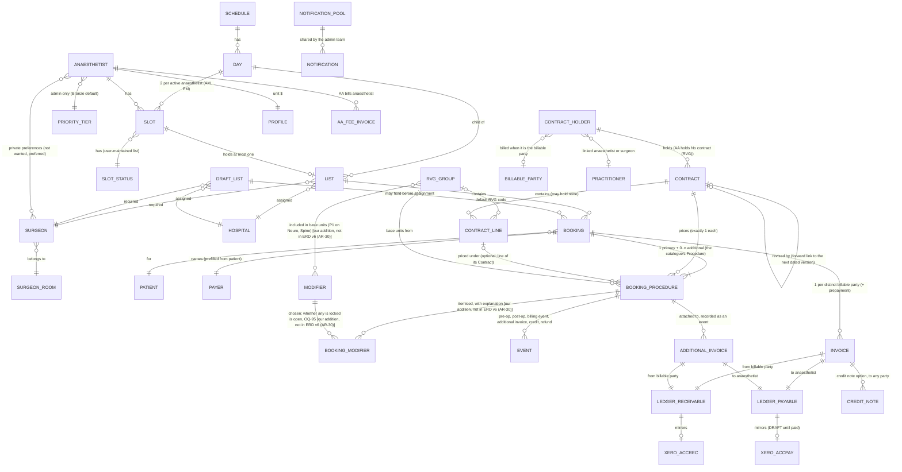

# AA Future-State Domain Model

Companion to the requirements catalogue in this folder. This is the narrative and structural reading of the future state
as understood on 2026-09-24, updated 2026-10-02, 2026-10-07, 2026-10-18 and 2026-10-19, built from the RFP, the six future-state diagrams, the meeting notes
with AA's lead administrator, the Q&A of 2026-09-24, the meeting with Greg (RFP author) and the Requirements Board
answers of 2026-10-01, the AA meeting with Greg of 2026-10-02 and its question answers (OQ-62 to OQ-75), the afternoon AA requirements review with Greg of 2026-10-02 (Notes 2026-10-02 · AA requirements review with Greg), the directors' answers of 2026-10-06 (Notes 2026-10-06 · AA directors meeting), the AA meeting with Greg and the AA client meeting of 2026-10-07 (Notes 2026-10-07 · AA meeting with Greg; Notes 2026-10-07 · AA client meeting), the AA meetings with Greg of 2026-10-14, 2026-10-16 and 2026-10-19 (Notes 2026-10-14 · AA meeting with Greg; Notes 2026-10-16 · AA meeting with Greg; Notes 2026-10-19 · AA meeting with Greg) and the board edits Donald made during the second, the pricing model executive summary v6 ([AR-28](artifacts/AR-28.md)) (Notes 2026-10-16 · Pricing model documents v6 #10), and the real fee schedules in `../../docs/discovery-reference/Data files/`. Where this document and the RFP disagree, this document wins.

The Contract structure here (RVG groups, contract holders, Contracts and their lines, and the booking procedure priced under them) follows the technical design v6 and its ERD ([AR-29](artifacts/AR-29.md), [AR-30](artifacts/AR-30.md)), Greg's proposal for the development team, which replaces the draft v4 (Notes 2026-10-16 · Pricing model documents v6 #10, #12). Where it shapes a relationship below, this document says so. The requirements themselves stay in plain words: the design's field names are given for orientation only, not as requirements. How a Procedure is priced is in §3.

## 1. What changed since the RFP

| RFP said | Future state says | Why |
| --- | --- | --- |
| Card | **Booking**. "Card" now only means the physical hospital or surgeon card. | Notes; Q&A #11 |
| Billing Engine | **Billing/Invoice Engine** | Q&A #11 |
| List states DRAFT → SUBMITTED → AUTHORISED, DRAFT being an assigned List still being worked | **DRAFT → ACTIVE → SUBMITTED → AUTHORISED**: DRAFT is a Draft List with no anaesthetist; ACTIVE is a List with all five of its pairing (anaesthetist, surgeon, hospital, day, session), where the anaesthetist completes Bookings and submits | Notes 2026-10-07 · List lifecycle states #1 to #3 |
| Each Procedure has a *billing route* (Hospital / Billable Party / Insurer), set explicitly, plus a separately looked-up *governing Contract* of type 1, 2 or 3 | Each Procedure selects exactly **one Contract**. The Contract defines rules and pricing, and through its contract holder (an insurer, a hospital, a surgeon or a surgeon's rooms, or an anaesthetist; AA itself holds No contract (RVG)) decides who is invoiced: the holder's own billable party, or the payer named on the Booking (OQ-67). There is no separate route step. The words "first party" and "third party" are dropped, since the cases are not truly that. | Diagrams 3 and 7; Q&A #2, #3; Notes 2026-09-29 #24; Notes 2026-10-02 #8; Notes 2026-10-07 · AA meeting with Greg #51; Notes 2026-10-07 · Pricing model documents #11, #22; Notes 2026-10-14 · AA meeting with Greg #10, #30; Notes 2026-10-16 · Pricing model documents v6 #22, #24 |
| Counterparty resolved by the engine when the List is AUTHORISED | Contract applied at **booking setup** by admin, and mandatory there: the office's main job is to identify who pays, by picking the contract holder, then the Contract, then its line where it has lines. The anaesthetist may change it; the office sees the change at review. Engine reads the locked Contract. | Diagram 7; Q&A #4; Notes 2026-10-07 · AA meeting with Greg #55; Notes 2026-10-16 · AA meeting with Greg #39, #48 |
| Secondary procedures in a split-billing episode charge **time units only** | Base units only on the **primary**; time on **every** procedure; modifiers on the primary **unless total modifier units exceed 4**, then split equally across all procedures with the remainder to the primary. | Notes; Q&A #1 |
| `priceOverride` on the Procedure | **The Contract on the Procedure sets its values.** Choosing the Contract (and its line) fills in the Procedure's price, rate and discount; from then on they are values on the Procedure. The anaesthetist may change the price, rate or discount only where the Contract lets them (its editable setting: typically yes on Contracts priced from RVG units, no on a hospital's fixed-price Contract (where no discount may be added either) or a surgeon's fixed fee). The office can change any price at any time, the way a fixed price is changed without changing the Contract (the anaesthetist may depart from it only where that Contract's flag allows it, a flag AA sets per Contract: OQ-107). No reason is needed; every change is audited and flagged at review, and the last change stands: neither side has more authority than the other. BTM is optional on a fixed price. Whether the anaesthetist may change a Contract's price, rate or discount is a flag on each Contract, set by AA, not a global rule (OQ-89, OQ-107). | Diagram 7; Q&A #3, #6; Notes 2026-10-14 · AA meeting with Greg #23, #24, #39; Notes 2026-10-16 · AA meeting with Greg #10, #54, #55; Notes 2026-10-16 · Pricing model documents v6 #11, #27; Notes 2026-10-19 · AA meeting with Greg #9, #20 |
| Xero as accounts receivable with the engine's database as a mirror for the app | The engine's **internal ledger is the system of record**. Xero is an AR and banking service mirroring ledger pairs. Patient history survives Xero contact archiving. | Q&A #9 |
| Payment to anaesthetist implied a fee deducted | **AA's fee is a separate invoice from AA to the anaesthetist**, managed by the system, distinct from any procedure's receivable and payable. A monthly fee invoice run raises one per anaesthetist: fixed charges (possibly several items) plus a charge per BCTI issued to them, set on a settings page; not a percentage cut of the payable. The fixed schedule, whether only paid invoices count and whether the fee nets against payables are open (OQ-60); Greg's view, to confirm with AA's accountant, is that only paid invoices count and the fee is always a separate invoice paid into a separate bank account, never netted. | Q&A #8; Notes 2026-10-01 #1; Notes 2026-10-02 #1 |
| "Self-funded, pre-payment required" as a patient category | **Prepayment is a first-class flow**: triggered when the office picks a Contract flagged as prepaid (normally the anaesthetist's own price list), never by a setting on the anaesthetist's profile. Such a Contract bills a person paying for the patient, never an organisation (OQ-73); prepayment invoice at setup, tracking, alerts. The prepaid amount is the price on that Contract's line, which always has one: the full amount, never a deposit or a part (OQ-04, OQ-76). The prepayment invoice, and its pair, are generated when an admin approves it (the office picks the prepaid Contract, then approves the invoice where outgoing invoices are approved), and it is then sent with the letter. The pair is a receivable from the patient and a payable to a **prepay holding account**, not to the anaesthetist (OQ-80). There is no settlement against a final BTM amount: nothing more is invoiced or credited automatically (see §3). | Diagram 7; Notes; Q&A #5; Notes 2026-10-01 #32, #50; Notes 2026-10-02 #14, #17; Notes 2026-10-06 · AA directors meeting #1, #4, #9; Notes 2026-10-07 · Pricing model documents #1, #35; Notes 2026-10-16 · AA meeting with Greg #20, #22; Notes 2026-10-16 · Pricing model documents v6 #4, #28; Notes 2026-10-19 · AA meeting with Greg #4 |
| Hospital HL7 integrations exist but are unreliable | **St George's and Southern Cross are integrated with the current system; everything else is manual.** The first release keeps a manual matching review and adds an automatic sync (on a schedule, when the matching screen opens, and by a sync button, with a last-synced time) for those two hospitals only. More hospital feeds, automatic matching and HL7/FHIR are Future Work. NHI lookup is in scope. | Q&A #4; Notes 2026-09-29 #14 |
| Patient master implied | **Patient record keyed on NHI**. Who is billed is set through the Contract: its holder's billable party, or the **payer named on the Booking**, prefilled from the patient and changeable to a parent or guardian. Proposed instead: the system's own patient ID, with the NHI as a second unique index (OQ-49); but the NHI is now mandatory, with no blank: a Booking cannot be saved without one, and an incoming Booking that has none waits at intake until the office adds it (OQ-49). Admins see patient outstanding bills and are alerted to patients with outstanding balances: a mild alert under the threshold (90 days from the invoice date, may move), a strong one above it, a mild one for a credit balance, and staff can always wave it through (OQ-41, OQ-74). NHI is mandatory, with no blank allowed, and the anaesthetist sees the NHI for Health Connect lookup. An incoming Booking without one waits at intake on the matching screen (OQ-49). | Notes; Q&A #9, #13; Notes 2026-09-29 #10, #26, #35; Notes 2026-10-01 #17, #23, #62; Notes 2026-10-02 #15; Notes 2026-10-07 · Pricing model documents #11; Notes 2026-10-16 · AA meeting with Greg #3; Notes 2026-10-19 · AA meeting with Greg #1 |
| Office monitoring of the billing flow | Retained, plus **ledger balance tools** (whole ledger, per anaesthetist, per patient) in the Admin App. | Q&A #12 |
| Two Lists per active anaesthetist per day, unassigned until a surgeon and hospital are set | Three distinct things: a **Slot** (a box for the AM or PM session, created and stored per active anaesthetist per day across a rolling schedule, four months ahead in current practice, its length a rarely changed setting; defaults to free and has a status from a user-maintained list until a List is put in it, and the List then shows in place of the status), an **active List** (assigned to an anaesthetist, put into a Slot, holds Bookings, follows the one-surgeon, one-hospital rule) and a **Draft List** (a List created with no anaesthetist: its surgeon, hospital, day and session are required; it also arises when an anaesthetist moves a List to the office (including marking its Slot unavailable), and when a recurring booking lands on an unavailable Slot; shown prominently in the Admin App, a major feature for AA staff; only ever assigned by an admin, never offered to anaesthetists to claim, OQ-86). Slots and Lists are both children of the day. This is the logical model; how it is stored is for the developers, and the word "slot" never appears in the UI (OQ-64). | Notes 2026-09-29 #17, #36; Notes 2026-10-01 #9, #13, #15, #20, #42; Notes 2026-10-02 #5, #23, #29, #30; Notes 2026-10-02 · AA requirements review with Greg #1, #20, #61; Notes 2026-10-07 · AA client meeting #12 |
| Permanent Lists and List templates | **Recurring bookings**: the standing intersection of a hospital, an anaesthetist and a surgeon (day of week, AM or PM), painted onto Lists. The term replaces "template", "permanent booking" and "Permanent List". | Notes 2026-10-01 #44 |
| An anaesthetist hands a List to a colleague by a swap request the office confirms | An anaesthetist **moves their own List** without office confirmation: to the AA office, where it becomes a Draft List, or pushed into a colleague's free Slot, with no acceptance needed (a high-trust system). The office is told through a **shared notification pool** in the Admin App and offered the cover-change update email; the colleague sees the List appear with a notice (OQ-65). An anaesthetist can also move a **single Booking** to a colleague who is free in that Slot: the move creates a List in the colleague's Slot holding it, and a Booking is never moved into another anaesthetist's existing List (OQ-85; the vacated Slot's status is OQ-84). | Notes 2026-10-01 #15; Notes 2026-10-02 #6, #18; Notes 2026-10-02 · AA requirements review with Greg #3; Notes 2026-10-19 · AA meeting with Greg #7, #16, #17 |
| Who did a List's procedures not stated | **Whoever submits a List did its procedures.** If another anaesthetist does a Booking, it is moved to a List of theirs, even a one-Booking List; the payable follows the Booking. A prepaid Booking's payable is the prepay holding account, so it does not move: nothing detects the move or recalculates anything, and whoever did the List is paid from the holding account. | Notes 2026-10-01 #16, #38; Notes 2026-10-06 · AA directors meeting #10 |
| A List leaves the anaesthetist's view once the office approves it for invoicing | The anaesthetist can still see and edit a submitted List until it is authorised; submitting still tells the office it has a job to do. Once authorised, the List is handed to invoicing and leaves the anaesthetist's main view (Lists not yet authorised, and upcoming work), and is found through a search, by patient name first and by NHI too, so an old Booking can be checked when an invoice is queried (OQ-31). | Notes 2026-10-07 · AA client meeting #2, #16; Notes 2026-10-16 · AA meeting with Greg #26, #33, #49 |
| No surgeon master data beyond a name | Surgeons' rooms and surgeons are master data; surgeons belong to rooms; each surgeon has a profile (NZ medical registration number and one HPI CPN identifier). **Private two-way preferences** (formerly the blacklist; a better name is still to choose) are kept by admin staff on surgeon and anaesthetist profiles: pairings someone does not want and pairings someone prefers. They are never shown to anaesthetists, and neither side learns of the other's. When admin assign or move a List, available anaesthetists with a conflict are shown separately from those without: information for the decision, never a block. There is no warning when an anaesthetist hands their own List to a colleague (OQ-43). Each anaesthetist also carries an admin-only **priority tier** (four tiers, Bronze the default; names provisional, OQ-102) that orders assignment suggestions, shuffled within a tier. The anaesthetist profile also holds the HPI CPN. | Notes 2026-09-29 #15, #16; Notes 2026-10-01 #19, #26; Notes 2026-10-07 · AA client meeting #4, #19 to #23 |
| No cancellation fee mentioned | AA charges no cancellation fees; a cancelled Booking's loss is taken. | Notes 2026-09-29 #1 |
| Prepaid amount worked out by the office from a local table, six or seven time units chosen by the anaesthetist's rate | The prepaid amount is the **price on the prepaid Contract's line**, normally the anaesthetist's own price list: one line and price for each procedure they price this way, and a prepay line always has a price. Greg: "technically it's an estimate, but it's the anaesthetist's price." Nothing is estimated from units (OQ-04, OQ-38). The anaesthetist sees the prepaid amount on the Booking. The office creates and maintains these Contracts, from the price list each anaesthetist supplies; anaesthetists do not create or edit Contracts in the app (OQ-91). Letters come from standard templates (OQ-58). What happens when the Contract's price changes after the patient has prepaid is open (OQ-104). | Notes 2026-09-29 #2; Notes 2026-10-06 · AA directors meeting #4, #5, #9; Notes 2026-10-07 · AA client meeting #3, #8, #17, #18; Notes 2026-10-07 · AA meeting with Greg #34, #36; Notes 2026-10-07 · Pricing model documents #35; Typed decision 2026-10-08 · Donald (product owner); Notes 2026-10-14 · AA meeting with Greg #5, #26; Notes 2026-10-16 · AA meeting with Greg #4, #20; Notes 2026-10-16 · Pricing model documents v6 #4 |
| Availability conflicts undecided (hard block or warning) | Soft warning: the Booking stays, a conflict is flagged and coloured (a hospital closure, or a Booking landing on a Slot already marked unavailable). A recurring booking landing on an unavailable Slot becomes a Draft List instead. An anaesthetist who marks a Slot unavailable while it holds a List is not left with a conflict: they return the List to the office (it becomes a Draft List) or assign it to a colleague (OQ-64). Generation paints the anaesthetist's calendar first, then recurring bookings; only short-notice sickness is open (OQ-81). | Notes 2026-09-29 #3; Notes 2026-10-02 #5, #27, #45; Notes 2026-10-02 · AA requirements review with Greg #1 |
| Anaesthetist bank details location open | Held in the system, on the anaesthetist's profile; the only billing setting there is the unit rate (a dollar value per RVG unit), the rest being identity, contact and bank details. No GST period and no prepaid procedures. | Notes 2026-09-29 #4; Notes 2026-10-16 · AA meeting with Greg #22, #25 |
| Office price override gated by the Contract | The office can always change any price, rate or discount, including a fixed fee (authorised, not hard-coded). It has no special authority: the office is normally the last to touch a Booking, and the last change stands. | Notes 2026-09-29 #5; Notes 2026-10-14 · AA meeting with Greg #24, #39; Notes 2026-10-16 · AA meeting with Greg #10 |
| Prepayment refund handled ad hoc between anaesthetists | Prepaid money is not paid to the anaesthetist: it is held in a **prepay holding account** (within AA's trust accounting, treated by the ledger like an anaesthetist's account) until the procedure is done, and a cancelled prepayment is refunded to the patient in full from it. A Booking moved to another anaesthetist keeps the agreed prepaid amount and the anaesthetist who does it is paid, wearing or benefiting from any difference: the new anaesthetist claims no more than was prepaid, the payable does not move because it is the holding account, and nothing is recalculated (OQ-70, OQ-80). The patient may be sent an informational email that their anaesthetist has changed. Prepayment is two steps: the money is collected into the holding account, then, when the procedure is done and the List goes to billing, a second pair moves it from the holding account to the anaesthetist who did the List, in place of another invoice to the patient. A prepaid price override together with a move and the holding account is still open (OQ-96). | Notes 2026-09-29 #6; Notes 2026-10-01 #2, #16, #57; Notes 2026-10-02 #11; Notes 2026-10-06 · AA directors meeting #10; Notes 2026-10-19 · AA meeting with Greg #4, #15 |
| Unpaid-patient alert on any unpaid invoice | Alert on patients with outstanding balances: mild under a threshold, strong above it (90 days to start, may move); the threshold applies only to amounts owing. The days count from the invoice date, and a credit balance raises a mild warning (OQ-74). | Notes 2026-09-29 #10; Notes 2026-10-01 #17; Notes 2026-10-02 #15 |
| Late billing lines added by the anaesthetist as supplementary invoices; adhoc billing after invoicing was open (OQ-24) | **Additional invoices** are a free-form function (description, quantity, amount; no pricing rules), created by admin staff (and, where a prepaid or fixed-price procedure's work differed, by the anaesthetist) to any billable party, recorded as an **event** on a Procedure and traceable to the original; no Contract or pricing rules; used for supplementary charges and for splitting a combined fixed-price Procedure. Like every event they go through the one standard review step (OQ-63). The function has a **credit note option**: the original is credited to any party, the original billable party included, then new additional invoices are raised (OQ-72). The rebilled invoices must equal the credited one, and the credit reverses the linked payable to the anaesthetist (OQ-77 parts 1 and 2); a split asked for before the combined invoice is sent, while the List is not yet authorised and handed to billing, is a normal admin edit of the Booking's Procedures, Contracts and prices, with no credit (OQ-77). Nothing is invoiced or credited automatically after a prepaid procedure or on any fixed-price Contract: where the work differed, the anaesthetist (or the office) raises an additional invoice or credit note by hand. Each additional invoice raised after the original has gone has its own ledger pair, Xero pair and anaesthetist payable; one raised before the Procedure's invoice is approved is a line on that invoice (see Events; Notes 2026-10-16 · AA meeting with Greg #59, #61). | Notes 2026-09-29 #8, #18, #23, #29; Notes 2026-10-01 #21; Notes 2026-10-02 #4, #13, #32, #33; Notes 2026-10-06 · AA directors meeting #1, #2, #10; Notes 2026-10-07 · AA client meeting #9; Notes 2026-10-19 · AA meeting with Greg #2 |
| No self-service for late lines (today the anaesthetist rings or emails the office) | **Events**: everything recorded against a Procedure after it is set up (pre-op, post-op, billing events, additional invoices, credits) is an event, its own element attached to the original Procedure, linked in reference rather than in time, and visible on it in both apps. The "other billing lines" (post-op, nerve catheters, pain consults) are merged into events. The anaesthetist mostly adds pre-op and post-op events themselves (self-service), and the admin team can too; each is a time recording or a fixed fee with its own date and time, no other modifiers, and a tick box for whether it will be invoiced. A **billing event** is a free-form way to invoice against a Procedure and its Contract: a charge with a free-text description, or a credit. A billable event is its own line item: on the Procedure's invoice if that is not yet approved, otherwise a separate invoice in the next run, all through the one standard review step (OQ-63). A refund can also show as an event, best done on the web. Covers pain management after the procedure and ACC pre-op assessments. The name "events" is kept for now. | Notes 2026-10-01 #6, #34, #61; Notes 2026-10-02 #4, #24, #25, #44; Notes 2026-10-16 · AA meeting with Greg #45, #59, #61, #62 |
| Correction after invoicing by credit note and re-issue, policy open (OQ-28) | A wrong invoice is **credited in full, then rebilled**; never retracted, edited or partly adjusted. Additional invoice is reserved for supplementary charges and splits. A refund after the anaesthetist has been paid is a credit note to the billable party and a **negative invoice** to the anaesthetist, netted in their next payment run and shown on the remittance advice (OQ-42). With no later payment to net against, it is handled outside the system (OQ-71). A credit note is not a refund: a refund of a resulting credit happens outside the system. Whether a prepayment invoice can be credited in part, when only part of the prepaid work was done, is open (OQ-97). | Notes 2026-09-29 #9, #12, #34; Notes 2026-10-01 #18; Notes 2026-10-02 #12, #33; Notes 2026-10-06 · AA directors meeting #10 |
| No path for telling hospitals about Booking changes | An on-demand button on any Booking in the Admin App lets the admin **draft an update email** via a mailto link (plain text, about 2,000 characters), prefilled with a subject, boilerplate, the changes the admin picks (one or many) from the Booking's change history and, where known, the To address (OQ-69). Contact emails are held for hospitals and surgeons' rooms. The system sends nothing. It is addressed to the hospital contact for a cover change and to the surgeon's room for a Booking change (OQ-46). Proposed: user-configurable templates, one per kind of change. Manual in the MVP; sending change emails automatically is later work (OQ-82). | Notes 2026-09-29 #19; Notes 2026-10-01 #22; Notes 2026-10-02 #10, #31; Notes 2026-10-07 · AA client meeting #11, #13, #25 |
| The Contract decides who is invoiced | The Contract decides who is billed, through its **contract holder**, with as many Contracts as AA needs (OQ-67). A holder that pays AA itself (an insurer that accepts direct claims, a hospital) is billed through its own billable party record; a holder that only sets the price (a surgeon's fixed-fee arrangement, an anaesthetist's own price list) leaves the **payer on the Booking** to be billed, as No contract (RVG) does. The only per-Booking choices are the Contract and the payer named on the Booking; splitting one Procedure's fee between two payers is an action on the Booking, not a Contract setting (US-08.2.3). Billable parties are held as reference records (hospitals, surgeons, insurers, patients or guardians), and no invoice email sits on the Contract. A holder linked to an anaesthetist or a surgeon has its Contracts offered only on that person's Bookings. No contract (RVG) is held by AA, which is never billed, so it bills the payer on the Booking (OQ-78). A Contract stays one unit: how it prices and who it bills are not picked separately, so two Contracts with the same pricing but different payers are two Contracts. | Notes 2026-09-29 #24; Notes 2026-10-01 #29; Notes 2026-10-02 #4, #8, #41; Notes 2026-10-07 · AA meeting with Greg #7, #26, #29; Notes 2026-10-07 · Pricing model documents #11, #22, #34; Typed decision 2026-10-05 · Donald (product owner); Notes 2026-10-14 · AA meeting with Greg #13, #31; Notes 2026-10-16 · AA meeting with Greg #64; Notes 2026-10-16 · Pricing model documents v6 #15, #24 |
| Contracts filtered by the patient's insurer or funding source | Where a Booking is insured, the office records on it the **insurer and the insurance approval number**, the reference the insurer gives when it accepts the claim. A code such as SXAP from the rooms or the hospital says the hospital is arranging the cover and is the billable party, not that the cover is approved. The insurer and approval number are stored on the Booking (US-11.4.3); whether insurance narrows the Contract list is open (OQ-93). The Contract decides who is billed. A Booking that says an insurer will pay with no insurer Contract chosen is a warning at office review, not a block, because pre-approval regularly falls through on the day. The office picks the contract holder, then the Contract, then its line where it has lines. The list shows Contracts, not lines: No contract (RVG) first, then the hospital's Contracts, then any surgeons' and anaesthetists' arrangements, those valid on the procedure date whose holder fits the Booking. The RVG code is optional for the office; picked first, it finds the lines carrying it as their default RVG code. Holder codes are kept as searchable references, and every Contract carries a short structured AA code (format still to be designed) (OQ-66). | Notes 2026-10-01 #10, #27, #29; Notes 2026-10-02 #7; Notes 2026-10-07 · AA meeting with Greg #2, #6, #27; Notes 2026-10-07 · Pricing model documents #11, #34; Notes 2026-10-14 · AA meeting with Greg #3, #19, #32, #33; Notes 2026-10-16 · AA meeting with Greg #1, #39, #40; Notes 2026-10-16 · Pricing model documents v6 #5, #31 |
| The default Contract | **No contract (RVG)** is the one default for the whole system: standard RVG pricing at the anaesthetist's own unit value, offered first. Behind the scenes it is a Contract like any other, held by AA, whose holder is never billed, so every Procedure is priced the same way: exactly one, carrying no practice-wide prices, and it never expires. It bills the payer on the Booking (OQ-78); insured patients who claim the money back themselves are billed under it. There are no hospital, insurer or per-procedure default Contracts. Whether it also carries routine procedures as lines (with their descriptions for the invoice; the documents do not say whether such lines carry prices) is open (OQ-106). | Notes 2026-09-29 #24; Notes 2026-10-07 · AA meeting with Greg #7, #54, #59, #60, #61; Notes 2026-10-07 · Pricing model documents #2, #10, #37; Notes 2026-10-14 · AA meeting with Greg #17, #19; Notes 2026-10-16 · Pricing model documents v6 #15, #22, #51 |
| Contract prices have one Contract-level effective date | Each **Contract is a series of dated versions**, its dates shared by all its lines. Every change, a correction to some lines or a periodic renewal of the whole schedule, creates a new version from a date the office chooses, never in the past and never backdated; nothing is deleted. The previous version ends the day before, versions never overlap or leave a gap, and a Contract may have only one future-dated version, which can be corrected freely until it takes effect. The version in force on the procedure date prices it (OQ-48). On submit, un-invoiced Procedures dated on or after the new version's start are relinked to the new version's line with the same line key; any with no match are listed for the office to resolve. One procedure can have different prices under different arrangements, each its own Contract. | Notes 2026-09-29 #25; Notes 2026-10-07 · AA meeting with Greg #39, #40; Notes 2026-10-07 · AA client meeting #6; Notes 2026-10-07 · Pricing model documents #18, #23, #36; Notes 2026-10-16 · AA meeting with Greg #15, #16; Notes 2026-10-16 · Pricing model documents v6 #42, #43, #47 |
| Base units come from the RVG code | Base units sit on the **RVG group** (as published, plus AA's own), and a **Contract line** may state its own for that Contract (OQ-62); position loadings are modifiers (OQ-06). There is no procedure list: the RVG groups are the one master list, and the procedure on a Booking is the text received (OQ-88). The anaesthetist picks the RVG code with a type-ahead showing each row's code, short description and base units; the office may enter one if they know it. RVG groups are seeded once from spreadsheets, then maintained by hand, so a rare RVG change is applied by hand. A base unit overridden consistently means AA changes its own data. | Notes 2026-09-29 #30; Notes 2026-10-01 #4, #59; Notes 2026-10-07 · AA meeting with Greg #62; Notes 2026-10-07 · Pricing model documents #8, #21; Notes 2026-10-14 · AA meeting with Greg #1, #19, #20; Notes 2026-10-16 · AA meeting with Greg #21; Notes 2026-10-16 · Pricing model documents v6 #1, #23 |
| Billable party defaults to the patient | Every Booking names a **payer**, prefilled from the patient and changeable by the office or the anaesthetist to a parent or guardian; the payer is billed whenever the Contract does not bill its holder. A patient under 18 as the payer is a **mild warning** to AA staff, clearable from the dashboard, not a block (no warning when the billable party is, say, a hospital); the office checks the guardian's contact details (OQ-54). A guardian's details are held as the Booking's payer, kept for the life of the debt and then archived. | Notes 2026-09-29 #20; Notes 2026-10-01 #28; Notes 2026-10-07 · AA meeting with Greg #25; Notes 2026-10-07 · Pricing model documents #11, #25, #34 |
| Billing failure scope open (OQ-05) | Failure is **per Booking**: other Bookings on the List still invoice. If any Procedure's billable party fails, the whole Booking is held back for AA admin staff to fix manually. | Notes 2026-10-01 #3 |
| No common warning model | **One warning routine** checks conditions and raises warnings, several per Booking if need be, of a before-procedure or after-procedure kind, mild or strong. They show on the admin dashboard as a to-do list, where they can be cleared, and as a small warning flag on the Booking in both apps, visually clear when the anaesthetist opens the Booking, much like the prototype; no confirm step on submit. Warnings are soft, never blocks. A settings page for thresholds, active warnings and switching off check steps is built only when AA asks. | Notes 2026-10-01 #28, #30, #31, #32, #47, #65; Notes 2026-10-02 · AA requirements review with Greg #15, #16 |
| No shared notices for the office | A **shared notification pool** in the Admin App: one pool for the whole admin team, separate from the to-do list, for things that happened and need no action, newest first. The first source is an anaesthetist moving their own List. Notices never expire: each is active or resolved, ticked off by hand by anyone on the team, which resolves it for everyone and hides it (who and when are kept, and a "show resolved" filter brings it back). The to-do list uses the same tick. A List or Booking can also be flagged to alert the office to review or act on it, with a note (OQ-79); one earlier idea is an anaesthetist's "please check this" flag on a Procedure. | Notes 2026-10-02 #6, #18, #43; Notes 2026-10-14 · AA meeting with Greg #7; Notes 2026-10-19 · AA meeting with Greg #3 |
| No GST schedule mentioned | A monthly **GST report** for each anaesthetist's GST return: a list of the payments AA passed to them in the month, with the GST component of each. It lists payments, not invoices sent, since an invoice may be paid in part (for example on a repayment plan). There is no GST period. Wanted early; release slot unconfirmed. | Notes 2026-10-01 #40; Notes 2026-10-16 · AA meeting with Greg #22, #24 |
| Fee schedules quoted GST inclusive, exclusive or both | Every price is held **GST exclusive**; GST is calculated when needed and goes at the foot of the invoice. | Notes 2026-10-07 · AA meeting with Greg #32 |
| Payment day and cycle not settled | Proposed: a **weekly payment cycle** identified by ISO week number (Friday close and ledger snapshot, Monday for the office to resolve issues, payment on Tuesday, anomalies rolled into the next cycle). The prototype and requirements build to it; it stays a question for AA's accountant (OQ-47). | Notes 2026-10-07 · AA client meeting #5, #15 |
| RFP response: master and reference data migrated at cutover | Clean cut. Reference data loaded once from controlled spreadsheets (a one-off seed), then maintained by hand; Solutions Plus used for operation names only (its unit values are not canonical and it holds junk entries). Separately, a mechanism to **upload a Contract's schedule** is a requirement, for Contracts only. Greg's v6 proposal: the office maintains one Contract at a time on a header and lines screen; edits and uploads (in the AA template, **Alter** to change some lines or **Replace** for a whole new schedule) are staged on a review dashboard and submitted together, creating a new dated version. Whether the upload is in the first release is open (OQ-100). | Notes 2026-09-29 #27, #28; Notes 2026-10-07 · AA meeting with Greg #48, #62; Notes 2026-10-16 · AA meeting with Greg #17, #18; Notes 2026-10-16 · Pricing model documents v6 #40 to #46 |

Everything else in the RFP (List lifecycle, Xero pairing, NHI change, archiving, time tiers,
per-anaesthetist unit value, roles, audit) carries forward unchanged, except that the audit trail
covers invoices and credit notes but not disbursements, payments or receipts (Greg: those are done
in Xero), with its depth
for the developers to settle, and sign-in is an account login for the anaesthetist PWA (Auth0 is
Stratos' default; platform, biometrics, MFA, single sign-on and identity provider are open, as is the
experience, OQ-83) (Notes 2026-10-02 · AA requirements review with Greg #2, #12, #42, #78, #84).

## 2. Entities



**Hierarchy:** Day → Slot → List → Booking → Procedure (a booking procedure) → priced under exactly one Contract, with events on the Procedure. Slots and Lists are both children of the day: a List is put into a Slot. This is the logical model; how it is stored is for the developers. A Draft List sits outside the Slots until assigned (Notes 2026-10-01 #27, #42; Notes 2026-10-02 #4, #5, #23, #29).

**Procedures and Contracts.** The master data is the RVG group, and contract holder → Contract (a series of dated versions) → contract line. Each RVG group is as published plus AA's own, with base units (required, above 0) and modifier units (default 0). A contract holder is an insurer, a hospital, a surgeon or a surgeon's rooms, or an anaesthetist (AA itself holds No contract (RVG)), and holds many Contracts. A Contract is a dated version (start, optional end, and a forward link to the version that revised it) holding contract lines; it may hold none, as a hospital's plain RVG Contract does. A line sets the terms for a group of procedures (for example "Cataracts" or "Facelift plus 1 add on"), may reference an RVG group as its default RVG code, and stands alone: lines do not nest, and several may share an RVG code. There is no procedure level: no procedure list sits between the text received and the RVG (OQ-88). Each Procedure on a Booking is priced under exactly one Contract and, where the Contract has lines, one of its lines. This shape is the technical design v6 and its ERD ([AR-29](artifacts/AR-29.md), data model; [AR-30](artifacts/AR-30.md)), Greg's proposal. The design's ERD has no entity for modifiers; BOOKING_MODIFIER, MODIFIER and the RVG group's "included" link are our addition, labelled so in the diagram, not part of ERD v6 (AR-30), and whether any modifier is applied and locked is open (OQ-95) (Notes 2026-10-06 · AA directors meeting #7; Notes 2026-10-14 · AA meeting with Greg #1, #29, #30; Notes 2026-10-16 · AA meeting with Greg #21; Notes 2026-10-16 · Pricing model documents v6 #1, #2, #12, #23 to #26, #52).

**Terms.** A Procedure on a Booking is what the design calls a *booking procedure*. The catalogue keeps "Procedure" for it. A lower-case "procedure" no longer names an entry on a procedure list, since there is none: the procedure on a Booking is the text received from the rooms or the hospital, a free-text field the anaesthetist reads as an input to choosing the Contract and the RVG code (Notes 2026-10-16 · AA meeting with Greg #21, #35, #44). *Time entry* is the design's name for the anaesthetist filling in the Booking (the business says "filling in the card"). The design retires "Card" too, in favour of Booking. The naming is still to settle (Notes 2026-10-07 · AA client meeting #32; Notes 2026-10-16 · Pricing model documents v6 #12, #22).

### Slot, List and Draft List

- Fixed canvas: two **Slots** per active anaesthetist per day across a rolling schedule, four months
  ahead in current practice (its length a setting changed rarely), whether or not a List or Booking
  is attached. A Slot is a box (container) that has a status, and a List is put into it. Every Slot
  is created and stored across the horizon, empty ones included:
  "the foundation on which everything else is painted" (OQ-64). The generation run writes an AM and
  a PM Slot as free for every active anaesthetist, then paints the anaesthetist's own calendar
  (holidays and other unavailability) first, then surgeons' recurring bookings; a recurring booking
  that lands on an unavailable Slot becomes a Draft List (Notes 2026-10-02 · AA requirements review with Greg #1, #20). A new anaesthetist gets Slots from their start date, and Slots can then be edited freely.
  The word "slot" never appears in the UI: users see Lists, and free or unavailable Slots are shown
  much as in the prototype today.
- **Availability status** belongs to the Slot, not the List, and is set by the anaesthetist per Slot
  (half-day), independent of bookings. The anaesthetist keeps it up from a calendar in their app
  (mark days off ahead, create a series, edit or delete one instance). The Slot status and that
  calendar are one mechanism; once a List is put in the Slot, the List shows in place of the status
  (OQ-27, OQ-64). The status values are **master data**, a user-maintained list rather than a fixed
  set: each has a fixed internal ID, an editable label and an editable colour, and rules read the ID,
  not the label. For now they start from the values in use (free by default, on holiday,
  unavailable) with colours chosen for now; the final values are to be defined with AA's users, who
  have redundant statuses (to verify). Theatre is not recorded.
- Marking a Slot unavailable while it holds a List asks the anaesthetist to return the List to the
  office, where it becomes a Draft List with its hospital, surgeon and Bookings, or to assign it to
  an available colleague, as when they move their own List. A Booking that lands on a Slot already
  marked unavailable is accepted and flagged as a conflict, as is a booked List whose hospital
  closes; a recurring booking that lands on one becomes a Draft List (Notes 2026-10-02 #5, #27, #45;
  Notes 2026-10-02 · AA requirements review with Greg #1).
- **List**: assigned to an anaesthetist, sits in one Slot, exactly one surgeon and one hospital,
  one day, one session; AM and PM may differ. A Slot with no List has no surgeon and no hospital.
  A List's status is its anaesthetist's. Lists are projected from **recurring bookings** (a hospital,
  an anaesthetist and a surgeon on a day of week and session) or made ad hoc: an admin puts an ad hoc
  List into a free Slot. A recurring booking creates its List at the far end of the rolling schedule, before any Bookings
  exist, so a List can hold no Bookings (Notes 2026-10-02 #28; Notes 2026-10-02 · AA requirements review with Greg #20).
- **Draft List**: a List created with no anaesthetist. Its surgeon, hospital, day and session are
  always known when it is created and all four are required. Bookings can be added before an
  anaesthetist is assigned. It arises when a surgeon's room needs an anaesthetist and none is
  assigned, when an anaesthetist moves a List to the office (including marking its Slot
  unavailable), and when a recurring booking lands on an unavailable Slot (Notes 2026-10-02 · AA requirements review with Greg #1, #61). It shows prominently
  in the Admin App (a major feature for AA staff), is never offered to anaesthetists to browse or
  claim (OQ-86; Notes 2026-10-07 · AA client meeting #12), and only an
  admin assigns it, when it becomes an active List in a Slot. A cancelled or unfilled one is removed or
  re-dated. The name Draft List is kept.
- **List state** (DRAFT → ACTIVE → SUBMITTED → AUTHORISED) is separate from availability status.
  DRAFT is a Draft List (no anaesthetist yet). A List is ACTIVE once it has all five of its pairing
  (anaesthetist, surgeon, hospital, day, session), whether an admin assigned it from a Draft List or
  it was set up assigned; an ACTIVE List that goes back to the office (moved or withdrawn by its
  anaesthetist) is DRAFT again. The anaesthetist
  completes Bookings and submits while it is ACTIVE (Notes 2026-10-07 · List lifecycle states #1 to #3).
- Lists move between anaesthetists with their Bookings intact. An anaesthetist moves their own
  List without office confirmation: to the office (it becomes a Draft List) or into a colleague's
  free Slot, with no acceptance needed. The office is told through the shared notification pool
  and offered the cover-change update email; the colleague sees the List appear in their app with
  a notice (OQ-65). An anaesthetist can also move a single Booking, only to a colleague who is free in that
  Slot: scrolling the free colleagues or typing to filter them, then creating a List in the
  colleague's Slot that holds the Booking. A Booking is never moved into another anaesthetist's
  existing List, and two Lists in one Slot are not supported (OQ-85). The mover may notify the
  admin team or raise the update email, optionally. The status of a Slot vacated by a moved List
  is OQ-84 (Notes 2026-10-02 · AA requirements review with Greg #3; Notes 2026-10-19 · AA meeting
  with Greg #7, #16, #17).
- **A List never moves to another day or session.** A List is defined by its day and session (it can still be handed to another anaesthetist, above), and Bookings sit on it. A change of procedure time within a List is an ordinary modification. When a Booking or a whole List moves to another day, the rooms cancel and re-send: the Bookings are removed from the old List and arrive again, as new Bookings, on the List of the new day. A Booking moved to another day is therefore a cancellation plus a new Booking, for the same patient (same NHI). The system does not recognise a move as a move: it detects removals from re-sent snapshots, by the match and merge (OQ-87) (Notes 2026-10-19 · AA meeting with Greg #8, #18).
- **Whoever submits a List did its procedures.** A Booking done by another anaesthetist is moved
  to a List of theirs, even a one-Booking List; its payable follows it. A prepaid Booking keeps its
  prepaid amount: the payable is the prepay holding account, which does not move, and the system
  detects nothing and recalculates nothing (Notes 2026-10-06 · AA directors meeting #10; Notes
  2026-10-19 · AA meeting with Greg #4). Say a completed or submitted Booking, not a "timesheet"
  (Notes 2026-10-01 #38, #39).
- Once the office has authorised a List and handed it to invoicing, it leaves the anaesthetist's
  main view, which shows Lists not yet authorised and upcoming work; until then the anaesthetist
  can still see and edit it. Older work is found through a search, by patient name first and NHI
  too, so an anaesthetist can check what they entered when an invoice is queried (OQ-31) (Notes
  2026-10-07 · AA client meeting #2, #16; Notes 2026-10-16 · AA meeting with Greg #26, #33, #49).
- Settled (OQ-64): the day is the parent of both Slots and Lists; an unavailable half-day is a Slot
  status, not a List; a newly unavailable anaesthetist's List leaves them by their choice (office
  or colleague) rather than keeping a conflict flag. Settled (OQ-81 parts 1 and 2): the
  anaesthetist's calendar is painted before recurring bookings, and a recurring booking on an
  unavailable Slot becomes a Draft List. Open: whether a short-notice sickness follows the
  unavailable flow or is recorded by the office as a conflict (OQ-81) (Notes 2026-10-02 · AA requirements review with Greg #1).

### Booking

- Replaces Card. Belongs to one List. References a Patient (NHI).
- Has exactly **one primary Procedure** and zero or more additional Procedures in the same
  anaesthetic episode. Anyone with edit rights can set which is primary.
- Names a **payer**, prefilled from the patient and editable by the office or the anaesthetist to a
  parent or guardian. Each Procedure's Contract decides who is billed: its holder's billable party
  when the holder pays AA itself, otherwise this payer (OQ-54, OQ-67) (Notes 2026-10-07 · Pricing
  model documents #11, #25, #34).
- Holds the **insurer and the insurance approval number** where it is insured, recorded by the
  office, normally; recording them is not the anaesthetist's job, though the v6 design lets either set them. A code such as SXAP from the rooms or the
  hospital says the hospital is arranging the cover and is the billable party, not that the cover is
  approved. A Booking that says it is insured but has no approval number: the office rings the
  surgeon's rooms. The insurance guides which Contract is chosen but never decides
  who is billed; whether it narrows the Contract list is open (OQ-93). A Booking that says an insurer will pay with
  no insurer Contract chosen raises a warning at office review, not a block. The v6 design holds an
  insurer and an "insurance acceptance" reference on each booking procedure; whether that is the
  approval number is not stated. Whether the insurer has approved the charges stays a gap in the
  information that reaches AA (Notes 2026-10-14 · AA meeting with Greg #3, #14; Notes 2026-10-16 ·
  AA meeting with Greg #1, #57; Notes 2026-10-16 · Pricing model documents v6 #5).
- Each of its Procedures keeps the descriptions received from the surgeon's rooms and from the
  hospital (whose list, received the day before, often expands the abbreviations), kept apart, plus
  an **invoice description**, the wording the invoice prints (see Procedure) (Notes 2026-10-07 · AA
  client meeting #29; Notes 2026-10-08 · Procedure picker and source text #7; Notes 2026-10-16 · AA
  meeting with Greg #36, #38).
- Carries prepayment state, from any of its Procedures on a Contract flagged as prepaid: required,
  the prepaid amount (the line's price, shown to the anaesthetist), prepayment invoice (Notes
  2026-10-06 · AA directors meeting #5; Notes 2026-10-16 · AA meeting with Greg #20; Notes
  2026-10-16 · Pricing model documents v6 #4, #28).
- Carries any open **warnings** (shown as a small flag in both apps; see Warnings below).
- Takes inbound changes (the rooms' List PDFs and the hospital's list, through a review and merge
  step for the office) until the List is SUBMITTED; the anaesthetist and the office can change it
  until AUTHORISED, the last change standing; then immutable. Append-only change history, from which
  the admin picks the changes an on-demand update email reports (OQ-69) (Notes 2026-10-16 · AA
  meeting with Greg #14, #26, #49).
- Sources: hospital download via matching screen, surgeon PDF (the RFP says this is currently the
  main pathway by volume; confirm, OQ-34), admin entry, anaesthetist ad hoc (optionally from a
  photo of the physical card), copy of another Booking. The hospital download is matched on the
  matching screen, with an automatic sync from St George's and Southern Cross. The rooms re-send
  the whole List as a PDF on every change; each hospital sends one theatre list a day, for the next
  day (format still OQ-13) (Notes 2026-10-16 · AA meeting with Greg #2, #12).
- Anything billed after setup is an event on the Procedure: pre-op and post-op events (mostly added
  by the anaesthetist), billing events (a free-form charge or credit) and additional invoices
  created by admin staff, or by the anaesthetist where a prepaid or fixed-price procedure's work
  differed (OQ-24, OQ-63); a wrong invoice is credited in full, then rebilled (OQ-28).
- Billing fails per Booking, not per List: if any Procedure's billable party fails, the whole
  Booking is held back for AA admin staff to fix manually (OQ-05).

### Procedure

- One procedure performed on one Booking (the design's *booking procedure*). Holds the descriptions
  received and an invoice description; the selected **Contract** and, where it has lines, one of
  its lines; an optional RVG code; base, time and modifier units; its price, rate and discount;
  start and finish times; and itemised modifiers (the ASA grade is one of the optional modifiers,
  not a separate field, FT-03.3). Choosing the Contract (and line) and the RVG code fills in its
  starting values (§3); from then on they are the Procedure's own values (Notes 2026-10-16 · AA
  meeting with Greg #47; Notes 2026-10-16 · Pricing model documents v6 #29).
- The RVG code is optional. The office may enter one if they know it, otherwise it is left for the
  anaesthetist, who normally picks one on an RVG Contract to get the base units; on a fixed-price
  Contract none is needed. The office may also leave the line blank for the anaesthetist; the
  Contract is what must be set (OQ-99) (Notes 2026-10-14 · AA meeting with Greg #19, #32; Notes
  2026-10-16 · AA meeting with Greg #39, #57; Notes 2026-10-16 · Pricing model documents v6 #7).
- **Received descriptions**: the procedure text exactly as each originating system sent it (the
  rooms' PDF, the hospital's list or feed, email), or typed "as given" on manual entry. Never edited
  or overwritten; a later update with different wording is added beside it, with its source system
  and time, and the rooms' and the hospital's are kept apart. Shown above the RVG code and the
  Contract on the booking screens, though the views need not look the same in every app. **Invoice
  description**: the wording the invoice prints, starting as the chosen Contract line's description
  where it has one, otherwise the Booking's description, and editable without changing the received
  texts; what it says on an RVG Contract is open (OQ-103). ERD v6 (AR-30) has neither field; the
  technical design's text adds a booking description and an invoice description (US-02.5.7,
  US-03.1.9, US-08.4.6; Notes 2026-10-08 · Procedure picker and source text #6 to #8; Notes
  2026-10-14 · AA meeting with Greg #18; Notes 2026-10-16 · AA meeting with Greg #36 to #38, #41;
  Notes 2026-10-16 · Pricing model documents v6 #8, #29).
- Exactly one Contract, the version in force on the procedure date (OQ-48). Snapshot of the Contract
  version taken at AUTHORISED.
- **Modifiers.** The anaesthetist chooses modifiers from the RVG modifier table plus AA's own, and
  claimed modifier units need a short explanation, because insurers ask for one. Modifier units are
  0 by default, a value held quietly on the RVG group that the user never sees. Whether the system
  applies and locks any modifier is back in question with Ben (OQ-95): the **age modifier** (A1,
  A2, from the patient's age; bands and stacking) and a modifier already included in a code's base
  units (P1, non-supine positioning, on every Neurosurgery code H7A to H9b, supine 'a' and prone 'b'
  alike, and every Spine code S1 to S10, OQ-94), shown selected at 0 units and locked. Ben does not
  think modifiers should be prompted or defaulted at all, Greg challenges locking ("everything's
  permissive"), and Donald will talk to Ben. Nothing is pre-filled from the ASA grade. Locked
  modifiers, if kept, imply a modifier record per Procedure, not only a note (Notes 2026-10-06 · AA
  directors meeting #3, #8; Typed decision 2026-10-08 · Donald (product owner); Notes 2026-10-14 ·
  AA meeting with Greg #4, #9, #21; Notes 2026-10-16 · AA meeting with Greg #7; Notes 2026-10-16 ·
  Pricing model documents v6 #36).
- `isPrimary` flag drives the multi-procedure rule.
- Holds **events**, each its own element attached to the Procedure (not a Procedure added to the
  Booking): pre-op and post-op events (an ACC pre-op assessment, pain management after the
  procedure), billing events (a free-form charge with a free-text description, or a credit; the
  former "other billing lines" are merged into these), additional invoices, credits and refunds,
  all listed on the Procedure in both apps. The anaesthetist or an
  admin adds a pre-op or post-op event; it has its own date and time, records either a time or a
  fixed fee, and takes no other modifiers. A tick box says whether it will be invoiced, so an event
  can be recorded without being billed. Its billable party is set by a "same as" tick (our
  reading: the Procedure's billable party; the default is not stated), otherwise entered. A billable event is its own line item: recorded before the Procedure's invoice
  is approved, it is a line on that invoice; recorded after, it is a separate invoice in the next
  run, traceable to the Procedure. Every event goes through the same standard review step (OQ-63)
  (Notes 2026-10-16 · AA meeting with Greg #45, #59, #61, #62).

### Contract

In plain words, a **Contract** is a structure in the system that sets how a procedure is paid for
and who pays; it is not necessarily a legal contract. AA is the party in the centre, and everyone
else with an arrangement is a **contract holder**. The Procedure says what was done; the Contract
says how it is paid for. The same work can be paid for under many Contracts, and changing the
Contract never changes the text received (Notes 2026-10-07 · AA meeting with Greg #8, #22; Notes
2026-10-07 · Pricing model documents #9, #10).

The Contract answers: *how is this priced, what rules apply, who gets the invoice, and what extra
information do we need to collect?* The reusable Contract (master data) stays separate from the
per-Booking **billing context** captured on the Procedure: the Contract names only the references its holder needs on invoices,
and the Booking *holds* the values (the payer, the insurer and approval number, recorded units, the
price, rate and discount).

The tables below follow the technical design v6 and its ERD ([AR-29](artifacts/AR-29.md),
[AR-30](artifacts/AR-30.md)), Greg's proposal. The field names are the design's, for orientation;
the requirements stay in plain words (Notes 2026-10-16 · Pricing model documents v6 #22 to #30).

**Contract holder (master data)**

| Field | Notes |
| --- | --- |
| name | For example Southern Cross, Merivale Plastics, Dr B. Smith prepay list. AA itself holds No contract (RVG). |
| who it is | An insurer, a hospital, a surgeon or a surgeon's rooms, or an anaesthetist for their own price list. "First party" and "third party" are not used. A hospital holder is always the billable party; an anaesthetist or a surgeon's rooms never is. Surgeons' arrangements are Contracts like any other. |
| holder is billable party (`is_billable_party`) | Yes when AA invoices the holder (an insurer that accepts direct claims, a hospital acting as agent for one): its billable party record is billed. No when it only sets the price (a surgeon's fixed-fee arrangement, an anaesthetist's price list, No contract (RVG)): the payer on the Booking is billed. |
| billable party (`billable_party_id`) | A reference to a billable party record (hospitals, surgeons, insurers, patients or guardians), required when the holder is billed. One record may serve more than one holder, which is unusual. No invoice email sits on the Contract (OQ-67). |
| practitioner (`practitioner_id`) | Optional: the anaesthetist or surgeon its Contracts belong to, so they are offered only on that person's Bookings. An anaesthetist's price list is created and kept by the office, from the list the anaesthetist supplies (OQ-91). How a surgeon's fixed-price arrangement is found for a Booking is open (OQ-105). |

Sources: Notes 2026-10-07 · AA meeting with Greg #22, #29; Notes 2026-10-14 · AA meeting with
Greg #10, #13, #30, #31, #35; Notes 2026-10-16 · AA meeting with Greg #9; Notes 2026-10-16 ·
Pricing model documents v6 #15, #22, #24.

**Contract (master data)**

| Field | Notes |
| --- | --- |
| id, aaCode, name | Every Contract carries AA's own unique identifier (`aaCode`), a short structured code; holder codes are kept as references and do not replace it. The code format is part of designing the Contract (OQ-66). The v6 design has no code beyond the name and a system version number. |
| holder | The contract holder; AA for No contract (RVG). |
| version: valid from, valid to, revised by | Each Contract is kept as a series of **dated versions**. Every change, a correction or mid-term update to some lines or a periodic renewal of the whole schedule, creates a new version from a date the office chooses: it has no default, cannot be in the past and is never backdated, and nothing is deleted. On submit the previous version ends the day before; versions never overlap or leave a gap, and a Contract ends without a successor only when the office enters an end date. A Contract may have only one future-dated version, freely corrected or withdrawn until it takes effect; after that an error is corrected with a new version. A forward link points from each version to the one that revised it. All lines share the Contract's dates. The version in force on the procedure date prices it (OQ-48); old invoices reproduce. Fee schedules change on fixed dates (1 April, 1 June, 1 October). |
| default (`is_default`) | Exactly one Contract is **No contract (RVG)**: held by AA, never billed, carrying no practice-wide prices, never expiring, offered first, found by this flag and never by its name. It bills the payer on the Booking (OQ-78). A holder's plain RVG Contract with no lines is offered by context in the same way (OQ-98). Whether No contract (RVG) also carries routine procedures as lines is open (OQ-106). |
| editable (`is_editable`) | Whether the anaesthetist may change the price, rate or discount on Procedures under this Contract: typically yes on Contracts priced from RVG units, no on a hospital's fixed-price Contract (where no discount can be added either) or a surgeon's fixed fee. The office can change any price on any Contract. |
| prepaid (`is_prepay`) | Picking a Contract flagged as prepaid starts the prepayment (letter and invoice), and its line always carries a price, the prepaid amount. Normally the anaesthetist's own price list. Never a part or a deposit. |
| typical arrangements | There are no kinds or categories of Contract: these settings make the five typical arrangements (table below), and other combinations can be set up for specific billing needs, such as standard RVG pricing less a fixed discount. ACC is a holder with ACC pricing. A Contract stays one unit: a hospital can hold several Contracts for the same procedure, one billed to ACC and one to an insurer, each a Contract of its own. |
| context | A Contract is offered when it is valid on the procedure date and its holder fits the Booking: the List's hospital, the surgeon or rooms, and, for a holder linked to a practitioner, that anaesthetist's or surgeon's Bookings. It need not have a line for the procedure. The exact rules are to be designed and tested with AA. |
| pricing terms | No pricing-basis field: the price follows from what the Contract's line sets, or from nothing for a Contract with no lines (§3). **RVG pricing** (nothing set): BTM × the anaesthetist's own unit value. **Fixed price**: the line's price; BTM optional, kept for reference if recorded. **Fixed-rate Contract**: BTM × the Contract's rate. **Fixed-discount Contract**: BTM × the anaesthetist's own unit value less the Contract's discount (for example a hospital at standard RVG pricing less 20%). |
| requiredBookingInputs | No separate field: the configurable required booking inputs are retired. What remains is the references a Contract's holder needs on its invoices, such as an insurer member number or the holder's own reference (for example SXAP), which the Contract names and the Booking then asks for (US-04.2.2). No invoice email sits here, only a billable party (Notes 2026-10-07 · AA meeting with Greg #10, #25, #33; Notes 2026-10-14 · AA meeting with Greg #2). |
| invoiceLayout | Contract holder layout vs patient layout: the hospital's invoice adds the BTM breakdown and a few fields to cross-match (Notes 2026-10-14 · AA meeting with Greg #6). |
| deliveryMethod | Email · portal upload (NIB) · none. |
| gstTreatment | Every price held GST exclusive; GST is calculated when needed and goes at the foot of the invoice. |

Sources: Notes 2026-10-06 · AA directors meeting #6, #7, #11; Notes 2026-10-07 · AA meeting with
Greg #23, #24, #32, #35, #38, #39, #40, #53; Notes 2026-10-07 · Pricing model documents #2, #18,
#23, #26, #27, #37, #38; Notes 2026-10-14 · AA meeting with Greg #19, #27, #28, #29, #36; Notes
2026-10-16 · AA meeting with Greg #5, #15, #16, #20, #64; Notes 2026-10-16 · Pricing model
documents v6 #2, #15, #25, #27, #28, #42, #43.

**Typical arrangements** (from the settings above; other combinations can be set up)

| Arrangement | Who pays | Price based on | Anaesthetist can change price | Prepaid |
| --- | --- | --- | --- | --- |
| No contract (RVG) | the payer on the Booking (the patient, or a guardian) | RVG units × the anaesthetist's own unit value | yes | no |
| A hospital's RVG Contract | the hospital | RVG units | yes | no |
| A hospital's fixed-price Contract | the hospital | the Contract's price or rate | no | no |
| An anaesthetist's prepay price list | the payer on the Booking | the anaesthetist's own price | yes | yes |
| A surgeon's fixed-fee arrangement | the payer on the Booking | the surgeon's fixed fee | no | no |

Sources: Notes 2026-10-14 · AA meeting with Greg #22, #23, #28; Notes 2026-10-16 · Pricing model
documents v6 #16, #30 ([AR-28](artifacts/AR-28.md), typical arrangements; [AR-29](artifacts/AR-29.md),
contract behaviour flags).

**Contract line** (children of a Contract, which may have none; each line stands alone; a blank
means the line does not set that value, and 0 is a value)

| Field | Notes and real examples from `Data files/` |
| --- | --- |
| line key | Generated by the system, unique and never reused. A line copied into a new version keeps it, which is how Procedures are relinked across versions. |
| reference code, description | The holder's own code for the line, optional and unique within the Contract, kept for reference, searchable when picking a Contract (type `8942` to filter to it) and used to match a holder's file: SXAP `AP0126 Blepharoplasty unilateral LA`; CES `HNZCATall`; ACC `OPT101`; Merivale `Abdominoplasty simple`. The description is printed on the invoice when the line is chosen; if blank, the Booking's description is used. |
| default RVG code | Optional: the RVG group the line refers to. It fills in the Procedure's RVG code when the line is picked, and lets a search by RVG code find the line. Several lines may share one. Fixed-price lines need none, though one can be given. |
| price | Ex GST. A fixed price, or a prepaid amount, for the work; BTM is then not needed. |
| rate | A unit rate in place of the anaesthetist's (a fixed-rate Contract). |
| discount | A percentage off the calculated price (a fixed-discount Contract), shown as its own invoice line. |
| base units, modifier units | The line's own figures, in place of the RVG group's, for this Contract. 0 is a value (some Contracts may zero modifiers). |

Removed from the line: a procedure (there is no procedure list), the time band (a Contract or its
line has no concept of one; time is only an optional recording from the anaesthetist, OQ-89; how a
schedule such as CES vitrectomy, up to 60 / 61-90 / 90-120 min then $100 per extra 15 min, is
expressed is not settled), the add-on flag, the quantity rule, the price tier and a line-level effective
date (all lines share the Contract's dates). Our reading: a holder's alternative price columns,
such as CES HNZ "commitment" and "panel", become Contracts of their own (Notes 2026-10-07 · AA
meeting with Greg #5, #30, #31; Notes 2026-10-14 · AA meeting with Greg #29, #37; Notes 2026-10-16 ·
AA meeting with Greg #40; Notes 2026-10-16 · Pricing model documents v6 #3, #26, #44; Notes
2026-10-19 · AA meeting with Greg #9, #20).

**Procedure billing context** (instance values, on the Procedure / Booking)

| Field | Notes |
| --- | --- |
| received descriptions, invoice description | The rooms' and the hospital's descriptions as received, kept apart, and the invoice description. |
| contract, contract line | The Contract version in force on the procedure date and, where it has lines, one of them, which must belong to it. The office sets them and the anaesthetist may change them; locked at AUTHORISED. |
| RVG code | Optional; the anaesthetist normally picks one on an RVG Contract to get the base units. |
| payer | On the Booking: prefilled from the patient, editable by the office or the anaesthetist to a parent or guardian; billed when the Contract does not bill its holder. |
| insurer, approval number | On an insured Booking, recorded by the office. The v6 design holds an insurer and an "insurance acceptance" reference on the booking procedure. |
| prepaymentRequired, prepaidAmount, prepaymentInvoiceId | On the Booking, from a Procedure on a prepaid Contract; prepaidAmount is the line's price, shown to the anaesthetist. |
| recorded BTM, modifiers with explanation | Base and modifier units start from the line or the RVG code; time units come from the start and finish times. Each claimed modifier needs a short explanation. BTM is optional on a fixed price. |
| price, rate, discount | Filled in from the Contract's line when it is chosen; then values on the Procedure, changed by the anaesthetist where the Contract is editable and by the office on any Contract. No reason is needed; each change is audited and flagged at review, and the last change stands. Reset when the Contract changes. |
| insurerMemberNumber, claimReference, purchaseOrder | As required by the Contract. |
| pricing snapshot | Set at authorisation (§3). |

**Selection.** At booking setup the office's main job is to identify who pays: it picks the
contract holder, then the Contract, then, where the Contract has lines, the line that fits. Setting
the Contract is mandatory; the RVG code is not the office's job. The list shows Contracts, not
lines: **No contract (RVG)** always first, then the hospital's Contracts, then any surgeons' and
anaesthetists' arrangements, limited to those valid on the procedure date whose holder fits the
Booking (the List's hospital, the surgeon or rooms, and Contracts that belong to the Booking's
anaesthetist or surgeon, so an anaesthetist sees only their own). Picking a Contract leads down to
its lines. The RVG code can come before or after: picked first, it finds the lines carrying it as
their default RVG code; with a fixed-price Contract picked first, no RVG code is needed. Whether
insurance on the Booking narrows the list is open (OQ-93), and a holder's own code can be typed to find its
Contract (OQ-66). The order and navigation are to be designed and tested with AA: Greg expects about
a dozen Contracts on a hospital and one on an anaesthetist, Donald expects more without an
intermediate list, and at the last level "you don't have a choice but to scroll through that list".
The anaesthetist may change the Contract, its line, the RVG code, and the price, rate or discount
where permitted, until the List is authorised, with no reason needed; each change is audited and
flagged at office review, and changing the Contract resets the starting values (§3). When
pre-approval falls through on the day, the anaesthetist changes to No contract (RVG) and the payer
is billed. A **combination** (for example the Merivale "Facelift plus 1 add on" at $3,910) is a
fixed-price line of its own; once it is chosen, history shows only the Contract (OQ-53). Each
Procedure on a Booking is priced on its own Contract, and many insurance jobs are plain RVG paid by
the insurer (Notes 2026-10-01 #29, #64; Notes 2026-10-02 #7; Notes 2026-10-07 · AA meeting with
Greg #2, #16, #24, #52, #53, #55; Notes 2026-10-07 · AA client meeting #27; Notes 2026-10-14 · AA
meeting with Greg #15, #32, #33, #34; Notes 2026-10-16 · AA meeting with Greg #39, #40, #49, #51;
Notes 2026-10-16 · Pricing model documents v6 #2, #17, #31).

### RVG groups and modifier master

- **RVG groups** (v6: RVG_GROUP): the NZSA RVG 2021 as published, each with its code, anatomy
  heading and procedure wording, and base units (required, above 0; how a printed range such as 10
  to 12 is held is open, OQ-101), plus modifier units (0 by default, kept quietly in the data: the
  user never interacts with it, and a prompt could be added later without changing the database).
  AA may add its own groups if it ever needs to, and does not mark them as AA-sourced (US-05.1.1). RVG codes are not unique
  enough to be keys. The RVG groups are the one master list: there is no procedure list (OQ-88).
  Users find a code with a type-ahead ("If I want H1, I just press H"), each row showing its code,
  short description and base units, since the same code can appear on more than one row with
  different values (Notes 2026-10-14 · AA meeting with Greg #1, #20, #21; Notes 2026-10-16 ·
  Pricing model documents v6 #1, #23).
- **Base units** sit on the RVG group, and a contract line may state its own for that Contract
  (OQ-62). A Procedure takes them when its RVG code is chosen, and the anaesthetist may change them.
  The RVG guide is only a guide (the same code appears with different base units), and AA can set
  any base units regardless of it; a base unit overridden consistently means AA changes its own
  data. An anaesthetist may enter base units outside a code's range, which raises an
  after-procedure warning for the office (OQ-56) (Notes 2026-10-07 · Pricing model documents #8,
  #21; Notes 2026-10-16 · Pricing model documents v6 #21, #36).
- RVG groups are seeded once from spreadsheets, then maintained by hand by the office, and every
  create, update and retirement is audited (Notes 2026-10-07 · AA meeting with Greg #62; Notes
  2026-10-16 · Pricing model documents v6 #48, #49).
- **Modifier master**: the RVG modifier table (pages 12 to 13): PA1-PA5, A1-A2, AS1/AS3/AS4, ASE,
  OB1-OB4, AI1, P1, VM1, TTE1-2, PACU1, EAA1, POC1-POC3, NC1-NC2, with unit values (some are not a
  plain number), plus AA's own modifiers (Vanessa's list), each with a short explanation when
  claimed. ACC pre-op: CS250, CS260, CS70 (TBC). Transcribed in `artifacts/files/NZSA RVG 2021
  modifiers.md`; the codes whose base units already include P1 (20 Neurosurgery and Spine codes)
  are in `artifacts/files/NZSA RVG 2021 included modifiers.csv`. The RVG gives one flat value per
  modifier, not typical or maximum values by body area; its only body-area notes are the
  Neurosurgery and Spine inclusions and an Upper Limb sitting-position addition. Whether the system
  applies any (the age modifier, included modifiers) is open (OQ-95; see Procedure). The modifier
  list is "itself quite a big list" (Notes 2026-10-06 · AA directors meeting #3, #8; Notes
  2026-10-07 · Pricing model documents #42 to #45; Notes 2026-10-14 · AA meeting with Greg #1, #9).

### Patient, payer and billable party

- Patient: one record per NHI (both formats validated, modulus 24 and 23), demographics,
  ethnicity (NZHIS Level 4), contact. Supplied by hospital, surgeon or AA. NHI is the clinical
  identifier and dedupe key; billing and ledger records key on a hidden internal patient ID with
  NHI as a cross-reference (RFP Appendix 1 policy). Proposed: the system's own patient ID is the
  key, with the NHI under a second unique index, against "keyed on NHI" (the NHI is now mandatory, with no blank, OQ-49); how
  duplicates found later are resolved is not settled. NHI and other PII never go to Xero, which
  holds only a unique ID linking back to the system's invoices (OQ-30).
- Billable party: whoever receives the invoice for a Procedure, decided by its Contract (OQ-67). A
  Contract whose holder pays AA itself bills the holder's billable party record; otherwise the
  payer on the Booking is billed. Billable parties are reference records (hospitals, surgeons,
  insurers, patients or guardians). The invoice email belongs to the billable party or the payer,
  never to the Contract (Notes 2026-10-07 · AA meeting with Greg #29; Notes 2026-10-07 · Pricing
  model documents #11, #22, #34).
- Payer: every Booking names one, prefilled from the patient and editable by the office or the
  anaesthetist to a parent or guardian; it is used whenever the Contract does not bill its holder.
- NHI is mandatory, with no blank allowed, and is present on every Booking from creation: a
  Booking cannot be saved without one. An incoming Booking (a feed or a surgeon's PDF) that has no
  NHI waits at intake, on the matching screen, until the office adds it (OQ-49) (Notes 2026-10-16 ·
  AA meeting with Greg #3; Notes 2026-10-19 · AA meeting with Greg #1). The NHI can be refreshed from the central
  register.
- A patient under 18 as the payer raises a mild warning, clearable, not a block; no warning when
  the billable party is not the patient (OQ-54). A guardian's details are held as the Booking's
  payer, kept for the life of the debt and then archived, not a master record.
- Admin can see a patient's outstanding invoices across all anaesthetists and is alerted to
  patients with outstanding balances: a mild alert under the threshold (90 days, may move), a
  strong one above it, and staff can always wave it through. The threshold applies only to amounts
  owing (OQ-41). The days count from the invoice date, and a credit balance raises a mild alert
  (OQ-74).

### Surgeon, surgeons' room, preferences and priority tiers

- Surgeons belong to rooms; a room holds a contact email.
- A surgeon profile holds the NZ medical registration number and the **HPI CPN** (Common Person
  Number): for an individual practitioner the CPN and the HPI practitioner number are one
  identifier, the surgeon's unique index. HPI (Health Provider Index) identifies practitioners and
  facilities and is not the patient's NHI (OQ-52).
- **Preferences** (formerly the blacklist; a better name is still to choose) are private and
  two-way: held by admin staff on surgeon and anaesthetist profiles, they record pairings someone
  does not want to work with (in either direction) and pairings someone prefers. They are never
  shown to anaesthetists, and neither side learns of the other's. When admin assign or move a List
  or Draft List, available anaesthetists with a conflict are shown separately from those without:
  information for the decision, never a block. There is no warning when an anaesthetist hands their
  own List to a colleague; the system reveals nothing (OQ-43) (Notes 2026-10-07 · AA client meeting
  #4, #19, #20).
- **Priority tier**: each anaesthetist carries an admin-only tier, set administratively, that orders
  the suggestions when admin look for someone to assign. Four tiers, Bronze the default
  (names provisional: Gold Elite for the directors, Gold for particularly helpful shareholders,
  Silver for other shareholders, Bronze for non-shareholders); within a tier the
  order is shuffled, to avoid favouritism. Not a numeric rank (Notes 2026-10-07 · AA client meeting
  #21 to #23).

### Internal ledger

- For every invoice: a **receivable** from the billable party and a linked **payable** to the
  anaesthetist. Prepayment invoices create the same pair, except that the payable side is to a **prepay holding
  account**, which the ledger treats like an anaesthetist's account: its balance is all the deposits
  received for procedures not yet done, and it sits within AA's trust accounting. Once the procedure
  is done and the List goes to billing, a second pair moves the money from the holding account to
  whichever anaesthetist did the List. The pair is created when the prepayment invoice is generated,
  which is when an admin approves it. A move to another anaesthetist changes nothing in the ledger
  (OQ-80, replacing OQ-70's update of the payable), and the prepaid amount is not recalculated (Notes
  2026-10-06 · AA directors meeting #10; Notes 2026-10-19 · AA meeting with Greg #4).
- Tracks $ in (receipts) and $ out (disbursements) so the whole ledger, each anaesthetist and each
  patient can be shown in or out of balance.
- Mirrored to Xero as ACCREC + DRAFT ACCPAY. Full receipt authorises the payable; partial receipt
  authorises a payable for exactly the amount received. Payment of the ACCPAY in Xero's payables
  run is detected the same way and recorded as the disbursement.
- Invoices are issued in the anaesthetist's name with AA as agent; the ACCPAY is a buyer-created
  tax invoice (BCTI), one per procedure, which IRD has since renamed (new name to confirm). Exact
  GST presentation to be confirmed with AA's accountant (OQ-29). Once generated for a period, the
  BCTIs are approved for payment before they are paid.
- A refund after the anaesthetist has been paid is a credit note to the billable party offset by a
  **negative invoice** to the anaesthetist, netted in their next payment run and shown on the
  remittance advice (OQ-42). With no later payment to net against, it is handled outside the
  system; AA settles it with the anaesthetist (OQ-71).
- The additional invoice function has a **credit note option**: the original invoice is credited
  to any party (the original billable party included), then new additional invoices are raised;
  the credit and the new invoices are events on the Procedure (OQ-72). A credit note is not a
  refund: refunding a resulting credit happens outside the system. When a combined invoice is
  split, the amounts are allocated by hand (not the old individual prices) and the rebilled
  invoices must equal the credited one; the credit reverses the linked payable to the anaesthetist
  (OQ-77 parts 1 and 2). A split asked for before the combined invoice is sent, while the List is
  not yet authorised and handed to billing, is a normal admin edit of the Booking's Procedures,
  Contracts and prices, with no credit (OQ-77 part 3). Proposed: the rebill starts from a draft
  copy of the original's lines (Notes 2026-10-07 · AA client meeting #9; Notes 2026-10-07 · AA
  meeting with Greg #3; Notes 2026-10-19 · AA meeting with Greg #2).
- No invoice or credit is raised automatically after a prepaid procedure or on a fixed-price
  Contract; the anaesthetist or the office raises one by hand where the work differed (Notes
  2026-10-06 · AA directors meeting #1, #2, #10).
- **Payment cycle** (proposed, OQ-47): weekly, identified by ISO week number: Friday close and
  ledger snapshot, Monday for the office to resolve issues, payment on Tuesday, anomalies rolled
  into the next cycle. Still to confirm with AA's accountant (Notes 2026-10-07 · AA client meeting
  #5, #15).
- **AA fee invoices** from AA to each anaesthetist are separate ledger items, raised by a monthly
  fee invoice run: fixed charges (several items may make it up) plus a charge per BCTI issued to
  the anaesthetist, set on a settings page (OQ-02). The fixed schedule, whether only paid invoices
  count and whether the fee nets against payables are OQ-60. Greg's view, to confirm with AA's
  accountant: only paid invoices count, and the fee is always a separate invoice paid into a
  separate bank account, never netted.
- A monthly **GST report** for each anaesthetist: a list of the payments AA passed to them in the
  month, with the GST component of each, so they know their income and its GST for their GST
  return. It lists payments, not invoices sent, since an invoice may be paid in part (for example
  on a repayment plan). It is something to download, email or print, so it suits the web app. The
  agency treatment is still OQ-29 (Notes 2026-10-01 #40; Notes 2026-10-16 · AA meeting with Greg
  #24, #32).
- Xero contacts use a hidden internal ID and are archived after inactivity; the ledger keeps the
  history.

### Warnings

- One routine checks conditions and raises warnings, possibly several per Booking, of a
  before-procedure or after-procedure kind, mild or strong (for example out-of-range base units,
  an unpaid prepayment, a child as payer, a patient's outstanding balance, a Booking that says an
  insurer will pay with no insurer Contract chosen).
- Warnings are soft: they never block. They show on the admin dashboard as a to-do list, where an
  admin clears them, and as a small warning flag on the Booking in both apps, visually clear
  when the anaesthetist opens the Booking, much like the prototype; there is no confirm step on
  submit.
- A settings page for thresholds, which warnings are active and switching off check steps (such as
  approving a prepayment invoice) is built only when AA asks (Notes 2026-10-01 #28, #31, #32, #47,
  #65; Notes 2026-10-02 · AA requirements review with Greg #15, #16).
- Notices that need no action are not warnings: they go to the **shared notification pool** in the
  Admin App, one pool for the whole admin team, separate from the to-do list, newest first. Every
  logged-on admin sees the same pool. The first source is an anaesthetist moving their own List (to
  the office or a colleague), saying which List moved and to whom. A notice never
  expires: it is active or resolved, and anyone on the team ticks it resolved by hand, which hides
  it for everyone (who and when are kept; a "show resolved" filter brings it back). One person
  reading a notice is not the same as it being actioned, so there is no "read" state. The pool is a
  panel on the Admin App dashboard beside the to-do list, active notices newest first with a count
  (OQ-79) (Notes 2026-10-02 #6, #18, #43; Notes 2026-10-19 · AA meeting with Greg #3).
- For now, a List or a Booking can be flagged to alert the office to review or act on it, with a
  note (OQ-79). One origin is the anaesthetist who is unsure about a Procedure or cannot complete
  it ("I'm not sure about this one, can you check it?", US-03.6.3); the v6 design also asks for a
  way to forward an incomplete Procedure to the office. A flag carries its note and opens that List
  or Booking (Notes 2026-10-14 · AA meeting with Greg #7; Notes 2026-10-16 · Pricing model
  documents v6 #37; Notes 2026-10-19 · AA meeting with Greg #3).

### Reference data and go-live

- Clean cut, not a full migration: decide what is useful rather than migrating everything.
- Reference data is loaded once from controlled spreadsheets in AA-defined templates: hospitals,
  surgeons and rooms, anaesthetists, RVG groups with their base units, modifiers, contract holders,
  Contracts and their lines (Notes 2026-10-02 · AA requirements review with Greg #10, #77).
  Loading must be repeatable, so test environments can be wiped and reloaded. The mechanism is
  open: the v6 design suggests a developer-run import as the baseline for the first release, then
  office screens to create, edit and retire records (Notes 2026-10-07 · AA meeting with Greg #62;
  Notes 2026-10-16 · Pricing model documents v6 #9, #48).
- Separate from the seed, a mechanism to **upload a Contract's schedule** is a requirement, for
  Contracts only. Greg's v6 proposal, which he calls "a strategy" the developers may find too
  difficult or expensive: the office maintains one Contract at a time on a header and lines screen
  (US-04.1.6); edits on screen and uploads in the AA template (one row per line) are not applied
  straight away but staged on a review dashboard for that Contract, then submitted together, all
  or nothing, creating a new dated version. **Alter** (a correction or mid-term update to some
  lines) starts from a copy of every current line and applies each row by its Operation (Add,
  Alter, Remove); **Replace** (a periodic renewal) starts empty, and the rows form the new
  schedule. Rows match on the line key, otherwise the holder's reference code, and exporting the
  current Contract to the template is recommended for the MVP. The dashboard shows header and line
  changes, errors that block submit and warnings that do not. Whether the upload is in the first
  release is not settled (OQ-100) (Notes 2026-10-07 · AA meeting with Greg #41, #43, #47, #48;
  Notes 2026-10-14 · AA meeting with Greg #41; Notes 2026-10-16 · AA meeting with Greg #17, #18;
  Notes 2026-10-16 · Pricing model documents v6 #40 to #46, #55).
- The Solutions Plus operation list is used for names only. Its unit values are not canonical and
  it holds junk entries (for example a "10% discount" saved as an operation).

## 3. Calculation rules

A Procedure is priced by the Contract on it and the values held on the Procedure itself. This is
Donald's decision of 2026-10-18; the documents' step order is not adopted for the build (Notes
2026-10-14 · AA meeting with Greg #39; Notes 2026-10-16 · AA meeting with Greg #10; Notes
2026-10-16 · Pricing model documents v6 #11, #14, #33).

```
choosing the Contract (and its line) and the RVG code fills in the Procedure's own values,
from the Contract version in force on the procedure date:
  base units, modifier units: set on the Procedure from the line's figures or the RVG code's
                              (a blank is not set; 0 is a value)
  price, rate, discount:      set on the Procedure from the line (none where the line sets none)

these are then the Procedure's own values:
  changed by whoever is permitted (the anaesthetist where the Contract is editable,
  the office on any Contract); no reason needed; audited; the last change stands
  reset to the new starting values when the Contract (or its line) changes

the fee is the Procedure's price where it has one (BTM optional, kept for reference if recorded),
otherwise (B + T + M) x rate x (1 - discount)
    rate     = set by the Contract line, or else the anaesthetist's own $ per unit
    discount = the Procedure's discount as a fraction (20% is 0.2), shown as its own invoice line
  a price of 0 gives a no-charge invoice; BTM is still recorded if entered
```

- Each Procedure is priced on its own Contract when the List is authorised, using the Contract
  version in force on the procedure date; where the Contract was revised after the Booking was
  made, its values are refreshed from the revised line (OQ-48). Time entry does not accept a price
  or discount from the anaesthetist on a Contract that is not editable. Submission is rejected when
  no price can be worked out; where the Contract is not valid on the procedure date and cannot be
  resolved, the original values are used and a warning is flagged. The anaesthetist needs a way to
  forward an incomplete Procedure to the office (Notes 2026-10-16 · Pricing model documents v6 #33,
  #37).
- The **pricing snapshot** stores the Contract version (each version is its own record), the values
  on the Procedure, the recorded BTM, the rate and discount used, the price, and the billable party
  or payer details. Later changes to the RVG groups or Contracts never alter an invoice already
  issued (Notes 2026-10-16 · Pricing model documents v6 #34).
- Whether the RVG multi-procedure rule below still applies is being confirmed (OQ-90); if it does,
  it adjusts the units of Procedures priced from units, before the price is worked out (Notes
  2026-10-16 · Pricing model documents v6 #38).

**Units within a Booking** (RVG default multi-procedure rule):

| Component | Primary procedure | Additional procedures |
| --- | --- | --- |
| Base units | Yes (one base code per anaesthetic) | Never. Field not editable. |
| Time units | From its own start and finish times: 1 per 15 min for the first 2 h, then 1 per 10 min; a part interval is always rounded up (OQ-75) | Same, from its own times |
| Modifier units | All of them if total ≤ 4. If total > 4: equal share + remainder | Equal share when total > 4 |

Worked example: three Procedures, modifiers AS3 (2) + OB3 (2) + ASE (2) + A1 (1) = 7 units.
7 > 4, so 7 ÷ 3 = 2 each with remainder 1 → primary 3, second 2, third 2. Base units on the
primary only. Each Procedure's time units from its own times. Each Procedure is then priced by
its own Contract, so a cosmetic add-on on a patient-direct Contract and a primary on a hospital
Contract each carry their correct share.

Some fixed-price schedules replace this rule (the SXAP and CES schedules price a second code at 50%,
or an add-on as its own fee); with the add-on flag gone from contract lines, how such a Contract
expresses it is open with OQ-90.

**Prepayment.** Required when a Procedure is on a Contract flagged as prepaid, normally the
anaesthetist's own price list, which the office picks at setup; such a Contract bills a person
paying for the patient, never an organisation (OQ-73) (the RFP's typical case is an additional
elective cosmetic procedure). Nothing on the anaesthetist's profile triggers it: a person sets up
the Contract, and a Booking made with it starts the prepayment. The amount is the **price on that
Contract's line**, which always has one: the full amount, never a deposit or a part (OQ-04, OQ-76),
and nothing is estimated from units (OQ-38). The anaesthetist sees it on the Booking. By default it
is the final price; the BTM recorded on the day is for reference. Greg: "technically it's an
estimate, but it's the anaesthetist's price." The office creates and maintains the anaesthetists'
price lists, from the list each supplies (OQ-91). The prepayment invoice is generated when an admin
approves it (the office picks the prepaid Contract, then approves the invoice where outgoing invoices
are approved) and is then sent with the letter (OQ-58). Its pair is a receivable from the patient
and a payable to the **prepay holding account**, not to the anaesthetist. The money is held there,
within AA's trust accounting, until the procedure is done; then, when the List goes to billing, a
second pair moves it from the holding account to whichever anaesthetist did the List, in place of
another invoice to the patient (OQ-80). A prepaid Booking that is cancelled is refunded in full
from the holding account. Open: what happens when the
Contract's price changes after the patient has prepaid but before the procedure, since a new
version would relink the Procedure to the new price (OQ-104); and whether the price on a prepaid
procedure can be changed at all (OQ-96). The v6 design treats the prepaid amount as an editable
price, billing a raised price's difference as an additional invoice and refunding a lowered one;
the directors' answer (nothing automatic, by hand only) stands for the build until Ben answers
OQ-96, now wider: a price override, a move and the holding account could all happen on the same
procedure and Greg may draw that out (Notes 2026-10-19 · AA meeting with Greg #15); whether a credit
can be for part of the prepayment is OQ-97 (Notes
2026-10-14 · AA meeting with Greg #5, #40; Notes 2026-10-16 · AA meeting with Greg #4, #20; Notes
2026-10-16 · Pricing model documents v6 #4, #6, #28; Notes 2026-10-19 · AA meeting with Greg #4).

**No automatic invoice or credit** follows a prepaid procedure or any fixed-price Contract: the
system calculates nothing further, in either direction and with no threshold (OQ-61, OQ-03). Where
the work turned out very different (only half done, or far longer), the anaesthetist, or the
office, raises an additional invoice or credit note by hand; the office can also change the price itself ([FT-05.4](stories/FT-05.4.md)) (whether a
credit can be for part of the prepayment is OQ-97). A prepaid Booking moved to another anaesthetist keeps the agreed amount:
the anaesthetist who does it is paid from the holding account, wearing or benefiting from any
difference, claims no more than was prepaid, and the system has no logic that detects the move or
re-triggers any calculation. The payable does not move, because it is the holding account, and the
patient may be sent an informational email that their anaesthetist has changed (OQ-40, OQ-70,
OQ-80) (Notes
2026-10-06 · AA directors meeting #1, #2, #4, #5, #9, #10; Notes 2026-10-07 · AA client meeting #3,
#8, #17, #18; Notes 2026-10-07 · Pricing model documents #1, #35; Notes 2026-10-14 · AA meeting
with Greg #5; Notes 2026-10-19 · AA meeting with Greg #4).

## 4. Glossary

| Term | Meaning |
| --- | --- |
| Booking | An appointment within a List for one patient. Formerly Card. |
| Card | The physical hospital or surgeon booking card only. |
| List | A pairing of anaesthetist, surgeon, hospital, day and session, sitting in a Slot and holding Bookings. One surgeon, one hospital. DRAFT (a Draft List) until it has an anaesthetist, then ACTIVE, SUBMITTED and AUTHORISED. |
| Active List | A List with all five of its pairing: anaesthetist, surgeon, hospital, day and session. The ACTIVE state, in which the anaesthetist completes its Bookings and submits it. |
| Primary Procedure | The one Procedure in a Booking that carries base units and anchors modifiers. |
| Contract | A structure in the system that sets how a procedure is paid for and who pays; not necessarily a legal contract. AA is the party in the centre, and everyone else with an arrangement is a contract holder. A Contract is a series of dated versions holding contract lines, or none. |
| Contract holder | The party a Contract belongs to: an insurer, a hospital, a surgeon or a surgeon's rooms, or an anaesthetist; AA holds No contract (RVG). Either AA invoices it, and its own billable party record is billed, or it only sets the price, and the payer on the Booking is billed. It may be linked to an anaesthetist or surgeon, whose Bookings alone are offered its Contracts. |
| Typical arrangements | The five Contract set-ups that cover most work: No contract (RVG), a hospital's RVG Contract, a hospital's fixed-price Contract, an anaesthetist's prepay price list and a surgeon's fixed-fee arrangement. Replaces "first party" and "third party". |
| No contract (RVG) | The one default for the whole system: standard RVG pricing at the anaesthetist's own unit value, offered first. Stored as a Contract like any other (exactly one, held by AA, never billed, carrying no practice-wide prices, never expiring); editable. Bills the payer on the Booking (OQ-78). Replaces "Default Contract" and "Default RVG Contract". |
| Contract line | A Contract's terms for a group of procedures: a line key, an optional reference code and description, an optional default RVG code, and any of a price (ex GST), a rate, a discount, and base or modifier units. A blank is not set; 0 is a value. Lines stand alone. |
| Contract line key | The system's own code for a contract line: unique, never reused, and kept when a new version copies the line, so Procedures can be relinked to the new version. |
| Reference code | The contract holder's own code for a contract line (for example a hospital's code), optional and unique within the Contract; used to search and to match a holder's file. |
| Contract version | One of a Contract's dated versions: a start date, an optional end date and a forward link to the version that revised it. Every change creates a new version from a date the office chooses, never backdated; the version in force on the procedure date prices it. |
| Editable (Contract setting) | Whether the anaesthetist may change the price, rate or discount on Procedures under a Contract. The office can change any price on any Contract. |
| Prepaid Contract | A Contract flagged as prepaid, normally an anaesthetist's own price list: picking it starts the prepayment, and its line's price is the prepaid amount. |
| Fixed-rate Contract | A Contract whose price is BTM × the Contract's rate instead of the anaesthetist's own unit value. New. |
| Fixed-discount Contract | A Contract whose price is BTM × the anaesthetist's own unit value less the Contract's discount, shown as its own invoice line. New. |
| Payer | The person named on the Booking to be billed whenever the Contract does not bill its holder: prefilled from the patient, editable by the office or the anaesthetist to a parent or guardian. |
| Billable party | Whoever receives the invoice for a Procedure, decided by its Contract: the holder's billable party record, or the payer on the Booking. Billable parties are reference records (hospitals, surgeons, insurers, patients or guardians). |
| RVG group | An RVG code as published in the NZSA guide (or one AA adds), with its anatomy heading, holding the base units and modifier units (0 by default) a Procedure takes when its RVG code is chosen. The one master list; there is no procedure list. |
| Source wording | The procedure text exactly as the rooms, hospital or other originating system sent it (or typed "as given"), kept unedited on the Procedure, the rooms' and the hospital's apart, and shown above its RVG code and Contract. The procedure on a Booking is this text. |
| Invoice description | The wording the invoice prints for a Procedure: the chosen Contract line's description where it has one, otherwise the Booking's description; editable without changing the text received. |
| Approval number | The reference an insurer gives when it accepts a claim, recorded by the office on an insured Booking with the insurer. A code such as SXAP is not one. |
| Procedure (on a Booking) | One procedure performed on one Booking: the text received, with its Contract (and line), optional RVG code, recorded units, price, rate and discount. The design calls it a *booking procedure*; the catalogue keeps "Procedure". Naming still to settle. |
| Time entry | The design's name for the anaesthetist filling in the Booking (business wording: "filling in the card"). |
| Included modifier | A modifier the RVG says a code's base units already include (P1 on every Neurosurgery code, 'a' and 'b' variants alike, and every Spine code): shown selected at 0 units and locked, if locking is kept (OQ-95). |
| Age modifier | A1 or A2, from the patient's age; whether the system applies and locks it is open (OQ-95). |
| Invoice email | Where the invoice is sent; belongs to the billable party, not necessarily the patient. |
| BTM / BTT | Base, Time, Modifier units (RVG). |
| RVG / RVU | NZSA Relative Value Guide / Relative Value Units. Units, not dollars. |
| Internal ledger | The Billing/Invoice Engine's own receivable and payable records; system of record. |
| ACCREC / ACCPAY | Xero receivable / payable invoice types mirroring ledger pairs. |
| Prepayment | The price on a prepaid Contract's line (normally the anaesthetist's own price list), invoiced in full to the person paying before the procedure, when an admin approves the invoice for a Booking set up on that Contract; never a deposit. Held in the prepay holding account until the procedure is done. By default the final price: nothing more is invoiced or credited automatically. |
| Prepay holding account | A ledger account that has the same accounting status as an anaesthetist's: the other side of a prepayment invoice's pair. Its balance is all the deposits received for procedures not yet done. When the procedure is done and the List goes to billing, a second pair moves the money from it to the anaesthetist who did the List. |
| AA fee | AA's charge to an anaesthetist, invoiced separately in a monthly run: fixed charges plus a charge per BCTI. |
| Matching screen | Admin screen where hospital bookings, downloaded or synced (St George's, Southern Cross), are matched to Lists and Bookings. |
| Slot | The box for an AM or PM session the Scheduling Engine creates and stores per anaesthetist per day (four months ahead in current practice). Defaults to free and has a status until a List is put in it. An implementation word, never shown in the UI. |
| Slot status | A Slot's availability (for example free, on holiday, unavailable), held as a user-maintained list with a fixed ID, editable label and colour. |
| Draft List | The DRAFT state: a List created with no anaesthetist; its surgeon, hospital, day and session are known. Shown prominently in the Admin App and only ever assigned by an admin. Name kept ("unassigned list" also heard). |
| Recurring booking | The standing intersection of a hospital, an anaesthetist and a surgeon on a day of week and session, painted onto Lists. Replaces "template", "permanent booking" and "Permanent List". Not a Booking for one patient. |
| Surgeons' room | Master record of a room, with contact email and the surgeons who belong to it. |
| Preferences | Private, two-way pairings of anaesthetists and surgeons, not wanted or preferred, kept by admin staff on both profiles and never shown to anaesthetists. Admin see conflicts separated when assigning or moving a List; no warning on an anaesthetist's own hand-over. Formerly "blacklist"; name still to choose. |
| Priority tier | An admin-only tier on each anaesthetist (four, Bronze the default) that orders assignment suggestions, shuffled within a tier. |
| HPI | Health Provider Index: identifies a practitioner or facility. Not the patient's NHI. |
| HPI CPN | HPI CPN (Common Person Number): the one identifier for an individual practitioner, used for surgeons and anaesthetists. |
| Trust account | AA's account holding prepayment money until the procedure is done, and from which a refund is made; refunds and trust payments are made from the system. Prepayments sit in the prepay holding account within it. |
| Additional invoice | A free-form invoice (description, quantity, amount; no pricing rules) created by admin staff (or by the anaesthetist, where a prepaid or fixed-price procedure's work differed) to any billable party, recorded as an event on a Procedure, traceable to the original; no Contract or pricing rules; for supplementary charges or a split. Not a correction. |
| Credit note option | Part of the additional invoice function: credits the original invoice to any party, then new additional invoices are raised. Not a refund. |
| Event | Anything recorded against a Procedure after it is set up: pre-op, post-op, billing events, additional invoices, credits, refunds. Its own element on the Procedure, with a tick box for whether it is invoiced and one review step. A pre-op or post-op event is a time recording or fixed fee with its own date and time; a billing event is a free-form charge with a description, or a credit (the former "other billing lines"). Name kept for now. |
| Negative invoice | The anaesthetist-side offset of a credit note issued after they have been paid; netted in their next payment run. |
| Remittance advice | What the anaesthetist receives with a payment run, showing the invoices paid and any negative invoices netted against them. |
| Warning | A soft flag raised by the warning routine on a Booking, before or after the procedure, mild or strong; listed on the admin dashboard to-do list and cleared there. Never a block. |
| Shared notification pool | The Admin App's one pool of notices for the whole admin team, for things that happened and need no action (for example a List an anaesthetist moved). Separate from the to-do list. Notices never expire; each is active or resolved by a manual tick. |
| Update email | A mailto draft the admin starts on demand from a Booking, reporting the changes they pick from its change history. The system sends nothing. |
| Timesheet | Not used. Say a completed or submitted Booking. |
